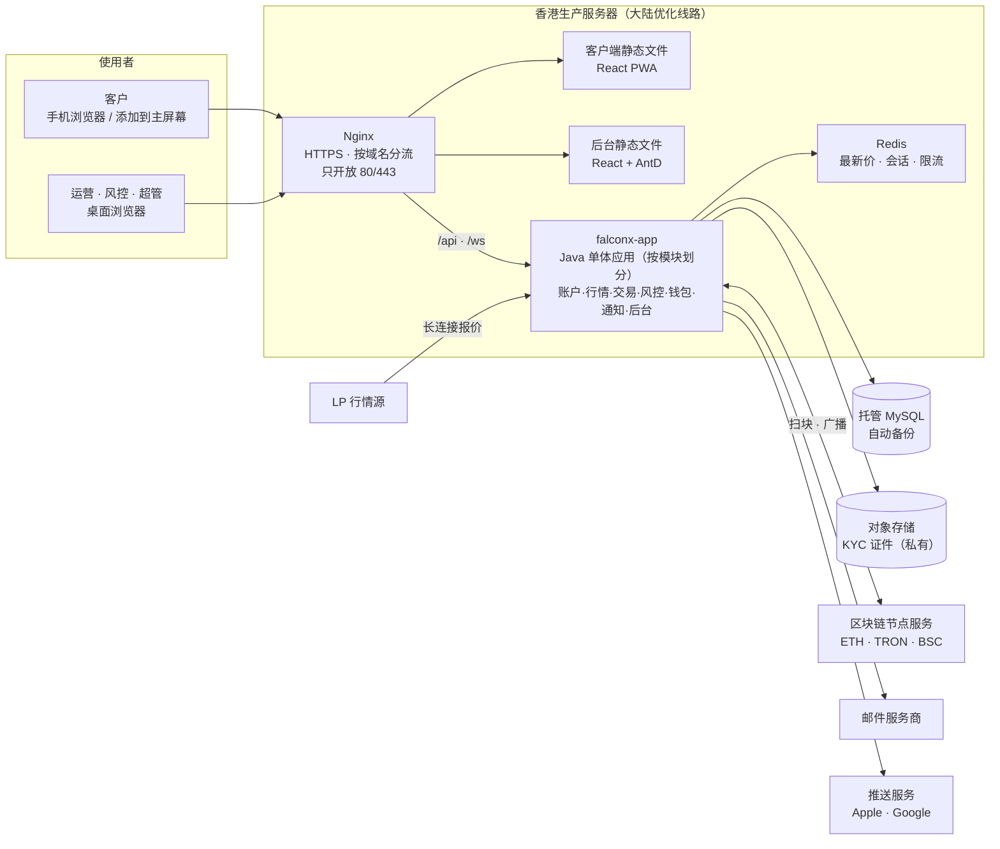
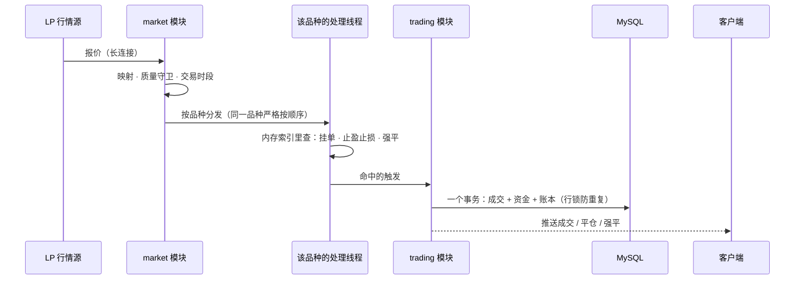
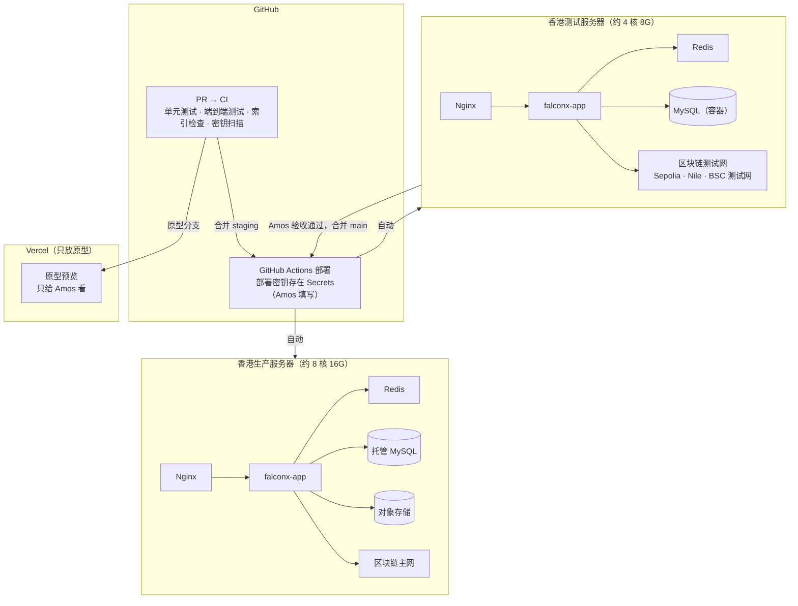
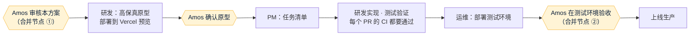

# FalconX Lite 系统架构方案
- 版本：v1（2026-10-14）
- 变更历史：v1（2026-10-14）首次创建
- 依据：agents main `4025297`（v0.9）；《需求文档/v1-需求说明书》v1.2；现有系统功能地图（fxsystem PR #2）；`平台规范/香港服务器.md` 草稿（agents PR #15）
- 编写：PM 负责业务视角并整合；研发负责技术方案和效果图；运维负责基础设施和部署
- 说明：本文是**当时的设计记录**。上线后的当前状态以《项目地图》《项目索引》和代码为准（规则 C53）。
- 状态：**等待 Amos 审核（合并节点 ①）。**审核通过后才做高保真原型；原型确认后才开始正式开发。

## 一图看懂



这张图想说明：现有系统的 6 个后端服务、Kafka、ClickHouse 合并成**1 个 Java 应用 + 1 个 MySQL + Redis**；客户和后台都通过同一台香港服务器上的 Nginx 进入，公网只开放 80 和 443。

## 1. 和现有系统比，简化了什么

| 方面 | 现有 fxsystem | FalconX Lite | 好处 |
|---|---|---|---|
| 后端 | 6 个服务 + 网关，约 130 个内部接口 | **1 个应用**，模块之间直接调用 | 没有内部接口，S1 类问题从根上消失；一次部署、一个日志 |
| 消息 | Kafka，20 多个主题（8 个只发不收） | 不用 Kafka；需要可靠重试的事用数据库任务表 | 少一个中间件；任务卡住可以查、可以重试 |
| 存储 | 5 个 MySQL 库 + ClickHouse + Redis | 1 个 MySQL 库 + Redis | K 线存 MySQL；不再存全量 Tick |
| 品种 | 约 1800 个 | 约 50 个 | 配置、测试、风控都可控 |
| 功能 | 235 项 | 保留和简化后约 180 项，新增 9 项 | 见《功能取舍对照表》 |
| 前端 | 2 个前端，界面只有中文 | 2 个前端（客户端 PWA、后台），中英文 | 手机可添加到主屏幕、能收推送 |
| 规则和文档 | 项目自带 10 角色体系；文档和代码有 152 处对不上 | 只用 agents 规则；项目地图、索引由 CI 检查 | AI 接手不会被旧文档误导 |
| 部署 | 开发者本机打包、跳过测试，scp 到服务器 | GitHub Actions：CI 通过才部署；测试环境验收后才上生产 | 符合规则 C34、C54 |

## 2. 业务视角（PM）
- 第一版只做一条主线：**充值 → 交易 → 提现**，以及支撑它的后台和自动处理。需求见《v1-需求说明书》。
- 后端按业务划分为 7 个模块，和需求说明书第 4 节一一对应：

| 模块 | 负责的业务 | 对应需求 |
|---|---|---|
| `account` 账户 | 注册、登录、邮箱验证、密码、资料、KYC、冻结 | 4.1 |
| `market` 行情 | LP 接入、质量守卫、交易时段、K 线、品种配置、汇率 | 4.2 |
| `trading` 交易 | 下单、挂单、止盈止损、持仓、保证金、强平、隔夜费、账本 | 4.3 |
| `risk` 风控 | 净敞口、自动禁开规则、暂停、持仓上限 | 4.5 |
| `wallet` 钱包 | 充值地址、扫块入账、提现、签名广播、对账 | 4.4 |
| `notification` 通知 | 站内信、推送、邮件、模板、偏好 | 4.7、X-04、X-05 |
| `admin` 后台 | 管理员认证、RBAC、审计、系统配置、仪表盘 | 4.8 |

## 3. 技术方案（研发）

### 3.1 技术选型
| 层 | 选型 | 理由 |
|---|---|---|
| 后端语言和框架 | Java 25 + Spring Boot 4（沿用） | 交易和资金逻辑直接搬现有代码和测试，不换语言重写（需求澄清 Q4） |
| 数据访问 | MyBatis + XML（沿用） | 现有代码都是这个写法，搬迁改动最小 |
| 数据库 | MySQL 8.4，1 个库，Flyway 管理迁移 | 生产用云厂商托管版 |
| 缓存 | Redis | 最新价、会话和 Token 黑名单、限流 |
| 实时推送 | 应用内 WebSocket（沿用现有协议，精简频道） | 单实例，不需要跨实例广播 |
| 客户端 | React + TypeScript + Vite（沿用现有代码精简）；PWA 用 Service Worker | 现有客户端代码可复用 |
| 后台 | React + Ant Design（沿用现有代码精简） | 同上 |
| 图表 | TradingView 开源的 lightweight-charts（现有经典图表在用，开源许可） | 不需要商业授权（N-02） |
| 多语言 | react-i18next，翻译文件放在仓库里 | 不依赖外部服务 |
| 推送 | Web Push（VAPID） | 不依赖 Google 的 SDK；大陆安卓的限制见需求 4.7 |
| 文件存储 | 云厂商的对象存储（私有桶） | KYC 证件不再存数据库 |
| 部署 | Docker Compose + Nginx，香港服务器 | 见第 4 节 |

### 3.2 代码目录和归属角色

```
falconx-lite/
├── backend/            研发   Spring Boot 单体应用
│   └── src/main/java/com/falconx/lite/
│       ├── account/  market/  trading/  risk/
│       ├── wallet/   notification/  admin/
│       └── common/     共用：金额、ID、错误码、traceId、任务表
├── web/client/         研发   客户端 PWA
├── web/admin/          研发   管理后台
├── e2e/                测试   端到端测试和页面走查（Playwright）
├── deploy/             运维   Docker Compose、Nginx、部署和回滚脚本
├── scripts/            研发   项目索引检查等脚本
├── .github/workflows/  运维   CI 和部署
├── 需求文档/ 技术方案/ 测试报告/ 部署方案/ 交付记录/   各角色的文档
└── assets/v1/          线框图、效果图、截图
```

- 每个角色只改自己负责的目录（总则第三节）。PM 可以改 `web/*/src/i18n/` 下翻译文件里的文案，不改结构。
- **模块边界用测试强制**：用 ArchUnit 写单元测试，检查模块之间只通过对方的 `api` 包调用，不直接访问对方的数据表和内部类。违反就 CI 失败。这样 AI 改代码时不会悄悄把模块搅在一起。

### 3.3 关键设计

**① 行情驱动引擎（最核心）**



这张图想说明：每个价格到达后，同一个品种的处理严格按顺序进行；只有命中触发条件时才访问数据库，所以能做到"触发 ≤1 秒"（AC-13）。

- 沿用现有的按品种分线程、内存索引和行锁做法（功能地图 T-19）。
- 应用启动时，从数据库把持仓和挂单加载进内存索引；重启后不会漏掉触发。

**② 资金一致性**
- 余额的每次变动和对应的账本记录在**同一个数据库事务**里完成；所有对外请求带幂等键，数据库唯一约束防重复。
- 金额一律用定点小数（`BigDecimal` / `DECIMAL`），不用浮点。
- 冲正余额不足时不扣成负数，生成挂账记录并通知风控（修复 F4）。

**③ 不用 Kafka 之后，可靠的异步任务怎么做**
- 新增一张**任务表**：出金广播、出金确认检查、发邮件、发推送都写成任务。
- 任务有状态（待处理、处理中、成功、失败）、重试次数和退避时间、**处理中超时自动回收**（修复现有 Outbox 卡在"发送中"无人回收的问题）。
- 任务表可以在后台查看，失败的任务可以手动重试。

**④ 钱包**
- ERC20 和 BSC 共用以太坊体系的扫块代码，TRON 单独一套（都从现有代码搬）。
- **只扫配置好的 USDT 合约**；合约没配置时直接不启动扫块，并在健康检查里报错（修复 F3）。
- 每条链的 USDT 精度在启动时从链上读取，并和配置比对，不一致就拒绝启动。BSC 的精度要上链实测。
- 提现签名私钥由 Amos 放在服务器环境变量里（真正的 KMS 推迟）；nonce 按链管理，启动时从链上同步；广播后超时未确认会重新检查并处理（修复 F6）。
- 大额提现延迟期结束后，直接生成上链任务（修复 F1）；TRC20 和 BSC 提现都补全（修复 F2）。

**⑤ 认证和安全**
- 客户和管理员是两套独立的登录体系。
- 客户登录失败锁定同时按账号和 IP 计数；修改或重置密码、冻结账号时，立即作废该用户的所有登录。
- 后台：完整 RBAC（沿用）。不能给自己或别人加超级管理员，除非操作人本身是超级管理员（修复 S4）；审计日志过滤密码字段（修复 S5）；高危权限全部登记（修复 S6）。
- IP 白名单只认 Nginx 传来的真实客户端 IP，不信任客户端自己带的请求头。
- 应用管理端点只监听内网，Nginx 不转发（修复 S3）。

**⑥ 推送和 PWA**
- 客户端提供 manifest 和 Service Worker，可以添加到主屏幕。
- 客户允许通知后，浏览器的推送订阅保存到服务器；事件发生时，通知模块生成"发推送"任务，由任务表负责发送和重试。
- VAPID 密钥对由 Amos 生成后放进服务器环境变量。

**⑦ 单实例的取舍（需要 Amos 知道）**
- 第一版后端只跑**一个实例**。行情引擎要求同一品种严格按顺序处理，单实例最简单、最可靠。
- 代价：应用重启或部署时，会有约 30 秒到 1 分钟不可用（客户端自动重连）。
- 缓解办法：
  - 部署安排在交易量低的时段；
  - 容器异常退出自动重启；
  - 回滚目标 5 分钟内完成；
  - 数据库用托管版，应用重启不丢数据。
- 多实例高可用推迟到第二版。

### 3.4 数据表概览
约 35 张表，全部在一个库里，每张表归一个模块。

| 模块 | 主要表 | 来源 |
|---|---|---|
| account | 用户、用户资料、KYC 申请、KYC 证件（只存对象存储路径）、邮箱验证码、登录记录 | 现有 identity 精简 |
| market | 品种（含报价映射、加点、杠杆、维持保证金率、费率、隔夜费率、热门标记）、交易时段、例外日、市场假期、K 线、汇率 | 现有 market 合并多张配置表 |
| trading | 交易账户、账本、订单、成交、持仓、挂单（含止盈止损）、强平记录、隔夜费结算 | 现有 trading-core 精简（去掉全仓、多币种账户） |
| risk | 风控配置（阈值、持仓上限）、风控状态（暂停/全局暂停）、风控事件 | 现有 risk 表大幅精简 |
| wallet | 充值地址、链扫描进度、链上交易、充值记录、白名单、提现单、提现链上交易、nonce、对账挂账 | 现有 wallet + trading 出金 |
| notification | 站内信、模板、推送订阅、通知偏好 | 现有 + 新增 |
| admin | 管理员、角色、菜单、权限点、角色权限、审计日志、系统配置 | 现有 console 沿用 |
| common | 任务表 | 新增 |

具体字段在开发前的《技术方案》里写，并对照功能地图逐表核对。

### 3.5 代码搬迁计划
> 本节按现有代码盘点结果填写，见第 3.5.1 节。

## 4. 基础设施和部署（运维）

### 4.1 部署拓扑



这张图想说明：测试环境和生产环境是两台独立的服务器，数据、钱包、密钥完全分开；只有 CI 通过、Amos 在测试环境验收后，代码才会到生产。

### 4.2 环境

| 环境 | 分支 | 地址 | 数据 | 区块链 |
|---|---|---|---|---|
| 原型 | 开发分支 | Vercel 预览地址 | 模拟数据，页面标注"原型" | 无 |
| 测试 | `staging` | `test-app.<域名>`、`test-admin.<域名>`（域名待 Amos 提供） | 独立测试库 | 测试网 |
| 生产 | `main` | `app.<域名>`、`admin.<域名>` | 托管 MySQL | 主网 |

### 4.3 运维要点
- **端口**：公网只开放 80、443；SSH 只对 Amos 指定的 IP 开放；上线前从外网扫描验证（AC-36）。
- **密钥**：只放在服务器的环境变量文件和 GitHub Secrets，由 Amos 填写；仓库只有 `.env.example` 变量名清单；CI 用密钥扫描工具检查（AC-37）。
- **备份**：托管 MySQL 自动备份，可以恢复到某个时间点；对象存储开启版本保留。
- **监控**：健康检查按功能拆分（数据库、Redis、LP 行情、各链节点、邮件、对象存储）；外部定时探测；告警邮件发到 Amos 指定的邮箱（H7 待定）。
- **回滚**：镜像按提交号打标签，保留最近 10 个，5 分钟内回滚；上线前演练一次。
- **CI 和分支保护**：本 PR 起就有 CI。仓库是私有的，免费版 GitHub 开不了分支保护，所以合并前人工确认 CI 是绿的，并附运行链接（C54）。如果你的 GitHub 是 Pro 或 Team 套餐，请告诉我，届时改为开启分支保护并勾选"不允许绕过"。

### 4.4 需要 Amos 提供的资源（部署测试环境前）
| 资源 | 说明 |
|---|---|
| 香港云服务器 2 台 | 云厂商和配置待定（H0），线路要实测 |
| 托管 MySQL 1 个（生产）、对象存储 1 个 | 和服务器同一个云厂商、同一区域 |
| 域名 | 客户端和后台各一个子域名，测试环境另两个（N-13） |
| 邮件服务商账号 | 候选：阿里云邮件推送、腾讯云邮件推送、Amazon SES。要求能稳定送达 QQ、163、Gmail，选定前各发测试邮件实测（N-05） |
| 区块链节点服务账号 | ETH、BSC、TRON 主网和测试网的 RPC（现有系统用的是 Alchemy，可以继续用） |
| 热钱包 | 三条链的出金热钱包，以及用于付 gas 的 ETH、BNB、TRX |

## 5. 视觉效果图（研发）
> 见第 5.1 节。

## 6. 风险和待定事项
| 编号 | 风险或待定 | 影响 | 处理 |
|---|---|---|---|
| K-01 | 合规（N-12）未定 | 能否上线 | Amos 和法务确认，上线前必须有结论 |
| K-02 | 大陆用户访问速度和稳定性 | 用户体验、行情剧烈波动时能否平仓 | 测试环境上线后，按 AC-30 在三家运营商实测；不达标再加 CDN 或更换线路 |
| K-03 | 大陆 iPhone 的 Web Push 没有实测资料 | 推送到达率 | 测试环境真机测试（AC-24）；不行就只靠站内信和邮件 |
| K-04 | 单实例：部署和重启时短暂不可用 | 部署时约 30 秒到 1 分钟不能交易 | 低峰期部署；多实例推迟到第二版 |
| K-05 | 提现签名私钥放在服务器环境变量 | 服务器被入侵时热钱包有风险 | 热钱包只放少量资金，定期从冷钱包补充；第二版接入 KMS |
| K-06 | BSC 链 USDT 的精度没有实测 | 精度错了，金额会差很多个数量级 | 启动时从链上读取并比对，不一致拒绝启动（3.3 ④） |
| K-07 | 从现有代码搬迁时把旧问题一起带过来 | 资金错误 | 功能地图第 5 节的每个问题先写复现测试再搬（AC-38） |

## 7. 后续步骤


## 跨角色反馈 / 分歧记录
| 编号 | 提出方 → 接收方 | 内容 | 状态 |
|---|---|---|---|
| AF-01 | 运维 → 研发 | 单实例部署时会短暂不可用，引擎要支持优雅停机：停机前停止接收新订单，处理完队列再退出 | 已采纳，写进 3.3 ⑦ 和后续技术方案 |
| AF-02 | 测试 → 研发 | AC-13 的"≤1 秒"需要应用在日志里记录"收到价格"和"写入成交"两个时间点 | 已采纳，开发时加入 |
| AF-03 | 研发 → PM | 品种清单（N-01）需要先确认，品种配置、风控阈值、测试数据都依赖它 | 已采纳，见第 3.6 节，随本方案交 Amos 确认 |
