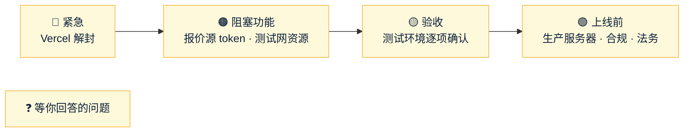

# Amos 待办
- 用途：记下**需要 Amos 做的事**和**等 Amos 回答的问题**，避免遗漏。智能体每次汇报时对照本文件提醒；Amos 说"做完了"或答复后，智能体核实，删除对应条目，并在文末"已完成"里留一行记录。
- 维护：智能体（PM）。新增的事项写清楚"做什么、为什么、怎么确认做好了、截止或阻塞了什么"。**不写任何密钥、密码的值**（只写变量名）。**凡是需要 Amos 注册、沟通、协商的事，智能体把已经查到的资料写全**（网址、联系方式、要问的问题、要填的地址和变量），放在下面的"📚 资料"一节，Amos 不用再自己找一遍（Amos 2026-10-17 要求）。
- 版本：v1.18（2026-10-21）
- 变更历史：v1（2026-10-17）Amos 要求创建（"创建一个文件，用来记录需要我做的事情……如果有我没回复的问题，你也可以及时找到并提醒我"），按 2026-10-16 至 10-17 的对话整理；v1.1（2026-10-17）Amos 答复 Q1–Q5：Q1 暂不做，Q2 按 1:1，Q3 去谈并入 T3，Q4 转为 T21，Q5 已删除；v1.2（2026-10-17）新增 Q6–Q8、T22–T23，T4 写明变量名；v1.3（2026-10-17）Amos 答复 Q6 选 B、Q7 买卖合计加 20 点（每边 10 点）（都已实现），Q8 和 T22 他自己处理、不再提醒；v1.4（2026-10-17）Amos 要求：新增"📚 资料"一节——AllTick、iTick 的注册和联系方式，币安、OKX 的行情地址和条款，三条测试链的节点、浏览器、水龙头、测试 USDT 合约（链上实测核对过），T3–T5 指向它；v1.5（2026-10-17）Amos 决定"还是用币安的报价"：新增 Q9–Q11（币安没有外汇和指数、贵金属原油美股只有永续、美国服务器访问受限），币安接入在做；v1.6（2026-10-17）Amos 答复 Q9 选 A、Q10 不用（他再找更好的报价源）；v1.7（2026-10-17）Amos 要求"归集方式加进待办，余额告警现在就做"：新增 Q12 资金归集方式，热钱包余额告警已做（下限在后台设置，默认 0 = 不告警）；v1.8（2026-10-17）Amos 答复 Q12 选 B 半自动归集（生产上线前做，先写方案给他审核）；v1.9（2026-10-17）Amos 确认提现自动审批方案和原型（"按建议"），后端已实现，记入已完成；v1.10（2026-10-18）Amos 要求"出金自动审核的限制条件中加一条，对于盈利客户需要人工审核"，口径确认后已实现 R13（累计净盈利 > 0 转人工，不算浮盈），记入已完成；v1.11（2026-10-19）R5 加"领测试币填哪个地址"：Amos 把"测试 USDT 合约"一列当成收款地址去领 BSC 和 TRON 的测试币，没到账；写明收款地址是两个热钱包地址；v1.12（2026-10-20）新增 Q13：资金归集方案待审核（`技术方案/v2-半自动归集.md`，按 Amos 10-20 "费用最低""能不能用成熟开源合约"的要求比较了几种做法，推荐路线 (b)，和 Q12 选的 B 不同，请他重新确认）；v1.13（2026-10-20）Amos 审核 Q13（"4不请审计   6归集门槛可以让我在后台改，默认值使用你的建议   7直接考虑租用能量的方案      其余按建议"），删除 Q13、记入已完成；新增开发阶段要做的 T24–T27（Safe 冷钱包、发起账户和租能量账户、TronSave 注册充值、部署合约签名），"📚 资料"新增 R6 TronSave、R7 Safe；v1.14（2026-10-20）Amos 决定"上限保留，现在就可以开始开发，新需求的开发和跑通充值提现同步进行"，记入已完成；资金归集第一阶段（合约 + 以太坊 / BSC）已开发，T24、T25、T27 现在可以做，T25、T27 按实际的部署脚本改写（操作说明 `部署方案/v2-归集合约部署.md`）；T26（TronSave）属于下一阶段；v1.15（2026-10-21）GitHub Actions 额度用完：新增 T28 准备手动发布镜像；已完成记 Amos 同意本地检查代替 CI、选 B 自己发布；v1.16（2026-10-21）仓库改为公开、GitHub Actions 恢复：删除 T28；已完成记三行（Actions 恢复和撤销例外、后台仍不加 IP 白名单、外部贡献者 PR 需审批才跑 CI）；v1.17（2026-10-21）新增 Q14：10-21 体验建议的方案（`技术方案/v2-体验优化-1021.md`）和原型待审核，第 11 条 Amos 已答复"选 a"；v1.18（2026-10-21）Amos 审核 Q14（"UX-1 语言 客户端和官网都默认跟随浏览器的语言，如果查不到浏览器语言再用英文       其他按建议"）：删除 Q14、记入已完成，体验优化第一批已实现（方案 v1.1）；外部可用性探测 Amos 改为"测试环境不开探测"（规则改为第一次部署测试 / 生产环境时问 Amos），记入已完成

## 一图看懂



这张图想说明：先处理最上游的紧急事项，然后是挡住功能开发的资源，再是验收，最后是上线前的准备；问题清单随时可以答。

## 🔴 紧急
| # | 做什么 | 为什么 | 怎么确认做好了 | 提出时间 |
|---|---|---|---|---|
| T1 | **Vercel 账号解封**（登录 Vercel 看封停原因：额度、账单或条款误判）。说明：https://vercel.com/knowledge/why-is-my-account-deployment-blocked | amos111 的**生产站点**（amos111.vercel.app）已经停了，返回 503 `DEPLOYMENT_PAUSED`；falconx-lite 的原型预览也打不开 | 告诉我，我从外部检查 amos111 首页和 `/api/tick/?health=1` | 10-16 |
| T2 | Vercel 解封后，**重新打开 amos111 的 tick-watch**（GitHub → amos111 → Actions → tick-watch → Enable workflow） | 你已经暂停了它，解封后不打开，链上监控停了就没人知道 | Actions 里 tick-watch 显示为启用并且运行成功 | 10-17 |

## 🟠 阻塞功能开发
| # | 做什么 | 为什么 | 怎么确认做好了 | 提出时间 |
|---|---|---|---|---|
| T3 | **谈报价源授权**（联系方式、网址见下面"📚 资料" R1–R4）：AllTick（主）、iTick（备）。要书面授权，写明"作为差价合约报价基准"和"在官网、客户端公开展示"两项；问清 50 个品种是否都有买卖价、外汇/指数/原油的数据来源、美股实时数据的交易所授权、香港机房接入延迟、SLA 赔偿。币安由你自己谈；**OKX 也去谈**（Amos 10-17 决定，加密货币可做第三个源交叉校验） | 条款默认禁止商用和再分发；没有授权，生产不能用真实报价 | 拿到书面授权文件 | 10-16 |
| T4 | **注册 AllTick、iTick 的试用账号**（注册网址见"📚 资料" R1、R2），**把 token 填进测试服务器 `.env`**：`FX_QUOTE_ALLTICK_TOKEN`、`FX_QUOTE_ITICK_TOKEN`（用 `sudo nano /opt/falconx/.env`；**不要把 token 发给我**）。先确认试用条款允许内部测试使用 | 接入代码在做，没有 token 只能用模拟报价 | 后台品种页"最后报价时间"在走，后台域名健康检查里报价源是 UP | 10-17 |
| T5 | **测试网资源**：节点地址、测试 USDT 合约、水龙头我都查好了（"📚 资料" R5，可以直接复制进 `.env`）。**你要做的只剩**：①离线生成测试用助记词，导出 ETH 和 TRON 的账户级 xpub（只有公钥）；②建两个测试热钱包（ETH/BSC 共用一个、TRON 一个），在水龙头领测试币；③把 xpub、热钱包地址和私钥填进 `.env`（**私钥只由你填，不要发给我**） | 没有这些，充值一直显示"暂未开通"，提现也走不通（验收 3.3 节） | 充值页显示地址；转测试币能到账 | 10-16 |

## 🟡 测试环境验收（S21，清单见 `交付记录/v1-交付说明.md` 第 3 节）
| # | 做什么 | 预期 | 提出时间 |
|---|---|---|---|
| T6 | 官网 https://test-www.quickcome.online （本地 DNS 缓存过期后）：看行情跳动、中英文切换、"免费注册"跳到客户端、三个法律页 | 都正常；手机和电脑都没有横向滚动 | 10-16 |
| T7 | iPhone 上注册，试新的出生日期（年/月/日三框）：数字键盘、输满自动跳格、退格回上一格、2 月 30 日只标红"日"、粘贴 `1988-05-12` 自动拆开、自动填充生日 | 顺手好用 | 10-16 |
| T8 | 后台：深色主题、编辑客户资料、新增品种（填模拟起始价后有报价，关掉"暂停开仓"后客户能下单）、风控看板自动刷新 | 都正常 | 10-16 |
| T9 | 客户端：新 Logo、电脑顶栏跑马灯、Tick 图和指标（MA/EMA/BOLL/MACD/RSI） | 都正常 | 10-16 |
| T10 | 检查测试服务器 `.env` 里 `FX_MAIL_FROM` 的显示名：如果写了 "FalconX"，改成 `Quick Come <noreply@email.quickcome.online>`，然后重启后端 | 收到的邮件发件人显示 Quick Come | 10-16 |
| T11 | iPhone 上已经"添加到主屏幕"的：删掉重新添加 | 图标是新的 Q 图形 | 10-16 |
| T12 | 交付说明 3.1–3.4 节剩下的真机、真人项：三家邮箱收信（AC-26）、iPhone 和安卓推送（AC-24，大陆网络下 iPhone 能否收到如实记录）、三家运营商连续 3 天测速（AC-30）、冻结客户 5 秒内登出（AC-04） | 按清单 | 10-16 |

## 🟢 上线前要定（S22）
| # | 做什么 | 现状 | 提出时间 |
|---|---|---|---|
| T13 | 生产服务器（H0）：云厂商、地区（建议香港）、配置；托管 MySQL、对象存储、异地备份；主网节点和热钱包 | 未定 | 10-16 |
| T14 | 告警收件邮箱（H7） | 先用 info@quickcome.online（服务器 `.env` 的 `FX_ALERT_EMAILS`） | 10-16 |
| T15 | 隔夜费率和周三三倍隔夜费 | 现在全是 0 | 10-16 |
| T16 | 上线时哪些品种默认"暂停开仓"（E2E-1） | 现在 BTCUSD 暂停 | 10-16 |
| T17 | 合规：牌照、公司主体（官网暂不写）、三份法律文本交法务审核（N-12）；美股实时价格对外展示是否要交交易所费用；品种中文名里的"标普 500""道琼斯 30"等商标是否要指数商授权 | 法律文本是原创样板，页顶标"需法务审核" | 10-16 |
| T18 | 让原项目 LP 换一个新密钥：fxsystem 仓库 `docs/market/LP接入操作手册-给AI.md` 里有一个像是真实的 `secretKey` | 未处理 | 10-16 |
| T19 | GitHub 给 falconx-lite 的 `main` 开分支保护（CI 不过不能合并）：Settings → Branches → Add rule | 未开 | 10-16 |
| T20 | 正式环境的密钥托管（KMS） | 未定 | 10-16 |
| T23 | iTick 买套餐前确认连接数：我们要 4 条（外汇、指数、加密、美股各 1 条），Professional（6 条）够，Basic 要先问清楚 | 接入代码已完成，等 token | 10-17 |
| T21 | **验收完后排期**：原计划没做的功能——客户分组、价格提醒、部分平仓、TradingView 图表、群发通知、DF-01/DF-02 | Amos 10-17：验收完再排 | 10-17 |

## ⏸ 资金归集（方案 `技术方案/v2-半自动归集.md` v1.2）：第一阶段（以太坊、BSC）已开发，T24、T25、T27 现在可以做；T26 是下一阶段（TRON）
| # | 做什么 | 为什么 | 怎么确认做好了 | 提出时间 |
|---|---|---|---|---|
| T24 | **建 Safe 2-of-3 多签冷钱包，测试网一个、主网一个**（网址和步骤见"📚 资料" R7）：三个签名人用三把不同的钥匙（建议：你的硬件钱包、你的手机钱包、另一个人或另一台设备的钱包），阈值 2。测试网建在 Sepolia（BSC 测试网要先确认 Safe 支不支持，我开发时查）；主网在以太坊和 BNB Chain 用**同一个地址**（Safe 界面创建时可以把同一个 Safe 部署到多条链）。把两个 Safe 地址发给我（地址是公开信息） | 以太坊、BSC 的钱只能进这个地址（方案 SW-3）；地址写进每个客户的充值地址算法，**定了就不能换**，换签名人在 Safe 里换（第 4.13 节） | 我在链上读到 Safe 的签名人和阈值 = 2 / 3 | 10-20 |
| T25 | **生成两个新账户并充少量币**（都不用热钱包，都是普通账户，用你自己的钱包生成）：①**部署账户**（只用来部署合约，不放服务器）：**以太坊和 BSC 上都没发过任何交易**（nonce = 0；两条链部署出的合约地址才相同，脚本会检查）；测试网在 R5 的水龙头领测试 ETH、tBNB，主网约 0.02 ETH + 0.01 BNB【实测：整套部署约 388 万 gas，按当天 gas 价格算】。②**发起账户**（ERC20、BSC 共用，服务器用它发归集交易、只付手续费）：测试网领测试币；主网充约 0.05 ETH + 0.02 BNB【估算：实测每批 1 个地址首次约 15.7 万 gas、已部署约 5 万 gas】。部署时只需要两个账户的**地址**；发起账户的地址和私钥在合约部署好以后填进服务器 `.env`：`FX_SWEEP_EVM_OPERATOR_ADDRESS`、`FX_SWEEP_EVM_OPERATOR_KEY`（**私钥只由你填，不要发给我**；没填或对不上时只是不能归集，不影响服务器启动） | 发起账户只付归集手续费、被盗也转不走钱（SW-8）；部署账户部署完就没有任何权限 | 两个地址发给我；部署后后台"资金归集 → 归集设置"显示发起账户和余额、没有配置问题提示 | 10-20 |
| T26 | **（下一阶段，TRON 归集开发时再做）注册 TronSave 并充值**（TRON 租能量，方案第 4.3 节；网址和步骤见"📚 资料" R6）：测试网 testnet.tronsave.io 先拿一个 API Key、用 Nile 测试 TRX 充值；上线前主网 tronsave.io 再拿一个，充 200–1,000 TRX（余额建议不超过 1,000 TRX）。API Key 填进服务器 `.env`：`FX_SWEEP_TRON_RENT_API_KEY`（**只由你填，不要发给我**） | Amos 10-20 决定 TRON 直接租能量；租金从 TronSave 余额扣，服务器上只放 API Key、不放新的私钥 | 后台归集设置页"租赁平台账户"显示余额 | 10-20 |
| T27 | **部署合约并签名**（一步一步的说明：`部署方案/v2-归集合约部署.md`）：在你自己的电脑上 ①装 Foundry v1.5.1；②拉代码，运行 `bash script/check-vendor.sh --upstream`、`forge test`（核对 BitGo 源码没被改过、30 个测试通过）；③先模拟、再正式部署：`forge script script/Deploy.s.sol --rpc-url <节点> --sender <部署账户地址> --broadcast --interactives 1`，参数 `SWEEP_PARENT`（T24 的 Safe）、`SWEEP_OPERATOR`（T25 的发起账户地址），私钥在终端提示时输入（或用硬件钱包 `--ledger`），**不要写进文件**；④在 Safe 里签"接受批量合约所有权"（`acceptOwnership`，2-of-3）；⑤跑 `VerifyDeployment.s.sol` 核对；⑥同一个部署账户在另一条链再做一遍，三个合约地址必须相同；⑦把脚本打印的 5 行 `FX_SWEEP_EVM_*` 和核对输出发给我，并填进服务器 `.env`。先 Sepolia + BSC 测试网，测试环境验收通过后再主网 | 私钥不经过 AI；部署账户签名决定合约地址，两条链要同一个部署账户、同一顺序（第 4.13.5 节） | 核对脚本显示"全部通过"；我在区块浏览器看到源码已验证；测试环境按说明第 10 节走一遍充值 → 归集 → Safe 收到 | 10-20 |

## ❓ 等你回答的问题
| # | 问题 | 我的建议（默认） | 提出时间 |
|---|---|---|---|
| Q11 | 币安对美国服务器限制访问：测试服务器（美国）只能连上**加密货币现货**的只读行情（`data-api.binance.vision`），合约和主站都返回 451。生产服务器选地区时要确认币安能访问（香港是否受限，查证中） | 生产服务器（T13）选地区前，我把币安对该地区的限制查清楚再给你建议 | 10-17 |

## 📚 资料（注册、联系、地址）
标注：【实测】= 我从开发环境实际调用核对过；【官网】= 实际打开过官方页面；【未核实】= 只查到第三方资料，请以页面为准。

### R1 AllTick（报价主源）
| 用途 | 地址 / 方式 |
|---|---|
| 注册（拿免费 token） | https://alltick.co/zh-CN/register 【官网】 |
| 登录 | https://alltick.co/zh-CN/login 【官网】 |
| 联系销售（谈商用授权） | https://alltick.co/zh-CN/contact 【官网】；Telegram：https://t.me/alltick_cn 、https://t.me/alltick001 【官网】；邮箱 support@alltick.co（调研报告记录，价格页上没列出）【未核实】 |
| 价格 | https://alltick.co/zh-CN/pricing （2026-10-16：免费 10 个演示品种；基础版 99 USDT/月 100 个品种；高级版 199 USDT/月）【官网】 |
| 条款 | https://alltick.co/terms （"不用于交易……不得再分发"，所以要谈书面授权）【官网】 |
| 接口文档 | https://github.com/alltick/realtime-forex-crypto-stock-tick-finance-websocket-api 【官网】 |
| 填进服务器 | `FX_QUOTE_ALLTICK_TOKEN` |

### R2 iTick（报价备源）
| 用途 | 地址 / 方式 |
|---|---|
| 注册 / 登录（页面上的"Login/Sign Up"） | https://itick.org/en/dashboard 【官网】（中文站 https://itick.org/zh-cn/pricing ） |
| 联系（谈商用授权、问连接数） | https://itick.org/en/contact ；Telegram：https://t.me/iticksupport ；WhatsApp：https://wa.me/85259046663 （+852 5904 6663）【官网】 |
| 价格 | https://itick.org/en/pricing （2026-10-16：Basic $99、Professional $199，新用户 8 折；我们要 4 条连接，Professional 够，见 T23）【官网】 |
| 条款 | https://itick.org/en/terms （"未经许可禁止再分发"）【官网】 |
| 接口文档 | https://docs.itick.org/en/websocket/forex 【官网】 |
| 填进服务器 | `FX_QUOTE_ITICK_TOKEN` |

### R3 币安（你自己谈）
| 用途 | 地址 |
|---|---|
| 现货 REST（只读行情专用，美国能访问） | `https://data-api.binance.vision` 【实测】 |
| 现货 WebSocket（只读行情专用） | `wss://data-stream.binance.vision` 【官网】 |
| 现货 REST 主站（美国返回 451 地区限制） | `https://api.binance.com/api/v3/ticker/bookTicker` 【实测】 |
| 合约 REST / WebSocket（美国返回 451） | `https://fapi.binance.com` / `wss://fstream.binance.com` 【实测】 |
| 文档 | 现货 REST：https://developers.binance.com/docs/binance-spot-api-docs/rest-api/general-api-information ；现货 WS：https://github.com/binance/binance-spot-api-docs/blob/master/web-socket-streams.md ；只读行情域名说明：https://github.com/binance/binance-spot-api-docs/blob/master/faqs/market_data_only.md ；合约 WS：https://developers.binance.com/docs/derivatives/usds-margined-futures/websocket-market-streams 【官网】 |
| 条款 | 公开数据条款 https://data.binance.vision/Binance_Vision-Terms_of_Use.pdf （第 3.4 条：商业使用要另签企业数据许可；第 4.4 条：不得集成进商业金融产品）【官网】；主服务条款 https://www.binance.com/en/terms （我这边打开是空白，请你在浏览器看） |
| 商务联系 | 【未查到】官方数据授权的联系入口，建议通过币安机构服务或客服询问"enterprise market data license" |

### R4 OKX（去谈）
| 用途 | 地址 |
|---|---|
| REST 行情 | `https://www.okx.com/api/v5/market/ticker?instId=BTC-USDT`（美国能访问）【实测】 |
| WebSocket 公共频道 | `wss://ws.okx.com:8443/ws/v5/public`（`bbo-tbt` 买一卖一，有变化每 10 毫秒推送）【官网】 |
| 文档 | https://www.okx.com/docs-v5/en/ 【官网】 |
| 条款 | API 协议 https://www.okx.com/en-us/help/okx-api-agreement （§9.4：行情只限个人非商业使用，商业用途要另签数据授权）；服务条款 https://www.okx.com/help/terms-of-service 【官网】 |
| 地区 | 香港在 OKX 的限制地区名单上：https://www.okx.com/en-us/help/360021813591 ——谈的时候问清香港服务器能不能用【官网】 |
| 商务联系 | 【未查到】，建议通过 OKX 机构服务或客服询问数据授权 |

### R5 三条测试链（可以直接复制进测试服务器 `.env`）
| 链 | 节点地址（RPC） | chainId | 测试 USDT 合约 | 浏览器 | 水龙头（领测试币） |
|---|---|---|---|---|---|
| ERC20：以太坊 Sepolia | `https://ethereum-sepolia-rpc.publicnode.com`【实测】 | 11155111【实测】 | `0xaA8E23Fb1079EA71e0a56F48a2aA51851D8433D0`（USDT，6 位小数【实测】；一般认为是 Aave 测试市场的 USDT，可以在 https://gho.aave.com/faucet 打开 Testnet 模式领取【未核实】） | https://sepolia.etherscan.io | 测试 ETH（付手续费）：Google Cloud https://cloud.google.com/application/web3/faucet/ethereum/sepolia （可能要求钱包在主网有 0.001 ETH）【未核实】 |
| BEP20：BSC 测试网 | `https://bsc-testnet-rpc.publicnode.com`【实测】（备用 `https://bsc-testnet.drpc.org`【实测】） | 97【实测】 | `0x337610d27c682E347C9cD60BD4b3b107C9d34dDd`（USDT，18 位小数【实测】，和我们配置的 18 位一致） | https://testnet.bscscan.com | 官方水龙头（tBNB 和 USDT）：https://www.bnbchain.org/en/testnet-faucet ，说明 https://docs.bnbchain.org/bnb-smart-chain/developers/faucet 【官网】 |
| TRC20：TRON Nile | `https://nile.trongrid.io`【实测】 | — | `TXYZopYRdj2D9XRtbG411XZZ3kM5VkAeBf`（TetherToken，6 位小数【实测】） | https://nile.tronscan.org | 官方水龙头（TRX 和测试 USDT）：https://nileex.io/join/getJoinPage ，说明 https://developers.tron.network/docs/getting-testnet-tokens-on-tron 【官网】 |

**复制进 `.env` 的内容**（这些不是密钥，可以直接用；`sudo nano /opt/falconx/.env`）：
```
FX_WALLET_ETH_RPC_URL=https://ethereum-sepolia-rpc.publicnode.com
FX_WALLET_BSC_RPC_URL=https://bsc-testnet-rpc.publicnode.com
FX_WALLET_TRON_RPC_URL=https://nile.trongrid.io
FX_WALLET_ERC20_USDT_CONTRACT=0xaA8E23Fb1079EA71e0a56F48a2aA51851D8433D0
FX_WALLET_BSC_USDT_CONTRACT=0x337610d27c682E347C9cD60BD4b3b107C9d34dDd
FX_WALLET_TRC20_USDT_CONTRACT=TXYZopYRdj2D9XRtbG411XZZ3kM5VkAeBf
FX_WALLET_ERC20_CHAIN_ID=11155111
FX_WALLET_BSC_CHAIN_ID=97
```
**你自己生成、自己填的**（不要发给我）：`FX_WALLET_ETH_XPUB`、`FX_WALLET_TRON_XPUB`（账户级 xpub，只有公钥）、`FX_WALLET_ETH_HOT_ADDRESS`、`FX_WALLET_ETH_HOT_KEY`（ERC20 和 BSC 共用）、`FX_WALLET_TRON_HOT_ADDRESS`、`FX_WALLET_TRON_HOT_KEY`。填完重启后端，告诉我，我从外部检查充值地址能不能生成。

**⚠️ 领测试币：水龙头里的"收款地址"填热钱包地址，不要填上表的"测试 USDT 合约"**（合约地址是 USDT 这种币本身的地址，不属于任何人，币发过去就取不回来了；Amos 10-19 因为这一列误领过一次）：

| 链 | 水龙头里填的收款地址（= `.env` 里的热钱包地址，公开信息） | 要领什么 | 去哪里领 |
|---|---|---|---|
| Sepolia | `0x039a6018fF9ac729137F53988eB43A6cB9f60A30`（`FX_WALLET_ETH_HOT_ADDRESS`） | 测试 ETH（手续费）+ 测试 USDT | 见上表"水龙头"列；USDT 用 Aave 水龙头 |
| BSC 测试网 | 同上 `0x039a…0A30`（ETH 和 BSC 共用） | tBNB（手续费）+ 测试 USDT | 见上表；网络选 **BSC Testnet**（不是 opBNB） |
| TRON Nile | `TCtTX8EsnjpkzKCgCyyKJKUrT6BZHd151R`（`FX_WALLET_TRON_HOT_ADDRESS`） | 先领 TRX（新地址要先收到 TRX 才在链上建立账户），再领测试 USDT | 见上表 |

水龙头只需要地址；任何页面要私钥或助记词都不要填。领完告诉我，我从链上核对余额。

说明：公共节点免费但有频率限制；测试环境够用。TRON 公共节点如果被限流，要在 https://www.trongrid.io 注册拿 API Key（目前代码还不支持带 Key，需要时我再加）【推断】。

### R6 TronSave（TRON 租能量，T26）
| 用途 | 地址 / 方式 |
|---|---|
| 主网网站（登录拿 API Key、充值） | https://tronsave.io/market ：右上角 Connect 连接 TronLink 钱包 → 点地址按钮 → Account Info → **Login TronSave**，之后页面显示 API Key 和充值地址【官网：docs.tronsave.io Developer Quickstart】 |
| 测试网网站（Nile） | https://testnet.tronsave.io （TronLink 切到 Nile 测试网；测试 TRX 用 R5 的 Nile 水龙头 https://nileex.io/join/getJoinPage 领）【官网】 |
| 充值规则 | 点 **Top Up**，从任意钱包往页面显示的充值地址转 TRX：每次至少 10 TRX；第一次多转约 1 TRX（激活充值地址）；每天 2 次免费，之后每次扣 0.3 TRX；约 3 秒到账【官网】。**建议余额不超过 1,000 TRX** |
| 接口 | 主网 `https://api.tronsave.io`、测试网 `https://api-dev.tronsave.io`；API Key 放在请求头 `apikey` 里【官网】 |
| 文档 | https://docs.tronsave.io （Developer Quickstart：https://docs.tronsave.io/developers/quickstart.md ）【官网】 |
| 联系 | Telegram：https://t.me/wantingtrx 【官网：文档首页】 |
| 要问的问题（可选） | 能量没成交 / 没到账时余额怎么退；订单到期是不是自动收回；API Key 能不能限制只买能量、不能提现；有没有 SLA |
| KYC | 文档没写要 KYC（用钱包登录）【官网】 |
| 填进服务器 | `FX_SWEEP_TRON_RENT_API_KEY`（密钥，只由你填）；`FX_SWEEP_TRON_RENT_API_URL` 我来填（公开地址） |
| 当前价格 | 2026-10-20 实测：65,000 能量 1 小时 67.25 sun / 能量 = 4.37 TRX（烧 TRX 是 100 sun / 能量 = 6.43 TRX）【实测】 |

### R7 Safe 多签（冷钱包，T24）
| 用途 | 地址 / 方式 |
|---|---|
| 创建 | https://app.safe.global → Create account → 选网络（测试网 Sepolia；主网 Ethereum，并添加 BNB Chain 用同一地址）→ 添加 3 个签名人地址 → 阈值选 2 → 用一个签名人钱包付创建手续费【官网：Safe 网站；多链同地址的操作【未核实：创建时的界面选项，到时一起看】】 |
| 文档 | https://docs.safe.global 【官网】 |
| 创建手续费 | 以太坊主网约 30 万 gas【未核实】，按当天 gas 价格算；Sepolia 用测试 ETH |
| 换签名人 | Safe 里 Settings → Setup → Owners：替换、增加、删除签名人，改阈值；**Safe 地址不变**（方案第 4.13 节） |
| 要发给我的 | 两个 Safe 地址（测试网、主网）；三个签名人地址（公开信息，用来设告警） |

## 已完成（保留最近的记录）
| 日期 | 事项 |
|---|---|
| 10-16 | 测试服务器准备、域名、Resend 邮件、超管改密码 |
| 10-16 | test-www 的 DNS 和证书扩展（三个域名） |
| 10-16 | agents 仓库 PR #15（平台规范《云服务器》）同意合并 |
| 10-17 | 同意合并模拟价（PR #51） |
| 10-17 | 暂停 amos111 的 tick-watch |
| 10-17 | Q1 后台两步验证：**暂时不做** |
| 10-17 | Q2 USDT 和 USD：**按 1:1** |
| 10-17 | Q3 OKX 数据授权：**去谈**（并入 T3） |
| 10-17 | Q4 未做的原计划功能：**验收完再排**（转为 T21） |
| 10-17 | Q5 删掉 S17 旧工作目录：**已删除** |
| 10-17 | Q6 两家报价源偏差超过阈值时：**选 B，已实现**（合并、部署到测试环境后生效）——只暂停开仓（市价开仓、新挂单、已有挂单成交都不行），平仓、止盈止损、强平照常，用主源的价格；仍亮 `quote.deviation` 告警，偏差回落自动恢复开仓；和运营手动暂停、风控暂停互不覆盖 |
| 10-17 | Q7 加点：**每个品种买卖合计 20 点 = 每边 10 点，已配置**（Amos 更正为"买卖一共 20 点"；迁移 V24，合并、部署到测试环境后生效）。"点" = 品种的最小价格单位 10^(-小数位)；加点是卖价减、买价加各一次，所以每边 10 点：EURUSD 等 5 位小数 → 每边 0.00010，USDJPY 等 3 位 → 0.010，XAUUSD、ETHUSD、美股等 2 位 → 0.10，BTCUSD 和指数 1 位 → 1.0，JPN225 0 位 → 10。客户看到的点差比原始点差宽 20 点（例如 EURUSD 宽 0.00020、XAUUSD 宽 0.20）。运营在后台改过加点的品种不动；后台新增品种默认也是每边 10 点 |
| 10-17 | Q9 币安没有的外汇和指数（31 个品种）：**选 A，继续 AllTick 主、iTick 备**（T3、T4 仍需要谈授权、拿 token） |
| 10-17 | Q10 黄金、白银、原油、美股：**不用币安永续合约价**；Amos 再找更好的报价源给我，找到后我核对覆盖、条款和接口 |
| 10-17 | **热钱包余额告警已做**（合并、部署到测试环境后生效；配好热钱包后才有数据，T5）：每 5 分钟查三个热钱包的 USDT 和手续费币余额，后台"资金 → 入金对账"页上方显示当前余额、下限、最后查询时间；告警项 `hot.ERC20.usdt`、`hot.ERC20.gas`、`hot.BSC.usdt`、`hot.BSC.gas`、`hot.TRC20.usdt`、`hot.TRC20.gas`，低于下限发告警邮件（异常、恢复各一封，30 分钟节流，不影响部署）。**下限默认 0 = 不告警，在后台"系统 → 系统配置"页的"热钱包余额告警"分组设置**（6 项，高危操作写审计）。建议主网填：每条链 USDT 1,000、ETH 0.02、BNB 0.01、TRX 1,000（依据见 `技术方案/v1-提现方案.md` 第 6 节） |
| 10-17 | Q8 老项目 fxsystem 怎么处理、T22 老系统服务器：**Amos 自己处理，不再提醒** |
| 10-17 | Q12 资金归集方式：**选 B 半自动**（系统生成待签名交易清单，Amos 离线签名，系统广播并核对；私钥不上服务器）。生产上线前做，先写方案交 Amos 审核 |
| 10-17 | 提现自动审批方案和原型：Amos 确认"按建议"，后端已实现（总开关默认关闭） |
| 10-18 | 提现自动审批加 R13 盈利客户转人工（累计净盈利 > 0，不算浮盈） |
| 10-20 | Q13 资金归集方案审核：SW-1 改选 (b)（Q12 由 B 改为以太坊/BSC 合约自动归集 + TRON 离线签名），SW-4 不审计，SW-6 门槛后台可改（默认按建议），SW-7 直接租能量，其余按建议 |
| 10-20 | 归集上线初期上限保留（每地址 5,000 / 每批 20,000 USDT，后台可改）；同意现在开始开发，和测试网充值提现同步进行 |
| 10-21 | 测试服务器内存耗尽卡死：Amos 重启服务器，并按命令改了服务器上的内存配置（后端 JVM 上限、容器不用交换分区） |
| 10-21 | GitHub Actions 额度用完、不充值：同意 Actions 恢复前由智能体在开发环境跑完整检查代替 CI 合并（C54 例外）；新版本发布选 B（Amos 自己电脑上运行 `deploy/manual-publish.sh`，T28） |
| 10-21 | 仓库改为公开，GitHub Actions 恢复（免费）；T28 手动发布不再需要；本地检查代替 CI 的例外撤销 |
| 10-21 | 仓库公开后测试后台仍不加 IP 白名单（Amos："后台不加白名单"，维持 SEC-06 决定） |
| 10-21 | GitHub Settings → Actions：外部贡献者的 PR 需要审批才跑 CI（Amos 已打开） |
| 10-21 | 体验优化 11 条审核：UX-1 改为默认跟随浏览器语言、取不到用英文，其余按建议 |
| 10-21 | 测试环境不开外部可用性探测（规则改为第一次部署测试/生产环境时问 Amos；probe-staging.yml 不上 main） |
