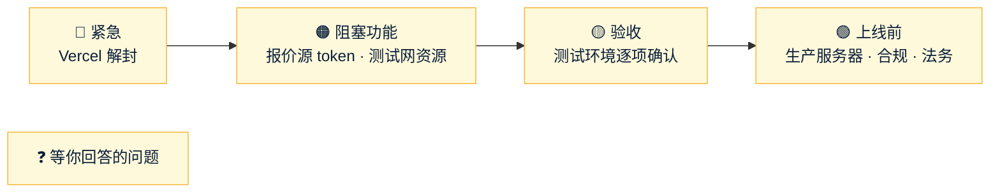

# Amos 待办
- 用途：记下**需要 Amos 做的事**和**等 Amos 回答的问题**，避免遗漏。智能体每次汇报时对照本文件提醒；Amos 说"做完了"或答复后，智能体核实，删除对应条目，并在文末"已完成"里留一行记录。
- 维护：智能体（PM）。新增的事项写清楚"做什么、为什么、怎么确认做好了、截止或阻塞了什么"。**不写任何密钥、密码的值**（只写变量名）。**凡是需要 Amos 注册、沟通、协商的事，智能体把已经查到的资料写全**（网址、联系方式、要问的问题、要填的地址和变量），放在下面的"📚 资料"一节，Amos 不用再自己找一遍（Amos 2026-10-17 要求）。
- 版本：v1.6（2026-10-17）
- 变更历史：v1（2026-10-17）Amos 要求创建（"创建一个文件，用来记录需要我做的事情……如果有我没回复的问题，你也可以及时找到并提醒我"），按 2026-10-16 至 10-17 的对话整理；v1.1（2026-10-17）Amos 答复 Q1–Q5：Q1 暂不做，Q2 按 1:1，Q3 去谈并入 T3，Q4 转为 T21，Q5 已删除；v1.2（2026-10-17）新增 Q6–Q8、T22–T23，T4 写明变量名；v1.3（2026-10-17）Amos 答复 Q6 选 B、Q7 买卖合计加 20 点（每边 10 点）（都已实现），Q8 和 T22 他自己处理、不再提醒；v1.4（2026-10-17）Amos 要求：新增"📚 资料"一节——AllTick、iTick 的注册和联系方式，币安、OKX 的行情地址和条款，三条测试链的节点、浏览器、水龙头、测试 USDT 合约（链上实测核对过），T3–T5 指向它；v1.5（2026-10-17）Amos 决定"还是用币安的报价"：新增 Q9–Q11（币安没有外汇和指数、贵金属原油美股只有永续、美国服务器访问受限），币安接入在做；v1.6（2026-10-17）Amos 答复 Q9 选 A、Q10 不用（他再找更好的报价源）

## 一图看懂



这张图想说明：先处理最上游的紧急事项，然后是挡住功能开发的资源，再是验收，最后是上线前的准备；问题清单随时可以答。

## 🔴 紧急
| # | 做什么 | 为什么 | 怎么确认做好了 | 提出时间 |
|---|---|---|---|---|
| T1 | **Vercel 账号解封**（登录 Vercel 看封停原因：额度、账单或条款误判）。说明：https://vercel.com/knowledge/why-is-my-account-deployment-blocked | amos111 的**生产站点**（amos111.vercel.app）已经停了，返回 503 `DEPLOYMENT_PAUSED`；falconx-lite 的原型预览也打不开 | 告诉我，我从外部检查 amos111 首页和 `/api/tick/?health=1` | 10-16 |
| T2 | Vercel 解封后，**重新打开 amos111 的 tick-watch**（GitHub → amos111 → Actions → tick-watch → Enable workflow） | 你已经暂停了它，解封后不打开，链上监控停了就没人知道 | Actions 里 tick-watch 显示为启用并且运行成功 | 10-17 |

## 🟠 阻塞功能开发
| # | 做什么 | 为什么 | 怎么确认做好了 | 提出时间 |
|---|---|---|---|---|
| T3 | **谈报价源授权**（联系方式、网址见下面"📚 资料" R1–R4）：AllTick（主）、iTick（备）。要书面授权，写明"作为差价合约报价基准"和"在官网、客户端公开展示"两项；问清 50 个品种是否都有买卖价、外汇/指数/原油的数据来源、美股实时数据的交易所授权、香港机房接入延迟、SLA 赔偿。币安由你自己谈；**OKX 也去谈**（Amos 10-17 决定，加密货币可做第三个源交叉校验） | 条款默认禁止商用和再分发；没有授权，生产不能用真实报价 | 拿到书面授权文件 | 10-16 |
| T4 | **注册 AllTick、iTick 的试用账号**（注册网址见"📚 资料" R1、R2），**把 token 填进测试服务器 `.env`**：`FX_QUOTE_ALLTICK_TOKEN`、`FX_QUOTE_ITICK_TOKEN`（用 `sudo nano /opt/falconx/.env`；**不要把 token 发给我**）。先确认试用条款允许内部测试使用 | 接入代码在做，没有 token 只能用模拟报价 | 后台品种页"最后报价时间"在走，后台域名健康检查里报价源是 UP | 10-17 |
| T5 | **测试网资源**：节点地址、测试 USDT 合约、水龙头我都查好了（"📚 资料" R5，可以直接复制进 `.env`）。**你要做的只剩**：①离线生成测试用助记词，导出 ETH 和 TRON 的账户级 xpub（只有公钥）；②建两个测试热钱包（ETH/BSC 共用一个、TRON 一个），在水龙头领测试币；③把 xpub、热钱包地址和私钥填进 `.env`（**私钥只由你填，不要发给我**） | 没有这些，充值一直显示"暂未开通"，提现也走不通（验收 3.3 节） | 充值页显示地址；转测试币能到账 | 10-16 |

## 🟡 测试环境验收（S21，清单见 `交付记录/v1-交付说明.md` 第 3 节）
| # | 做什么 | 预期 | 提出时间 |
|---|---|---|---|
| T6 | 官网 https://test-www.quickcome.online （本地 DNS 缓存过期后）：看行情跳动、中英文切换、"免费注册"跳到客户端、三个法律页 | 都正常；手机和电脑都没有横向滚动 | 10-16 |
| T7 | iPhone 上注册，试新的出生日期（年/月/日三框）：数字键盘、输满自动跳格、退格回上一格、2 月 30 日只标红"日"、粘贴 `1988-05-12` 自动拆开、自动填充生日 | 顺手好用 | 10-16 |
| T8 | 后台：深色主题、编辑客户资料、新增品种（填模拟起始价后有报价，关掉"暂停开仓"后客户能下单）、风控看板自动刷新 | 都正常 | 10-16 |
| T9 | 客户端：新 Logo、电脑顶栏跑马灯、Tick 图和指标（MA/EMA/BOLL/MACD/RSI） | 都正常 | 10-16 |
| T10 | 检查测试服务器 `.env` 里 `FX_MAIL_FROM` 的显示名：如果写了 "FalconX"，改成 `Quick Come <noreply@email.quickcome.online>`，然后重启后端 | 收到的邮件发件人显示 Quick Come | 10-16 |
| T11 | iPhone 上已经"添加到主屏幕"的：删掉重新添加 | 图标是新的 Q 图形 | 10-16 |
| T12 | 交付说明 3.1–3.4 节剩下的真机、真人项：三家邮箱收信（AC-26）、iPhone 和安卓推送（AC-24，大陆网络下 iPhone 能否收到如实记录）、三家运营商连续 3 天测速（AC-30）、冻结客户 5 秒内登出（AC-04） | 按清单 | 10-16 |

## 🟢 上线前要定（S22）
| # | 做什么 | 现状 | 提出时间 |
|---|---|---|---|
| T13 | 生产服务器（H0）：云厂商、地区（建议香港）、配置；托管 MySQL、对象存储、异地备份；主网节点和热钱包 | 未定 | 10-16 |
| T14 | 告警收件邮箱（H7） | 先用 info@quickcome.online（服务器 `.env` 的 `FX_ALERT_EMAILS`） | 10-16 |
| T15 | 隔夜费率和周三三倍隔夜费 | 现在全是 0 | 10-16 |
| T16 | 上线时哪些品种默认"暂停开仓"（E2E-1） | 现在 BTCUSD 暂停 | 10-16 |
| T17 | 合规：牌照、公司主体（官网暂不写）、三份法律文本交法务审核（N-12）；美股实时价格对外展示是否要交交易所费用；品种中文名里的"标普 500""道琼斯 30"等商标是否要指数商授权 | 法律文本是原创样板，页顶标"需法务审核" | 10-16 |
| T18 | 让原项目 LP 换一个新密钥：fxsystem 仓库 `docs/market/LP接入操作手册-给AI.md` 里有一个像是真实的 `secretKey` | 未处理 | 10-16 |
| T19 | GitHub 给 falconx-lite 的 `main` 开分支保护（CI 不过不能合并）：Settings → Branches → Add rule | 未开 | 10-16 |
| T20 | 正式环境的密钥托管（KMS） | 未定 | 10-16 |
| T23 | iTick 买套餐前确认连接数：我们要 4 条（外汇、指数、加密、美股各 1 条），Professional（6 条）够，Basic 要先问清楚 | 接入代码已完成，等 token | 10-17 |
| T21 | **验收完后排期**：原计划没做的功能——客户分组、价格提醒、部分平仓、TradingView 图表、群发通知、DF-01/DF-02 | Amos 10-17：验收完再排 | 10-17 |

## ❓ 等你回答的问题
| # | 问题 | 我的建议（默认） | 提出时间 |
|---|---|---|---|
| Q11 | 币安对美国服务器限制访问：测试服务器（美国）只能连上**加密货币现货**的只读行情（`data-api.binance.vision`），合约和主站都返回 451。生产服务器选地区时要确认币安能访问（香港是否受限，查证中） | 生产服务器（T13）选地区前，我把币安对该地区的限制查清楚再给你建议 | 10-17 |

## 📚 资料（注册、联系、地址）
标注：【实测】= 我从开发环境实际调用核对过；【官网】= 实际打开过官方页面；【未核实】= 只查到第三方资料，请以页面为准。

### R1 AllTick（报价主源）
| 用途 | 地址 / 方式 |
|---|---|
| 注册（拿免费 token） | https://alltick.co/zh-CN/register 【官网】 |
| 登录 | https://alltick.co/zh-CN/login 【官网】 |
| 联系销售（谈商用授权） | https://alltick.co/zh-CN/contact 【官网】；Telegram：https://t.me/alltick_cn 、https://t.me/alltick001 【官网】；邮箱 support@alltick.co（调研报告记录，价格页上没列出）【未核实】 |
| 价格 | https://alltick.co/zh-CN/pricing （2026-10-16：免费 10 个演示品种；基础版 99 USDT/月 100 个品种；高级版 199 USDT/月）【官网】 |
| 条款 | https://alltick.co/terms （"不用于交易……不得再分发"，所以要谈书面授权）【官网】 |
| 接口文档 | https://github.com/alltick/realtime-forex-crypto-stock-tick-finance-websocket-api 【官网】 |
| 填进服务器 | `FX_QUOTE_ALLTICK_TOKEN` |

### R2 iTick（报价备源）
| 用途 | 地址 / 方式 |
|---|---|
| 注册 / 登录（页面上的"Login/Sign Up"） | https://itick.org/en/dashboard 【官网】（中文站 https://itick.org/zh-cn/pricing ） |
| 联系（谈商用授权、问连接数） | https://itick.org/en/contact ；Telegram：https://t.me/iticksupport ；WhatsApp：https://wa.me/85259046663 （+852 5904 6663）【官网】 |
| 价格 | https://itick.org/en/pricing （2026-10-16：Basic $99、Professional $199，新用户 8 折；我们要 4 条连接，Professional 够，见 T23）【官网】 |
| 条款 | https://itick.org/en/terms （"未经许可禁止再分发"）【官网】 |
| 接口文档 | https://docs.itick.org/en/websocket/forex 【官网】 |
| 填进服务器 | `FX_QUOTE_ITICK_TOKEN` |

### R3 币安（你自己谈）
| 用途 | 地址 |
|---|---|
| 现货 REST（只读行情专用，美国能访问） | `https://data-api.binance.vision` 【实测】 |
| 现货 WebSocket（只读行情专用） | `wss://data-stream.binance.vision` 【官网】 |
| 现货 REST 主站（美国返回 451 地区限制） | `https://api.binance.com/api/v3/ticker/bookTicker` 【实测】 |
| 合约 REST / WebSocket（美国返回 451） | `https://fapi.binance.com` / `wss://fstream.binance.com` 【实测】 |
| 文档 | 现货 REST：https://developers.binance.com/docs/binance-spot-api-docs/rest-api/general-api-information ；现货 WS：https://github.com/binance/binance-spot-api-docs/blob/master/web-socket-streams.md ；只读行情域名说明：https://github.com/binance/binance-spot-api-docs/blob/master/faqs/market_data_only.md ；合约 WS：https://developers.binance.com/docs/derivatives/usds-margined-futures/websocket-market-streams 【官网】 |
| 条款 | 公开数据条款 https://data.binance.vision/Binance_Vision-Terms_of_Use.pdf （第 3.4 条：商业使用要另签企业数据许可；第 4.4 条：不得集成进商业金融产品）【官网】；主服务条款 https://www.binance.com/en/terms （我这边打开是空白，请你在浏览器看） |
| 商务联系 | 【未查到】官方数据授权的联系入口，建议通过币安机构服务或客服询问"enterprise market data license" |

### R4 OKX（去谈）
| 用途 | 地址 |
|---|---|
| REST 行情 | `https://www.okx.com/api/v5/market/ticker?instId=BTC-USDT`（美国能访问）【实测】 |
| WebSocket 公共频道 | `wss://ws.okx.com:8443/ws/v5/public`（`bbo-tbt` 买一卖一，有变化每 10 毫秒推送）【官网】 |
| 文档 | https://www.okx.com/docs-v5/en/ 【官网】 |
| 条款 | API 协议 https://www.okx.com/en-us/help/okx-api-agreement （§9.4：行情只限个人非商业使用，商业用途要另签数据授权）；服务条款 https://www.okx.com/help/terms-of-service 【官网】 |
| 地区 | 香港在 OKX 的限制地区名单上：https://www.okx.com/en-us/help/360021813591 ——谈的时候问清香港服务器能不能用【官网】 |
| 商务联系 | 【未查到】，建议通过 OKX 机构服务或客服询问数据授权 |

### R5 三条测试链（可以直接复制进测试服务器 `.env`）
| 链 | 节点地址（RPC） | chainId | 测试 USDT 合约 | 浏览器 | 水龙头（领测试币） |
|---|---|---|---|---|---|
| ERC20：以太坊 Sepolia | `https://ethereum-sepolia-rpc.publicnode.com`【实测】 | 11155111【实测】 | `0xaA8E23Fb1079EA71e0a56F48a2aA51851D8433D0`（USDT，6 位小数【实测】；一般认为是 Aave 测试市场的 USDT，可以在 https://gho.aave.com/faucet 打开 Testnet 模式领取【未核实】） | https://sepolia.etherscan.io | 测试 ETH（付手续费）：Google Cloud https://cloud.google.com/application/web3/faucet/ethereum/sepolia （可能要求钱包在主网有 0.001 ETH）【未核实】 |
| BEP20：BSC 测试网 | `https://bsc-testnet-rpc.publicnode.com`【实测】（备用 `https://bsc-testnet.drpc.org`【实测】） | 97【实测】 | `0x337610d27c682E347C9cD60BD4b3b107C9d34dDd`（USDT，18 位小数【实测】，和我们配置的 18 位一致） | https://testnet.bscscan.com | 官方水龙头（tBNB 和 USDT）：https://www.bnbchain.org/en/testnet-faucet ，说明 https://docs.bnbchain.org/bnb-smart-chain/developers/faucet 【官网】 |
| TRC20：TRON Nile | `https://nile.trongrid.io`【实测】 | — | `TXYZopYRdj2D9XRtbG411XZZ3kM5VkAeBf`（TetherToken，6 位小数【实测】） | https://nile.tronscan.org | 官方水龙头（TRX 和测试 USDT）：https://nileex.io/join/getJoinPage ，说明 https://developers.tron.network/docs/getting-testnet-tokens-on-tron 【官网】 |

**复制进 `.env` 的内容**（这些不是密钥，可以直接用；`sudo nano /opt/falconx/.env`）：
```
FX_WALLET_ETH_RPC_URL=https://ethereum-sepolia-rpc.publicnode.com
FX_WALLET_BSC_RPC_URL=https://bsc-testnet-rpc.publicnode.com
FX_WALLET_TRON_RPC_URL=https://nile.trongrid.io
FX_WALLET_ERC20_USDT_CONTRACT=0xaA8E23Fb1079EA71e0a56F48a2aA51851D8433D0
FX_WALLET_BSC_USDT_CONTRACT=0x337610d27c682E347C9cD60BD4b3b107C9d34dDd
FX_WALLET_TRC20_USDT_CONTRACT=TXYZopYRdj2D9XRtbG411XZZ3kM5VkAeBf
FX_WALLET_ERC20_CHAIN_ID=11155111
FX_WALLET_BSC_CHAIN_ID=97
```
**你自己生成、自己填的**（不要发给我）：`FX_WALLET_ETH_XPUB`、`FX_WALLET_TRON_XPUB`（账户级 xpub，只有公钥）、`FX_WALLET_ETH_HOT_ADDRESS`、`FX_WALLET_ETH_HOT_KEY`（ERC20 和 BSC 共用）、`FX_WALLET_TRON_HOT_ADDRESS`、`FX_WALLET_TRON_HOT_KEY`。填完重启后端，告诉我，我从外部检查充值地址能不能生成。

说明：公共节点免费但有频率限制；测试环境够用。TRON 公共节点如果被限流，要在 https://www.trongrid.io 注册拿 API Key（目前代码还不支持带 Key，需要时我再加）【推断】。

## 已完成（保留最近的记录）
| 日期 | 事项 |
|---|---|
| 10-16 | 测试服务器准备、域名、Resend 邮件、超管改密码 |
| 10-16 | test-www 的 DNS 和证书扩展（三个域名） |
| 10-16 | agents 仓库 PR #15（平台规范《云服务器》）同意合并 |
| 10-17 | 同意合并模拟价（PR #51） |
| 10-17 | 暂停 amos111 的 tick-watch |
| 10-17 | Q1 后台两步验证：**暂时不做** |
| 10-17 | Q2 USDT 和 USD：**按 1:1** |
| 10-17 | Q3 OKX 数据授权：**去谈**（并入 T3） |
| 10-17 | Q4 未做的原计划功能：**验收完再排**（转为 T21） |
| 10-17 | Q5 删掉 S17 旧工作目录：**已删除** |
| 10-17 | Q6 两家报价源偏差超过阈值时：**选 B，已实现**（合并、部署到测试环境后生效）——只暂停开仓（市价开仓、新挂单、已有挂单成交都不行），平仓、止盈止损、强平照常，用主源的价格；仍亮 `quote.deviation` 告警，偏差回落自动恢复开仓；和运营手动暂停、风控暂停互不覆盖 |
| 10-17 | Q7 加点：**每个品种买卖合计 20 点 = 每边 10 点，已配置**（Amos 更正为"买卖一共 20 点"；迁移 V24，合并、部署到测试环境后生效）。"点" = 品种的最小价格单位 10^(-小数位)；加点是卖价减、买价加各一次，所以每边 10 点：EURUSD 等 5 位小数 → 每边 0.00010，USDJPY 等 3 位 → 0.010，XAUUSD、ETHUSD、美股等 2 位 → 0.10，BTCUSD 和指数 1 位 → 1.0，JPN225 0 位 → 10。客户看到的点差比原始点差宽 20 点（例如 EURUSD 宽 0.00020、XAUUSD 宽 0.20）。运营在后台改过加点的品种不动；后台新增品种默认也是每边 10 点 |
| 10-17 | Q9 币安没有的外汇和指数（31 个品种）：**选 A，继续 AllTick 主、iTick 备**（T3、T4 仍需要谈授权、拿 token） |
| 10-17 | Q10 黄金、白银、原油、美股：**不用币安永续合约价**；Amos 再找更好的报价源给我，找到后我核对覆盖、条款和接口 |
| 10-17 | Q8 老项目 fxsystem 怎么处理、T22 老系统服务器：**Amos 自己处理，不再提醒** |
