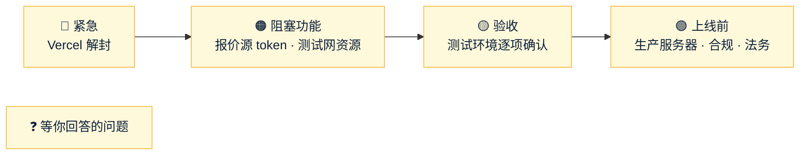

# Amos 待办
- 用途：记下**需要 Amos 做的事**和**等 Amos 回答的问题**，避免遗漏。智能体每次汇报时对照本文件提醒；Amos 说"做完了"或答复后，智能体核实，删除对应条目，并在文末"已完成"里留一行记录。
- 维护：智能体（PM）。新增的事项写清楚"做什么、为什么、怎么确认做好了、截止或阻塞了什么"。**不写任何密钥、密码的值**（只写变量名）。
- 版本：v1.1（2026-10-17）
- 变更历史：v1（2026-10-17）Amos 要求创建（"创建一个文件，用来记录需要我做的事情……如果有我没回复的问题，你也可以及时找到并提醒我"），按 2026-10-16 至 10-17 的对话整理；v1.1（2026-10-17）Amos 答复 Q1–Q5：Q1 暂不做，Q2 按 1:1，Q3 去谈并入 T3，Q4 转为 T21，Q5 已删除

## 一图看懂

这张图想说明：先处理最上游的紧急事项，然后是挡住功能开发的资源，再是验收，最后是上线前的准备；问题清单随时可以答。

## 🔴 紧急
| # | 做什么 | 为什么 | 怎么确认做好了 | 提出时间 |
|---|---|---|---|---|
| T1 | **Vercel 账号解封**（登录 Vercel 看封停原因：额度、账单或条款误判）。说明：https://vercel.com/knowledge/why-is-my-account-deployment-blocked | amos111 的**生产站点**（amos111.vercel.app）已经停了，返回 503 `DEPLOYMENT_PAUSED`；falconx-lite 的原型预览也打不开 | 告诉我，我从外部检查 amos111 首页和 `/api/tick/?health=1` | 10-16 |
| T2 | Vercel 解封后，**重新打开 amos111 的 tick-watch**（GitHub → amos111 → Actions → tick-watch → Enable workflow） | 你已经暂停了它，解封后不打开，链上监控停了就没人知道 | Actions 里 tick-watch 显示为启用并且运行成功 | 10-17 |

## 🟠 阻塞功能开发
| # | 做什么 | 为什么 | 怎么确认做好了 | 提出时间 |
|---|---|---|---|---|
| T3 | **谈报价源授权**：AllTick（主，support@alltick.co）、iTick（备，Telegram @iticksupport）。要书面授权，写明"作为差价合约报价基准"和"在官网、客户端公开展示"两项；问清 50 个品种是否都有买卖价、外汇/指数/原油的数据来源、美股实时数据的交易所授权、香港机房接入延迟、SLA 赔偿。币安由你自己谈；**OKX 也去谈**（Amos 10-17 决定，加密货币可做第三个源交叉校验） | 条款默认禁止商用和再分发；没有授权，生产不能用真实报价 | 拿到书面授权文件 | 10-16 |
| T4 | **注册 AllTick、iTick 的试用账号，把 token 填进测试服务器 `.env`**（变量名等接入代码合并后我给你，**不要把 token 发给我**） | 接入代码在做，没有 token 只能用模拟报价 | 后台品种页"最后报价时间"在走，后台域名健康检查里报价源是 UP | 10-17 |
| T5 | **测试网资源**：三条链（ERC20 Sepolia、BEP20 BSC 测试网、TRC20 Nile）的节点地址、测试用 xpub、测试热钱包，以及测试 USDT 合约（测试网没有官方 USDT，需要部署或选一个公开测试币） | 没有这些，充值一直显示"暂未开通"，提现也走不通（验收 3.3 节） | 充值页显示地址；转测试币能到账 | 10-16 |

## 🟡 测试环境验收（S21，清单见 `交付记录/v1-交付说明.md` 第 3 节）
| # | 做什么 | 预期 | 提出时间 |
|---|---|---|---|
| T6 | 官网 https://test-www.quickcome.online （本地 DNS 缓存过期后）：看行情跳动、中英文切换、"免费注册"跳到客户端、三个法律页 | 都正常；手机和电脑都没有横向滚动 | 10-16 |
| T7 | iPhone 上注册，试新的出生日期（年/月/日三框）：数字键盘、输满自动跳格、退格回上一格、2 月 30 日只标红"日"、粘贴 `1988-05-12` 自动拆开、自动填充生日 | 顺手好用 | 10-16 |
| T8 | 后台：深色主题、编辑客户资料、新增品种（填模拟起始价后有报价，关掉"暂停开仓"后客户能下单）、风控看板自动刷新 | 都正常 | 10-16 |
| T9 | 客户端：新 Logo、电脑顶栏跑马灯、Tick 图和指标（MA/EMA/BOLL/MACD/RSI） | 都正常 | 10-16 |
| T10 | 检查测试服务器 `.env` 里 `FX_MAIL_FROM` 的显示名：如果写了 "FalconX"，改成 `Quick Come <noreply@email.quickcome.online>`，然后重启后端 | 收到的邮件发件人显示 Quick Come | 10-16 |
| T11 | iPhone 上已经"添加到主屏幕"的：删掉重新添加 | 图标是新的 Q 图形 | 10-16 |
| T12 | 交付说明 3.1–3.4 节剩下的真机、真人项：三家邮箱收信（AC-26）、iPhone 和安卓推送（AC-24，大陆网络下 iPhone 能否收到如实记录）、三家运营商连续 3 天测速（AC-30）、冻结客户 5 秒内登出（AC-04） | 按清单 | 10-16 |

## 🟢 上线前要定（S22）
| # | 做什么 | 现状 | 提出时间 |
|---|---|---|---|
| T13 | 生产服务器（H0）：云厂商、地区（建议香港）、配置；托管 MySQL、对象存储、异地备份；主网节点和热钱包 | 未定 | 10-16 |
| T14 | 告警收件邮箱（H7） | 先用 info@quickcome.online（服务器 `.env` 的 `FX_ALERT_EMAILS`） | 10-16 |
| T15 | 隔夜费率和周三三倍隔夜费 | 现在全是 0 | 10-16 |
| T16 | 上线时哪些品种默认"暂停开仓"（E2E-1） | 现在 BTCUSD 暂停 | 10-16 |
| T17 | 合规：牌照、公司主体（官网暂不写）、三份法律文本交法务审核（N-12）；美股实时价格对外展示是否要交交易所费用；品种中文名里的"标普 500""道琼斯 30"等商标是否要指数商授权 | 法律文本是原创样板，页顶标"需法务审核" | 10-16 |
| T18 | 让原项目 LP 换一个新密钥：fxsystem 仓库 `docs/market/LP接入操作手册-给AI.md` 里有一个像是真实的 `secretKey` | 未处理 | 10-16 |
| T19 | GitHub 给 falconx-lite 的 `main` 开分支保护（CI 不过不能合并）：Settings → Branches → Add rule | 未开 | 10-16 |
| T20 | 正式环境的密钥托管（KMS） | 未定 | 10-16 |
| T21 | **验收完后排期**：原计划没做的功能——客户分组、价格提醒、部分平仓、TradingView 图表、群发通知、DF-01/DF-02 | Amos 10-17：验收完再排 | 10-17 |

## ❓ 等你回答的问题
| # | 问题 | 我的建议（默认） | 提出时间 |
|---|---|---|---|
| — | 暂时没有 | — | — |

## 已完成（保留最近的记录）
| 日期 | 事项 |
|---|---|
| 10-16 | 测试服务器准备、域名、Resend 邮件、超管改密码 |
| 10-16 | test-www 的 DNS 和证书扩展（三个域名） |
| 10-16 | agents 仓库 PR #15（平台规范《云服务器》）同意合并 |
| 10-17 | 同意合并模拟价（PR #51） |
| 10-17 | 暂停 amos111 的 tick-watch |
| 10-17 | Q1 后台两步验证：**暂时不做** |
| 10-17 | Q2 USDT 和 USD：**按 1:1** |
| 10-17 | Q3 OKX 数据授权：**去谈**（并入 T3） |
| 10-17 | Q4 未做的原计划功能：**验收完再排**（转为 T21） |
| 10-17 | Q5 删掉 S17 旧工作目录：**已删除** |
