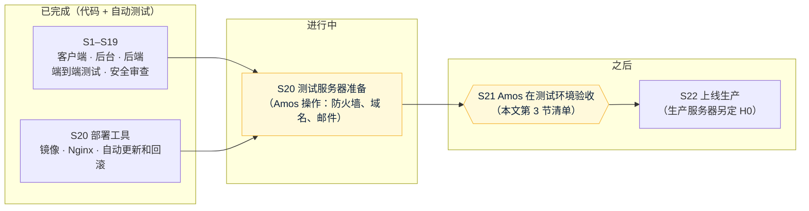

# Quick Come v1 交付说明（草稿）
- 版本：v0.5 草稿（2026-10-16）
- 变更历史：v0.1（2026-10-16）测试环境部署前起草：交付内容、S21 验收清单、已知问题和待定事项；v0.2（2026-10-16）Amos 决定后台不加 IP 白名单，验收清单第 4 步取消；D-1、D-2 已修；v0.3（2026-10-16）AC-13 压测完成（第 3.4 节第 17 项，本机复刻测试服务器）；v0.4（2026-10-16）v2 品牌改名：产品对客户的名字改为 Quick Come（原 FalconX Lite；代码、数据库、镜像等内部名字和本文件的文件名不变）；v0.5（2026-10-16）第 3 节开头提醒：模拟报价起始价更新到当前市价后，测试环境已有持仓和挂单按新价格计算
- 状态：**草稿**。测试环境部署（S20）、Amos 验收（S21）、上线（S22）后逐步补全，上线后改为正式版。
- 编写：PM（整合研发、测试、运维的内容）
- 依据：`需求文档/v1-需求说明书.md` v1.5（AC-01～AC-41）、`需求文档/v1-任务清单.md`、`测试报告/v1-端到端测试方案.md`、`测试报告/v1-安全审查.md`、`部署方案/v1-部署方案.md`

## 一图看懂

这张图想说明：代码和自动测试已经完成，现在等测试服务器准备好；之后由 Amos 按第 3 节的清单验收，验收通过才能上生产。

## 1. 交付了什么
| 部分 | 内容 | 怎么验证过 |
|---|---|---|
| 客户端（手机和电脑分开设计，UI 风格 C） | 注册登录、KYC、行情和 K 线、市价和限价单、止盈止损、持仓和挂单、资产（三条链充值、白名单、提现）、资金流水、通知中心和偏好、中英文、主题和涨跌色、PWA | 客户端单元测试 98 个；端到端主流程（390px 手机） |
| 管理后台 | 系统（管理员、角色、菜单、配置、审计）、客户、KYC、入金、出金、对账、任务、通知、仪表盘、交易监控（手动强平、强制撤单）、风控、品种、交易时段和休市日、汇率、交易参数 | 后台单元测试 85 个；端到端里的 KYC 和出金审核 |
| 后端（1 个 Java 应用） | 账户、行情（模拟报价源，LP 待接）、交易撮合和强平、隔夜费、追保、钱包（扫块、入账、提现签名广播、对账）、风控（净敞口自动禁开）、通知（站内信、邮件、Web Push）、后台接口 | 后端测试 240 个（真实 MySQL、Redis）；模块边界检查 |
| 端到端测试 | 注册 → 充值 → KYC → 下单 → 止盈自动平仓 → 手动平仓 → 流水 → 白名单 → 提现 → 后台审核 → 上链完成；同时检查风控字段不外泄（AC-23）、不访问 Google（AC-29）、没有横向滚动（AC-31） | 每个 PR 的 CI 都跑 |
| 安全 | 上公网前的安全审查：17 条发现，5 条已修（跨站请求、后台域名绕过、验证码换新、后台越权、500），其余记录 | `测试报告/v1-安全审查.md` |
| 部署 | 两个镜像、Nginx（HTTPS、两个域名）、服务器端自动更新（失败自动换回）、回滚、备份和恢复、外部验证脚本 | 本机 Docker 完整演练（部署方案 9.1 节）；CI 已推出镜像 |

现有系统的问题（功能地图第 5 节 S1–S6、F1–F6、T1–T7）都有对应测试（AC-38），逐条清单在 S21 前整理进本文。

## 2. 环境
| 环境 | 地址 | 说明 |
|---|---|---|
| 原型 | Vercel 预览（见 `技术方案/v1-原型说明.md`） | 浏览器内模拟数据，页面顶部黄色"原型"横幅 |
| 测试 | `https://test-app.<域名>`、`https://test-admin.<域名>`（域名待 Amos 提供） | 美国阿里云轻量应用服务器 2 核 2G；页面顶部紫色"测试环境"标识条；邮件和推送标题带"[测试]"；只用测试网和测试密钥；合并到 staging 后几分钟内自动更新 |
| 生产 | 待定（H0） | 不设测试环境标识 |

## 3. S21 验收清单（Amos 在测试环境操作）
> **提醒（2026-10-16 模拟报价起始价更新）**：这个版本部署到测试环境后，模拟报价从新的起始价开始（2026-10-16 市价：加密货币比以前低 27%～70%，原油高 55%～62%，日经高 37%，AAPL 高 39%），**这是预期变化，不是故障**。已有持仓按新价格计算：亏损方向的会被强平（亏损最多是这笔保证金），盈利方向的会有很大浮盈，止盈止损、挂单可能立即触发，并发出对应的通知；K 线图上会有一个跳空。需要保留的验收数据请在部署前记下，不需要的建议部署前平仓、撤单。详见 `技术方案/v2-模拟报价起始价.md` 第 3 节。

自动测试已经覆盖的不需要你重复（见第 4 节）。下面是**只有真实环境、真机、真人才能确认**的部分，按建议顺序排列。每项写了预期结果；不符合的截图发给我。

### 3.1 部署好就能验（不需要邮件和测试网）
| # | 做什么 | 预期 | 对应 |
|---|---|---|---|
| 1 | 电脑浏览器打开后台，用超级管理员登录，按提示改初始密码 | 能登录；顶部有"测试环境"标识；改密码后重新登录 | G1、G2 |
| 2 | 后台逐个点开左侧菜单 | 每个页面都能打开，没有报错 | AC-35 |
| 3 | 新建一个只有"出金审核查看"权限的角色和管理员，用它登录 | 只看到对应菜单 | AC-32 |
| 4 | ~~在后台填 IP 白名单~~：Amos 2026-10-16 决定不加，这一步取消 | — | SEC-06 |
| 5 | 手机打开客户端，切换英文、切换主题和涨跌色 | 没有中文残留；颜色一起变 | AC-27、AC-40 |
| 6 | iPhone Safari、安卓 Chrome 添加到主屏幕 | 图标和名称正确，从图标打开是全屏 | AC-28 |

### 3.2 配好邮件后（D3）
| # | 做什么 | 预期 | 对应 |
|---|---|---|---|
| 7 | 用 QQ、163、Gmail 邮箱各注册一个客户 | 验证码 60 秒内到，标题带"[测试]"，不在垃圾箱 | AC-01、AC-26 |
| 8 | 手机上走一遍：登录 → 看行情（价格在跳）→ 市价下单 → 设止盈止损 → 平仓 → 看资金流水 | 每步都正常，没有横向滚动，按钮都能点到 | AC-31、AC-10、AC-11 |
| 9 | 电脑上（1280 宽）做同样的事 | 电脑布局正常 | AC-39 |
| 10 | 提交 KYC（3 张照片），在后台审核驳回一次、再通过一次 | 客户收到结果邮件和站内信 | AC-05 |
| 11 | 允许浏览器通知后，再下单、平仓 | iPhone（已添加到主屏幕）和安卓收到推送；**大陆网络下 iPhone 能否收到如实记录** | AC-24 |
| 12 | 在后台冻结一个客户 | 该客户 5 秒内被登出，不能下单和提现 | AC-04 |

### 3.3 接上测试网后（D4 第二步）
| # | 做什么 | 预期 | 对应 |
|---|---|---|---|
| 13 | 向三条链的充值地址各转一笔测试网 USDT；再转一笔 0.99 USDT | 达到确认数后 2 分钟内到账；0.99 的显示"低于最小充值金额" | AC-07、AC-41 |
| 14 | 每条链各提一笔小于 3,000 和一笔大于等于 3,000 的提现，后台审核 | 5 分钟内上链；大额先过延迟期 | AC-19 |
| 15 | 向充值地址转一个假 USDT（不在配置里的合约） | 不入账 | AC-08 |

### 3.4 需要你安排人或时间的
| # | 做什么 | 预期 | 对应 |
|---|---|---|---|
| 16 | 电信、联通、移动三家网络各一处，打开行情页，连续 3 天，每天早中晚各一次 | ≤3 秒（测试服务器在美国，只作参考，生产机房 H0 按结果选） | AC-30 |
| 17 | 50 个品种的报价压测（Amos 已同意；测试服务器上没有替身接口，改在本机用同样的镜像和 compose、容器绑 2 核复刻测试服务器） | 触发到成交 ≤1 秒 | AC-13：**已完成，满足**（2026-10-16，实际执行）：两次各 10 分钟、共 44,783 次触发，p99 686 ms / 710 ms，超过 1 秒 0.056%（都在后端刚启动的第一分钟）。真实测试服务器上未验证。见 `测试报告/v1-压测报告-AC13.md`；发现 LT-1（同时发验证码死锁，未修） |

## 4. 已由自动测试覆盖的验收项
AC-02、03、09、12、14、15、16、17、18、20、21、22、23、25、29、33、34、37、38：每个 PR 的 CI 都在跑，测试类见 `测试报告/v1-端到端测试方案.md` 第 5 节。

## 5. 已知问题和待定事项
### 5.1 需要 Amos 决定
| 编号 | 事项 | 现状 |
|---|---|---|
| E2E-1 | 新库上 BTCUSD 默认"暂停开仓"（沿用原型演示数据）。上线时哪些品种默认暂停？ | 未改 |
| — | 隔夜费率和周三三倍隔夜费 | 现在全部为 0（品种页显示"未配置"） |
| H7 | 风控阈值；风控和系统告警的收件邮箱 | 未定 |
| DF-01、DF-02 | 见《功能取舍对照表》 | 未定 |
| — | 客户端充值卡片新增的"充值记录"区块样式（原型里没有）；场景切换面板只在原型模式显示 | 待确认 |
| SEC-06 | 后台 IP 白名单默认为空（对整个公网开放） | **已决定：不加**（Amos 2026-10-16） |
| SEC-09、SEC-10 | 按 IP 锁定登录可能误伤共用出口 IP 的用户；知道邮箱就能把别人锁 15 分钟 | AC-02 的产品决定，未改 |
| — | 验证码限次：同一邮箱同一用途每天 10 次、同一 IP 每小时 30 次 | 安全审查定的默认值，可调 |

### 5.2 v1 不改的已知缺口
- 隔夜费率没有"未配置"状态（多空都是 0 时显示"未配置"）。
- 对账问题的说明只有中文。
- 风控事件里看不到操作原因（在审计日志里）。
- KYC 驳回原因只有一种语言。
- 外部定时探测要合并到 main 后才运行（部署方案 7.1）。
- 安全审查里记录的低风险项（`测试报告/v1-安全审查.md` 第 4 节）。

## 6. 需要 Amos 提供的资源
| 资源 | 什么时候要 | 现状 |
|---|---|---|
| 测试服务器 | S20 | ✅ 已提供（美国轻量应用服务器，已清空） |
| 防火墙设置 | S20 第一步 | 待你操作 |
| 测试域名（两个子域名） | S20 | 待提供 |
| 邮件服务商（SMTP） | S20，验收 3.2 节之前 | 待提供 |
| 浏览器推送密钥（测试环境一对） | S20 | 你在自己电脑上生成 |
| 第一个超级管理员 | S20 | 你填进服务器 |
| 测试网节点、测试热钱包、测试 xpub | 验收 3.3 节之前 | 待提供 |
| LP 行情账号 | 上线前 | 待提供；测试环境先用模拟报价 |
| 生产服务器、生产域名、托管 MySQL、对象存储、主网节点和热钱包 | S22 前 | 待定（H0） |
| 合规文案（N-12） | S22 前 | 待提供 |
