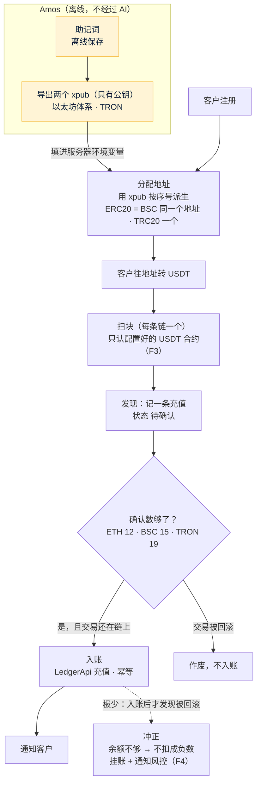

# FalconX Lite 充值方案（S12）
- 版本：v1.3（2026-10-20）
- 变更历史：v1（2026-10-15）首次创建，交 Amos 审核；v1.1（2026-10-15）Amos 审核：D4 改为最小充值 1 USDT，其他确认；S12a 同时建 `wallet_deposit`（入账框架要用）；v1.2（2026-10-15）S12b 实现时细化：冲正只扣客户可以自由动用的钱（不动持仓保证金和挂单冻结），入账后复查 2 倍确认数的区块，每次扫块的区块数按链配置；v1.3（2026-10-20）v2 资金归集第一阶段（`技术方案/v2-半自动归集.md` v1.2）：以太坊体系充值地址可以换成合约转发地址（CREATE2），老地址停用后继续扫块 30 天；扫块区分"归集转出"和"不是归集的转出"；修复账本幂等键长度（迁移 V29）
- 状态：**Amos 2026-10-15 审核通过**（"D4 设最小 1 USDT，其他都确认"）
- 依据：`00-架构方案.md` v1.1 第 3.3 节 ④ 钱包（已审核）；`需求文档/v1-需求说明书.md` v1.3 第 4.4 节、AC-06 至 AC-09；现有系统 `falconx-wallet-service`（地址派生、扫块、确认数）
- 编写：研发；测试、运维确认各自部分

## 一图看懂

这张图想说明：服务器上**只有公钥（xpub）**，能生成充值地址、能看到到账，但**动不了充值地址里的钱**；钱只认配置好的 USDT 合约，等足够的确认数才入账。

## 1. 需要 Amos 审核的决定
| 编号 | 决定 | 我的建议 | 为什么 |
|---|---|---|---|
| D1 | 充值地址怎么来 | **Amos 离线生成助记词，只把两个 xpub 填进服务器**（`FX_WALLET_ETH_XPUB`、`FX_WALLET_TRON_XPUB`）。地址按 BIP44 派生：以太坊体系 `m/44'/60'/0'/0/序号`，TRON `m/44'/195'/0'/0/序号`，和现有系统一样 | 服务器被入侵也拿不走充值地址里的钱。xpub 不是密钥（不能转账），但会暴露所有充值地址，仍按配置由 Amos 填写，不进仓库、不发到对话（底线） |
| D2 | 资金归集（把各充值地址里的 USDT 转到冷钱包） | **第一版不做自动归集**，由 Amos 用助记词在离线钱包里定期归集；提现从单独的热钱包出（S13，热钱包只放少量资金，架构方案 K-05） | 自动归集需要把充值地址的私钥放到服务器上，还要给每个地址补 gas，风险和工作量都大。现有系统也没有自动归集 |
| D3 | 确认数 | ETH 12、BSC 15、TRON 19（沿用现有系统），可配置 | 和现有系统一致 |
| D4 | 最小充值金额 | ~~不设最小值~~ → **Amos 确定：最小 1 USDT**（`falconx.wallet.min-deposit`）。低于 1 USDT 的不入账，记一条"低于最小充值金额"的充值记录，客户能看到；钱留在充值地址，Amos 离线归集时一并处理。金额保留 8 位小数，多余的位数舍去 | 需求说明书 v1.4 4.4-1、AC-41 |
| D5 | 节点服务 | ETH、BSC 用 Alchemy（现有系统在用），TRON 用 TronGrid；地址带密钥，Amos 填进服务器（`FX_WALLET_ETH_RPC_URL`、`FX_WALLET_BSC_RPC_URL`、`FX_WALLET_TRON_RPC_URL`），我只核对变量名 | 现有账号可以继续用 |
| D6 | 拆成两步 | **S12a**：地址派生、注册时分配、充值地址接口、扫块和入账的框架（用链替身测试）；**S12b**：三条链的真实扫块客户端、回滚冲正和挂账、充值记录接口 | S12 工作量"大"，拆开后每一步都能单独停下确认 |

## 2. 规则
| 规则 | 做法 |
|---|---|
| 地址分配 | 注册时同步分配（需求 4.4-1）：以太坊体系一个地址（ERC20、BSC 共用）、TRON 一个地址；序号用数据库自增，保证每个用户不同。服务器没有配置 xpub 时注册照常成功，第一次打开资产页时补分配 |
| 只认 USDT 合约（F3） | 每条链只配置一个 USDT 合约地址；其他代币（包括名字也叫 USDT 的假币）一律不入账，记日志（AC-08）。某条链配置了节点但没配置合约时，这条链的扫块不启动，健康检查报错 |
| 扫块 | 每条链一个扫描器，记录扫到的区块号（重启接着扫）。以太坊体系用 `eth_getLogs` 查 USDT 合约的 Transfer 事件，按"收款地址是我们的"过滤；TRON 用 TronGrid 的合约事件接口。发现后记一条"待确认"的充值 |
| 入账 | 确认数够了以后，再查一次这笔交易所在区块的哈希没变（没被回滚），然后调用 `LedgerApi` 记 `DEPOSIT`。幂等键 = 链 + 交易哈希 + 日志序号，同一笔不会入账两次。目标：达到确认数后 2 分钟内入账（AC-07） |
| 精度 | ERC20、TRC20 的 USDT 是 6 位小数；BSC 上的 USDT 是 18 位小数，**按需求要上链实测确认**（S20 联调时做）。精度可配置 |
| 回滚冲正（F4） | 入账前发现被回滚：作废，不入账。入账后继续复查 2 倍确认数的区块，期间被回滚（极少发生）：冲正。**只扣客户可以自由动用的钱**（余额 − 挂单冻结 − 持仓保证金 + 浮动亏损，和开仓口径一致），不动持仓保证金和挂单冻结，余额不会变负；没扣到的差额记挂账（`wallet_suspense`）、通知风控人员（AC-09） |
| 扫块批量 | 每次最多扫的区块数按链配置：ERC20 20 个、BSC 50 个（主网 USDT 每个区块转账很多，避免超过节点服务的返回条数上限）、TRON 10 个（按区块逐个查） |
| 合约充值地址（v1.3，v2 归集第一阶段） | 服务器配齐四个公开地址（`FX_SWEEP_EVM_FACTORY`、`FX_SWEEP_EVM_IMPLEMENTATION`、`FX_SWEEP_EVM_PARENT`、`FX_SWEEP_EVM_BATCHER`）后，**以太坊体系**（ERC20、BSC 同一个地址）的新地址 = BitGo 工厂的 CREATE2 地址（`wallet/address/Create2`，盐 = keccak256("falconx-deposit" ‖ 用户ID)），里面的钱只能去 Safe 冷钱包；地址纯计算，不上链、不需要私钥，第一次归集时才部署合约。没配时照旧 xpub。TRON 不变（xpub）。每个用户每个体系同时只有一个"正在用"的地址，客户端只显示它；换成合约地址时原来的地址"停用"，**继续扫块 30 天、照常入账**（SW-9），超过 30 天收到的只记警告日志、不入账（要人工处理）。收款识别不变：收款方是合约地址（没部署时就是普通地址）对 Transfer 事件没有区别 |
| 从我们的地址转出（v1.3） | 扫块同时看"付款方是我们的地址"的 USDT 转账：合约地址转出、交易是归集批次发的、去了冷钱包 → 归集，不算异常；去了冷钱包但不是系统发的（例如 Safe 手动归集）→ 告警、对账列出 `SWEEP_UNKNOWN_OUTFLOW`；去了别处 → 最高级别告警、对账列出 `SWEEP_DEST_MISMATCH`。xpub 地址的转出（Amos 现在离线手动归集，D2）只记日志。都不影响入账和客户余额 |
| 客户看到的 | 资产页：三条链的地址、二维码、需要的确认数、最小充值 1 USDT（AC-06）；充值记录：待确认（当前确认数）、已到账、已作废、低于最小充值金额（AC-41）。到账时通知客户（站内信和邮件在 S15 接上） |

## 3. 表（S12a 建前三张，S12b 建挂账表）
| 表 | 作用 |
|---|---|
| `wallet_address` | 用户的充值地址：用户、链体系（以太坊 / TRON）、序号、地址（唯一）；v1.3（迁移 V28）加方案（XPUB / FORWARDER）、第几套合约参数、盐、正在用 / 已停用、停用时间、合约部署时间 |
| `wallet_address_scheme` | v1.3（迁移 V28）：合约地址的每一套参数（工厂、实现合约、冷钱包、批量合约） |
| `wallet_sweep_outflow` | v1.3（迁移 V28）：扫块看到的从我们的地址转出的 USDT 和分类 |
| `wallet_chain_cursor` | 每条链扫到的区块号 |
| `wallet_deposit` | 充值：链、交易哈希、日志序号（唯一）、区块号和哈希、收款地址、用户、金额、状态（待确认 / 已入账 / 已作废 / 已冲正）、确认数 |
| `wallet_suspense` | 挂账：冲正时余额不够扣的差额，等风控处理（对账页面在 S14） |

## 4. 测试
| 层次 | 怎么测 |
|---|---|
| 地址派生 | 用 BIP39 公开的测试助记词（"abandon … about"，人人都知道，没有任何价值）导出的 xpub，核对公开的测试向量（例如以太坊第 0 个地址 `0x9858EfFD232B4033E47d90003D41EC34EcaEda94`，实现时再用独立工具复核一遍）。这是测试数据，不是密钥 |
| 扫块和入账 | 链替身：模拟出块、转账、假币、回滚，在 CI 里跑（真实 MySQL） |
| 合约地址（v1.3） | Java 算法和 Foundry 的 1,000 个测试向量一致（`Create2Test`）；地址切换、老地址 30 天内入账和超期不入账、转出分类（`SweepFlowTest`）；anvil 本地链用真实合约和真实交易哈希跑充值入账（`SweepAnvilTest`，CI 的 `sweep-anvil`） |
| 测试网 | S20 联调：Sepolia、BSC 测试网、TRON Nile，各转一笔（AC-07、AC-08）。需要 Amos 提供测试网的 xpub、节点地址，以及测试网 USDT |

## 5. 需要 Amos 提供（不阻塞 S12a）
- 测试网和生产各一套 xpub（以太坊体系、TRON），填进服务器环境变量
- 三条链的节点服务地址（含密钥）
- 三条链的 USDT 合约地址（生产用官方合约；测试网用测试代币合约）

## 跨角色反馈 / 分歧记录
- 2026-10-20（v1.3，研发）：开发归集时在 anvil 本地链上用真实交易哈希发现：账本的幂等键 `biz_id` 是 VARCHAR(64)，而充值的幂等键"链:交易哈希:日志序号"有 72–74 个字符，真实充值入账会失败（端到端测试的链替身用短哈希，没测出来）。迁移 V29 把 `trading_ledger.biz_id` 加宽到 128。测试网联调前已修复。
