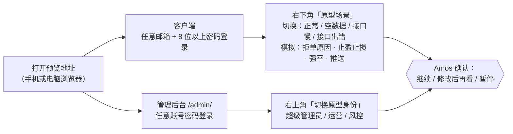

# FalconX Lite 高保真可交互原型说明
- 版本：v1（2026-10-14）
- 变更历史：v1（2026-10-14）首次创建
- 依据：agents main `4025297`（v0.9）；`00-架构方案.md` v1.1（已审核通过）；`需求文档/v1-需求说明书.md` v1.2
- 编写：研发（原型实现）；PM（走查和本说明的"请你确认"部分）
- 状态：**等待 Amos 确认原型**（总则第 4.5 步）。确认前不开始正式开发。

## 一图看懂：原型怎么看

这张图想说明：原型里所有数据都是模拟的，可以随便点；右下角的"原型场景"和后台右上角的"切换原型身份"用来看各种情况。

## 1. 地址
部署到 Vercel 预览后，在这里补上完整链接（规则：每个页面给可以直接打开的完整地址）。

| 应用 | 地址 |
|---|---|
| 客户端 | https://falconx-lite-git-claude-v1-prototype-jeffzhaifei-3827s-projects.vercel.app/ |
| 管理后台 | https://falconx-lite-git-claude-v1-prototype-jeffzhaifei-3827s-projects.vercel.app/admin/ |

预览地址固定跟随分支 `claude/v1-prototype`，每次推送后自动更新。2026-10-14 首次部署成功（Vercel 状态 Ready）。

- Vercel 项目：`falconx-lite`（amos111 的团队，免费版），2026-10-14 由 Amos 导入。
- `https://falconx-lite.vercel.app` 是这个项目的**生产地址**，对应 `main` 分支。`main` 上还没有前端代码，所以现在打开是 404，**属于预期**；原型阶段不使用这个地址。
- 原型用的是 PR #2（分支 `claude/v1-prototype`）的**预览地址**。预览地址默认开启 Vercel 登录保护，需要用团队成员账号登录后查看（Vercel 规范第二节）。

## 2. 页面清单
### 2.1 客户端（手机优先；电脑上宽度 ≥1024 时变成三栏交易界面）
| 页面 | 路径 | 看什么 |
|---|---|---|
| 登录 | [`/login`](https://falconx-lite-git-claude-v1-prototype-jeffzhaifei-3827s-projects.vercel.app/login) | 密码填 `wrongpass1` 看"密码错误"，邮箱含 `locked` 看"账号已锁定" |
| 注册 | [`/register`](https://falconx-lite-git-claude-v1-prototype-jeffzhaifei-3827s-projects.vercel.app/register) | 不填直接提交，所有错误一次显示；验证码为 123456 |
| 忘记密码 | [`/forgot-password`](https://falconx-lite-git-claude-v1-prototype-jeffzhaifei-3827s-projects.vercel.app/forgot-password) | 邮件验证码重置 |
| 首页 | [`/`](https://falconx-lite-git-claude-v1-prototype-jeffzhaifei-3827s-projects.vercel.app/) | 账户概览、热门品种、持仓、最近通知；"添加到主屏幕"提示 |
| 行情 | [`/markets`](https://falconx-lite-git-claude-v1-prototype-jeffzhaifei-3827s-projects.vercel.app/markets) | 6 个分类、50 个品种、报价每秒跳动；BTCUSD 显示"暂停开仓" |
| 交易 | [`/trade/XAUUSD`](https://falconx-lite-git-claude-v1-prototype-jeffzhaifei-3827s-projects.vercel.app/trade/XAUUSD) | K 线（6 个周期）；买卖按钮打开下单面板；持仓 / 挂单 / 历史 |
| 资产 | [`/assets`](https://falconx-lite-git-claude-v1-prototype-jeffzhaifei-3827s-projects.vercel.app/assets) | 选网络（ERC20 / TRC20 / BSC）后显示地址和二维码 |
| 资金流水 | [`/assets/ledger`](https://falconx-lite-git-claude-v1-prototype-jeffzhaifei-3827s-projects.vercel.app/assets/ledger) | 按类型和日期筛选 |
| 提现 | [`/assets/withdraw`](https://falconx-lite-git-claude-v1-prototype-jeffzhaifei-3827s-projects.vercel.app/assets/withdraw) | 填 50000 看限额错误；各种提现状态 |
| 白名单 | [`/assets/whitelist`](https://falconx-lite-git-claude-v1-prototype-jeffzhaifei-3827s-projects.vercel.app/assets/whitelist) | 新增、删除，新地址 24 小时后生效 |
| 我的 | [`/me`](https://falconx-lite-git-claude-v1-prototype-jeffzhaifei-3827s-projects.vercel.app/me) | 入口汇总 |
| 个人资料 | [`/me/profile`](https://falconx-lite-git-claude-v1-prototype-jeffzhaifei-3827s-projects.vercel.app/me/profile) | 查看和编辑 |
| 身份认证 | [`/me/kyc`](https://falconx-lite-git-claude-v1-prototype-jeffzhaifei-3827s-projects.vercel.app/me/kyc) | 用"原型场景"切换 KYC 状态（未提交、审核中、通过、驳回） |
| 通知中心 | [`/me/notifications`](https://falconx-lite-git-claude-v1-prototype-jeffzhaifei-3827s-projects.vercel.app/me/notifications) | 已读、全部已读 |
| 通知偏好 | [`/me/notify-prefs`](https://falconx-lite-git-claude-v1-prototype-jeffzhaifei-3827s-projects.vercel.app/me/notify-prefs) | 推送和邮件分别开关 |
| 修改密码 | [`/me/password`](https://falconx-lite-git-claude-v1-prototype-jeffzhaifei-3827s-projects.vercel.app/me/password) | |

### 2.2 管理后台（地址前缀 [`/admin`](https://falconx-lite-git-claude-v1-prototype-jeffzhaifei-3827s-projects.vercel.app/admin)）
| 菜单 | 页面 |
|---|---|
| 仪表盘 | [`/admin/dashboard`](https://falconx-lite-git-claude-v1-prototype-jeffzhaifei-3827s-projects.vercel.app/admin/dashboard) |
| 客户 | [`/admin/customers`](https://falconx-lite-git-claude-v1-prototype-jeffzhaifei-3827s-projects.vercel.app/admin/customers)、`/admin/customers/:id`（冻结、调余额） |
| KYC 审核 | [`/admin/kyc`](https://falconx-lite-git-claude-v1-prototype-jeffzhaifei-3827s-projects.vercel.app/admin/kyc)、`/admin/kyc/:id` |
| 资金 | [`/admin/funds/deposits`](https://falconx-lite-git-claude-v1-prototype-jeffzhaifei-3827s-projects.vercel.app/admin/funds/deposits)、[`/admin/funds/withdrawals`](https://falconx-lite-git-claude-v1-prototype-jeffzhaifei-3827s-projects.vercel.app/admin/funds/withdrawals)（出金审核）、[`/admin/funds/reconciliation`](https://falconx-lite-git-claude-v1-prototype-jeffzhaifei-3827s-projects.vercel.app/admin/funds/reconciliation)、[`/admin/funds/tasks`](https://falconx-lite-git-claude-v1-prototype-jeffzhaifei-3827s-projects.vercel.app/admin/funds/tasks)（任务表） |
| 交易监控 | [`/admin/trading/orders`](https://falconx-lite-git-claude-v1-prototype-jeffzhaifei-3827s-projects.vercel.app/admin/trading/orders)、[`/admin/trading/positions`](https://falconx-lite-git-claude-v1-prototype-jeffzhaifei-3827s-projects.vercel.app/admin/trading/positions)（手动强平）、[`/admin/trading/pending`](https://falconx-lite-git-claude-v1-prototype-jeffzhaifei-3827s-projects.vercel.app/admin/trading/pending)（强制撤单） |
| 风控 | [`/admin/risk`](https://falconx-lite-git-claude-v1-prototype-jeffzhaifei-3827s-projects.vercel.app/admin/risk) |
| 品种与行情 | [`/admin/market/symbols`](https://falconx-lite-git-claude-v1-prototype-jeffzhaifei-3827s-projects.vercel.app/admin/market/symbols)、[`/admin/market/sessions`](https://falconx-lite-git-claude-v1-prototype-jeffzhaifei-3827s-projects.vercel.app/admin/market/sessions)、[`/admin/market/fx`](https://falconx-lite-git-claude-v1-prototype-jeffzhaifei-3827s-projects.vercel.app/admin/market/fx) |
| 交易参数 | [`/admin/params`](https://falconx-lite-git-claude-v1-prototype-jeffzhaifei-3827s-projects.vercel.app/admin/params) |
| 通知 | [`/admin/notify/templates`](https://falconx-lite-git-claude-v1-prototype-jeffzhaifei-3827s-projects.vercel.app/admin/notify/templates)、[`/admin/notify/send`](https://falconx-lite-git-claude-v1-prototype-jeffzhaifei-3827s-projects.vercel.app/admin/notify/send)、[`/admin/notify/records`](https://falconx-lite-git-claude-v1-prototype-jeffzhaifei-3827s-projects.vercel.app/admin/notify/records) |
| 系统 | [`/admin/system/admins`](https://falconx-lite-git-claude-v1-prototype-jeffzhaifei-3827s-projects.vercel.app/admin/system/admins)、`roles`、`menus`、`permissions`、`audit`、`config` |
| 其他 | [`/admin/login`](https://falconx-lite-git-claude-v1-prototype-jeffzhaifei-3827s-projects.vercel.app/admin/login)、[`/admin/change-password`](https://falconx-lite-git-claude-v1-prototype-jeffzhaifei-3827s-projects.vercel.app/admin/change-password)（用账号 `newbie` 登录演示首次登录强制改密） |

## 3. 哪些是模拟的
- **全部数据和操作**都是浏览器里的模拟，刷新后会恢复，不连任何后端、数据库、区块链和 LP。
- 推送：只请求浏览器的通知权限，用"原型场景 → 模拟推送"在本机弹出通知，不经过服务器。
- 二维码是真实生成的，但地址是虚构的，**不要往里转账**。
- 行情和 K 线是随机生成的，价格水平按 2026 年取值。

## 4. 请你确认的事
1. **页面和流程**：客户端 16 个页面、后台 10 个菜单下的全部页面，有没有缺的、多余的、流程不对的。
2. **视觉**：和已审核的效果图一致；深色主题目前是基础版（客户端），后台还没有深色。
3. **下单计算**：按 A-01 的合约大小计算，例如黄金 0.10 手 = 10 盎司。
4. **高杠杆的强平距离（请特别看一下）**：按现有杠杆档位，最高杠杆下，开仓价离强平价只有（1 ÷ 杠杆 − 维持保证金率）。例如外汇 500 倍、维持保证金率 0.1%，价格只要反向波动约 0.1%（EURUSD 约 11 个点）就会强平。这是 A-03"沿用现有杠杆"的直接结果。你可以在原型的下单面板里把杠杆调到上限，看"预估强平价"。如果觉得太近，可以在正式开发前降低最大杠杆。
5. **后台权限**：右上角切换"运营""风控"身份，看菜单和按钮是否符合你的预期。

## 5. 已知不足
| 不足 | 处理 |
|---|---|
| 客户端深色主题是基础版，部分状态标签颜色没有适配 | 正式开发时完善 |
| 后台没有深色主题 | 正式开发时决定是否需要 |
| 后台打包后的脚本约 1.4MB，没有按页面拆分 | 正式开发时按页面拆分 |
| 电脑上宽度 1024–1180 之间，持仓表要横向滚动 | 正式开发时调整 |
| 手机上的后台宽表格要在卡片内横向滑动 | 后台以电脑为主，可接受 |
| 原型里任意账号都能登录后台（按超级管理员进入） | 原型演示用 |
| 客户端路由库 react-router 6 有 2 个中危安全公告，修复需要升级到第 7 版（大版本） | 原型阶段不处理；正式开发时升级到 react-router 7，CI 的依赖检查只拦高危 |
| 充值页 BSC "15 个区块确认"是占位值 | 实际确认数在技术方案里定，上链实测后写入（架构方案 K-06） |
| 注册的国籍下拉只有 22 个国家和地区 | 正式开发时补全 |

## 6. 测试情况（实际执行）
| 项目 | 客户端 | 后台 |
|---|---|---|
| 单元测试 | 42 个通过 | 40 个通过 |
| lint | 0 错误 | 0 错误 |
| 构建 | 通过 | 通过 |
| 自动截图检查 | 105 张（390、1280 两种宽度 × 正常、空数据、出错） | 153 张 |
| 自动检查项 | 横向溢出、NaN/undefined/Invalid Date、未翻译的键、按钮越界、控制台报错、外部请求 | 同左 |
| 人工逐张查看 | 约 20 张（**没有逐张全看**） | 约 30 张（**没有逐张全看**） |
| PM 走查 | 用真实操作走了注册、下单（大数量）、充值选 BSC、提现超限、后台出金拒绝、风控页（规则 C40），见"跨角色反馈" | |
| Vercel 路由 | 用 `vercel build` 生成真实路由表，并在本地按同一路由表模拟，13 个地址全部打开正确的应用（规则 C39） | |
| Vercel 预览 | 部署状态 Ready（规则 C23）。预览有登录保护，智能体打不开页面，**线上页面只能由 Amos 登录后确认** | |

## 跨角色反馈 / 分歧记录
| 编号 | 提出方 → 接收方 | 内容 | 状态 |
|---|---|---|---|
| PF-01 | PM → 研发 | "添加到主屏幕"提示浮在每个页面上，遮住了充值警示、二维码和提现表单 | 已采纳并修复：只在首页作为普通卡片显示，关闭后不再出现；PM 复查截图通过 |
| PF-02 | PM → 研发 | 下单数量输入框显示 0.2510，确认按钮显示 0.25 手，两处不一致 | 已采纳并修复：数量最多 2 位小数，输入框、预估和确认按钮用同一个值；新增 2 个测试 |
| PF-03 | PM → 研发 | 后台风控页侧栏白底在中途断开 | 已采纳并修复：侧栏固定铺满视口；PM 复查截图通过 |
| PF-04 | 运维 → 研发 | `vercel build` 生成的路由要求 `/admin/` 带结尾斜杠，`/admin` 会落到客户端 | 已采纳：`vercel.json` 增加 `/admin` → `/admin/` 跳转，已用路由表复核 |
| PF-05 | 研发 → PM | 最高杠杆下强平价离开仓价很近（见第 4 节第 4 条） | 转 Amos |
| PF-06 | 测试 → 研发 | 后台 `npm audit` 有 3 个高危（react-router 6.28 的开放重定向问题），CI 会拦下 | 已采纳并修复：后台升级 react-router-dom 到 6.30.6，高危清零；客户端剩 2 个中危，见第 5 节 |
