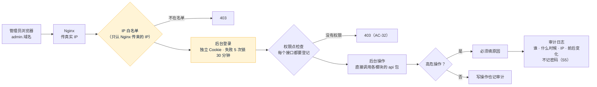

# FalconX Lite 后台接口方案（S16）
- 版本：v1.5（2026-10-16）
- 变更历史：v1（2026-10-15）首次创建，交 Amos 审核；v1.1（2026-10-15）Amos 回复"确认"（G1–G8 按建议，G6 保留逐仓）；S16a 实现时调整和补充 7 处，见第 7 节；v1.2（2026-10-16）S16b 实现时和原型字段不同的 5 处，见第 8 节；v1.3（2026-10-16）S16c 和原型不同的 7 处，见第 9 节；v1.4（2026-10-16）S18 后台页面接接口后补第 10 节（实际接口形状和已知缺口）；v1.5（2026-10-16）v2 补充第 11 节（需求说明书 v2.1 第 11.1 节 E1、E2、E3、E6、E7：新接口、新权限点、深色主题、自动刷新）
- 状态：**Amos 2026-10-15 审核通过**（"确认"）
- 依据：`需求文档/v1-需求说明书.md` v1.5 第 4.8 节、第 5.2 节、AC-04、AC-05、AC-21、AC-32 至 AC-35；`00-架构方案.md` v1.1 第 3.4 节（后台：修复 S4、S5、S6，IP 白名单只认真实 IP）；功能取舍对照表 C-10 至 C-13；后台原型（`web/admin/`：10 个一级菜单、46 个权限点、约 65 个接口）
- 编写：研发；测试、运维确认各自部分

## 一图看懂

这张图想说明：后台每个请求都要过三道关：IP 白名单、登录、权限点。所有写操作都记审计，高危操作还必须填原因。业务逻辑不在后台模块里重写，后台只调用各模块已有的接口（`AccountApi`、`WithdrawAdminApi`、`RiskApi` 等）。黄色是需要 Amos 定的部分。

## 1. 需要 Amos 审核的决定
| 编号 | 决定 | 我的建议 | 为什么 |
|---|---|---|---|
| G1 | 第一个超级管理员怎么建 | Amos 在服务器后台填 `FX_ADMIN_INIT_USERNAME` 和 `FX_ADMIN_INIT_PASSWORD`（密码只由 Amos 填）。系统第一次启动、还没有任何管理员时，用它建超级管理员，并标为"首次登录必须改密码"。建好以后这两个变量不再起作用，Amos 可以删掉 | 密码不经过 AI、不进仓库（底线）；不在日志里打印随机密码 |
| G2 | 管理员登录方式 | 按原型：**用户名 + 密码**。后台用独立的 Cookie（和客户端的登录互不影响），8 小时有效，30 分钟不操作自动退出；失败 5 次锁 30 分钟（原型的系统配置值）；密码至少 10 位，含字母和数字。**第一版不做两步验证（TOTP）**，靠 IP 白名单 + 强密码 | 原型没有两步验证的页面。要做的话需要先补原型（绑定、输入验证码两个页面），建议放到第二版；如果 Amos 要求第一版就做，告诉我，我先补原型 |
| G3 | IP 白名单 | 在系统配置里维护（原型的 `admin.ipWhitelist`，支持单个 IP 和网段）。**只认 Nginx 传来的真实客户端 IP**，伪造的请求头不起作用（修复现有问题）。**白名单为空时不限制**，系统配置页和健康日志会提醒；生产环境上线前必须填 | 测试环境和开发时方便；生产忘了填时有提醒。改白名单是高危操作；为防止把自己锁在外面，保存时检查当前操作人的 IP 必须在新名单里 |
| G4 | 高危操作的确认方式 | 按原型：弹窗勾选"我已确认" + **必须填原因**，原因写进审计。**不要求重新输入密码** | 和原型一致；高危权限只分给少数人 |
| G5 | 调余额 | 按原型的系统配置：**单笔 ≤ 5,000、每个管理员每天 ≤ 20,000 USDT**，后台可改；可加可减，扣减不能超过客户的可提金额（浮动盈利不算，和提现同一口径），不能把余额扣成负数；记账本 `ADMIN_ADJUST`，必须填原因 | 金额限制防止误操作和内部风险 |
| G6 | "强平线"怎么处理 | **原型和现在的实现不一致，请 Amos 裁决。** 原型的交易参数页有"强平线（账户保证金水平 %）"；现在的实现是**逐仓**：每个持仓按自己的强平价平仓（品种的维持保证金率决定，S7 起这样做，余额不会被扣成负数）。我建议**保留逐仓**，交易参数页只放追保线和追保通知间隔，强平线一栏改成说明文字"按品种维持保证金率逐仓强平，在品种配置里改"，需要小改原型 | 逐仓已经实现并测试过（AC-14 不穿仓）；再加账户级强平线，两套规则会互相打架 |
| G7 | 哪些参数可以在后台改 | 原型系统配置的 17 项都可以改（提现限额、冷静期、大额延迟、白名单生效时间和数量、登录锁定、IP 白名单、调余额限额、追保通知间隔）。**充值确认数只能调高、不能低于现在的值**（ERC20 12、TRC20 19、BSC 15），调低会增加被链上回滚的风险。手续费在系统配置里加 3 项（ERC20、TRC20、BSC） | 确认数调低是资金风险；调高没有风险 |
| G8 | 拆成三步 | **S16a**：后台登录、IP 白名单、权限点检查、审计、管理员 / 角色 / 菜单 / 权限点、系统配置；**S16b**：客户（列表、详情、冻结、调余额）、KYC 审核、资金（入金、出金审核、对账、任务）、通知（模板、手动发送、记录）；**S16c**：交易监控（订单、持仓、挂单、手动强平、强制撤单）、风控看板和操作、品种和行情（品种、时段、假期、汇率）、交易参数、仪表盘 | 接口约 65 个，一次做完 PR 太大，审起来困难；S16a 是后面两步的基础 |

## 2. 规则
| 规则 | 做法 |
|---|---|
| 接口路径 | 全部在 `/api/admin/` 下，字段和原型 `web/admin/src/api/types.ts` 一致；客户的登录 Cookie 访问后台接口无效，反过来也一样 |
| 权限点 | 以原型的 `config/permissions.ts`（46 个，含高危标记）为准，后端用同一份清单。**每个后台接口都必须声明需要的权限点**；测试扫描所有后台接口，没有声明的、声明了不存在的权限点的，测试失败。前后端两份清单不一致时 CI 失败 |
| 超级管理员（修复 S4，AC-33） | 超级管理员角色拥有全部权限，不能删除、不能改权限。**只有超级管理员能把超级管理员角色分配给别人**；任何人都不能通过编辑接口给自己加角色；最后一个超级管理员不能被停用或去掉角色 |
| 角色 | 可以新建、改名、改权限点、删除（有成员的不能删）；内置角色不能删 |
| 菜单 | 菜单结构固定在代码里（每个页面都有入口，AC-35），后台只能改名称、顺序、是否显示；隐藏菜单不影响权限（权限只看权限点） |
| 审计（修复 S5，AC-34） | 所有写操作都记：管理员、时间、真实 IP、操作、对象、是否高危、结果（成功 / 失败）、原因、修改前后的值。**字段名含 password、secret、token、key 的值一律记成 `***`**；查询只读，不能改、不能删 |
| 管理员 | 新建时由系统生成临时密码，**只在创建结果里显示一次**，首次登录必须改；重置密码同理；停用后立即退出登录 |
| 和各模块的关系 | 后台模块只调用各模块的 `api` 包（ArchUnit 强制），需要的查询在各模块 `api` 里补；例如出金审核调 `WithdrawAdminApi`，冻结客户调 `AccountApi.freeze`（AC-04） |
| 列表 | 统一分页（每页最多 100 条），按时间倒序；修复现有"超过 100 人查不到"（C-10） |

## 3. 表（S16a）
| 表 | 作用 |
|---|---|
| `admin_user` | 管理员：用户名、显示名、邮箱、密码哈希（BCrypt）、状态、首次登录必须改密码、失败次数、锁定到、最后登录时间 |
| `admin_session` | 后台登录会话（和客户的会话分开） |
| `admin_role`、`admin_role_permission`、`admin_user_role` | 角色、角色的权限点、管理员的角色 |
| `admin_menu` | 菜单的名称、顺序、是否显示（结构在代码里） |
| `admin_audit_log` | 审计日志 |
| `admin_config` | 系统配置（键、值、单位、分组、修改人、修改时间）；各模块读配置时优先用这里的值，没有时用 `application.yml` 的默认值 |

## 4. 测试（测试工程师确认）
| 验收 | 怎么测 |
|---|---|
| AC-32 权限 | 新建只有"出金审核查看"的角色和管理员：菜单只返回对应的一项；逐个调用其他所有后台接口都返回 403（测试自动列出全部后台接口，不靠手写清单） |
| AC-33 超管 | 非超级管理员通过新建管理员、编辑管理员、编辑角色三种方式加超级管理员，全部被拒；给自己加角色被拒；最后一个超级管理员不能停用 |
| AC-34 审计 | 每个高危接口调用后都有审计记录且带原因；改密码、建管理员、重置密码的审计里搜不到明文密码 |
| AC-35 菜单 | 每个页面都在菜单里（和原型的路由表对比） |
| IP 白名单 | 不在白名单的 IP 返回 403；伪造 `X-Forwarded-For` 不起作用；改白名单时不能把自己排除在外 |
| 登录 | 失败 5 次锁 30 分钟；停用后立即失效；首次登录必须改密码 |
| AC-04、AC-05、AC-21（S16b） | 后台冻结客户 5 秒内登录失效；后台审核 KYC；后台紧急取消有审计 |

## 5. 运维（运维工程师确认）
| 事项 | 做法 |
|---|---|
| 新增环境变量 | `FX_ADMIN_INIT_USERNAME`、`FX_ADMIN_INIT_PASSWORD`（G1，密码只由 Amos 填，建好第一个超管后可以删） |
| Nginx | 后台用单独的域名（`admin.域名`），只把 `/api/admin/` 和后台静态文件转给应用；`X-Forwarded-For` 由 Nginx 覆盖写入，不追加客户端带来的值（S20 部署时配置） |
| 上线检查 | 生产环境上线前 IP 白名单必须填（S20 检查清单） |

## 6. 不做
- 两步验证（G2，建议第二版）。
- 群发通知（原型已注明第一版推迟）。
- 审计日志导出（原型没有）。

## 7. 实现时的调整（S16a，v1.1）
| 位置 | 原方案 | 实现 | 为什么 |
|---|---|---|---|
| 系统配置表 | `admin_config`（后台模块） | `common_config`（共用，`common.config.SystemConfig`） | 钱包、交易模块都要读配置；放在后台模块里，业务模块就要反过来依赖后台模块。和任务表 `common_task` 同样做法；只有后台模块写 |
| 登录锁定配置 | 未写明对谁 | 系统配置的 `login.lockThreshold`、`login.lockMinutes` 只管**后台管理员**登录（5 次、30 分钟）；客户登录沿用现有系统（5 次、15 分钟，`application.yml`） | 需求写客户登录"沿用现状"；原型的这两项在"安全"分组，按 G2 用于后台 |
| 临时密码 | 只在创建结果里显示一次 | 同方案。原型写的是"临时密码发邮件给本人" | 按审核通过的方案；后台页面接接口时（S18）在弹窗里显示一次 |
| 菜单 | 可改名称、顺序、是否显示 | 只改顺序和是否显示 | 菜单名称是翻译键（中英文在前端翻译文件里），改名称改的是翻译 |
| 补充：不能越权 | 只写了超级管理员角色 | 非超级管理员只能分配、编辑"权限点都在自己权限范围内"的角色 | 否则有"编辑角色"权限的人可以给自己的角色加权限，或者把权限更大的角色分给别人，绕过 S4 的修复 |
| 补充：改密码 | — | 改密码后其他设备上的登录全部退出，当前设备换新令牌 | 密码可能已经泄露时，改密码要让别人的登录失效 |
| 登录结果 | 原型 AdminSession 有 token | 不返回 token，令牌只在 HttpOnly Cookie 里 | 页面脚本拿不到令牌，被注入脚本时也偷不走 |

## 8. S16b 和原型字段不同的地方（v1.2，后台页面接接口时（S18）按这里改）
| 位置 | 原型 | 实现 | 为什么 |
|---|---|---|---|
| 出金状态 | 没有"已审核待上链" | 数据库的"已审核待上链"（`APPROVED`）显示为 `broadcasting`；筛选 `broadcasting` 时两种都查出来 | 审核通过后几秒到几分钟内就会上链；热钱包余额不够时会停在这里（提现方案 W4），后台能在"上链中"里看到 |
| 对账问题 | 4 种类型（缺入账、金额不符、冲正挂账、未知交易），字段 chainAmount / ledgerAmount | 按后端实际的 7 种问题类型（数据库设计第 16 节），字段 `type`、`ref`、`expected`、`actual`、`diff`、`detail` | 后端对账的口径比原型细（提现冻结、提现账本也对），原型的 4 种对应不上 |
| 任务类型 | withdraw_broadcast、withdraw_confirm、email、push | 只有 `email`、`push`（提现的广播和确认由提现推进任务直接做，不走任务表） | S13b 的实现方式 |
| KYC 照片 | 原型只有占位图 | 新增 `GET /api/admin/kyc/{id}/images/{front|back|selfie}`，不允许浏览器缓存 | AC-05"后台能查看" |
| 选客户 | 原型 `searchCustomers` 没写权限 | `GET /api/admin/customers/search` 需要 `notify:send` | 只在"手动发送"页用；每个接口都必须有权限点 |

## 9. S16c 和原型不同的地方（v1.3，后台页面接接口时（S18）按这里改）
| 位置 | 原型 | 实现 | 为什么 |
|---|---|---|---|
| 交易时段 | 时段模板（品种挂一个 `sessionId`） | 每个品种自己的一周时段（`GET /api/admin/sessions` 按品种列出），第一版只读 | S6 起时段就是按品种配置的；改时段影响开仓和隔夜费，第一版不在后台改 |
| 休市日 | 挂在时段模板上，有"提前收市" | 挂在品种上（`*` 表示全部品种），只有全天休市；可以增删 | 同上；提前收市第一版不做 |
| 品种字段 | `lpSymbol`、`spreadPoints`、`sessionId`、`openFeeRate` | 没有前三项（LP 代码在 S20 接 LP 时再定）；有 `markup`（统一加点，价格单位）、`maxLots`、`lotStep`、`openPaused`、`sortOrder` | 按后端品种表 |
| 订单状态 | 有 `rejected` 和拒绝原因 | 只有 `filled`、`pending`、`cancelled`；被拒绝的下单请求不保存 | 拒绝时直接返回错误码给客户，不落库 |
| 交易参数 | 有"强平线" | `liquidationLevel` 总是空；只能改追保线和追保通知间隔 | G6：逐仓，按品种维持保证金率强平 |
| 单客户持仓上限、追保线 | — | 存在系统配置里，但**只能在风控页、交易参数页改**，系统配置页不显示 | 否则有 `config:edit` 的人可以绕过 `risk:user_limit`、`params:edit` |
| 仪表盘"平台盈亏" | 未定义口径 | 今天已实现的：手续费 + 隔夜费收入 − 客户已实现盈亏，不含浮动盈亏 | 对赌模式下客户亏就是平台赚；浮动部分在风控看板的净敞口里看 |

另外：改品种的维持保证金率、手续费率只影响以后开的仓，已有持仓的强平价不变；有持仓或挂单的品种不能停用（停用后这些持仓没法报价和平仓）。

## 10. S18 接接口时补充的地方（v1.4）
1. `GET /api/admin/withdrawals/{id}` 返回嵌套结构 `{withdrawal: {...}, kycStatus, ...}`，前端 `web/admin/src/api/real.ts` 展开成原型的平铺结构。
2. `PUT /api/admin/symbols/{code}` 的手续费率字段统一叫 `openFeeRate`（校验出错时的字段名原来是 `feeRate`，S18 已改）。
3. 已知缺口，v1 不改，记在这里：
   - 隔夜费率没有"未配置"状态：传空表示不改，只能传 0；前端把"多空都是 0"显示为"未配置"。
   - 对账问题的 `detail` 是后端写的中文，英文界面也显示中文。
   - 风控看板 `settings.updatedAt` 为空（前端显示取数时间）；风控事件的 `reason` 为空，操作原因在审计日志里查。
   - 通知记录多一个状态 `pending`（排队中），前端已加。
   - 休市日说明最多 128 字（其他原因字段 200 字）。

## 11. v2 补充（v1.5，需求说明书 v2.1 第 11.1 节 E1、E2、E3、E6、E7）
### 11.1 新接口和新权限点
| 接口 | 作用 | 权限点 |
|---|---|---|
| `PUT /api/admin/customers/{id}/profile` | E1 编辑客户资料：`firstName`、`middleName`、`lastName`、`birthDate`（YYYY-MM-DD）、`nationality`（两位大写）、`reason`；返回客户详情 | `customer:edit`（新，高危） |
| `POST /api/admin/symbols` | E3 新增品种：`code`、`nameZh`、`nameEn`、`category`、`digits`、`contractSize`、`quoteCurrency`、`maxLeverage`、`maintenanceMarginRate`、`openFeeRate`、`minLots`、`maxLots`、`lotStep`、`markup`、`hot`，交易时段二选一 `copySessionsFrom`（已有品种代码）或 `sessionTemplate`（`fx` / `crypto` / `us_stock`），`reason`；返回新品种 | `symbol:create`（新，高危） |
| `PUT /api/admin/symbols/{code}` | 原有接口，多一个字段 `openPaused`（品种自己的"暂停开仓"：新增的品种默认打开，运营确认报价正常后在这里关掉） | `symbol:edit`（原有，高危） |
| `GET /api/admin/symbols` | 原有接口，每个品种多 `lastQuoteAt`（最后一条正常报价的时间，从没收到过为空）、`tradingOpen`（现在是否在交易时段内） | `symbol:view`（原有） |
| `GET /api/admin/customers/{id}` | 原有接口，多 `lastLoginIp`、`lastLoginIpAt`（最近一个登录会话 `account_session` 的 IP 和时间） | `customer:view`（原有） |

权限点从 46 个变成 48 个，前端 `web/admin/src/config/permissions.ts` 和后端 `admin/security/Permission` 同步（`AdminSystemTest` 比对）；超级管理员自动拥有，其他角色要在"角色"里勾选。**没有新的数据库迁移**（新增品种写已有的 `market_symbol`、`market_session`）。新错误码 `SYMBOL_EXISTS`（代码已存在，含停用的）；新字段错误码 `notEditable`、`nameTooLong`、`nameChars`、`dateFormat`、`dateInvalid`、`ageUnder18`、`nationalityInvalid`、`noFxRate`，中英文翻译在后台前端。

### 11.2 做法和取舍
| 事项 | 做法 | 为什么 |
|---|---|---|
| E1 校验 | 和客户端注册同一套规则（`web/client/src/lib/validators.ts` 的 `validateProfile`）：名、姓必填，每段最多 50 字、只能是文字、空格、点、撇号、连字符；出生日期 1900 年以后、不晚于今天、年满 18 周岁；国籍两位大写字母。字段错误一次全部返回 | 需求要求"和客户端注册一致"；后端注册接口原来只查长度 64，比客户端松，后台编辑按更严的客户端口径 |
| E1 邮箱、状态 | 请求里带了 `email` 或 `status` 直接拒绝（字段错误 `notEditable`），不是静默忽略 | 状态只能用冻结 / 解冻改（AC2-14），带了说明调用方理解错了 |
| E1 KYC 已通过 | **允许改**（Amos 的默认），弹窗提示"该客户 KYC 已通过，修改会和证件不一致"；审计的修改后里加 `kycApproved: true`，改了姓名或出生日期时再加 `kycMismatch` | 客户自己的资料页在 KYC 通过后锁定（不变）；后台是更正错误用的，留痕即可 |
| E3 默认暂停开仓 | 新品种写 `market_symbol.open_paused = 1`；在品种页"编辑"里关闭（`symbol:edit`，高危审计记前后）。风控页的品种暂停（`risk_symbol`）是另一道开关，不受影响 | 需求要求"运营确认报价正常后再打开"；用品种自己的开关，不和风控的暂停混在一起 |
| E3 报价货币 | 新增字段 `quoteCurrency`（需求清单里没写，但保证金和盈亏要按它折算成 USDT）；必须能折算：USD / USDT、已有 `XXXUSD` 或 `USDXXX` 品种，或配置了固定汇率，否则字段错误 `noFxRate` | 否则这个品种永远不能开仓 |
| E3 不重启 | 写表后在事务提交时调用 `SymbolCatalog.reload()`：行情入口 `QuoteProcessor`、撮合、下单、风控敞口（`RiskSwitchService` 按 `MarketApi.symbols()`）、K 线、客户端品种列表都从这份内存数据取品种 | `AdminV2Test` 用测试替身推一条报价后，客户能下单，风控看板和 K 线都有这个品种 |
| E3 报价源 | 模拟报价源只给 `simulated-prices.csv` 里有起始价的品种报价，新品种不推报价，后台显示"暂无报价"，客户端价格显示"—"；接 LP 后（M-01）由 LP 的报价映射决定 | 没有起始价时编不出合理的价格 |
| E3 合约单位、基础货币 | 按类别推出合约单位（外汇 baseCcy、贵金属 ounce、能源 barrel、美股 share、其他 unit）；基础货币取代码去掉报价货币后的前半段（EURUSD → EUR），否则用代码 | 只用来显示，不值得让运营多填两项 |
| E3 隔夜费率 | 新品种多空都是 0（未配置，品种页标红），之后在"编辑"里填 | 和第一版品种一样，值要 Amos / LP 提供 |
| E6 标红 | 开市时超过 1 分钟没报价标红；从没收到过报价显示"暂无报价"（开市时也标红）；休市时显示最后时间加"休市"，不标红 | 休市没报价是正常的 |
| E2 深色主题 | 右上角"跟随系统 / 浅色 / 深色"，默认跟随系统，选择存在浏览器 `localStorage` 的 `fx-admin-theme`（读写出错按跟随系统）；Ant Design 用深色算法加自己的 token（`web/admin/src/theme.ts`），自定义样式用两套 CSS 变量（`web/admin/src/styles/global.css`），`web/admin/index.html` 里先设好 `data-theme` 防止白屏一闪。深色下文字、链接、涨跌、警示色在四种底色上的对比度都 ≥ 4.5:1（最低是空头红 `#f87171` 在 `#1a2538` 上约 5.6:1）；主色按钮仍是 `#0e7490` 底白字（5.4:1） | AC2-15；后台没有图表库，仪表盘和风控看板的进度条、标签都跟着变 |
| E7 自动刷新 | `web/admin/src/hooks/useAutoRefresh.ts`：风控看板、持仓监控、品种页每 5 秒，仪表盘每 30 秒；右上角可以暂停 / 继续；页面不可见（切走标签页）时停止，回来立即刷新一次。刷新是静默的（`useApi` 的 `refresh`，不显示加载中，表格不闪），失败和手动刷新一样显示错误 | 需求只点名风控看板；持仓和品种页（最后报价时间）也是监控用的，仪表盘是汇总数字，30 秒够了。真正的推送以后再做 |
