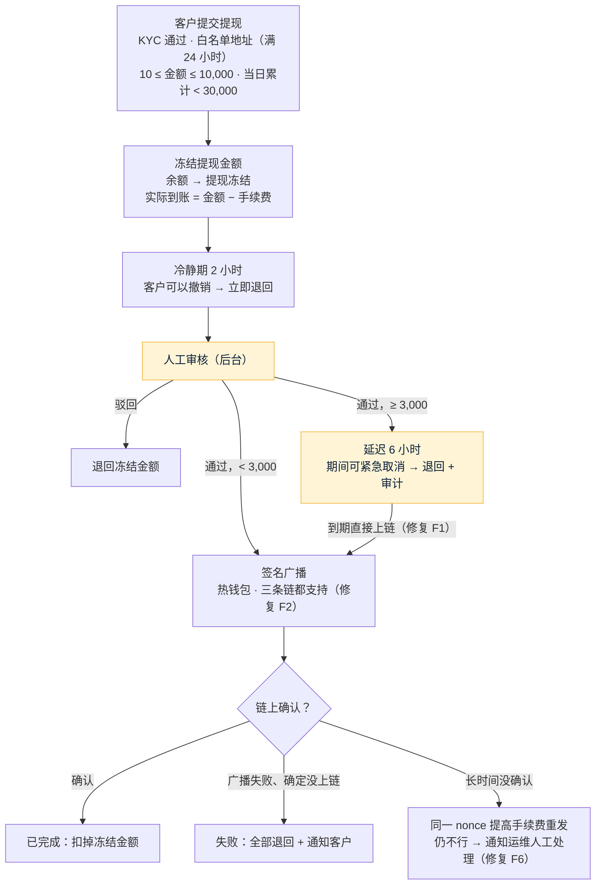

# FalconX Lite 提现方案（S13）
- 版本：v1.2（2026-10-15）
- 变更历史：v1（2026-10-15）首次创建，交 Amos 审核；v1.1（2026-10-15）Amos 回复"方案确认"（W1–W5 全部按建议）；实现时按原型修正手续费口径：冻结提现金额，手续费从中扣，实际到账 = 金额 − 手续费（v1 写成了冻结 金额 + 手续费，和原型不一致）；v1.2（2026-10-15）S13b 实现时补充：同一笔提现已发出就不再用新 nonce 发（防重复付钱）、节点明确拒绝连续 3 次才退款、TRON 签名前核对节点构造的交易、2 分钟没上链原样重发
- 状态：**Amos 2026-10-15 审核通过**（"方案确认"）
- 依据：`00-架构方案.md` v1.1 第 3.3 节 ④ 钱包、风险 K-05（已审核）；`需求文档/v1-需求说明书.md` v1.4 第 4.4 节 4–6 条、AC-17 至 AC-21；原型（客户端 W4 提现、后台出金审核）；现有系统功能地图 F1、F2、F6
- 编写：研发；测试、运维确认各自部分

## 一图看懂

这张图想说明：钱一提交就冻结，任何一条失败路径都会**完整退回**；只有确定交易没有上链才退款，避免"退了款又上了链"重复付钱。

## 1. 需要 Amos 审核的决定
| 编号 | 决定 | 我的建议 | 为什么 |
|---|---|---|---|
| W1 | 热钱包私钥放哪里 | 按已审核的架构方案（K-05）：**Amos 把私钥填进服务器环境变量**（`FX_WALLET_ETH_HOT_KEY` 给 ERC20 和 BSC 共用、`FX_WALLET_TRON_HOT_KEY`），同时填对应的公开地址（`FX_WALLET_ETH_HOT_ADDRESS`、`FX_WALLET_TRON_HOT_ADDRESS`）。启动时用私钥算出地址和填的地址对一遍，对不上就不启动提现、健康检查报错。私钥只在签名时用，不写日志、不出现在任何接口和错误信息里 | 密钥不经过 AI、不进仓库（底线）；热钱包只放少量资金，Amos 定期从冷钱包补充。第二版接 KMS |
| W2 | 签名怎么做 | 以太坊体系（ERC20、BSC）用开源库 **web3j 的签名部分**在本地签名；TRON 由节点构造交易、本地签名后广播 | 资金相关的签名用成熟的开源库，比自己写可靠；TRON 没有轻量的官方 Java 库，签名本身很简单（对交易 ID 做 secp256k1 签名），用公开测试数据核对 |
| W3 | 提现手续费 | 按原型：**ERC20 5、TRC20 1、BSC 0.5 USDT**，可在后台改（S16）；**从提现金额里扣**，实际到账 = 金额 − 手续费（和原型一致） | 现有系统没有收提现手续费；Amos 确认 |
| W4 | 热钱包余额不够时 | 不失败、不退款，提现停在"已审核待上链"，通知运维和风控补钱，补上后自动继续 | 余额不足是我们的问题，不该让客户的提现失败 |
| W5 | 拆成两步 | **S13a**：白名单、提交和限额、冻结、冷静期撤销、审核和驳回、大额延迟和紧急取消、退款，签名用替身；**S13b**：三条链真实签名广播、nonce 管理、确认和超时处理、热钱包检查 | 和 S12 一样，每一步都能单独停下确认 |

## 2. 规则
| 规则 | 做法 |
|---|---|
| 提交条件（AC-17） | KYC 已通过；只能提到白名单地址，**新地址 24 小时后生效**，最多 10 个；最小 10、单笔 ≤ 10,000、当日（UTC）累计 < 30,000 USDT（N-08）；金额不超过**可提金额**（余额 − 挂单冻结 − 持仓保证金 + 浮动亏损，浮动盈利不算，DF-02）。6 种拒绝原因各有错误码 |
| 冻结 | 提交时把提现金额从余额转到"提现冻结"（`WITHDRAW_FREEZE`），链上转出 金额 − 手续费，手续费归平台；退回时转回（`WITHDRAW_UNFREEZE`）；完成时从提现冻结扣掉（`WITHDRAW_PAYOUT`）。都走 `LedgerApi`，同一事务、幂等 |
| 冷静期（AC-18） | 2 小时，期间客户可以撤销，冻结立即退回；过了冷静期不能撤销，进入人工审核 |
| 审核 | 后台出金审核（页面和权限在 S16，S13 先做服务）：通过或驳回（驳回必须填原因，冻结退回）。每次操作记提现事件（谁、什么时候、做了什么） |
| 大额延迟（修复 F1，AC-21） | ≥ 3,000 USDT 审核通过后延迟 6 小时；期间后台可以紧急取消（资金退回，记事件和审计）。**延迟到期后直接生成上链任务**，不再依赖别的事件 |
| 上链（修复 F2，AC-19） | 三条链都支持。审核通过（大额是延迟到期）后写入任务表，5 分钟内广播 |
| nonce（修复 F6） | 以太坊体系每条链一个 nonce，启动时从链上同步，按顺序分配；广播被拒"nonce 太低"时重新同步。TRON 没有 nonce，交易 60 秒过期，过期没上链可以安全重建 |
| 防重复付钱（S13b） | 同一笔提现已经有"已发出"的广播记录，就不再用新 nonce 发；连不上节点时当作"可能已发出"，交给确认任务 |
| 节点拒绝（S13b） | 节点明确拒绝：记失败、以太坊体系重新同步 nonce，下次再试；同一笔连续 3 次被拒才失败退款（交易从没进过内存池，退款安全） |
| TRON 交易核对（S13b） | 节点构造的交易在签名前核对：交易 ID 是 raw_data_hex 的 SHA-256，并且里面是热钱包调 USDT 合约、转给这个地址这个金额；不一致就不签 |
| 超时（修复 F6） | 以太坊体系 30 分钟没确认：同一 nonce 提高手续费重发（最多 3 次）；仍不行通知运维人工处理，**不自动退款**（防止重复付钱）。只有能确定交易不会上链时（广播被直接拒绝、TRON 交易已过期且查不到）才失败退款（AC-20） |
| 完成 | 链上确认（ETH 12、BSC 15、TRON 19，同充值）后标为已完成，扣掉提现冻结 |
| 通知 | 每个状态变化推给客户（`/api/ws/trading` 的 `withdraw` 事件，和客户端约定一致）；站内信和邮件在 S15 |

## 3. 表（S13a）
| 表 | 作用 |
|---|---|
| `wallet_whitelist` | 白名单地址：用户、网络、地址、备注、生效时间；每人最多 10 个 |
| `wallet_withdrawal` | 提现单：金额、手续费、网络、地址、状态（冷静期 / 待审核 / 已审核 / 延迟中 / 上链中 / 已完成 / 失败已退回 / 已驳回 / 已撤销，和客户端一致）、冷静期结束、延迟结束、交易哈希、驳回原因 |
| `wallet_withdraw_event` | 提现事件：每次状态变化，谁操作的 |
| `wallet_withdraw_tx`（S13b） | 每次广播：链、nonce、交易哈希、手续费、状态（重发会有多条） |

## 4. 测试
| 层次 | 怎么测 |
|---|---|
| 规则和状态 | 真实 MySQL：6 种拒绝原因（AC-17）、冷静期撤销（AC-18）、驳回退回、大额延迟到期直接上链（F1）、紧急取消（AC-21）、广播失败退款（AC-20）、并发提交不会超过可提金额和当日累计 |
| 签名 | 用公开的测试私钥和测试数据核对签名结果（不是真实密钥） |
| 测试网（S20） | 三条链各一笔 < 3,000 和一笔 ≥ 3,000（AC-19）；需要 Amos 提供测试网热钱包私钥（填进测试服务器）和测试代币 |

## 5. 需要 Amos 提供（不阻塞 S13a）
- 测试网和生产的热钱包（以太坊体系一个、TRON 一个）：私钥由 Amos 填进服务器，地址告诉我核对变量名即可
- 热钱包里的手续费币（ETH、BNB、TRX）和少量 USDT

## 跨角色反馈 / 分歧记录
本阶段无。
