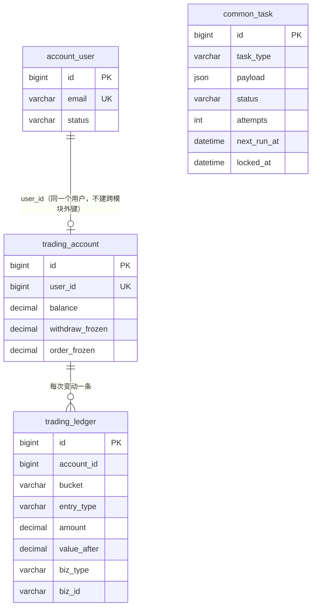

# FalconX Lite 数据库设计
- 版本：v1（2026-10-15）
- 变更历史：v1（2026-10-15）S3 首次创建：迁移工具、第一批 4 张表、账本和任务表的规则
- 依据：`00-架构方案.md` v1.1 第 3.3、3.4 节（已审核）；agents main `2697d91`（v0.10）
- 编写：研发
- 维护：每个步骤新增或修改表时，在同一个 PR 里追加本文件的版本记录。表结构以迁移脚本为准，本文件说明"为什么"和"规则"。

## 一图看懂：第一批表和谁能读写

这张图想说明：账户里的钱只在 `trading_account` 里，每一次变动都在 `trading_ledger` 里留一条记录；`common_task` 是独立的异步任务表。

## 1. 通用规则
| 规则 | 做法 |
|---|---|
| 表归属 | 表名以模块名开头（`account_`、`market_`、`trading_`、`risk_`、`wallet_`、`notification_`、`admin_`、`common_`），只由该模块的代码读写；其他模块通过对方的 `api` 包调用 |
| 跨模块关联 | 只存对方的 ID，**不建跨模块外键**，模块可以独立演进 |
| 金额 | `DECIMAL(24,8)`；代码里 `BigDecimal`，超过 8 位小数直接拒绝，不悄悄四舍五入（`common/money/Amounts.java`） |
| 时间 | `DATETIME(3)`，一律 UTC；每个数据库连接建立时设置 `time_zone = '+00:00'` |
| 表结构变更 | 只通过 Flyway 迁移脚本（`backend/src/main/resources/db/migration/V<n>__<说明>.sql`），已合并的脚本不再修改，改动写新脚本 |
| SQL | MyBatis XML，放在 `backend/src/main/resources/mapper/<模块>/` |

## 2. 表
### 2.1 `account_user`（account 模块）
S3 只建最少的字段，S4 补登录、验证码等。

| 字段 | 说明 |
|---|---|
| `email` | 唯一 |
| `password_hash` | S4 写入，只存哈希 |
| `status` | `ACTIVE` / `FROZEN` |

### 2.2 `trading_account`（trading 模块）
每个用户一个 USDT 账户（只做逐仓、单币种）。

| 字段 | 说明 |
|---|---|
| `balance` | 余额，含已占用的保证金。已占用保证金按持仓计算，不单独存 |
| `withdraw_frozen` | 提现冻结 |
| `order_frozen` | 挂单冻结 |

数据库约束保证三项都不小于 0。

### 2.3 `trading_ledger`（trading 模块）
| 字段 | 说明 |
|---|---|
| `bucket` | 变动的是哪一项：`BALANCE` / `WITHDRAW_FROZEN` / `ORDER_FROZEN` |
| `entry_type` | 业务类型，见 `trading.api.LedgerEntryType` |
| `amount` | 增加为正、减少为负 |
| `value_after` | 变动后这一项的值，方便对账和排查 |
| `biz_type` + `biz_id` | 来源业务和单号 |

唯一键 `(biz_type, biz_id, entry_type, bucket)` 是幂等键。

### 2.4 `common_task`（common）
| 字段 | 说明 |
|---|---|
| `status` | `PENDING` → `RUNNING` → `SUCCEEDED`；失败退避后回到 `PENDING`，次数用完为 `FAILED` |
| `attempts` / `max_attempts` | 已尝试次数 / 最多次数（默认 8） |
| `next_run_at` | 到这个时间才能被领取 |
| `locked_at` / `locked_by` | 开始处理的时间和处理者 |

## 3. 账本规则（`trading.api.LedgerApi`，所有模块改余额都只能走这里）
1. **同一个事务**：改金额和写账本在同一个事务里；调用方已有事务时加入调用方的事务，一起提交或一起回滚（项目地图约定 1）。
2. **先锁账户行**（`SELECT … FOR UPDATE`），再查幂等、改金额、写账本。同一账户的变动排队执行，幂等检查不会被并发绕过。
3. **幂等**：同一个幂等键第二次调用不再变动，返回第一次的结果（`duplicate = true`）。
4. **不能为负**：任何一项变成负数就拒绝（`INSUFFICIENT_FUNDS`），什么都不写。冲正时余额不足的挂账处理（修复 F4）在 S13 提现里实现。
5. **校验口径**：任何时候，账本里 `BALANCE` 的变动加起来都等于账户余额（测试里检查）。

## 4. 任务表规则（`common.task.TaskService`）
1. 入队可以放在业务事务里，业务提交了任务才存在。
2. 领取用 `FOR UPDATE SKIP LOCKED`，多个处理者同时领取不会重复。
3. 失败后第 n 次等待 2ⁿ 秒，最长 1 小时；次数用完标为失败，后台可查看、手动重试（S16）。
4. 处理中超时没有结果的任务回收成待处理（修复 fxsystem 的 Outbox 卡在"发送中"无人回收）。处理者要保证同一任务重复执行没有副作用（幂等）。
5. 到期判断全部用数据库时间，应用服务器时钟不准不影响。

## 5. 测试（实际执行，真实 MySQL 8.4，C37）
| 测试 | 覆盖 |
|---|---|
| `LedgerServiceTest` | 入账、余额不足拒绝且不写账本、幂等、调用方回滚时一起回滚、超过 8 位小数拒绝、25 个并发扣款恰好成功 10 个且账本和余额一致、三项分开记账 |
| `TaskServiceTest` | 只领取到期任务、退避重试、次数用完标为失败、成功后不再领取、超时回收、4 个处理者同时领取不重复、退避时间计算 |

## 跨角色反馈 / 分歧记录
本阶段无。
