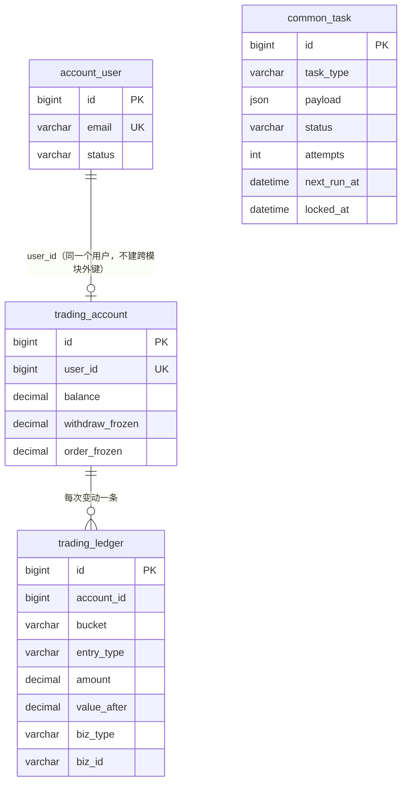

# FalconX Lite 数据库设计
- 版本：v1.7（2026-10-15）
- 变更历史：v1（2026-10-15）S3 首次创建：迁移工具、第一批 4 张表、账本和任务表的规则；v1.1（2026-10-15）S4 新增用户资料、邮箱验证码、登录会话（V2），第 6 节登录规则；v1.2（2026-10-15）S5 新增 KYC 申请（V3），第 7 节 KYC 规则；v1.3（2026-10-15）S6 新增行情的 4 张表（V4）和 50 个品种，第 8 节行情规则；v1.4（2026-10-15）S7 新增订单、持仓、风控开关（V5），第 9 节下单规则；v1.5（2026-10-15）S8 订单加改单次数和撤单时间（V6），第 10 节持仓操作规则，可用余额改为不计浮动盈利（DF-02）；v1.6（2026-10-15）S9 第 11 节撮合引擎规则（无表结构变更）；v1.7（2026-10-15）S10 隔夜费结算记录（V7），第 12 节隔夜费规则
- 依据：`00-架构方案.md` v1.1 第 3.3、3.4 节（已审核）；agents main `2697d91`（v0.10）
- 编写：研发
- 维护：每个步骤新增或修改表时，在同一个 PR 里追加本文件的版本记录。表结构以迁移脚本为准，本文件说明"为什么"和"规则"。

## 一图看懂：第一批表和谁能读写

这张图想说明：账户里的钱只在 `trading_account` 里，每一次变动都在 `trading_ledger` 里留一条记录；`common_task` 是独立的异步任务表。

## 1. 通用规则
| 规则 | 做法 |
|---|---|
| 表归属 | 表名以模块名开头（`account_`、`market_`、`trading_`、`risk_`、`wallet_`、`notification_`、`admin_`、`common_`），只由该模块的代码读写；其他模块通过对方的 `api` 包调用 |
| 跨模块关联 | 只存对方的 ID，**不建跨模块外键**，模块可以独立演进 |
| 金额 | `DECIMAL(24,8)`；代码里 `BigDecimal`，超过 8 位小数直接拒绝，不悄悄四舍五入（`common/money/Amounts.java`） |
| 时间 | `DATETIME(3)`，一律 UTC；每个数据库连接建立时设置 `time_zone = '+00:00'` |
| 表结构变更 | 只通过 Flyway 迁移脚本（`backend/src/main/resources/db/migration/V<n>__<说明>.sql`），已合并的脚本不再修改，改动写新脚本 |
| SQL | MyBatis XML，放在 `backend/src/main/resources/mapper/<模块>/` |

## 2. 表
### 2.1 `account_user`（account 模块）
S3 只建最少的字段，S4 补登录、验证码等。

| 字段 | 说明 |
|---|---|
| `email` | 唯一 |
| `password_hash` | S4 写入，只存哈希 |
| `status` | `ACTIVE` / `FROZEN` |

### 2.2 `trading_account`（trading 模块）
每个用户一个 USDT 账户（只做逐仓、单币种）。

| 字段 | 说明 |
|---|---|
| `balance` | 余额，含已占用的保证金。已占用保证金按持仓计算，不单独存 |
| `withdraw_frozen` | 提现冻结 |
| `order_frozen` | 挂单冻结 |

数据库约束保证三项都不小于 0。

### 2.3 `trading_ledger`（trading 模块）
| 字段 | 说明 |
|---|---|
| `bucket` | 变动的是哪一项：`BALANCE` / `WITHDRAW_FROZEN` / `ORDER_FROZEN` |
| `entry_type` | 业务类型，见 `trading.api.LedgerEntryType` |
| `amount` | 增加为正、减少为负 |
| `value_after` | 变动后这一项的值，方便对账和排查 |
| `biz_type` + `biz_id` | 来源业务和单号 |

唯一键 `(biz_type, biz_id, entry_type, bucket)` 是幂等键。

### 2.4 `common_task`（common）
| 字段 | 说明 |
|---|---|
| `status` | `PENDING` → `RUNNING` → `SUCCEEDED`；失败退避后回到 `PENDING`，次数用完为 `FAILED` |
| `attempts` / `max_attempts` | 已尝试次数 / 最多次数（默认 8） |
| `next_run_at` | 到这个时间才能被领取 |
| `locked_at` / `locked_by` | 开始处理的时间和处理者 |

### 2.5 `account_profile`（account 模块，V2）
注册时填的 5 项资料：名、中间名、姓、出生日期、国籍（ISO 两位字母）。KYC 通过后锁定（S5）。

### 2.6 `account_email_code`（account 模块，V2）
| 字段 | 说明 |
|---|---|
| `purpose` | `REGISTER` / `RESET_PASSWORD` |
| `code_hash` | 验证码的 SHA-256（混入邮箱和用途），不存原值 |
| `attempts` | 已试错次数，达到 5 次作废 |
| `expires_at` / `consumed_at` | 10 分钟有效；用过即作废 |

### 2.7 `account_session`（account 模块，V2）
| 字段 | 说明 |
|---|---|
| `token_hash` | 会话令牌的 SHA-256；令牌原值只在浏览器的 HttpOnly Cookie 里 |
| `last_seen_at` / `expires_at` | 72 小时没有访问就过期；有访问时每分钟最多续期一次 |
| `revoked_at` | 登出、改密、重置、冻结时写入，立即失效 |

### 2.8 `account_kyc_application`（account 模块，V3）
每次提交一行；用户当前的 KYC 状态看最新一行。

| 字段 | 说明 |
|---|---|
| `doc_type` / `doc_number` | `ID_CARD` / `PASSPORT`；证件号统一大写，最多 64 位 |
| `front_key` / `back_key` / `selfie_key` | 对象存储路径，例如 `kyc/<用户>/<申请>-front.jpg`；**数据库里没有图片内容**（AC-05） |
| `status` | `PENDING` → `APPROVED` / `REJECTED` |
| `reject_reason` | 驳回时必填，最多 500 字 |
| `reviewer_id` / `reviewed_at` | 审核的管理员和时间 |

### 2.9 `market_symbol`（market 模块，V4）
50 个品种（`00-架构方案.md` 3.6）。合约大小按功能地图 A-01，杠杆上限按 A-03 沿用现有系统第一档。以后在后台修改（S16），改完调用 `SymbolCatalog.reload()`。

| 字段 | 说明 |
|---|---|
| `contract_size` / `unit` | 每手合约大小和单位（例如黄金 100 盎司、外汇 100,000 基础货币） |
| `quote_ccy` | 报价币种；保证金和盈亏按实时汇率折算成 USDT（S7） |
| `max_leverage`、`min_lots`、`max_lots`、`lot_step`、`fee_rate`、`maintenance_margin_rate` | 下单参数（S7 使用） |
| `markup` | 统一加点（价格单位）：卖价减、买价加，**只在行情入口加一次**（修复 T1） |
| `swap_long` / `swap_short` | 隔夜费率，S10 使用；值待 Amos 提供，先为 0 |
| `hot` / `open_paused` / `enabled` | 热门（自选默认）、暂停开仓（只能平仓）、是否上架 |

### 2.10 `market_session` / `market_holiday`（market 模块，V4）
- 每周交易时段，UTC，按分钟（`open_minute` 含、`close_minute` 不含）。第一版：外汇、贵金属、指数、能源 周日 22:00 至 周五 21:00；加密货币全天；美股 周一至周五 13:30–20:00（夏令时口径，冬令时调整待 S16 后台配置）。
- 休市日按 UTC 日期，`symbol = '*'` 表示全部品种。没有配置时段的品种视为休市。

### 2.11 `market_kline`（market 模块，V4）
收盘后的 K 线，主键 `(symbol, timeframe, open_time)`；价格用**不含加点的中间价**。`ticks` 是这根 K 线收到的报价条数，不是成交量。未收盘的那一根在内存里。

### 2.12 `trading_order`（trading 模块，V5）
| 字段 | 说明 |
|---|---|
| `client_order_id` | 客户端生成的幂等键，`(user_id, client_order_id)` 唯一：同一次提交重试只下一次单 |
| `order_type` / `side` | `MARKET` / `LIMIT`；`BUY` / `SELL` |
| `frozen_amount` | 限价挂单冻结的金额 = 按限价算的保证金 + 手续费（记在账户的 `order_frozen`） |
| `notional_usd` | 下单时的 USD 名义价值，算持仓上限用 |
| `status` | 市价单 `FILLED`；限价单 `PENDING` → `FILLED`（S9 撮合）/ `CANCELLED`（撤单，`cancelled_at`） |
| `revision` | 改单次数（V6）。改单调整冻结的账本幂等键是 `ORDER_MODIFY` + "订单号:次数" |

### 2.13 `trading_position`（trading 模块，V5）
逐仓持仓。开仓时的合约大小、报价币种、汇率、维持保证金率都存下来，以后改品种配置不影响已有持仓（追加保证金按开仓时的维持保证金率重算，修复 T-11，S8）。平仓相关字段（`closed_at`、`close_price`、`close_reason`、`realized_pnl`）在 S8、S9 写入。

### 2.15 `trading_swap`（trading 模块，V7）
隔夜费结算记录（AC-16"流水可查"）。每个持仓每个结算日一行，唯一键 `(position_id, rollover_date)` 保证只结算一次；费率为 0 也记一行（金额 0）。存当时的费率、价格、汇率和入账金额。持仓表加 `swap_total`（累计隔夜费）。

### 2.14 `risk_switch`（risk 模块，V5）
只有一行。`global_open_paused` 全局暂停开仓；S11 加净敞口自动禁开，S16 后台操作（二次确认、审计）。

## 3. 账本规则（`trading.api.LedgerApi`，所有模块改余额都只能走这里）
1. **同一个事务**：改金额和写账本在同一个事务里；调用方已有事务时加入调用方的事务，一起提交或一起回滚（项目地图约定 1）。
2. **先锁账户行**（`SELECT … FOR UPDATE`），再查幂等、改金额、写账本。同一账户的变动排队执行，幂等检查不会被并发绕过。
3. **幂等**：同一个幂等键第二次调用不再变动，返回第一次的结果（`duplicate = true`）。
4. **不能为负**：任何一项变成负数就拒绝（`INSUFFICIENT_FUNDS`），什么都不写。冲正时余额不足的挂账处理（修复 F4）在 S13 提现里实现。
5. **校验口径**：任何时候，账本里 `BALANCE` 的变动加起来都等于账户余额（测试里检查）。

## 4. 任务表规则（`common.task.TaskService`）
1. 入队可以放在业务事务里，业务提交了任务才存在。
2. 领取用 `FOR UPDATE SKIP LOCKED`，多个处理者同时领取不会重复。
3. 失败后第 n 次等待 2ⁿ 秒，最长 1 小时；次数用完标为失败，后台可查看、手动重试（S16）。
4. 处理中超时没有结果的任务回收成待处理（修复 fxsystem 的 Outbox 卡在"发送中"无人回收）。处理者要保证同一任务重复执行没有副作用（幂等）。
5. 到期判断全部用数据库时间，应用服务器时钟不准不影响。

## 5. 测试（实际执行，真实 MySQL 8.4，C37）
| 测试 | 覆盖 |
|---|---|
| `LedgerServiceTest` | 入账、余额不足拒绝且不写账本、幂等、调用方回滚时一起回滚、超过 8 位小数拒绝、25 个并发扣款恰好成功 10 个且账本和余额一致、三项分开记账 |
| `AuthFlowTest` | 注册（资料、交易账户、密码哈希）、验证码试错 5 次作废、字段错误一次返回、邮箱已注册、60 秒内不能重发、同一账号失败 5 次锁定且换 IP 仍锁定、锁定期满解锁、同一 IP 换账号也锁定、统一错误码、重置和修改密码后会话失效、冻结后立即失效、登出、未登录 401 |
| `KycFlowTest` | 提交后审核中、证件号掩码、数据库只存路径、文件可以从存储读回；非图片、超过 2MB、缺文件、证件类型错误一次返回；审核中不能重复提交；驳回必填原因并通知；驳回后重新提交；通过后资料锁定、不能再提交、不能重复审核；同一证件不能两个账户用；资料查看和修改 |
| `QualityGuardTest`、`TimeframeTest` | 质量守卫每条规则；K 线各周期的起点 |
| `MarketFlowTest` | 50 个品种和合约参数、加点只加一次、异常报价不覆盖最新价、汇率折算、交易时段（美股盘后和周末、加密全天、外汇周五收市和周日开市、休市日）、K 线跨周期写库、行情接口需要登录 |
| `MarketPushTest` | 真实启动服务：未登录不能连接 WebSocket；登录后收到全部报价、新报价推送、订阅的 K 线推送 |
| `OrderCalcTest` | 保证金、手续费、强平价和手算一致（USD 报价和日元报价，误差 ≤0.01，AC-10） |
| `OrderFlowTest` | 市价买卖成交价、记账、账本合计等于余额；非 USD 品种按汇率折算；加点只加一次；重复提交只下一次单；限价单冻结和撤单释放、不能重复撤、不能撤别人的单；7 种拒单原因和报价不可用（AC-12）；持仓上限含挂单；字段错误一次返回、止盈止损方向；10 个并发下单只成功 3 个；交易接口 |
| `PositionFlowTest` | 平仓盈利入账、亏损封顶为保证金且余额不为负、浮动盈利不能开新仓或追加保证金、交易时段外不能平仓、止盈止损方向和取消、追加保证金按开仓时的维持保证金率重算强平价（T-11）、改单冻结多退少补（AC-11）、并发平仓只平一次、持仓接口和历史 |
| `MatchingEngineTest` | 买入限价单按更优价成交并带上止盈止损、1 秒内完成；卖出限价单；没到价不成交；止盈（多单）、止损（空单）按市价平仓；强平优先于止损、跳空时亏损封顶；全局暂停时挂单不成交、恢复后成交；成交时余额不足撤销挂单；20 个持仓同时强平 1 秒内完成 |
| `TradingPushTest` | 真实启动服务：未登录不能连接交易推送；下单、止盈触发时收到 `fill`、`positions`、`account`、`tp` 事件，别人收不到 |
| `SwapTest` | 多单负费率从保证金扣、强平价重算、只结算一次；空单正费率返还；结算时点后开仓、周六、休市日不收；停机后补结算；结算时点后才平仓的从余额扣；费率为 0 只记录；日元品种按汇率折算 |
| `TaskServiceTest` | 只领取到期任务、退避重试、次数用完标为失败、成功后不再领取、超时回收、4 个处理者同时领取不重复、退避时间计算 |

## 6. 登录规则（S4，account 模块）
默认值沿用现有系统（功能地图 A-01、A-02），在 `application.yml` 的 `falconx.auth` 里可以调整。

| 规则 | 做法 |
|---|---|
| 密码 | 长度 8–64，不限制复杂度；BCrypt（强度 10）哈希 |
| 登录失败锁定 | **按账号和 IP 同时计数**（现有系统只按 IP，需求 4.1-2），任一连续失败 5 次就锁定 15 分钟；每次失败重新计时；登录成功清零；换 IP 仍锁定（AC-02）。计数在 Redis |
| 用户不存在和密码错误 | 返回同一个错误码 `INVALID_CREDENTIALS` |
| 冻结 | 不能登录（`USER_FROZEN`）；冻结时作废所有会话，每次请求都检查用户状态（AC-04） |
| 改密、重置 | 重置：所有会话失效；修改：其他设备失效，当前设备保留（AC-03） |
| 验证码 | 6 位数字、10 分钟有效、60 秒内不能重发、最多试 5 次、用过即作废；重置密码时邮箱不存在也返回成功，不暴露哪些邮箱注册过 |
| 会话 | 随机令牌放在 HttpOnly、Secure、SameSite=Strict 的 Cookie（`fx_session`，路径 `/api`）；页面脚本读不到，其他网站发起的请求不会带上 |
| 客户端 IP | 取 Nginx 传来的 `X-Forwarded-For`，只信任内网代理 |
| 邮件 | 写成 `MAIL_SEND` 任务（通知模块），S15 接上邮件服务商后才真正发出 |

## 7. KYC 规则（S5，account 模块）
| 规则 | 做法 |
|---|---|
| 什么时候需要 | 只在提现前要求通过（需求 4.1-6）；提现通过 `AccountApi.kycStatus` 查询（S13） |
| 提交 | 证件类型、证件号、正面、反面、手持自拍。审核中、已通过时不能再提交；驳回后可以重新提交 |
| 图片 | **服务端校验**：每张 ≤2MB（上传大小限制 + 业务代码两道），按文件头判断必须是 JPG 或 PNG，不信任浏览器报的类型（现有系统只在前端限制） |
| 证件号 | 同一证件不能被两个账户同时使用（审核中或已通过）；返回给客户时只显示后 4 位 |
| 审核 | 后台调用 `AccountApi.approveKyc` / `rejectKyc`（S16 做页面）；只能审核"审核中"的申请；驳回必须填原因；结果邮件写成任务（S15 发出，站内信和推送也在 S15） |
| 资料锁定 | 通过后个人资料不能再修改（`PROFILE_LOCKED`） |
| 文件存放 | `common.storage.ObjectStorage`。现在是本地目录（`FX_STORAGE_DIR`），正式环境在 S20 换成对象存储服务 |

## 8. 行情规则（S6，market 模块）
| 规则 | 做法 |
|---|---|
| 报价源 | 适配层只要求输出 `RawQuote`（品种、买价、卖价、时间）。现在只有模拟源（`FX_MARKET_SOURCE=simulated`，随机游走，起始价在 `backend/src/main/resources/simulated-prices.csv`）；**默认 `none`，不启动任何报价源**，防止生产环境忘了配置时用上模拟价格。LP 接入在 S20 联调 |
| 处理顺序 | 品种是否上架 → 是否在交易时段 → 质量守卫 → 加点 → 更新最新价 → K 线 → 通知订阅者（`QuoteProcessor`）。按品种分到 8 个单线程队列，同一品种的报价按顺序处理 |
| 质量守卫（照搬现有系统阈值） | 价格不为正、买卖倒挂、点差超过 5% → `ABNORMAL`；报价时间和当前时间相差超过 5 秒 → `STALE`；价格 1 分钟没有变化 → `NO_QUOTE`；单次跳变超过 10%、60 秒内波动超过 5% → `ABNORMAL`。阈值在 `application.yml` 的 `falconx.market` 里 |
| 不可成交 | 状态不是 `FRESH`、休市时，`MarketQuote.executable = false`，下单和撮合（S7、S9）必须检查；异常报价不覆盖最新价 |
| 汇率折算 | `MarketApi.toUsdRate`：`XXXUSD` 用中间价，`USDXXX` 用倒数，没有对应品种的用固定汇率（港币按联系汇率），USD 和 USDT 为 1 |
| K 线 | 1m、5m、15m、1h、4h、1d，按 UTC 向下取整；用中间价聚合；跨入下一个周期时把上一根写库。**未收盘的一根只在内存，应用重启会丢失**（单实例的已知取舍） |
| 推送 | WebSocket `/api/ws/market`，握手时检查登录 Cookie。连上先推全部报价，之后每 250 毫秒推有变化的；订阅一个品种和周期的 K 线后推送更新 |

## 9. 下单规则（S7，trading 模块 `trading/order/OrderService.java`）
计算公式和原型 `web/client/src/lib/trading.ts` 同一口径（`OrderCalc`）。

| 规则 | 做法 |
|---|---|
| 成交价 | 买入按 ask、卖出按 bid，直接用 `MarketApi` 的对客报价（已含加点），**不再加点**（修复 T1） |
| 名义价值、保证金、手续费 | 名义价值 = 价格 × 手数 × 合约大小 × 报价币种对 USD 的汇率；保证金 = 名义价值 ÷ 杠杆；手续费 = 名义价值 × 费率，开仓收；金额保留 8 位小数 |
| 强平价 | 亏损达到（保证金 − 名义价值 × 维持保证金率）时的价格，按品种小数位四舍五入 |
| 检查顺序 | ① 同一个 `clientOrderId` 已下过单 → 返回第一次的结果 ② 字段格式，一次全部返回（C56） ③ 拒单原因：交易时段外 `TRADING_CLOSED`、品种暂停 `SYMBOL_PAUSED`、全局暂停 `GLOBAL_PAUSED`、报价不可成交 `QUOTE_UNAVAILABLE`、汇率失效 `RATE_STALE`、超过杠杆上限 `LEVERAGE_EXCEEDED` ④ 止盈止损方向（多单 止盈 > 基准 > 止损，空单相反；基准是成交价或限价） ⑤ 锁账户行后：持仓上限 `POSITION_LIMIT`、可用余额 `INSUFFICIENT_BALANCE` |
| 汇率失效 | 汇率来源品种（例如日元看 `USDJPY`）当前不可成交时，所有以该币种报价的品种不能开新仓（需求 4.5-5） |
| 持仓上限 | 已有持仓 + 挂单 + 本单的 USD 名义价值合计不超过 `falconx.trading.position-limit-usd`（默认 3,000,000，修复 T4）。挂单也算进去，防止挂单成交后超限 |
| 可用余额 | 余额 − 挂单冻结 − 已用保证金 + 各持仓的浮动亏损（**浮动盈利不计入**，S8 起，见第 10 节）；需要 保证金 + 手续费 |
| 并发 | 同一账户的下单先锁账户行，"检查可用 → 写订单 → 记账"排队执行，不会超额开仓（测试：10 个并发只成功 3 个） |
| 记账 | 市价单：手续费 `TRADE_FEE`（余额）；限价单：`ORDER_FREEZE`（挂单冻结），撤单 `ORDER_UNFREEZE`。来源业务 `ORDER` + 订单号 |
| 限价单 | 冻结保证金和手续费（原型只冻结保证金；多冻结手续费是为了成交时不会付不起手续费）。挂单时限价已经优于市价的，S9 撮合时按更优的市价成交（待 S9 实现） |

## 10. 持仓操作规则（S8，trading 模块 `trading/order/PositionService.java`、`OrderService.modify`）
| 规则 | 做法 |
|---|---|
| 全额平仓 | 多单按 bid、空单按 ask；需要在交易时段内、报价可成交。盈亏按当前汇率折算（汇率暂时没有时用开仓汇率），记 `REALIZED_PNL`（来源业务 `POSITION` + 持仓号）。同一持仓并发平仓只成功一次 |
| 逐仓亏损封顶 | 一个持仓最多亏掉自己的保证金（AC-14）。`closeLocked` 也给 S9 的止盈止损和强平用 |
| 可用余额（资金安全） | 可用 = 余额 − 挂单冻结 − 已用保证金 + 浮动亏损。**浮动盈利不能用来开新仓、追加保证金**，保证"余额 ≥ 挂单冻结 + 全部持仓保证金"始终成立，平仓和强平都不会把余额扣成负数。原型把浮动盈利也算进可用，两者不一致（DF-02）。S13 提现的可提金额也要按这个口径 |
| 修改止盈止损 | 方向以当前平仓价为基准（没有报价时用开仓价），和客户端一致；传空表示取消 |
| 追加保证金 | 不超过可用余额（`MARGIN_INSUFFICIENT`），最多 2 位小数；强平价按**这个持仓开仓时的维持保证金率和开仓汇率**重算（修复 T-11）。保证金只是余额里被占用的部分，追加不改余额，不记账 |
| 改单 | 可以改限价、手数、止盈止损（杠杆和方向不能改）；按新的限价和手数重算冻结金额，多退少补（AC-11）；持仓上限和可用余额的检查同下单；汇率失效时不能改 |
| 历史 | 已平仓的持仓（`P` + 持仓号）和已撤销的挂单（`O` + 订单号），按时间倒序分页；手续费显示开仓手续费 |

## 11. 撮合引擎规则（S9，trading 模块 `trading/order/MatchingEngine.java`）
| 规则 | 做法 |
|---|---|
| 驱动 | 订阅 `MarketApi` 的可成交报价。收到报价只记下"这个品种有新价格"，不占用行情处理线程 |
| 排队 | 每个品种同一时间只有一次检查；检查期间来的新报价合并，检查完用最新价格再查一次（不会越积越多） |
| 找触发 | 数据库查询：挂单（买 限价 ≥ ask、卖 限价 ≤ bid）；持仓（多单看 bid、空单看 ask，触及强平价、止损或止盈）。不在内存里另存一份，不会和数据库不一致 |
| 执行 | 被触发的每一条交给执行线程并行处理，每条一个事务：锁账户行 → 锁订单或持仓行 → 用这次的价格再确认 → 执行。状态在锁内检查，同一条不会处理两次，和客户自己的平仓、撤单也不冲突 |
| 挂单成交 | 成交价取限价和市价里对客户更好的那个（买 min(限价, ask)，卖 max(限价, bid)）。先释放冻结，再按成交价重算保证金和手续费开仓。品种暂停、全局暂停时不成交，继续挂着；汇率失效时等下一次报价；可用余额不够时撤销这张挂单（冻结全部释放） |
| 止盈止损、强平 | 优先级：强平 > 止损 > 止盈。都按当前市价平仓（多单 bid、空单 ask）；跳空越过强平价时亏损封顶为保证金，余额不为负（AC-14）。原型按强平价成交，后端按市价成交 + 封顶，结果对客户不会更差 |
| 强平线 | 按价格触及强平价判断。强平价由"持仓亏损达到 保证金 − 维持保证金"算出，和"保证金水平低于强平线"是同一个条件（需求 4.3-6） |
| 时延（AC-13） | 记录从收到价格到写入成交的耗时，超过 1 秒记警告日志。本地实测（真实 MySQL）：28 次撮合中位 59–72 毫秒，最大 121–149 毫秒（含 20 个持仓同时强平）。50 个品种同时推送的压测在测试环境做（S20） |
| 推送 | WebSocket `/api/ws/trading`（需要登录），只推给本人：`account`、`positions`、`orders`（数据变了，客户端重新拉取），`trade`（`fill` / `tp` / `sl` / `liquidation`，带品种、盈亏、价格）。事件名和客户端 `ServerEvent` 一致（修复 T6）。客户自己下单、平仓、改单也推，多个设备同步 |
| 线程和连接 | 检查线程 `engine-threads`（8）、执行线程 `engine-workers`（8）；数据库连接池最大 30（`FX_DB_POOL_SIZE`），空闲保留 5 |
| 留给后面 | 自动强平开关（风控，S11）；成交、止盈止损、强平的站内信和邮件（S15） |

## 12. 隔夜费规则（S10，trading 模块 `trading/order/SwapService.java`）
| 规则 | 做法 |
|---|---|
| 结算时点 | 每天 UTC 22:00（沿用现有系统，`falconx.trading.swap.rollover-time`）；定时任务每分钟检查，时点过后 1 分钟内结算 |
| 结算日 | 只在品种的**交易日**结算：这一天有交易时段、不是休市日（需求 4.3-8）。外汇、贵金属、指数、能源是周日到周五，加密是每天，美股是周一到周五 |
| 谁要收 | 结算时点之前开仓、结算时点还持有的持仓（AC-16）。结算时点后才平仓的也收 |
| 金额 | 手数 × 合约大小 × 平仓方向的最新价 × \|费率\| × 报价币种对 USD 的汇率；**费率为负扣、为正返还**（沿用现有系统） |
| 从哪里扣 | 持仓还在：从**这个持仓的保证金**里扣（逐仓），最多扣到 0，强平价随之重算，到价由撮合引擎强平；已平仓：从余额扣，不动用其他持仓的保证金和挂单冻结。这样余额始终不为负（AC-14）。返还进余额 |
| 记账 | 账本 `SWAP`，来源业务 `SWAP` + "持仓号:结算日" |
| 补结算 | 服务停机后补最近 3 天（`catch-up-days`） |
| 费率 | 品种配置的 `swap_long` / `swap_short`，**待 Amos 提供，现在都是 0**（只记录、不记账） |
| 没有做 | 周三收三倍（覆盖周末）：现有系统也没有，需求没有要求。外汇按交易日结算，周五、周日各一次，周六不收。Amos 提供费率时一起确认 |

## 跨角色反馈 / 分歧记录
| 编号 | 提出方 → 接收方 | 内容 | 状态 |
|---|---|---|---|
| DF-02 | 研发 → PM | 原型（`web/client/src/mocks/trading.ts`）的可用余额把浮动盈利也算进去。这样客户可以用浮动盈利开新仓，新仓亏光保证金时余额会变成负数，违反 AC-14"余额不为负"。后端 S8 起改为浮动盈利不计入可用（第 10 节）；客户端显示的"可用"在 S17 改成同一口径，需求说明书是否补充这条规则待 Amos 确认 | 待 Amos 确认 |
| DF-01 | 研发 → PM | 需求 4.3-9 列了 7 种拒单原因，但"品种自己的报价过期或异常"不属于其中任何一种。后端新增错误码 `QUOTE_UNAVAILABLE`（报价暂不可用），客户端在 S17 加翻译；需要 PM 确认是否写进需求说明书和 AC-12 | 待 Amos 确认 |
