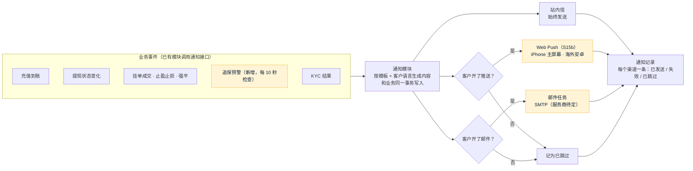

# FalconX Lite 通知方案（S15）
- 版本：v1（2026-10-15）
- 变更历史：v1（2026-10-15）首次创建，交 Amos 审核
- 状态：**待 Amos 审核**
- 依据：`需求文档/v1-需求说明书.md` v1.5 第 4.7 节、第 4.3 节第 7 条、X-04、X-05、X-09、AC-05、AC-07、AC-15、AC-20、AC-22、AC-24、AC-25；原型（客户端：通知中心、通知偏好；后台：通知模板、手动发送、通知记录）；功能取舍对照表 N-05、N-22
- 编写：研发；测试、运维确认各自部分

## 一图看懂

这张图想说明：业务模块只说"发生了什么"，发不发、发哪个渠道、用什么语言都由通知模块决定；站内信一定有，推送和邮件按客户的开关；每个渠道的结果都留记录，后台能查。黄色是需要 Amos 定的部分。

## 1. 需要 Amos 审核的决定
| 编号 | 决定 | 我的建议 | 为什么 |
|---|---|---|---|
| N1 | 邮件怎么发 | 用通用的 **SMTP** 发送。主流服务商（Amazon SES、SendGrid、阿里云邮件推送、腾讯企业邮等）都支持 SMTP，换服务商只改配置。服务商定下来之前（N-05）：**没配置就只写日志、不发**，健康检查显示"邮件未配置"。Amos 在服务器后台填：`FX_MAIL_HOST`、`FX_MAIL_PORT`、`FX_MAIL_USERNAME`、`FX_MAIL_PASSWORD`（密码只由 Amos 填）、`FX_MAIL_FROM` | 服务商还没定，不能卡住开发；SMTP 不绑定任何一家 |
| N2 | Web Push 的密钥（VAPID） | **Amos 在自己电脑上生成一对密钥**（例如 `npx web-push generate-vapid-keys`），填进服务器后台：`FX_PUSH_VAPID_PUBLIC_KEY`、`FX_PUSH_VAPID_PRIVATE_KEY`（私钥只由 Amos 填）、`FX_PUSH_VAPID_SUBJECT`（联系邮箱，形如 `mailto:ops@…`）。启动时用私钥算出公钥和填的公钥对一遍，对不上就不发推送、健康检查报错（和热钱包同样做法）。没填就不发推送，站内信和邮件照常 | 密钥不经过 AI、不进仓库（底线）；这对密钥换了以后所有客户要重新订阅，所以测试和生产各用一对，生成后不要换 |
| N3 | Web Push 加密怎么做 | 按公开标准（RFC 8291 内容加密、RFC 8292 VAPID 签名）用 JDK 自带的加密功能实现，**用 RFC 8291 附录里的官方测试数据核对**（和 S13 签名用公开测试数据核对同样做法）。不引入第三方 web-push 库 | Java 的 web-push 库最近一次发布是 2021 年，已经不维护，还会带进一堆旧依赖；这个标准只用到 JDK 已有的 ECDH、HKDF、AES-GCM 和 ES256 签名，有官方测试数据可以逐字节核对 |
| N4 | 追保预警的节流（AC-15） | 保证金水平 = 净值 ÷ 已用保证金（和客户端显示的口径一致），**追保线 100%**（沿用现状 1.00，S16 后台可改）。**跌破追保线时通知一次；一直在线下不重复；回到线上以后再跌破才再通知，并且同一客户两次通知至少隔 5 分钟**（5 分钟沿用现状） | 现状是"只要在线下，每 5 分钟发一次"，客户开着邮件的话 1 小时会收到 12 封；需求写的是"通知客户一次"。如果 Amos 要完全沿用现状（每 5 分钟重复），改一个配置即可 |
| N5 | 风控人员的通知（X-09） | 第一版风控人员**只收邮件**（S11 已实现，收件人是 `FX_RISK_ALERT_EMAILS`），同时写入通知记录，后台风控页能看到风控事件。**不做后台站内信和推送** | 需求第 4.3 节第 3 条写的是"站内信 + 邮件 + 推送"，但后台原型没有站内信入口，也没有推送订阅入口；两边不一致，请 Amos 裁决。如果要做，需要先补后台原型 |
| N6 | 提现哪些状态通知客户 | 客户自己做的操作（提交、撤销）不通知；其余都通知：审核通过、驳回（带原因）、开始上链、已完成、失败已退回、紧急取消 | 客户自己操作时页面上已经看到结果，再发一条是打扰 |
| N7 | 拆成两步 | **S15a**：通知模块、模板、站内信、通知偏好、邮件（SMTP + 未配置时只写日志）、各业务事件接入、追保预警、通知记录；**S15b**：Web Push 订阅、加密和发送、失效订阅清理 | 和 S12、S13 一样，每一步都能单独停下确认；S15b 依赖 N2 的密钥决定 |

## 2. 规则
| 规则 | 做法 |
|---|---|
| 渠道（4.7） | 站内信始终发送，客户不能关（原型通知偏好里站内信开关是灰的）；推送和邮件各有开关（X-05），默认都开；关闭的渠道记为"已跳过"（AC-25） |
| 模板 | 按后台原型的内置模板：`deposit_credited` 入金到账、`withdraw_status` 出金状态、`order_filled` 挂单成交、`tp_sl_triggered` 止盈止损、`margin_call` 追保预警、`liquidated` 强平、`kyc_result` KYC 结果、`email_code` 邮箱验证码（只发邮件），以及发给风控人员的模板（自动禁开、冲正挂账、对账差异、热钱包余额不足等）。每个模板有中英文标题和正文、变量、渠道；内置模板只能改文案、不能禁用（S16 做编辑页面） |
| 语言 | 站内信存模板编号和变量，**打开时按客户当前界面语言显示**（原型做法，切换语言后旧消息也跟着变）；推送和邮件发送时按客户最后一次使用的语言（客户端切换语言时告诉服务端，默认中文） |
| 不丢、不早发 | 业务事件在业务事务里写入通知（和 S4 邮件任务同样做法），业务回滚就不发；推送和邮件通过任务表发送，失败重试最多 5 次，仍失败记"失败"和原因 |
| 站内信接口 | `GET /api/notifications`（分页）、`GET /api/notifications/unread-count`、`POST /api/notifications/{id}/read`、`POST /api/notifications/read-all`；新消息实时推给客户端（`/api/ws/trading` 的 `notification` 事件，和客户端 `ServerEvent` 一致） |
| 通知偏好接口 | `GET/PUT /api/me/notify-prefs`（`push`、`email`），`PUT /api/me/notify-lang` |
| 追保预警（N4） | 交易模块每 10 秒检查有持仓的客户，算保证金水平；跌破追保线按 N4 规则通知（模板 `margin_call`，变量：保证金水平）。状态存数据库，服务重启不会重复发 |
| 各事件 | 充值入账（AC-07）、提现状态（N6，含 AC-20 失败退回）、挂单成交、止盈、止损、强平（S9 引擎）、KYC 结果（AC-05，替换 S4 里直接发邮件的写法）、风控人员（AC-22，N5） |
| 后台手动发送 | 原型有"手动发送给单个客户"，服务在 S15a 做好，页面权限、二次确认和审计在 S16 |
| Web Push（S15b） | 客户端订阅后把订阅信息（推送地址、两把公钥）交给服务端，一个客户可以有多个设备；推送服务返回"订阅已失效"（404、410）就删除该订阅；内容只放标题和正文，不放金额以外的敏感信息 |

## 3. 表（S15a）
| 表 | 作用 |
|---|---|
| `notify_template` | 模板：编号、中英文名称、中英文标题和正文、变量、渠道、是否内置、是否启用 |
| `notify_pref` | 客户的通知偏好：推送开关、邮件开关、推送和邮件用的语言 |
| `notify_message` | 站内信：客户、类型（和客户端 `NotificationKind` 一致）、模板编号和变量（手动发送的直接存标题和正文）、已读时间 |
| `notify_record` | 通知记录：每个渠道一条，来源（模板 / 手动）、状态（已发送 / 失败 / 已跳过）、错误原因、操作人 |
| `notify_margin_state` | 追保状态：客户是否在追保线下、上次通知时间 |
| `notify_push_sub`（S15b） | Web Push 订阅：客户、推送地址、公钥、创建时间 |

## 4. 测试（测试工程师确认）
| 验收 | 怎么测 |
|---|---|
| 每种通知（S15 完成标准） | 每个业务事件触发一次，检查站内信、通知记录、邮件任务 |
| AC-05、AC-07、AC-20 | KYC 通过和驳回、充值入账、上链失败退回，客户都收到站内信，开着邮件时有邮件任务 |
| AC-15 | 用可调时钟把保证金水平推到线下：只通知一次；一直在线下不重复；回到线上再跌破，满 5 分钟才再通知 |
| AC-22 | 自动禁开时风控人员收到邮件（N5） |
| AC-25 | 关掉推送或邮件后对应渠道记"已跳过"，站内信照常 |
| 邮件 | 用测试用的 SMTP 服务（在测试进程里启动，不连外网）收信，核对收件人、语言和内容 |
| Web Push（S15b） | 用 RFC 8291 附录的测试数据逐字节核对加密结果；签名用公开工具核对；真机验证（AC-24）在 S20 测试环境做，大陆网络下的结果如实记录 |

## 5. 运维（运维工程师确认）
| 事项 | 做法 |
|---|---|
| 新增环境变量 | 邮件 5 个（N1）、推送 3 个（N2）。值都由 Amos 在服务器后台填，我只核对变量名 |
| 健康检查 | 新增 `mail`（未配置 / 正常 / 连不上）和 `push`（S15b：未配置 / 正常 / 公私钥对不上）；未配置不影响服务启动 |
| 出网 | 服务器要能访问邮件服务商的 SMTP 端口，以及各浏览器的推送服务（Google、Apple、Mozilla） |

## 6. 不做
- 群发（原型已注明第一版推迟）。
- 短信。
- 大陆安卓推送（需求 4.7 的已知限制，第二版做安卓 App 外壳）。
