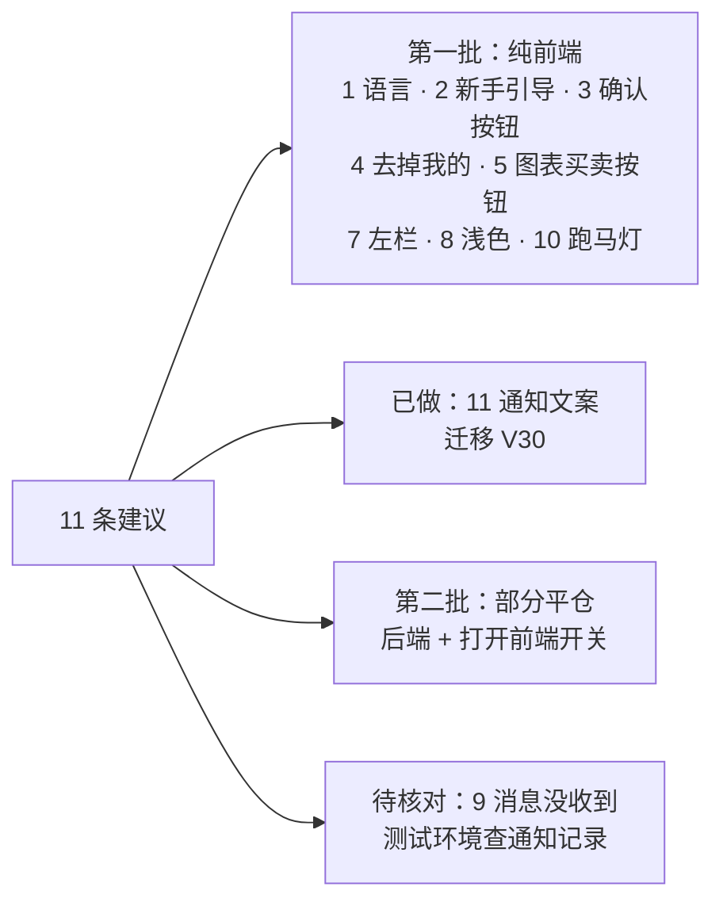

# 体验优化方案：Amos 2026-10-21 测试环境试用的 11 条建议
- 版本：v1.0（2026-10-21）
- 状态：**等 Amos 审核**（第 4 节 UX-1…UX-10 每个都有建议，回"按建议"即可）。第 11 条 Amos 已答复"11 选 a"（问题在文案），已实现（迁移 V30，见第 3.11 节）。
- 依据：Amos 2026-10-21 原话（第 1 节逐条引用）；代码以 `origin/staging` `dfd1d78` 为准。
- 原型：客户端原型模式（`VITE_API_MODE=mock`）里已经做好第 1、2、3、4、5、6、7、8、10 条的界面，开关在 `web/client/src/lib/ux1021.ts`：
  `UX1021`（纯前端改动）、`PARTIAL_CLOSE`（部分平仓，后端未做，只有模拟层）现在都等于"是不是原型模式"，**测试环境、生产（真实接口模式）的界面和行为完全不变**。Amos 确认后，第一批把 `UX1021` 改成 `true` 上线，部分平仓等后端做完再打开 `PARTIAL_CLOSE`。
- 写法：每条写"现状 → 原因 → 建议改法 → 影响范围 → 工作量"。"实际执行"表示在开发环境跑过、量过；"代码走查"表示只读了代码。
- 编写：PM + 研发（同一个智能体）。

## 一图看懂

这张图想说明：大部分是前端小改动，一批上线；通知文案已经改好；部分平仓要动后端，单独一批；"没收到消息"先在测试环境核对再定改法。

## 1. 原话和结论一览

| # | Amos 原话（摘要） | 结论 | 批次 | 工作量 |
|---|---|---|---|---|
| 1 | 语言切换显示的是"待切换的语言"，改成传统下拉框，标记当前语言；大部分是大陆用梯子的人，默认中文 | 登录页按钮上写的确实是要切换到的语言；客户端默认已是中文，但官网按浏览器语言跳转时会把英文带进客户端并记住 | 一 | 前端 0.5 天 |
| 2 | 新客户登录先看到全部行情，不知道做什么；加 3–4 步引导；"上来就开户"有道理 | 4 步引导，终点是认证 → 充值 | 一 | 前端 1 天（另：后端记"看过"0.5 天，可后做） |
| 3 | 看不到底部"确认交易"，以为顶部"卖出""买入"就是交易 | **实际执行确认**：1366×768、1280×720 下确认按钮在首屏外；1440×900 屏幕的浏览器里也在首屏外 | 一 | 前端 0.5 天 |
| 4 | "我的"和右上角小人重复，删"我的" | 电脑顶栏去掉"我的"；手机底部导航没有小人，保留 | 一 | 前端 0.1 天 |
| 5 | K 线左上角"买入""卖出"没意义，还影响缩放 | 去掉（下单都在右栏） | 一 | 前端 0.1 天 |
| 6 | 缺少部分平仓 | 后端完全不支持（只有全额平仓接口）；第一版需求里明确推迟（N-10、T-29） | 二 | 后端 2.5 天 + 前端 0.5 天 + 测试 1 天 |
| 7 | 左侧行情红绿在跳、K 线也在跳，眼花；可收起或只显示自选名称 | 左栏三种状态：只看自选名称（默认）/ 全部行情 / 收起 | 一 | 前端 0.5 天 |
| 8 | 默认浅色，黑色太"脏" | 默认浅色；自己选过深色的保留 | 一 | 前端 0.2 天 |
| 9 | 消息提醒里没收到消息 | 只有 7 类事件发站内信；**市价开仓、手动平仓、注册都不发**，最可能是这个原因；需要在测试环境核对（第 3.9 节清单） | 核对后定 | 核对 0.5 天 |
| 10 | 顶部跑马灯没意义，看 K 线分神，更适合官网 | 客户端去掉（只有电脑版有，手机本来就没有），官网保留 | 一 | 前端 0.1 天 |
| 11 | KYC 审核后消息"变量不对"：您的身份认证已通过，现在可以提现 | Amos 答复"选 a"：是文案问题。**已改**：通过、驳回拆成两个模板，写明充值、交易、提现都已开通；另查出其他模板 4 处文案问题一起改（V30），3 处真实的变量问题待定（第 3.11 节） | 已做 | 已完成 |

## 2. 现状速查（和本方案有关的代码）
- 客户端：页面结构（手机、电脑两套）见《项目地图》第 2 节 `web/client/`；路由 `web/client/src/App.tsx`；顶栏和底部导航 `web/client/src/components/Layout.tsx`；交易页 `web/client/src/pages/Trade.tsx`；下单面板 `web/client/src/components/OrderPanel.tsx`；平仓弹窗 `web/client/src/components/PositionDialogs.tsx`；语言 `web/client/src/i18n/index.ts`；主题 `web/client/src/app/ThemeProvider.tsx`。
- 后端：平仓 `backend/src/main/java/com/falconx/lite/trading/order/PositionService.java`；撮合 `MatchingEngine.java`；隔夜费 `SwapService.java`；通知 `notification/service/NotifyService.java`、`Render.java`；模板 `backend/src/main/resources/db/migration/V14__notification.sql`。
- 官网：语言 `web/site/src/i18n/lang.ts`。

## 3. 逐条方案

### 3.1 第 1 条：语言下拉框，默认中文
- **现状（代码走查 + 实际执行）**：登录、注册页右上角是一个按钮（`components/LangSwitch.tsx`），中文界面上写着"English"、英文界面上写着"中文"——写的是**要切换到的**语言，不是当前语言。"我的"页是"中文 | English"二选一。客户端默认语言是中文，**不跟随浏览器**（`i18n/index.ts`：地址栏 `?lang=` → 记住的 `fx.lang` → 中文）。但**官网默认跟随浏览器**（`web/site/src/i18n/lang.ts` 的 `detectLang`：浏览器首选语言不是 zh 开头就用英文），点"注册 / 登录"跳客户端时带 `?lang=en`，客户端**以它为准并记住**。用英文系统或英文浏览器的大陆客户从官网进来，客户端一直是英文。
- **建议改法**（原型已做）：
  - 新组件 `components/LangSelect.tsx`：按钮显示**当前语言**（"🌐 简体中文 ▾"），点开是下拉列表，当前语言打勾并标"当前"，点另一项切换；Esc、点外面关闭。登录注册页和"我的 → 设置"都换成它。
  - 默认中文不变（UX-1）。官网也改成默认中文、不跟随浏览器，访客手动切换过才带 `?lang=`。
- **影响范围**：前端（客户端、官网）。后端不变（推送和邮件的语言仍按客户端告诉后端的界面语言）。
- **工作量**：0.5 天（含官网）。

### 3.2 第 2 条：新手引导（终点是认证 → 充值）
- **现状**：登录后直接到行情页（全部 50 个品种在跳），没有任何引导。认证只在提现前强制（`WithdrawService` 的 `KYC_REQUIRED`），充值、交易不要求认证。
- **原话理解**："对于非小白"按笔误处理：**新手第一次登录显示 3–4 步引导，可跳过，之后能在"我的"里重看**。按"上来就开户"的思路，引导的终点是"完成认证 → 充值"，不是试玩、不介绍行情功能。
- **建议改法**（原型已做，`components/Onboarding.tsx`、`hooks/useOnboarding.ts`）：

| 步 | 标题 | 正文 | 要点 / 按钮 |
|---|---|---|---|
| 1 | 欢迎来到 Quick Come | 在这里用 USDT 交易外汇、黄金、指数、原油和加密货币的差价合约。开始交易前只需要两步： | ① 完成身份认证（约 3 分钟）② 充值 USDT（到账后就能下单）；脚注"随时可以在'我的 → 新手引导'重新查看" |
| 2 | 第一步：完成身份认证 | 上传证件照片，姓名、出生日期要和证件一致。一般 1 个工作日内审核完，结果会发到站内信和邮箱。 | 身份证正反面或护照信息页；手持证件的自拍；"现在去认证 ›"；脚注"认证通过后充值、交易、提现都可以使用；提现前必须完成认证" |
| 3 | 第二步：充值 USDT | 在"资产 → 充值"选择网络，复制你的专属地址，从交易所或钱包转入 USDT。 | 支持以太坊（ERC20）、波场（TRC20）、BNB Chain；到账后余额自动更新并收到通知；"现在去充值 ›"；脚注"只能转入 USDT，网络要和地址一致，转错无法找回" |
| 4 | 最后：下第一笔单 | 在交易页选品种，填好手数和杠杆，点下单区底部的"确认买入 / 确认卖出"。 | 逐仓：每笔持仓最多亏掉它自己的保证金；可以设止盈止损；脚注风险提示。**主按钮：认证没提交 →"去完成认证"；已提交或已通过 →"去充值"** |

  - 每一步都有"跳过"（最后一步是"以后再说"），右上角 × 也算看过。
  - **谁会看到**：身份认证状态是"未提交"、在这个账号上还没看过的客户，登录后自动打开一次（UX-2）。已认证的老客户不弹。
  - **重看**："我的"账户菜单里加"新手引导"。
  - **记住"看过"**：原型记在浏览器（`fx.onboarding.v1:<用户号>`）。正式上线建议同时加后端字段（换手机、换浏览器不重复弹），见 UX-2。
  - 引导走完后的配套（建议同批做）：认证提交成功页加"下一步：去充值"按钮；充值到账的通知写"现在可以开始交易了"（已在 V30 改）。
- **影响范围**：前端；后端可选（记"看过"：`account_user` 加一列 + 一个接口）。
- **工作量**：前端 1 天；后端 0.5 天（可后做）。

### 3.3 第 3 条：确认按钮在首屏外
- **实际执行**（Playwright，原型模式，staging 代码，`XAUUSD` 交易页，下单面板默认状态）：

| 视口 | 确认按钮底边 | 视口高 | 结果 |
|---|---|---|---|
| 1280×720 | 785 | 720 | **首屏外** |
| 1366×768 | 785 | 768 | **首屏外** |
| 1440×900 | 849 | 900 | 能看到（整页仍多出 12px 滚动） |
| 1366×633（1366×768 屏幕扣掉浏览器地址栏、书签栏、任务栏） | 785 | 633 | **首屏外** |
| 1440×765（1440×900 屏幕的浏览器实际可视区） | 785 | 765 | **首屏外** |
| 1920×960 | 909 | 960 | 能看到 |

- **原因**：
  1. 下单面板内容本身要 734px 高（方向、市价 / 限价、手数 + 快捷手数、杠杆 + 快捷杠杆、止盈止损折叠行、6 行预估、说明），确认按钮排在最后；面板是一个整体滚动区，按钮随内容滚走。
  2. 交易页三栏高度 `calc(100vh − 横幅 − 顶栏 − 24px)`，但主区上下内边距合计 36px，算少了 12px；最小高度 660px 又比笔记本浏览器的可视区高，整页再多出一截滚动。
  3. 面板最上面就是醒目的"卖出 / 买入"大按钮（选方向用），加上图表左上角还有一对"卖出 / 买入"（第 5 条），容易被当成下单按钮。
- **建议改法**（原型已做）：确认按钮和"逐仓 · 提交后二次确认"固定在右栏底部（`.op-sticky`，`position: sticky`），上面的内容在面板里滚动；三栏高度改按 36px 算，最小高度降到 520px，持仓区高度随视口缩放。**改后实际执行**：1366×768 按钮底边 703 / 768、1280×720 655 / 720、1366×633 568 / 633，都在首屏内，整页不再滚动。
- **影响范围**：前端（电脑交易页样式）。手机交易页本来就是底部固定的"卖出 / 买入"，不变。
- **工作量**：0.5 天。

### 3.4 第 4 条：去掉顶栏"我的"
- **现状**：电脑顶栏菜单"行情 · 交易 · 资产 · 我的"，右上角还有头像（同样进"我的"）。手机是底部 5 个导航，没有头像。
- **建议改法**（原型已做）：电脑顶栏去掉"我的"，头像加悬停提示"我的"；**手机底部导航保留"我的"**（手机上没有头像，去掉就进不了"我的"）。
- **影响范围**：前端。**工作量**：0.1 天。

### 3.5 第 5 条：去掉图表上的"卖出 / 买入"
- **现状**：电脑交易页图表左上角浮着两个价格按钮（`PriceButtons`），点了只是切换右栏方向；按钮压在 K 线上，挡住左上角的缩放和十字线。
- **建议改法**（原型已做）：去掉。方向在右栏选。行情页表格每行的"卖 / 买"小按钮保留（点了进交易页并选好方向）。
- **影响范围**：前端。**工作量**：0.1 天。

### 3.6 第 6 条：部分平仓
- **现状（代码走查）**：
  - 接口只有全额平仓 `POST /api/trading/positions/{id}/close`（`TradingController.close`，注释"全额平仓"），没有手数参数。
  - `PositionService.close` → `closeLocked(p, exit, reason)`：按整个持仓的手数算盈亏，亏损封顶为整个持仓的保证金，`closePosition` 把整行标为 CLOSED，账本记一笔 `REALIZED_PNL`。
  - 撮合引擎 `MatchingEngine.trigger`：止盈、止损、强平都调 `closeLocked`，平整个持仓。
  - 隔夜费 `SwapService.settle`：按持仓手数算，从这个持仓的保证金里扣（逐仓），每个持仓每个结算日一条 `trading_swap`（唯一键防重复），持仓上累计 `swap_total`。
  - 数据：`trading_position` 一行一个持仓，`order_id` 唯一（`uk_trading_position_order`）。
  - 需求：第一版明确推迟（《v1-需求澄清问题》N-10、《v1-功能取舍对照表》T-29"部分平仓推迟到第二版"），客户端平仓弹窗写着"第一版只支持全额平仓"。
- **建议规则**（UX-6，原型模拟层已按这套规则实现，`mocks/trading.ts` 的 `closePosition`、`lib/validators.ts` 的 `validateCloseLots`）：
  1. **手数**：平仓手数 ≥ 品种最小手数、按品种步长（`lot_step`）、≤ 持仓手数；平完剩下的手数要么是 0（全部平仓），要么 ≥ 最小手数，否则提示"剩余手数会小于最小手数，请改成全部平仓"。快捷比例 25% / 50% / 75% / 全部（按步长向下取整）。
  2. **价格和时段**：和全额平仓一样，多单按卖价、空单按买价，要在交易时段内、报价可成交；偏差暂停开仓时照样能平（约定 28）。
  3. **剩余持仓**：开仓价、杠杆、开仓汇率不变；保证金按手数比例留下（含追加过的保证金）；强平价按剩余手数和剩余保证金重算（按比例拆分时数学上不变，重算只为消掉舍入误差）；**止盈止损价格不变**，触发时平掉剩余的全部。
  4. **挂单**：挂单是独立的开仓单，和持仓无关，**不受影响**。
  5. **保证金和盈亏**：平掉部分的保证金 = 持仓保证金 × 平仓手数 ÷ 持仓手数（8 位小数，剩余部分用减法得到，避免合计差一分）；盈亏只算平掉的手数；**逐仓亏损封顶 = 平掉部分的保证金**。
  6. **手续费**：开仓时已经收过，平仓不收；拆分时持仓上的 `fee` 按比例拆到两行，只用于显示，不记账。
  7. **隔夜费**：已经结算过的 `trading_swap` 记录留在原持仓；`swap_total` 按比例拆到两行（只用于显示）；以后按剩余手数结算。部分平仓发生在结算时点之后、结算任务跑之前（停机补结算）时，拆出来的那一行开仓时间和原持仓相同、平仓时间在结算时点之后，`settle` 会把它当成"结算时点还持有"按它的手数从余额里扣——这是对的，不会多扣也不会漏扣。
  8. **账本**：每次部分平仓记一笔 `REALIZED_PNL`（来源 = 拆出来的那一行）；保证金的释放不是账本记录（可用余额按持仓保证金实时算，约定 11），所以不用额外记账。账本合计 = 余额的检查不变。
  9. **数据怎么存**：**拆行**——原持仓那行减少手数、保证金，继续是 OPEN；新插一行 CLOSED 的持仓（新的对外编号 `public_no`，`parent_id` 指向原持仓，手数 = 平掉的手数，平仓价、盈亏、平仓原因写在这一行）。历史、后台交易监控、对账、R13 净盈利（只读账本）都不用改查询。需要新迁移：`trading_position` 加 `parent_id`，`order_id` 的唯一键改成普通索引（拆出来的行和原持仓是同一张订单）。
  10. **通知**：手动平仓（全部或部分）现在不发通知，部分平仓也不发；止盈止损、强平照旧发。
- **接口**：`POST /api/trading/positions/{id}/close` 加可选请求体 `{"lots":"0.50"}`，不传 = 全部平仓（老客户端不受影响）；返回加 `closedLots`、`remainingLots`。新错误码 `CLOSE_LOTS_INVALID`（字段错误 `lots`：`lotsStep`、`lotsMin`、`closeLotsMax`、`closeRemainMin`），客户端 `errors.ts` 加映射和翻译。`@UserWriteLimited` 不变。
- **前端**（原型已做）：平仓弹窗（`PartialCloseDialog`）默认填全部手数，可改手数和快捷比例，显示平仓参考价、平掉部分的预计盈亏、释放保证金、平仓后剩余，确认按钮写"平仓 0.50 手"或"全部平仓"。真实接口模式下 `PARTIAL_CLOSE` 为否，仍是原来的全额平仓弹窗；`api/trading.ts` 在真实接口模式下传了手数直接报错，**不会悄悄变成全部平仓**。
- **影响范围**：后端（交易模块、迁移、后台交易监控显示"部分平仓"）、前端（弹窗、历史标"部分平仓"）、端到端测试（主流程加一步部分平仓）。
- **工作量**：后端 2.5 天（含并发和舍入测试）、前端 0.5 天、测试 1 天。

### 3.7 第 7 条：左侧行情列表
- **现状**：电脑交易页左栏是完整的品种列表（搜索、分类、每行卖价、买价、涨跌），默认分类是"自选"（没设置过时等于热门品种），价格每次变动都有红绿闪色。
- **建议交互**（原型已做，`components/WatchRail.tsx`，记在浏览器 `fx.trade.wl`）：
  - **只看自选（默认）**：左栏变窄（188px），只列自选品种的代码和中文名（休市、暂停开仓的标签保留），**不显示价格、不闪色**；当前品种左边一条色条；底部"＋ 管理自选"进全部行情。
  - **全部行情**：原来的完整列表，用来找品种、加减自选（☆）。
  - **收起**：左栏收成 40px 的窄条，只有展开按钮和竖排"自选"，图表最宽。
  - 顶部两个页签"☆ 自选 / 全部行情"，右边"‹"收起。
  - **没有自选时**：显示"还没有自选品种"，提示"在'全部行情'里点品种旁边的 ☆ 加入自选。这里只显示名称，不跳价格。"和按钮"浏览全部品种"。（第一次使用时自选默认是热门品种，只有客户自己全部取消才会出现。）
- **影响范围**：前端。**工作量**：0.5 天。

### 3.8 第 8 条：默认浅色
- **现状**：客户端默认深色（v2 UI 风格 C）；主题记在 `fx.theme.v2`，**每次打开页面都会写入当前主题**，所以分不清"客户自己选了深色"和"默认就是深色"。后台默认跟随系统，不受影响。
- **建议改法**（原型已做）：默认浅色；换新键 `fx.theme.v3`，**只在客户自己切换时写入**——以后选过深色的人一直是深色。旧键不再读：现在所有人都会变成浅色一次（生产还没上线，只影响测试环境的几个账号），之后自己选的都会保留（UX-8）。上线时 `index.html` 的预设主题和 `theme-color`、PWA 背景色一起改成浅色，避免打开时先闪一下黑屏。
- **影响范围**：前端。**工作量**：0.2 天。

### 3.9 第 9 条：消息提醒里没收到消息
- **哪些事件会产生站内信（代码走查）**：业务在事务里调 `NotifyApi.toUser(用户, 模板, 变量)`；站内信、推送、邮件三个渠道按模板的 `channels` 和客户偏好各写一条通知记录（`notify_record`）。

| 模板 | 什么时候发 | 发送位置 |
|---|---|---|
| `DEPOSIT_CREDITED` | 充值确认数够了、入账 | `wallet/deposit/DepositService` |
| `WITHDRAW_STATUS` | 提现审核通过、大额延迟、驳回、开始上链、完成、失败退回、紧急取消（客户自己提交、撤销不发） | `wallet/withdraw/WithdrawService.notifyCustomer` |
| `ORDER_FILLED` | **限价挂单**被撮合成交（市价单不发） | `trading/order/MatchingEngine` |
| `TP_SL_TRIGGERED` | 止盈、止损触发平仓 | `MatchingEngine.trigger` |
| `LIQUIDATED` | 强平（撮合引擎自动、后台手动） | `MatchingEngine.trigger`、`TradingAdmin.liquidate` |
| `MARGIN_CALL` | 账户保证金水平跌破追保线（同一次只发一次，5 分钟节流） | `trading/order/MarginCallMonitor` |
| `KYC_APPROVED` / `KYC_REJECTED`（V30 前是 `KYC_RESULT`） | 后台审核身份认证 | `account/kyc/KycService` |
| 后台手动发送 | 运营在后台"通知 → 手动发送" | `NotifyService.manual` |

  **不发站内信的**：注册、登录、市价开仓、手动平仓、改止盈止损、追加保证金、提交提现、发现待确认的充值（只有页面上的实时刷新）。
- **客户端从哪里取**：消息中心 `GET /api/notifications?lang=…`（按当前界面语言现场生成标题正文）；未读数 `GET /api/notifications/unread-count`，铃铛、"我的"红点在打开页面时取一次，之后**只在 `WS /api/ws/trading` 收到 `notification` 事件时刷新**（`hooks/useUnread.ts`）；系统通知栏的推送靠 Web Push（`api/webPush.ts`，浏览器已授权 + 推送偏好开着 + 后端配了 VAPID 公钥才订阅）。
- **测试环境上可能的原因**（按可能性排序）：
  1. **Amos 做的操作本来就不发消息**：市价下单、手动平仓、注册都不发站内信；测试环境没有充值（T5 测试网资源未配，充值"暂未开通"），所以也没有到账通知；KYC 审核是有消息的（第 11 条他看到了 KYC 消息，说明站内信本身是通的）。**最可能是这个**。
  2. **以为"消息提醒"是系统通知栏的推送**：测试服务器 `.env` 的 `FX_PUSH_VAPID_*` 是否已填（部署方案"第一步（可以晚点）"）；没填时推送全部记"已跳过：推送没有配置"。浏览器没点"允许通知"也不会订阅；iPhone 要先"添加到主屏幕"；Chrome 的推送走谷歌 FCM，大陆网络不开梯子收不到（交付说明 AC-24 已提示如实记录）。
  3. **未读角标没刷新**：WebSocket 断开期间收到的新消息不会让角标变化，刷新页面才更新（断线重连后只补发账户、持仓、挂单的刷新，没有补未读数）。
  4. **模板被停用**：内置模板后台改不了"停用"，但库里 `notify_template.enabled` 如果被手工改过，`toUser` 会只记日志"模板 … 已停用，不发送"。
  5. **邮件**：`FX_MAIL_*` 没配时邮件只记录不发（邮件不是"消息提醒"，但 Amos 可能也在等邮件）。
- **需要在测试环境核对的**（0.5 天，需要后台账号，不需要 Amos 做事）：
  1. 后台"通知 → 通知记录"按 Amos 的客户号筛：有没有 INBOX 记录、PUSH / EMAIL 是"已发送 / 已跳过（原因）/ 失败"。
  2. 客户端 `GET /api/notifications/unread-count` 和消息中心列表是否一致；手机和电脑各看一次。
  3. 后台域名 `/api/health` 的 `alerts.mail`；服务器 `docker compose -p falconx logs app | grep -E "模板|推送|Web Push"`。
  4. `.env` 是否有 `FX_PUSH_VAPID_PUBLIC_KEY`（只看有没有值，不看值）；`notify_push_sub` 里 Amos 的设备数。
  5. 用后台"手动发送"给 Amos 发一条站内信 + 推送，看铃铛角标、消息中心、系统通知栏是否都收到。
- **建议**（UX-9）：成交、平仓类消息补齐**站内信**（不推送、不发邮件，免得刷屏）：新增 `POSITION_OPENED`（市价开仓成交）、`POSITION_CLOSED`（手动平仓、部分平仓）两个模板；注册成功发一条"欢迎"站内信，内容和新手引导一致（下一步：认证 → 充值）；断线重连后补刷新未读数。
- **影响范围**：后端（2 个模板 + 3 处调用）、前端（重连刷新未读数）。**工作量**：核对 0.5 天；补消息 1 天。

### 3.10 第 10 条：跑马灯
- **现状**：只有电脑版 1280 宽以上的顶栏有（`components/HotTicker.tsx`，v2 E4）；**手机本来就没有**；1024–1279 宽也不显示。官网首页有行情跳动（另一套，`web/site/`）。
- **建议改法**（原型已做）：客户端去掉（顶栏中间留白，账户信息靠右）；官网保留。`HotTicker` 组件和测试先留着（开关关掉就不渲染），上线一段时间没人要再删（UX-10）。
- **影响范围**：前端。**工作量**：0.1 天。

### 3.11 第 11 条：通知模板（已实现，迁移 V30）
- **现状（实际执行 + 代码走查）**：`KYC_RESULT` 的正文是"您的身份认证{result}。\n驳回原因：{reason}"，`{result}` 的值由代码翻译（`notification/service/Render.java`）：通过 = "已通过，现在可以提现"、驳回 = "未通过"；渲染结果"您的身份认证已通过，现在可以提现。"，`RenderTest` 也是这个结果——变量替换本身没错。
- **Amos 说"变量不对"指什么**：Amos 答复"11 选 a"——是**文案**：认证通过后只说"现在可以提现"，像是"认证了才能用、只能提现"，而实际上充值、交易本来就能用，认证解锁的是提现；而且这半句写死在代码的变量翻译里，运营在后台改模板也改不到。
- **已改**（新迁移 `V30__notify_template_copy_1021.sql`，V14 不动；`KycService` 改发新模板）：
  - 身份认证拆成两个模板，**整段文案都在模板里，运营可以在后台改**：
    - `KYC_APPROVED`（没有变量）：标题"身份认证已通过"；正文"您的身份认证已通过，充值、交易、提现均已开通。还没有充值的话，可以在'资产'页充值 USDT 开始交易。"
    - `KYC_REJECTED`（变量 `reason`）：标题"身份认证未通过"；正文"您的身份认证未通过，请到'身份认证'页面按原因修改后重新提交。充值和交易不受影响。\n驳回原因：{reason}"
    - 旧的 `KYC_RESULT` 不删、不停用（已经发出的站内信打开时还要按它生成），名称改成"KYC 结果（旧，已改用 …）"。
  - 其他客户模板只改**仍等于 V14 原文**的（4 段一字不差才改，做法同 V20；运营改过的保留）：

| 模板 | 原文的问题 | 改成 |
|---|---|---|
| `DEPOSIT_CREDITED` | 只说到账，没说下一步 | 句末加"现在可以开始交易了。" |
| `ORDER_FILLED` | 没说是限价单、已经开仓（这个模板只在挂单成交时发） | "您的限价单 {symbol} {side} {lots} 手已按 {price} 成交，已开仓。" |
| `MARGIN_CALL` | "请追加保证金或**减仓**"：现在没有部分平仓，客户会去找不存在的按钮 | "请及时追加保证金或**平掉部分持仓**" |
| `LIQUIDATED` | "已**于** {price} 强制平仓"读起来像时间 | "已**按** {price} 强制平仓"，并补一句"逐仓模式下亏损最多为这笔持仓的保证金，不影响其他持仓。" |

    部分平仓上线后，`MARGIN_CALL` 可以再改回"减仓"。
  - 客户端原型模拟数据里的同一段文案一起改（`mocks/db.ts`、`mocks/user.ts`）。
  - 测试：`NotifyFlowTest` 新增"V30 文案整理"和"客户模板正文用到的变量都在 `variables` 列里"两项检查；`KycFlowTest`、`AdminOpsTest`、`PushFlowTest`、`EnvLabelFlowTest` 按新模板和新文案更新；`RenderTest` 保留旧模板（只用来显示历史消息）。`mvn -f backend test` 实际执行通过（458 个，跳过 2 个）。
- **全部模板的变量检查**（代码走查：每个模板的占位符 ↔ 调用处传的变量 ↔ `variables` 列）。占位符和传入的变量都对得上、没有漏传；另外查出 3 处**真实的变量问题**，没在这次改（不是文案，涉及业务代码），建议第一批一起修（UX-11）：

| 模板 | 问题 | 建议 |
|---|---|---|
| `WITHDRAW_STATUS`（客户） | `{orderId}` 传的是内部自增 id（`WithdrawService.move` 的 `String.valueOf(w.id)`），客户端提现记录显示的是对外编号（雪花 ID，约定 25）——**客户看到的编号对不上** | 改传 `w.publicNo` |
| `HOT_WALLET_LOW`（风控邮件） | `{what}` 传的是"USDT 不够""手续费币不够""TRX（手续费）不够"，模板是"…的 {what} 不足"，结果是"USDT 不够 不足"；英文那一份也是中文 | 改传币种（USDT / ETH / BNB / TRX），文字由模板写 |
| `WITHDRAW_STUCK`（风控邮件） | `{withdrawalId}` 是内部 id，后台列表显示对外编号 | 改传对外编号 |

  小问题（不影响理解，暂不改）：`ORDER_FILLED` 的手数去掉了末尾 0（"0.1 手"，客户端显示"0.10"）；`DEPOSIT_CREDITED` 的链名是代码（ERC20 / BSC / TRC20）；`SWEEP_UNKNOWN_OUTFLOW` 的 `{hint}` 中英文两段都带中英双语；后台原型（mock）的模板列表和后端不一致（编号小写、文案不同），只影响后台原型。

## 4. 需要 Amos 定的（每个都有建议）

| # | 问题 | 选项 | 建议 |
|---|---|---|---|
| UX-1 | 默认语言 | A 客户端、官网都默认中文，不跟随浏览器，手动切换后记住；B 客户端中文、官网跟随浏览器（现状） | **A**。大陆客户用英文系统、英文浏览器的不少，跟随浏览器会让他们一直看英文；官网跳客户端时只在访客手动选过语言时带 `?lang=` |
| UX-2 | 新手引导 | ①步骤和文案按第 3.2 节表格；②谁看到：认证"未提交"且没看过的客户自动弹一次；③"看过"记在哪：A 只记浏览器、B 记在后端（换设备不重复） | ①按表格；②按建议；③**先 A**（纯前端，随第一批上线），后端字段放第二批 |
| UX-3 | 确认按钮 | A 固定在右栏底部（原型）；B 再把预估区折叠成 2 行 | **A**，B 不做（预估是下单前该看的） |
| UX-4 | "我的" | 电脑顶栏去掉、手机底部保留 | **按建议**（手机没有右上角头像） |
| UX-5 | 图表上的买卖按钮 | 去掉；行情页表格里的"卖 / 买"小按钮保留 | **按建议** |
| UX-6 | 部分平仓规则 | a 最小手数和步长按品种配置，剩余不能小于最小手数；b 剩余持仓止盈止损**保留**（另一选择：清空让客户重设）；c 挂单不受影响；d 保证金、手续费、隔夜费累计按手数比例拆，盈亏只算平掉部分、亏损封顶为这部分保证金；e 账本每次一笔 `REALIZED_PNL`；f 数据拆行（新的已平仓行 + `parent_id`）；g 手动部分平仓不发通知 | **全部按建议**（b 选保留：客户设的止损通常还想要） |
| UX-7 | 交易页左栏 | 默认"只看自选名称"，可切"全部行情"、可收起；没有自选时显示空状态和"浏览全部品种" | **按建议**；默认状态也可以选"收起"，但新客户会找不到切品种的地方 |
| UX-8 | 默认浅色 | A 换新键，现在所有人变浅色一次，以后自己选的保留；B 沿用旧键（几乎所有人都会留在深色，因为旧版本每次都写入） | **A**（生产没上线，只影响测试账号） |
| UX-9 | 补消息 | 新增"开仓成交""平仓"两类站内信（不推送、不发邮件）+ 注册欢迎站内信 + 重连刷新未读数 | **先核对测试环境（第 3.9 节）**；核对后按建议补 |
| UX-10 | 跑马灯 | 客户端去掉（手机本来没有），官网保留 | **按建议** |
| UX-11 | 第 3.11 节的 3 处变量问题 | 第一批一起修 / 以后再说 | **第一批一起修**（后端各一两行，`WITHDRAW_STATUS` 的编号客户看得到） |

## 5. 先做哪些

| 批次 | 内容 | 前提 | 工作量 | 上线方式 |
|---|---|---|---|---|
| 已完成 | 第 11 条通知文案（V30）、客户端原型（本分支） | — | — | V30 随本分支合并就会在测试环境生效 |
| 第一批（纯前端为主） | 1 语言下拉框 + 官网默认中文、2 新手引导（浏览器记"看过"）、3 确认按钮、4 去掉"我的"、5 图表买卖按钮、7 左栏、8 默认浅色（含 `index.html`）、10 去掉跑马灯；UX-11 的 3 处变量修复（后端小改） | Amos 审核本方案和原型 | 前端 2.5 天 + 后端 0.5 天 + 回归 0.5 天 | `lib/ux1021.ts` 的 `UX1021` 改成 `true`，同步改端到端测试（主流程里的跑马灯检查、顶栏"我的"） |
| 第二批 | 6 部分平仓（后端 + 迁移 + 打开 `PARTIAL_CLOSE`）；2 的后端"看过"字段 | 第一批验收通过 | 后端 3 天 + 前端 0.5 天 + 测试 1 天 | 单独 PR，端到端主流程加一步部分平仓 |
| 核对后定 | 9 补消息 | 第 3.9 节核对结果 | 1 天 | 随第一批或第二批 |

## 6. 原型怎么看
- 本地：`VITE_API_MODE=mock npm run dev --prefix web/client`，任意邮箱 + 8 位以上密码登录。
- 新手引导：原型数据默认是"已认证"，不会自动弹；在右下角"原型场景"面板把身份认证改成"未提交"就会弹出（每个浏览器只自动弹一次；清掉浏览器数据可以再看），或在"我的 → 新手引导"打开。
- 部分平仓：交易页持仓表或手机"持仓"页点"平仓"。
- 截图（浅色，电脑 1440×900、1366×768，手机 390×844）随本次汇报发给 Amos，不进仓库。

## 跨角色反馈 / 分歧记录
- 测试：第 3 条的"首屏"按浏览器**实际可视区**算（屏幕分辨率减去地址栏、书签栏、任务栏），只按屏幕分辨率量会低估问题（1440×900 屏幕按分辨率量是"能看到"，实际可视区 765 高是"看不到"）。第一批上线后端到端测试加 1366×633 视口检查确认按钮可见。
- 研发：这次按要求不改真实接口模式的行为，所以前端改动都挂在 `UX1021` 开关上、原型模式才生效；第 11 条（Amos 已答复）例外，后端模板文案已改。
