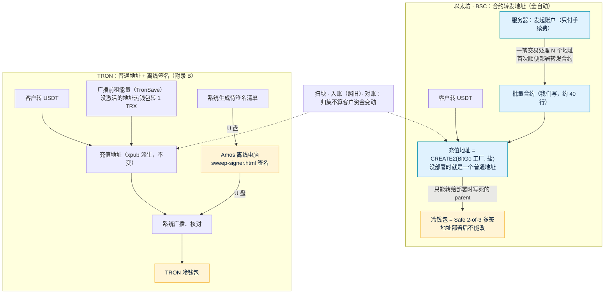
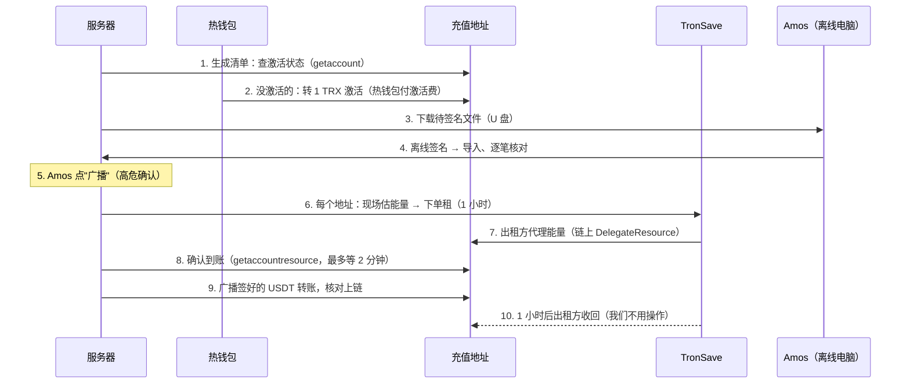

# 资金归集方案（充值地址 → 冷钱包，费用最低）
- 版本：v1.1（2026-10-20）
- 编写：研发（测试、运维确认各自部分）
- 状态：**Amos 10-20 已审核**（结论见下面"Amos 10-20 审核结论"和第 1 节的"Amos 结论"列）。**合约、后端、离线签名工具都没有实现**，按审核结论排进开发；原型只在原型（模拟数据）模式下显示，真实接口模式下对账页看不到入口，归集页面显示"未上线"（第 6 节）。
- 版本历史：v1.0（2026-10-20）初稿，推荐路线 (b)，交 Amos 审核；v1.1（2026-10-20）按 Amos 10-20 审核结论修改：SW-1 改选 (b)、SW-4 不请第三方审计（新增第 4.14 节风险和替代措施）、SW-6 门槛和手续费占比上限后台可改、SW-7 TRON 直接租能量（第 4.3 节重写：渠道调研、推荐、流程、付款、带宽和激活、费用、失败处理）、新增第 4.13 节"地址生成和变更"（含发起账户私钥泄露的处置流程）；原型的归集设置页和 TRON 部分同步修改。
- 背景：
  - Amos 2026-10-17 答复《Amos 待办》Q12 **选 B 半自动归集**，"生产上线前做，先写方案给他审核"。Q12 原文中 B 的定义：系统每次生成"哪些充值地址有多少 USDT、各需要补多少手续费币"的待签名交易清单，Amos 在离线电脑上用助记词签名，再把签好的交易交给系统广播，**私钥始终不上服务器**。
  - Amos 2026-10-20 补充："资金归集，如何可以做到费用最低，这条也是需要你思考的，之前我查到过 使用 智能合约 批量归集的策略，不知道是否靠谱"；同日又问："智能合约可以使用网上成熟、稳定、安全、开源的吗？你可以找到吗"。所以本方案先比较几种做法的费用和风险（第 3 节）、找现成的开源合约（第 3.5 节）、比较三条路线（第 3.6 节），再给推荐（第 4 节）。
- **结论先说**：**路线 (b)（Amos 10-20 已确认）**——**以太坊和 BSC 用 BitGo 开源的合约转发地址（原样部署）+ 服务器自动批量归集，钱只能进 Safe 多签冷钱包；TRON 用 B（普通地址 + 离线签名），广播前给每个充值地址租能量**（推荐 TronSave，租不到时自动回退到热钱包补 TRX、烧 TRX，第 4.3 节）。Q12 由 B 改为"以太坊 / BSC 合约自动归集 + TRON 离线签名"。TRON 部分的完整设计是附录 B（B 原本是按三条链写的，现在只用于 TRON；能量部分以第 4.3 节为准）。

## Amos 10-20 审核结论
Amos 原话：**"4不请审计   6归集门槛可以让我在后台改，默认值使用你的建议   7直接考虑租用能量的方案      其余按建议"**。

| 编号 | 结论 | 方案里怎么落实 |
|---|---|---|
| SW-1 | **改选路线 (b)**：Q12 从 B 改为"以太坊和 BSC 用 BitGo 转发合约自动归集，TRON 用 B 离线签名" | 全文按 (b) |
| SW-4 | **不请第三方审计**（"4不请审计"） | 第 4.14 节：写清风险；替代措施是 BitGo 合约原样部署、核对字节码，批量合约尽量短、覆盖率 100%、模糊测试，测试网完整演练，上线初期每个地址、每批设金额上限、冷钱包只放小额、逐步放开；**这些措施不能等同于审计** |
| SW-6 | **门槛后台可改，默认值按建议**（"6归集门槛可以让我在后台改，默认值使用你的建议"） | 门槛（ERC20 100 / BSC 10 / TRC20 100 USDT）和手续费占比上限（3%）都放进归集设置页：`sweep:config` 高危权限、原因必填、写审计；页面上显示默认值（第 4.9 节、第 6 节） |
| SW-7 | **TRON 直接租能量，不先烧 TRX**（"7直接考虑租用能量的方案"） | 第 4.3 节：渠道调研和比较、推荐 TronSave、流程、谁付租金、带宽和激活、每个地址的费用、失败处理；烧 TRX 只作为租不到时的自动回退 |
| SW-2、SW-3、SW-5、SW-8～SW-14、SW-B1～SW-B12 | **按建议**（"其余按建议"） | 不变；SW-B2（第一版烧 TRX）被 SW-7 取代，SW-B1（热钱包补 TRX）缩小为"激活新地址 + 租不到时回退" |

同日 Amos 还问了地址怎么生成、换冷钱包或发起账户时地址会不会变，研发从 BitGo 源码核对后写成第 4.13 节"地址生成和变更"。
- 依据：`技术方案/v1-充值方案.md` v1.2（D1 地址派生、D2 第一版不做自动归集，已审核）；`技术方案/v1-提现方案.md` v1.4（热钱包、nonce、TRON 过期重建、热钱包余额告警第 6 节）；`技术方案/v1-后台方案.md`（权限点、高危确认、审计）；代码 `backend/src/main/java/com/falconx/lite/wallet/`（`address/AddressService`、`deposit/`、`withdraw/HotWallet`、`withdraw/HotBalanceMonitor`、`withdraw/EvmWithdrawSender`、`withdraw/TronWithdrawSender`、`recon/ReconService`）。
- **不改的东西**：充值入账、冲正、客户余额、账本都不变（归集是平台自己的钱在平台自己的地址之间搬家，不是客户的资金变动）；提现照旧只从热钱包出；只认配置的 USDT 合约（约定 3、12）。
- 标注：【实测】= 2026-10-20 从开发环境实际调用主网节点、读源码核对过（带"模拟"的是 `eth_estimateGas` 加状态覆盖，没有真的发交易）；【官网】= 实际打开过官方文档或官方仓库；【估算】= 按公开的计费规则推算；【未核实】= 第三方资料、搜索摘要或推断，请以官方为准。

## 一图看懂



这张图想说明：以太坊和 BSC 的充值地址换成"转发合约地址"，里面的钱**只能去部署时写死的 Safe 多签冷钱包**；服务器上的发起账户只付手续费、按按钮，它的私钥被偷了也转不走客户的钱，所以可以全自动、一笔交易处理几十个地址、不用给每个地址补手续费币。TRON 上没有成熟的同类合约（BitGo 自己在 TRON 上也不用合约，第 3.5 节），用 B：普通地址 + Amos 离线签名，费用靠门槛和租能量控制（Amos 10-20：直接租能量）。

## 1. 需要 Amos 确认的事（Amos 10-20 已确认，见最后一列）
| 编号 | 事项 | 我的建议 | 为什么 | Amos 结论（10-20） |
|---|---|---|---|---|
| SW-1 | **Q12 是否改选路线 (b)**（第 3.6 节） | **改选 (b)**：以太坊、BSC 用合约转发地址 + 自动归集；TRON 维持 B | 以太坊、BSC 有现成、在生产上用了多年的开源合约（BitGo），能做到"全自动又不把充值私钥放服务器"；TRON 没有成熟的同类合约，自己移植要写新代码、做完整审计，而 TRON 每个地址的费用两种做法差不多（第 3.2 节）。**Q12 当时否掉的"C 全自动"是"把充值私钥放服务器"，(b) 不放，但流程变了，需要你重新确认** | **改选 (b)**（"其余按建议"） |
| SW-2 | 以太坊、BSC 用哪份合约 | **BitGo `eth-multisig-v4` 的 `ForwarderV4` + `ForwarderFactoryV4`，原样部署**（固定到一个提交号、同一个编译器版本，部署后核对字节码和 BitGo 官方部署一致）；只自己写一个约 40 行的批量合约 | BitGo 生产上用于以太坊、BSC 的自动归集【官网】；我们自己写的代码只剩"批量调用"，而且批量合约**碰不到钱**（钱永远由 BitGo 的代码转给 parent） | 按建议 |
| SW-3 | 冷钱包（BitGo 叫 parent） | **Safe 2-of-3 多签钱包的地址**（以太坊、BSC 各部署一个，可以是同一地址）。**parent 部署后永远不能改**（BitGo 合约里只在初始化时设一次，没有修改函数【官网：源码】）；要换人、换钥匙，在 Safe 里换签名人，地址不变；真要换地址 = 所有以太坊、BSC 充值地址作废换新 | 不能改反而最安全：后台、服务器、发起账户都改不了钱的去向，不需要时间锁 | 按建议 |
| SW-4 | 审计 | v1.0 建议：BitGo 合约**没有找到公开的审计报告**（只找到 Quantstamp 2021 年"审计了 BitGo 的以太坊多签钱包"的新闻，没写范围和版本，第 3.5 节），请一家做**小范围复核**（约 0.5–1.5 万美元、1–2 周【未核实：第三方报价汇总】）。**v1.1：Amos 决定不请审计，改用第 4.14 节的替代措施** | 我们新增的代码很少；BitGo 的代码在生产上管着大量资金多年，但"没有公开报告"要如实告诉你；不审计的剩余风险见第 4.14 节 | **不请审计**（"4不请审计"）→ 第 4.14 节 |
| SW-5 | 归集怎么触发（以太坊、BSC） | **先手动**：后台"执行归集"一键（高危确认）；跑稳一个月后打开**自动**：每天一次、以太坊 gas 低于上限才执行 | 先看几次真实结果再放手 | 按建议 |
| SW-6 | 归集门槛 | ERC20 **100**、BSC **10**、TRC20 **100** USDT；另加"手续费 ≤ 金额 × 3%"，不满足的这次跳过。**v1.1：门槛和占比上限都在归集设置页可改**（`sweep:config` 高危、原因必填、审计，页面显示默认值），以上是默认值 | 每笔手续费固定、和金额无关（第 3.3 节）。TRON 租能量后每个地址约 1.56 美元，100 USDT 时占 1.6% | **后台可改，默认值按建议**（"6归集门槛可以让我在后台改，默认值使用你的建议"） |
| SW-7 | TRON 能量 | v1.0 建议第一阶段烧 TRX、量大以后再租。**v1.1：Amos 决定直接租能量**：推荐 **TronSave**（HTTP API，预存余额，Nile 测试网可测；2026-10-20 实测报价 65,000 能量 1 小时 67.25 sun / 能量，比烧 TRX 便宜约 30%），广播前给每个要转出的充值地址租，确认到账再广播；租不到时自动回退到热钱包补 TRX；第 4.3 节 | 烧 TRX 是 100 sun / 能量；租金从 TronSave 平台余额扣，服务器只放 API Key、不放新的私钥 | **直接租能量**（"7直接考虑租用能量的方案"）→ 第 4.3 节 |
| SW-8 | 以太坊、BSC 的发起账户 | 一个**新的**以太坊体系账户（ERC20、BSC 共用），**不用热钱包**；私钥由你填进服务器 `.env`（`FX_SWEEP_EVM_OPERATOR_KEY`），账上只放够一两周的手续费币；余额低告警（默认 0 = 不告警） | 和提现分开：不抢热钱包的 nonce；被盗时只损失它自己的手续费币 | 按建议 |
| SW-9 | 测试环境已经发出的充值地址 | 以太坊体系的**换成合约地址**：旧地址继续扫块 30 天、照常入账，客户端只显示新地址；TRON 地址**不变**。**生产还没有客户，现在换代价最低** | 第 4.10 节 | 按建议 |
| SW-10 | 客户误转的其他币 | 以太坊、BSC：转发合约收到 ETH / BNB 会**自动转给 parent**，其他代币可以一并归集到 parent；TRON：仍然用助记词离线处理。都不入账（只认 USDT） | BitGo 合约自带这些功能【官网：源码】 | 按建议 |
| SW-11 | 鼓励客户用便宜的链 | 充值页三条网络按手续费从低到高排（TRC20 / BSC 在前），ERC20 旁边标"手续费较高"；**不禁止** | 以太坊对我们的首次部署成本最高、波动最大 | 按建议 |
| SW-12 | 权限点 | 新增 3 个：`sweep:view`（查看）、`sweep:operate`（执行归集、TRON 生成清单 / 导入签名 / 广播 / 作废，**高危**）、`sweep:config`（门槛、自动开关、gas 上限、TRON 冷钱包地址，**高危**）。以太坊、BSC 的冷钱包地址**后台改不了**（合约里写死）。权限点 49 → 52 | 后台被攻破也改不了以太坊、BSC 钱的去向 | 按建议 |
| SW-13 | TRON 以后要不要也改合约（路线 (a)） | 上线 3 个月后，按 TRON 归集的频率和你离线签名的工作量再定；要做时移植 BitGo 转发器到 TRON、修好第 3.5 节的三个坑、做完整审计 | 先用成熟的路线上线 | 按建议 |
| SW-14 | 原型 | 看截图（第 6 节） | 原型先行 | 按建议（v1.1 截图见第 6 节） |
| SW-B1…SW-B12 | TRON 用 B 时的细节（手续费谁补、离线工具、清单格式、冷钱包地址延迟生效等） | 见附录 B 第 B.1 节，建议不变 | — | 按建议（SW-B2 被 SW-7 取代） |

## 2. 现状
| 项 | 现状（代码） |
|---|---|
| 充值地址 | `AddressService`：账户级 xpub 按 BIP44 派生，**序号 = 用户 ID**。以太坊体系 `m/44'/60'/0'/0/{用户ID}`（ERC20 和 BSC 同一个地址），TRON `m/44'/195'/0'/0/{用户ID}`；表 `wallet_address` 存 `user_id`、`family`、`idx`、`address`。服务器只有 xpub（充值方案 v1.2 第 2 节写的是"序号用数据库自增"，代码实际用用户 ID，以代码为准） |
| 扫块 | 只扫配置好的 USDT 合约的 Transfer 事件，只看"收款方是我们的地址"（`EvmChainClient`、`TronChainClient`） |
| 热钱包 | `HotWallet`：以太坊体系一把私钥（ERC20、BSC 共用）、TRON 一把；nonce 按链存库（表 `wallet_chain_nonce`）；`HotBalanceMonitor` 每 5 分钟查余额 |
| 对账 | `ReconService`：充值记录 ↔ 账本 ↔ 链上区块哈希；提现 ↔ 账本。**不比较充值地址的链上余额** |
| 归集 | 没有（充值方案 D2：Amos 离线手动） |

## 3. 做法比较（费用最低是核心目标之一）
### 3.1 每种做法怎么工作
| | **B：现状地址 + 离线签名**（Amos 10-17 已选） | **D：CREATE2 合约转发地址** | **E：EIP-7702 委托** |
|---|---|---|---|
| 充值地址 | 不变：xpub 派生的普通地址（EOA） | 工厂合约用 CREATE2 算出的地址：`keccak256(前缀 ++ 工厂地址 ++ 盐 ++ keccak256(初始化代码))` 的后 20 字节。**不用提前部署**，客户往里转 USDT 和往普通地址转一样 | 不变：现有普通地址，每个地址离线签一次"授权"，把自己的代码委托给一个归集合约 |
| 归集一个地址要几笔交易 | **两笔**：先给地址补手续费币，再由地址自己转 USDT（离线签名） | 发起账户一笔交易处理 N 个地址；每个地址第一次归集时顺便部署最小代理合约（EIP-1167），以后直接调用 | 发起账户一笔交易处理 N 个地址（第一次带上授权） |
| 为什么合约不能批量操作现状地址 | 普通地址的 USDT 只有它自己的私钥能动；想让合约代转，要先 `approve`，而 `approve` 本身也是一笔要付手续费的交易——**还是得先补手续费币**。以太坊主网 USDT 也不支持 `permit`（免手续费授权） | — | EIP-7702 正是为解决这个问题：授权是签名、不是交易，由别人付费带上链 |
| 谁付手续费 | 每个充值地址自己（所以要先补） | 只有发起账户 | 只有发起账户 |
| 地址里留下的零头 | 每个地址留一点手续费币（补的时候按上限补，实际用不完） | 没有 | 没有 |
| 私钥 | 充值助记词离线，**每次归集都要离线签名** | 充值地址**没有私钥**；服务器上只有发起账户的私钥，它**只能让钱去冷钱包** | 充值助记词离线，每个地址只签一次授权 |
| 支持的链 | 三条都行 | 三条链的虚拟机都支持 CREATE2（TRON 前缀是 `0x41`，以太坊是 `0xff`【官网：TRON 文档"TVM vs EVM"】）；**但只有以太坊体系有成熟的开源合约**（第 3.5 节） | 以太坊（Pectra 升级，2025-05-07 主网生效【官网：ethereum.org】）、BSC（Pascal 硬分叉，2025-03-20 主网生效，含 BEP-441 = EIP-7702【未核实：BNB Chain 文档的搜索摘要，没有逐字打开】）；**TRON 不支持**（TRON 官方"TVM vs EVM"页的硬分叉列表止于 Cancun，没有提到 7702【官网】） |

**EIP-6780 和"部署后自毁"**：D 有一个变种是"每次归集在同一笔交易里部署转发合约、转出、自毁"，让地址平时永远没有代码。2024 年 Cancun 升级的 EIP-6780 以后，`SELFDESTRUCT` **只有在合约和自毁发生在同一笔交易里时才真的删除账户**，否则只转走原生币、代码留着。所以这个变种仍然可用（同一笔交易里创建 + 自毁 → 账户被删除 → 下次还能在同一地址 CREATE2）。TRON 的行为和 EIP-6780 一致，另外多一条限制：账户还有未到期的质押、委托时自毁会失败【官网：TRON"TVM vs EVM"】；TRON 主网已开启 Cancun 相关的 TVM 升级【实测：`getAllowTvmCancun` = 1】。但它**每次都要付部署费**，比"部署一次、以后直接调用"贵（下表），BitGo 用的也是"部署一次"。

### 3.2 每归集一个地址的费用（美元）
**行情和 gas 价格**（2026-10-20 09:17 UTC）：ETH 2,381.78、BNB 727.58、TRX 0.3322 USD【实测：币安只读行情 `data-api.binance.vision` 的 `ticker/price`】；以太坊主网 baseFee 0.0444 gwei、BSC gasPrice 0.05 gwei【实测：publicnode 主网节点 `eth_gasPrice`、最新区块 `baseFeePerGas`】；TRON 能量单价 100 sun、带宽 1,000 sun/字节、激活费 1 TRX + 0.1 TRX【实测：TronGrid 主网 `getchainparameters`】。以太坊今天的 gas 极低，表里另给 5 gwei（较忙）和 30 gwei（拥堵）两档。

**gas / 能量用量**（全部是转 USDT 给"已经持有 USDT 的冷钱包"；充值地址转完余额归零）：

| 动作 | 以太坊 | BSC | 来源 |
|---|---|---|---|
| B：充值地址直接转 USDT | 46,153 | 34,516 | 【实测（模拟）】`eth_estimateGas` + 状态覆盖：随机地址只有 USDT、没有原生币 |
| B：热钱包给它补手续费币 | 21,000 | 21,000 | 【实测（模拟）】普通转账 |
| **BitGo 转发器：首次部署** | ~250,000 | 同左 | 【官网】BitGo 文档"Wallet and Forwarder Versions"：v4 转发器"Contract deployment ~250,000 gas units"（部署时要写 parent、feeAddress 等几项存储，比最小部署贵） |
| **BitGo 转发器：归集代币** | ~40,000（单独一笔） | 同左 | 【官网】同上："Consolidating tokens ~40,000 gas units" |
| BitGo 转发器：批量里每多一个地址 | ≈ 27,000 | ≈ 27,000 | 【估算】40,000 − 21,000 基础费 + 冷账户访问和循环约 8,000 |
| 自己组装的最小转发合约：调用已部署的（单独一笔） | 48,979 | 37,270 | 【实测（模拟）】状态覆盖放一段手写的最小转发代码 |
| 自己组装：批量里每多一个已部署地址 | ≈ 34,000 | ≈ 22,400 | 【估算】上一行 − 21,000 + 2,600（冷账户访问）+ 约 3,500（代理转调、循环） |
| 自己组装：首次（顺便部署，不写额外存储） | ≈ 76,000 | ≈ 64,000 | 【估算】+ CREATE2 32,000 + 代码 45 字节 × 200 + 哈希 |
| D 变种：部署 + 转出 + 自毁（每次） | ≈ 70,000（单独一笔 89,970） | ≈ 58,400（单独一笔 78,395） | 【实测（模拟）】合约创建交易；批量时减 21,000 |
| E：首次（带授权）/ 以后 | ≈ 59,000 / ≈ 34,000 | ≈ 47,400 / ≈ 22,400 | 【估算】+ 每个授权 25,000（EIP-7702 空账户 `PER_EMPTY_ACCOUNT_COST`） |

TRON（能量；TRON 节点没有状态覆盖模拟，合约做法是估算）：

| 动作 | 能量 / 费用 | 来源 |
|---|---|---|
| USDT 转给已有 USDT 的地址 | **64,285** 能量（其中动态能量加价 49,635，USDT 合约 `energy_factor` = 34,000 即 +340%） | 【实测】主网 `triggerconstantcontract` |
| USDT 转给从没持有过 USDT 的地址 | **130,285** 能量 | 【实测】同上。**Amos 说的"约 13 万 / 约 6.5 万"核对属实** |
| B：给充值地址补 TRX | 带宽约 270 字节 → 约 0.27 TRX（热钱包免费带宽用完时）；地址没激活时热钱包另付 1 TRX + 0.1 TRX | 【官网】激活规则；【估算】字节数 |
| B：充值地址转 USDT 的带宽 | 约 345 字节；激活过的地址每天 600 免费带宽，够用 | 【实测】raw_data 205 字节 +【估算】签名和开销 |
| 合约做法：批量里每个已部署地址 | ≈ 66,000 能量（USDT 转账 64,285 + 代理转调；TRON 的 CALL、SLOAD 比以太坊便宜【官网】） | 【估算】 |
| 合约做法：首次（最小部署） | ≈ 107,000 能量 | 【估算】 |

**每个地址的费用（美元）**：

| 做法 | 以太坊（0.0444 gwei，今天） | 以太坊（5 gwei） | 以太坊（30 gwei） | BSC（0.05 gwei） | TRON（烧 TRX） | TRON（租能量，TronSave 67.25 sun【实测】，第 4.3.6 节） |
|---|---|---|---|---|---|---|
| B 现状地址（补 + 转，两笔） | 0.0071 | 0.80 | 4.80 | 0.0020 | **2.23**（6.70 TRX；首次没激活 2.71） | **1.56**（每个地址租 70,000 能量 1 小时 = 4.71 TRX；首次没激活另加 2.1 TRX = 0.70 美元） |
| **BitGo 转发器，首次（部署 + 归集）** | 0.031 | 3.45 | 20.72 | 0.0105 | 不适用 | 不适用 |
| **BitGo 转发器，以后每次（批量）** | **0.0029** | **0.32** | **1.93** | **0.0010** | 不适用 | 不适用 |
| 自己组装，首次 / 以后（批量） | 0.0080 / 0.0036 | 0.91 / 0.40 | 5.43 / 2.43 | 0.0023 / 0.0008 | 3.55 / 2.19（烧） | 1.42 / 0.88（只给发起账户租） |
| D 变种：每次部署 + 自毁 | 0.0074 | 0.83 | 5.00 | 0.0021 | ≈ 3.4 | ≈ 1.4 |
| E EIP-7702，首次 / 以后 | 0.0062 / 0.0036 | 0.70 / 0.40 | 4.22 / 2.43 | 0.0017 / 0.0008 | **不支持** | 不支持 |

一次性成本：BitGo 方案每条链部署工厂和实现合约各一次（以太坊约 300 万 gas【估算】，今天约 0.32 美元，30 gwei 时约 214 美元）+ Safe 多签（以太坊约 30 万 gas【未核实】）；不请第三方审计（SW-4，Amos 10-20），没有审计费用。B 的一次性成本：离线签名工具（我们写，附录 B.8）。

**怎么看这张表**：
1. 以太坊、BSC 今天的 gas 极低，每个地址都不到 4 美分；**差别在 gas 涨起来时**。BitGo 转发器首次部署贵（约 25 万 gas，以太坊 30 gwei 时 20 美元），但以后每次只要 B 的 40%。同一个地址被归集约 6 次以后（客户多次充值），BitGo 就比 B 便宜；BSC 上差别都在 1 美分以内。
2. 自己组装的最小合约首次最便宜，但要多写代码、做完整审计（第 3.6 节）。
3. **TRON 是大头**：每个地址烧 TRX 约 2.2 美元，几种做法差不多（USDT 合约本身就要 6.4 万能量）。省钱靠**租能量**：TronSave 2026-10-20 实测 1 小时 67.25 sun / 能量，每个地址约 1.56 美元（v1.0 写的"约 0.9 美元"是按第三方汇总页的 40 sun 估的【未核实】，实测没这么低）；在 B 下每个地址单独租。

### 3.3 不管选哪种都要做的降费手段
| 手段 | 说明 | 本方案怎么做 |
|---|---|---|
| **归集门槛** | 每笔手续费是固定的、和金额无关：TRON 转 10 USDT 和转 10,000 USDT 都是约 6.4 万能量。地址里钱少时不归，攒够了一次归 | 每条链一个门槛 + 手续费占比上限（SW-6） |
| **挑 gas 低的时段** | 以太坊 baseFee 一天里能差几倍；BSC、TRON 基本恒定 | 自动模式下以太坊设 gas 上限（默认 2 gwei），高于上限推迟到下一个时段，连续推迟 3 天提醒 |
| **批量** | 一笔交易处理 N 个地址，每笔的 21,000 基础费被 N 个地址分摊 | 以太坊、BSC 每批最多 100 个地址 |
| **鼓励客户用 BSC 和 TRON** | 以太坊归集成本最高、波动最大 | 充值页排序和提示（SW-11），不禁止 |
| **TRON 质押或租能量** | 质押：每 1 TRX 每天约 9.6 能量【实测：`TotalEnergyLimit` 180,000,000,000 ÷ `TotalEnergyWeight` 18,745,225,137；JustLend 接口 `priceFor10KEnergByStake` 1041.4 TRX / 万能量，一致】，每天归集 1 个地址要质押约 7,300 TRX（约 2,420 美元），本金锁定、解押要等【未核实：Stake 2.0 解押等待 14 天】；租：各渠道比较见第 4.3.1 节 | **直接租能量**（SW-7，Amos 10-20），租不到时回退烧 TRX |
| **冷钱包先收过 USDT** | 转给从没持有过 USDT 的地址，TRON 要 13 万能量（贵一倍），以太坊也贵约 17,000 gas | 新冷钱包第一次用之前，先手动往里转 1 USDT |

### 3.4 小结（三种做法本身）
| | B 现状 + 离线签名 | D 合约转发地址 | E EIP-7702 |
|---|---|---|---|
| 费用 | 中（以太坊多一笔补手续费、留零头） | 以太坊、BSC **长期最低**；TRON 和 B 差不多 | 以太坊、BSC 和 D 一样低；**TRON 用不了** |
| Amos 的工作量 | **每次**离线签名 | 只在设置多签时 | 每个新地址离线签一次授权 |
| 能不能全自动 | 不能 | **能，服务器上的钥匙转不走钱** | 以太坊、BSC 能 |
| 新增风险 | 离线电脑、U 盘、人工操作 | 合约 bug | 授权签错、委托合约 bug；助记词仍是总钥匙 |
| 对已发出的测试地址 | 不变 | 要换 | 不变 |

### 3.5 可用的开源合约（Amos 10-20 问"能不能用网上成熟、稳定、安全、开源的"）
| 合约 | 是什么 | 核实结果 |
|---|---|---|
| **BitGo `eth-multisig-v4`**（https://github.com/BitGo/eth-multisig-v4 ） | 包含 `ForwarderV4`（转发合约实现）、`ForwarderFactoryV4`（CREATE2 工厂）、`CloneFactory`（EIP-1167 最小代理）、`TransferHelper` | 【官网：仓库 README、源码，2026-10-20 读取】①许可证 **Apache-2.0**（仓库 `LICENSE`）；②地址用 CREATE2 预先算出、**收到钱以后才部署**，是 EIP-1167 最小代理（README "Wallets and forwarders are deployed using CREATE2 to allow addresses to be generated on demand, but only deployed upon first use"）；③`flushTokens(token)` 把转发合约里某个代币的全部余额转给 `parentAddress`，**只有 parent 和 feeAddress 能调用**（`onlyAllowedAddress`）；还有 `batchFlushERC20Tokens(tokens[])`（**一个**转发合约的多个代币），**没有"一次处理多个转发合约"的函数**，要自己加批量合约；④`parentAddress`、`feeAddress` 只在 `init` 里设一次（`require(parentAddress == address(0x0), 'Already initialized')`），**没有修改函数**；工厂还把 parent 和 feeAddress 混进盐里（`keccak256(abi.encodePacked(parent, feeAddress, salt))`），所以**地址本身就绑定了 parent 和 feeAddress**；⑤收到 ETH 自动转给 parent；⑥`callFromParent(target, value, data)`：parent 可以让转发合约调用任意合约（用来处理误转的特殊代币），**只有 parent 能调用**，feeAddress 不能；⑦代币转账用 `TransferHelper.safeTransfer`：`success && (data.length == 0 \|\| abi.decode(data, (bool)))`，**兼容以太坊主网 USDT 不返回 bool**；⑧仓库的部署配置 `hardhat.config.ts` 里有 `bsc`、`tbsc`（BSC 主网和测试网）以及 Polygon、Arbitrum 等 |
| BitGo 在生产上怎么用 | 托管服务的"收款地址" | 【官网：developers.bitgo.com "Wallet and Forwarder Versions"、"EVM consolidations"】v4 转发器用于以太坊等 EVM 链；**以太坊、BNB（BSC）、Polygon 是"自动归集、智能合约转发器、手续费由 gas tank 付"**；**TRON 列在"手动归集"，手续费由收款地址自己付 TRX**——也就是 **BitGo 自己在 TRON 上也不用合约转发器**。gas 数字：部署约 250,000，归集代币约 40,000 |
| BitGo 的审计 | — | **没有找到公开的、针对 `ForwarderV4` 的审计报告**：仓库 README 没有提到审计；BitGo 安全页面（bitgo.com/company/security）只有概括性说明；Quantstamp 2021-03-24 的新闻"Quantstamp 审计了 BitGo 的以太坊多签钱包"没有写仓库、版本和范围，也没有报告链接【官网：Quantstamp 博客】。所以只能说"在生产上用了多年"，不能说"审计过" |
| **OpenZeppelin Contracts**（https://github.com/OpenZeppelin/openzeppelin-contracts ，MIT） | 经过审计的基础组件：`Clones`（EIP-1167 + CREATE2 地址预测 `predictDeterministicAddress`）、`SafeERC20`、`TimelockController`、`AccessControl` | OpenZeppelin 公开了各版本的审计报告（仓库 `audits/` 目录）【未核实：没有逐个打开】。用它组装 = **组件审计过，但我们的组装代码是新的**，要整体审计 |
| **Safe**（https://safe.global ） | 多签钱包，用来做冷钱包 / parent / 合约所有者 | 支持以太坊、BNB Chain 等【未核实：没有打开 Safe 支持链列表】；**TRON 没有 Safe**，用 TRON 账户自带的多重签名权限（主网已开启【实测：`getAllowMultiSign` = 1】） |
| TRON 上成熟、开源、审计过的同类合约 | — | **没有找到**。已知的坑：①CREATE2 前缀是 `0x41` 不是 `0xff`【官网：developers.tron.network/docs/tvm-vs-evm】，而 TRON 官方"迁移以太坊合约"页又说 TRON 的 Solidity 编译器在 `new C{salt: …}()` 时会模拟 `0xff`，两页矛盾【未核实】；②**TRON 上的 USDT 转账成功时也返回 false**，标准 `SafeERC20`（以及 BitGo 的 `TransferHelper`）会因此回滚，要改成核对余额变化（OpenZeppelin 对 Across TRON 合约的审计说明：https://openzeppelin.com/news/across-tron-spokepoolperiphery-diff-audit ）【未核实：第三方审计报告，实现前在 Nile 上实测】；③用 `TransferContract` 转原生 TRX 时不会触发合约的 receive / fallback（TRON 官方"Fallback Functions"页这样写，提议支持它的 TIP-11 被否决；但"合约间调用"页说法相反【官网，两页矛盾】）——所以 BitGo"收到 ETH 自动转给 parent"在 TRON 上不成立，误转的 TRX 要另外处理 |

**BitGo 原样部署 vs 我们按 OpenZeppelin 自己组装，风险的区别**：

| | BitGo 原样部署 | 按 OpenZeppelin 自己组装 |
|---|---|---|
| 代码来源 | 一整套现成的转发器，**生产上管着大量资金多年**（BitGo 托管服务的以太坊、BSC 收款地址） | 组件（Clones、SafeERC20、TimelockController）审计过，**组装逻辑是我们新写的** |
| 公开审计 | **没找到** | 组件有；组装代码要我们请人审 |
| 我们要写的代码 | 只有约 40 行批量合约（碰不到钱：钱永远由 BitGo 代码转给 parent） | 工厂 + 转发合约 + 时间锁接线，约 150 行，都管钱 |
| 功能 | 多（NFT 回调、`callFromParent`、自动转 ETH），攻击面大一点，但都只对 parent 开放 | 只做我们要的，攻击面小 |
| 冷钱包能不能改 | **不能**（写进地址了）；换钥匙在 Safe 里换 | 可以设计成能改（要加多签 + 时间锁，也就多了一个风险点） |
| 首次部署 gas | 贵（约 25 万） | 便宜（约 7.6 万） |
| 出问题时 | 和 BitGo 用的同一份代码，问题大概率先被别人发现 | 只有我们自己用，问题只能靠审计和测试发现 |
| 能不能移植到 TRON | 能改，但改完就不是"原样"了，等于新代码 | 同一份组装代码改三个坑 |

结论：**以太坊、BSC 用 BitGo 原样部署**（我们最不容易出错的选择）；自己组装只在要移植到 TRON（路线 (a)）时才值得。

### 3.6 三条路线比较
| | **(a) 三条链都用合约** | **(b) 以太坊、BSC 用合约；TRON 用 B + 租能量（推荐，Amos 10-20 已选）** | **(c) 三条链都用 B** |
|---|---|---|---|
| 以太坊、BSC | BitGo 原样（或 OZ 组装） | BitGo 原样 + 批量合约 | 现状地址 + 离线签名 |
| TRON | 移植转发器、修好 3.5 节的三个坑（USDT 返回 false 改核对余额、`0x41` 前缀、TRX 不触发 receive），**新代码**，要**完整审计** | 现状地址 + 离线签名（附录 B），广播前租能量（第 4.3 节） | 同 (b) |
| 每个地址费用 | 以太坊、BSC 长期最低；TRON 烧 2.19 / 租 0.88 美元 | 以太坊、BSC 同 (a)；TRON 烧 2.23 / 租 0.95 美元 | 以太坊多一笔补手续费、留零头；TRON 同 (b) |
| Amos 的工作量 | 只有多签操作 | **只有 TRON 要离线签名**（按门槛攒，估计每周一次） | 三条链都要离线签名 |
| 审计费用和周期 | 以太坊、BSC 小范围复核 + TRON 完整审计（TRON 代码少但是新的，又是非主流链，要找有 TRON 经验的审计方）：约 1.5–4 万美元、3–6 周【未核实：第三方报价汇总（Sherlock、QuillAudits、Zealynx 2026 年的价格参考：小型合约 0.5–1.5 万美元、几天到 3 周；复审另加）】 | 约 0.5–1.5 万美元、1–2 周【未核实，同左来源】（**v1.1：Amos 决定不请审计**，改用第 4.14 节的替代措施，费用 0） | 0（离线工具是我们自己的代码，开源审阅，不请外部审计） |
| 开发量 | 大 | 中（合约部分很少；TRON 用附录 B） | 中（附录 B，三条链） |
| 风险 | TRON 新代码管着 TRON 上的钱 | 以太坊、BSC 依赖 BitGo 代码（无公开审计但生产验证）；TRON 依赖人工离线操作 | 全部依赖人工离线操作 |
| 上线时间 | 最长 | 中 | 中 |

**推荐 (b)**：以太坊、BSC 用最成熟的现成合约拿到"全自动 + 钱只能进多签"；TRON 上没有成熟的现成合约，BitGo 自己也在 TRON 上走普通地址，我们照做，费用上靠门槛和租能量；以后 TRON 量大、离线签名太累时再做 (a)（SW-13）。

## 4. 推荐路线 (b) 的设计
### 4.1 以太坊、BSC：合约
| 合约 | 来源 | 要点 |
|---|---|---|
| `ForwarderV4`（实现）、`ForwarderFactoryV4`（工厂） | BitGo `eth-multisig-v4`，**原样**；固定一个提交号和编译器版本（仓库用 `pragma solidity 0.8.20`），部署后在区块浏览器验证源码；能找到 BitGo 自己的官方部署时，核对字节码一致 | 以太坊和 BSC 用同一个部署账户、同一个 nonce 部署到**同一个地址**，算出的充值地址就相同，保持"ERC20 = BSC 同一地址"的约定（需求 4.4-1） |
| `SweepBatcher`（批量合约，我们写，约 40 行） | 只用 OpenZeppelin 的 `Ownable2Step` | 它就是所有转发合约的 `feeAddress`；`sweep(token, salts[])`：只有登记的发起账户能调用；对每个盐：没部署就 `factory.createForwarder(parent, address(this), salt)`，然后 `forwarder.flushTokens(token)`；每个地址单独 `try`，失败发事件、不影响其他地址；**合约里不持有任何钱**；所有者（增删发起账户）= Safe |
| 冷钱包 = parent | Safe 2-of-3 多签（SW-3） | 部署后不能改 |

- **盐**：`keccak256("falconx-deposit", 用户ID)`；BitGo 工厂会再混入 parent 和 feeAddress。所以 **parent（Safe 地址）和批量合约地址都要在发出第一个充值地址之前定下来**，以后换任何一个，所有地址都要换。
- **批量合约有 bug 怎么办**：钱不会丢（转钱的是 BitGo 代码，目标永远是 parent）；最坏是批量调用失败。**兜底**：parent（Safe）本身也有权调用每个转发合约的 `flushTokens`，可以在 Safe 里手动归集；再部署一个新的批量合约只能用于新地址（旧地址只认旧的 feeAddress）。
- **误转**：ETH / BNB 自动转给 parent；其他 ERC20 可以 `flushTokens`；特殊情况 parent 用 `callFromParent`。都不入账（只认 USDT）。
- 以太坊上有的钱包用 `transfer`（只给 2,300 gas）往合约地址转 ETH 会失败——我们本来就不收 ETH 充值。

### 4.2 安全边界：谁能做什么（以太坊、BSC）
| 角色 | 能做 | 不能做 |
|---|---|---|
| **服务器上的发起账户**（私钥在 `.env`） | 调用批量合约：把充值地址里的钱转进 parent；花自己的手续费币 | 改 parent、把钱转到任何别的地方 |
| **发起账户的私钥被偷** | 攻击者可以：①转走发起账户里的手续费币（所以只放一两周的量，SW-8）；②反复调用批量合约浪费手续费（钱照样进冷钱包）；③不调用（归集停了，告警会发现） | **偷不走充值地址里的钱** |
| **服务器整个被攻破** | 同上；另外能改后台显示、停扫块（现在就有的风险） | 同上：钱的去向写在链上的合约和地址里 |
| **Safe 多签（Amos）** | 动冷钱包里的钱；手动归集；增删发起账户 | — |
| **合约有 bug** | BitGo 部分：和 BitGo 托管服务同一份代码；我们的批量合约：碰不到钱 | → 不请审计（SW-4），用第 4.14 节的替代措施：字节码核对、覆盖率 100%、模糊测试、测试网完整演练、上线初期金额上限 |

**这改变了 Q12 的结论**：Q12 时把"全自动"等同于"把充值私钥放服务器"（C），所以选了 B；以太坊、BSC 用合约转发地址后，全自动不需要充值私钥，服务器上那把钥匙即使被偷也转不走钱。

### 4.3 TRON：B（附录 B）+ 租能量（Amos 10-20：直接租能量）
TRON 按附录 B 做，只是范围缩小到 TRC20 一条链：门槛和跳过规则（B.3）、清单格式（B.6：TRON `raw_data_hex`，`expiration` 设成生成后 20 小时，链上上限 24 小时【实测：java-tron `Constant.MAXIMUM_TIME_UNTIL_EXPIRATION = 24 * 60 * 60 * 1_000L`】）、冷钱包地址后台配置 + 24 小时生效延迟（B.7）、离线签名工具 `sweep-signer.html`（B.8，只需要支持 TRON）、广播和核对（B.9）。**能量和手续费币以本节为准**：不再"热钱包补 TRX、烧 TRX"（附录 B.4、B.5、SW-B2），改为广播前给每个要转出的充值地址租能量；热钱包只做两件事：给没激活的地址转 1 TRX 激活，以及租不到能量时回退补 TRX。

#### 4.3.1 能量租赁渠道调研（2026-10-20）
| 渠道 | 价格（每次转 USDT 约 6.4 万能量） | 最小数量 / 时长 | 能否指定接收地址 | 链上可验证 | 对接方式 | 账号 / KYC | 可靠性 |
|---|---|---|---|---|---|---|---|
| **TronSave**（https://tronsave.io ，文档 https://docs.tronsave.io ） | **67.25 sun / 能量（1 小时）**、86.5 sun（1 天）：65,000 能量 1 小时 = 4.37 TRX【实测：主网报价接口 `POST https://api.tronsave.io/v2/estimate-buy-resource`，2026-10-20，不需要 API Key；SLOW / MEDIUM / FAST 三档当时同价】 | 文档没写最小值，示例是 65,000 能量、按秒计时长【官网】 | 能：请求里填 `receiver`【官网】 | 能：出租方用 Stake 2.0 的 `DelegateResourceContract` 代理给接收地址，链上能查到代理来源和数量（`/wallet/getdelegatedresourceaccountindexv2`、`getaccountresource`）【官网：TRON Stake 2.0 文档；TronSave 侧未实测】 | HTTP API（`buy-resource`、`estimate-buy-resource`、`user-info`），也有 TypeScript / Java / Python 等 SDK；另一种方式是每次用自己的钱包签一笔 TRX 付款交易（不需要 API Key）【官网】 | 用钱包登录拿 API Key，**没写要 KYC**；预存余额：往平台给的充值地址转 TRX，每次至少 10 TRX，每天 2 次免费、以后每次 0.3 TRX，首次多付约 1 TRX 激活充值地址【官网】 | 撮合市场（很多出租方挂单），订单可以设 `maxPriceAccepted`、`allowPartialFill`【官网】；**有 Nile 测试网**：网站 testnet.tronsave.io、接口 `https://api-dev.tronsave.io`【官网；Nile 报价接口实测能用】；没公开 SLA【未核实】 |
| **JustLend DAO 能量租赁**（链上合约，主网 `TU2MJ5Veik1LRAgjeSzEdvmDYx7mefJZvd`，Nile `TSos1xxjqMrGKBxycVmtgrnFvv9M6FDFUX`） | 每天 0.474 TRX / 万能量（≈ 47 sun / 能量 / 天）【实测：`https://openapi.just.network/lend/strx` 的 `priceFor10KEnergByRent` = 0.47394441；合约 `_rentalRate` 与之一致】；按秒计租金，**用掉的能量另扣 0.75 天押金**【官网：docs.justlend.org "Energy Rental"】→ 7 万能量租 1 小时、用掉 6.4 万 ≈ 2.4 TRX；**但每笔 `rentResource` 调用本身要约 8.4 万能量**【实测（模拟）：主网 `triggerconstantcontract`，新付款方 + 新接收方】，付款账户自己没有能量时要烧约 8.4 TRX，合起来比直接烧 TRX 还贵 | 没写最小值；预付款 = 押金（1 天租金）+ 租金 + 清算保证金 `minFee` **20 TRX**（按时归还退回）【实测：主网 `minFee()` = 20,000,000 sun；代理 6,800 TRX 时预付 22 TRX 回滚、24 TRX 成功（模拟）】；最长 30 天 | 能：`rentResource(receiver, amount, 1)`；**接收地址必须已激活、不能是合约**【官网；实测（模拟）：给没激活的地址租，交易回滚】 | 能（全在链上：`RentResource` 事件、`rentals(renter, receiver, 1)`） | 合约调用（TronWeb），到期前要自己 `returnResource`，不还会被清算、扣清算保证金【官网】 | **不需要账号、不需要 API Key**；但服务器上要有付款账户的**私钥** | 由 JustLend DAO 合约提供，不依赖某个公司的服务器；参数可能被 DAO 调整（2025-09 租金率从 15% 降到 8%【未核实：媒体报道】） |
| **TRON 官方 Stake 2.0：自己质押 + 资源代理** | 不付租金：自己质押 TRX 得到能量，`DelegateResource` 代理给充值地址、用完 `UnDelegateResource` 收回；两笔都是系统合约，只耗带宽（付款账户每天 600 免费带宽，够 2 笔）【实测：`getFreeNetLimit` = 600】。成本是**锁住本金**：每 1 TRX 每天约 9.6 能量，每天归集 1 个地址约 7,300 TRX（约 2,420 美元）【实测】 | 无；能量 24 小时恢复 | 能 | 能 | 系统合约（TronWeb / 节点 HTTP），不是租赁 | 不需要账号；服务器上要有质押账户的**私钥**（它能代理、取消代理，不能直接动别人的钱） | TRON 协议本身，最可靠；解押要等【未核实：14 天】 |
| GetBlock TRON Energy（https://docs.getblock.io/tron-energy ） | 文档示例 65,000 能量 1 天 36 sun / 能量 = 2.34 TRX【官网示例，**未实测**：要 API Key 才能报价】 | 30,000–5,000,000 能量；1 小时 / 1 天 / 3 天 / 7 天【官网】 | 下单接口要填接收地址（报价接口没有）【官网，未逐页核对】 | 能（同样是 Stake 2.0 代理） | HTTP API（Bearer API Key）【官网】 | 要注册 GetBlock 账号拿 API Key【官网】；KYC 未写 | 文档写"代理确认后才扣钱，失败不扣"【官网，未实测】 |
| 其他（Feee.io、iTRX、CatFee、Netts 等） | 第三方汇总页说市场价约 35–58 sun / 能量【未核实：多个页面互相转抄】 | — | 一般能 | 一般能（Stake 2.0 代理） | 多数是 HTTP API + API Key | 要注册 | 都是小公司，**没逐个核实**，这次不推荐 |

说明："1 小时 67.25 sun"比"1 天 86.5 sun"便宜，因为 TronSave 按"能量 × 时长"另算单价；我们每笔只要几分钟，租 1 小时最划算。

#### 4.3.2 推荐和备选
- **推荐 TronSave**：①实测报价比烧 TRX 便宜约 33%（67.25 vs 100 sun）；②HTTP API + 预存余额，**服务器上只放 API Key，不放新的私钥**；③能指定接收地址、链上能核对能量是否到账；④有 Nile 测试网，开发阶段能完整联调；⑤报价接口公开，后台能显示实时报价。
- **备选 1：烧 TRX（自动回退）**：TronSave 不可用、余额不够、报价高于上限或 2 分钟内能量没到账时，按"回退到烧 TRX"开关（默认开）由热钱包给这个地址补 TRX，链上按 100 sun / 能量扣。永远可用，只是贵。
- **备选 2：GetBlock TRON Energy**：TronSave 长期不可用时换它（接口类似，要注册拿 API Key，开发时再实测价格）。
- **不选 JustLend 按地址租**：链上、免账号是优点，但每笔 `rentResource` 本身约 8.4 万能量、还要 20 TRX 清算保证金和"到期前自己归还"，按地址逐个租比烧 TRX 还贵；服务器上还要放付款私钥。以后如果改成"付款账户自己先有能量"再评估。
- **以后量大时再考虑自己质押（Stake 2.0）**：每天归集笔数稳定、愿意锁一笔 TRX 时，边际成本接近 0；要服务器上有质押账户私钥（风险和热钱包同级），单独写方案。

#### 4.3.3 流程（B 方案 + 租能量）

这张图想说明：租能量放在"签名导入以后、Amos 点广播时"才做——租期只有 1 小时，Amos 签名可能要几个小时，提前租会过期浪费；签好的交易在 20 小时有效期内随时能广播，所以先签、后租、再广播。

1. **生成清单**（不变，附录 B.3）：另外用 `getaccount` 查每个地址是否激活。**只收过 TRC20 的地址不会被激活**【实测：2026-10-20 主网最近 60 个 USDT 收款地址里有 2 个 `getaccount` 返回空，例如 `TJzH2uXrMa5TiTnzGKjJbU6GHW8VdhWwt9` 在区块 87,272,873 收到 USDT（交易 `8425dc4f…2901` 成功），账户仍不存在】。没激活的由热钱包转 **1 TRX** 激活（热钱包另付激活费 1.1 TRX【官网 + 实测参数：`getCreateNewAccountFeeInSystemContract` = 1 TRX、`getCreateAccountFee` = 0.1 TRX】），这 1 TRX 留在地址里，免费带宽不够时用来付带宽。受附录 B.4.3 的热钱包上限约束。
2. **离线签名、导入、核对**（不变，附录 B.8、B.9.1）。交易的 `fee_limit` 仍是 20 TRX；地址里只有不到 1 TRX，**能量不够时交易会执行失败、不会把地址里的 USDT 以外的东西花光**，所以必须先确认能量到账再广播。
3. **广播**（Amos 点"广播"，高危确认）：系统对每个核对通过的地址依次做：
   1. **现场估能量**：`triggerconstantcontract` 模拟这笔转账，得到能量 E（转给已有 USDT 的冷钱包约 64,285【实测】）；租 `ceil(E × 1.09 / 1000) × 1000`（默认约 70,000，余量防动态能量上涨）。
   2. **检查限额**：报价 ≤ 最高单价（默认 90 sun，不能高于烧 TRX 的 100 sun）、今天已花 + 这笔 ≤ 每天租金上限（默认 500 TRX）、平台余额够；不满足 → 按"回退"处理。
   3. **下单**：`POST /v2/buy-resource`：`receiver` = 充值地址、`resourceType` = ENERGY、`resourceAmount`、`durationSec` = 3600、`unitPrice` = 最高单价、`options.allowPartialFill = false`；订单号落库（`wallet_sweep_item.rent_order_id`）。**接口超时不等于没下单**（约定 13 同一原则）：先按订单号和链上代理查，查不到再重下，每个地址每批最多下 2 单。
   4. **确认到账**：每 3 秒查 `getaccountresource`（`EnergyLimit − EnergyUsed ≥ E`），并用 `getdelegatedresourceaccountindexv2` 记下代理来源地址；最多等 2 分钟。
   5. **广播**签好的交易（附录 B.9.2），确认和核对照旧（B.9.3）。
   6. **到期**：TronSave 订单到期由出租方收回【官网：按时长出租；收回动作未实测】，我们不用归还；用 JustLend 时才要自己 `returnResource`。
4. 地址之间互不影响：某个地址租不到只影响它自己。默认每次并行 10 个地址。

#### 4.3.4 谁来付租金、服务器上放什么
| 做法 | 付款方 | 服务器上要放的 | 金额上限 | 结论 |
|---|---|---|---|---|
| **TronSave 预存余额 + API Key（推荐）** | TronSave 账户余额，由 Amos 从自己的钱包充值 | `FX_SWEEP_TRON_RENT_API_KEY`（**是密钥，只由 Amos 填进 `.env`**）；**不放新的私钥** | 平台余额建议不超过 **1,000 TRX**（约 330 美元，够约 200 个地址）；系统侧每天租金上限默认 500 TRX、最高单价 90 sun；余额低于告警下限发邮件 | API Key 泄露时最多损失平台余额（攻击者能拿余额给任意地址买能量；能不能用 API 提走余额【未核实】，按"能"算风险） |
| TronSave"每次签名付款"或 JustLend | 单独的 **TRON 付款账户**（新地址，不用热钱包） | 付款账户**私钥** `FX_SWEEP_TRON_RENT_KEY`（只由 Amos 填） | 账上只放 **200 TRX** 以内，余额告警 | 多一把会自动付钱的私钥在服务器上，不推荐；只在 API 方式不可用时用 |
| 热钱包付 | 热钱包 | 已有的热钱包私钥 | 附录 B.4.3 的每笔 / 每批 / 每日上限 | 只用于"激活 1 TRX"和"回退烧 TRX"，不用来付租金 |

#### 4.3.5 带宽和激活
- **激活**：只收过 TRC20 的地址不会激活（上面实测）；没激活的地址没有免费带宽，**JustLend 也不能给它租**（实测回滚）；Stake 2.0 代理给没激活的地址【未核实：TronSave 是否支持】。所以统一做法：生成清单时热钱包先转 1 TRX 激活。
- **免费带宽**：激活过的账户每天 600 免费带宽【实测：`getFreeNetLimit` = 600】；一笔 USDT 转账约 **345 字节**【实测：主网交易 `8425dc4f…2901` 的 `net_fee` = 345,000 sun = 345 字节 × 1,000 sun】→ 每个地址每天免费转 1 笔，够用（同一地址同时只在一个批次里）。
- **不够时**：同一天第二笔、或免费带宽被别的交易用掉时，按 1,000 sun / 字节从地址里的 TRX 扣（约 0.35 TRX）——激活时留的 1 TRX 够付约 2 次；不够时热钱包按需补（和"回退"同一套上限）。也可以向 TronSave 租带宽，量小不值得。

#### 4.3.6 每个地址的实际费用估算（TRX 0.3322 美元【实测：币安只读行情，2026-10-20】）
| 做法 | 每次（地址已激活、冷钱包已有 USDT） | 首次额外 | 依据 |
|---|---|---|---|
| 烧 TRX（v1.0 的第一阶段，现在只做回退） | 6.43 TRX 能量 + 0.27 TRX 补 TRX 交易 = **6.70 TRX ≈ 2.23 美元** | 激活费 1.1 TRX | 【实测】能量 64,285 × 100 sun；补 TRX 的带宽【估算】 |
| **TronSave 租 1 小时（推荐）** | 70,000 × 67.25 sun = **4.71 TRX ≈ 1.56 美元**（按实测用量 65,000 算是 4.37 TRX） | 转入 1 TRX + 激活费 1.1 TRX = 2.1 TRX ≈ 0.70 美元 | 【实测】报价接口；带宽用免费额度【实测】 |
| GetBlock 租 1 天 | 70,000 × 36 sun = 2.52 TRX ≈ 0.84 美元 | 同上 | 【官网示例，未实测】 |
| JustLend 按地址租 1 小时 | 租金约 0.14 + 用掉能量扣押金约 2.29 + `rentResource` 约 8.4 万能量（烧 8.43）+ 归还交易【未核实】≈ **11 TRX 以上 ≈ 3.7 美元** | 同上 | 【实测（模拟）+ 官网】 |
| 自己质押代理 | ≈ 0（只耗带宽） | 锁 ~7,300 TRX / 每天每个地址 | 【实测】参数 |

冷钱包第一次收 USDT 时要 130,285 能量【实测】，所以新冷钱包启用前仍先手动转 1 USDT（第 3.3 节）。

#### 4.3.7 失败处理
| 情况 | 怎么发现 | 处理 |
|---|---|---|
| **租到了能量，但交易失败**（动态能量涨了 `OUT_OF_ENERGY`、USDT 合约暂停或地址被冻结等） | 交易回执 `receipt.result` ≠ SUCCESS | 这一笔"失败"、原因写清；**租金不退**（已经代理）；同一份签名不能再用（txID 已上链），下次生成清单时重新签；同一原因连续 3 笔就暂停本批剩下的广播、告警（`sweep.failed.TRC20`），避免继续花租金 |
| **能量没到账**（2 分钟内 `getaccountresource` 不够） | 轮询超时 | 先按订单号查状态：没成交的取消或等平台退回余额【未核实：TronSave 未成交订单的退款规则，开发时实测】；"回退到烧 TRX"开着 → 热钱包给这个地址补 `E × 100 sun × 1.2`（约 7.72 TRX），确认后广播；关着 → 这一笔停在"等待能量"，有效期内可以手动重试，过期作废。记录 `rent_status = notDelivered / fallbackBurn` |
| **只到账一部分** | 同上 | 当作没到账（不广播，不然差额会从地址里的 TRX 扣，不够就失败） |
| **能量过期**（到账后节点故障等，1 小时内没广播出去） | 广播前再查一次能量 | 不够就重新租一次（计入每天上限）；第二次还不行按"没到账"回退 |
| TronSave 接口故障 / 余额不足 / 报价高于上限 | 下单失败、余额查询 | 整批按"回退"处理；告警 `sweep.rent.failed`（30 分钟节流）、`sweep.rent.balance`（平台余额 < 下限） |
| 接口超时（不知道下没下单） | 超时 | 先查订单和链上代理，查不到再下单；每个地址每批最多 2 单（防重复付钱） |

### 4.4 地址生成和充值识别要改什么
| 地方 | 改动 |
|---|---|
| `AddressService` | 以太坊体系新增"合约地址"模式：按 BitGo 工厂地址、实现地址、parent、批量合约地址、盐算地址（纯计算，不访问节点）；配置 `FX_SWEEP_EVM_FACTORY`、`FX_SWEEP_EVM_IMPLEMENTATION`、`FX_SWEEP_EVM_PARENT`、`FX_SWEEP_EVM_BATCHER`（都是公开地址，不是密钥）。**配置齐了就用合约地址，否则照旧用 xpub**；TRON 照旧用 xpub |
| `wallet_address` | 加列 `scheme`（`XPUB` / `FORWARDER`）、`salt`、`status`（`ACTIVE` / `RETIRED`）、`deployed_at`；每个用户每个体系同时只有一个 `ACTIVE` 地址；旧地址 `RETIRED` 后扫块继续看 30 天（SW-9） |
| 扫块 | **识别逻辑不用改**：仍然是"USDT 的 Transfer 事件，收款方是我们的地址"——收款方是转发合约（还没部署时就是普通地址）对 Transfer 事件没有区别。另外看"付款方是我们的地址"的 Transfer：交易哈希是归集记录里的 → 归集确认；**不是 → 最高级别告警**（以太坊、BSC 上只可能转去 parent，转去别处说明合约有问题；TRON 上说明助记词可能泄露） |
| 入账、冲正、账本 | 不变 |
| 客户端 | 不变（只是以太坊体系地址换了）；充值页按 SW-11 排序 |

### 4.5 门槛和"哪些地址进这一批"（三条链同一规则）
1. 取 `ACTIVE` 地址中**没有"待确认"充值**、最近一笔入账已超过 2 倍确认数的；已在进行中批次里的跳过（`active_key`）。
2. 查 USDT 余额（批量 `balanceOf`），**≥ 门槛**的进候选（SW-6）。
3. 估手续费：以太坊、BSC 按"已部署 / 未部署"（`eth_getCode`）分开算；**手续费折美元 > 金额 × 3%** 的跳过（币价用报价模块已有的 ETHUSD、BNBUSD；TRX 用后台填的参考价，0 = 不检查）。
4. 以太坊 baseFee 高于上限（默认 2 gwei）时整批推迟（自动模式）或提示（手动模式）。
5. 按余额从大到小，每批最多 100 个（TRON 按附录 B，200 个）。以太坊、BSC 的归集金额 = 合约执行时的**全部余额**（`flushTokens` 读 `balanceOf`），生成和执行之间新到的钱也一起转走。

### 4.6 以太坊、BSC 一批怎么执行（服务器签名，不需要离线清单）
| 链 | 交易 | nonce / 手续费 |
|---|---|---|
| 以太坊 | 发起账户发 **EIP-1559** 交易调用 `SweepBatcher.sweep`，`gasLimit` = `eth_estimateGas` × 1.2，`maxFeePerGas` = 2 × baseFee + 小费（默认 0.05 gwei，可配） | 发起账户自己的 nonce（单独一套，不和热钱包共用）；30 分钟没上链用同一 nonce 加价 20% 重发，最多 3 次（和提现同一套逻辑） |
| BSC | legacy + EIP-155（和提现一样） | 同上 |

- **广播前模拟**：`eth_call` 先跑一遍，失败的不发。一批的内容落库，后台可以导出 CSV 留档。
- **连不上节点不等于失败**（约定 13 同一原则）：当"可能已发出"，按交易哈希查。
- 核对（每 30 秒）：交易成功且确认数够（和充值同一确认数）→ 逐个地址看 USDT Transfer 事件：`from` = 充值地址、`to` = parent、金额 = 执行前余额；再查地址余额归零（期间又到账的除外）。
- **部分成功**：批量合约里每个地址单独 `try`，失败的地址发事件，系统记原因，下次自动带上；连续 3 次失败的停止自动归集、告警、等人工看。整笔交易失败（gas 不够等）：全批没动，减半批量重试一次，仍失败告警。
- 批次状态：`PENDING` → `SENT` → `CONFIRMED` / `PARTIAL` / `FAILED` / `DEFERRED`（gas 太高推迟）。TRON 的批次状态按附录 B.9。

### 4.7 冷钱包地址
| 链 | 存在哪 | 后台 |
|---|---|---|
| 以太坊、BSC | parent = Safe 地址，**写在每个转发合约里和地址算法里**，不能改 | 归集设置页**只读**显示 parent、Safe 的签名人和阈值（从链上读，带读取时间）、批量合约的发起账户名单；Safe 的签名人或阈值变化、批量合约发起账户增删时（链上事件）立即发告警邮件 |
| TRON | 后台配置 | 附录 B.7：高危、原因必填、审计、**24 小时后生效**、可取消、邮件；离线工具再比对 Amos 自己保存的冷钱包地址 |

后端额外检查：冷钱包不能是我们的充值地址、热钱包、USDT 合约地址（Amos 10-19 领测试币时把合约地址当收款地址的教训），命中就告警。

### 4.8 和充值入账、对账页的关系
- 归集**不写账本、不改客户余额**；客户端无变化。冷钱包不是我们的充值地址，归集转出不会被识别成充值。
- 对账新增问题类型：`SWEEP_UNKNOWN_OUTFLOW`（充值地址出现不是归集的转出）、`SWEEP_AMOUNT_MISMATCH`（归集金额和 Transfer 事件、余额对不上）、`SWEEP_DEST_MISMATCH`（钱去了不是冷钱包的地方）。
- 对账页上方（热钱包余额下面）加一行"资金归集"摘要：每条链待归集金额、上次归集时间、发起账户余额，点进去到归集页面。

### 4.9 权限、审计、告警、接口、数据表
- 权限点：`sweep:view`、`sweep:operate`（高危）、`sweep:config`（高危），共 52 个（SW-12）；前后端清单同时改（约定 16）。
- 审计：`sweep.run`（以太坊、BSC 手动执行，原因必填）、`sweep.retry`、`sweep.settings_update`（门槛、手续费占比上限、上线初期金额上限、TRON 能量设置等，修改前后的值完整记录，原因必填），以及附录 B.12 的 TRON 各项。
- 接口（计划）：`GET /api/admin/sweep/overview`、`GET / PUT /api/admin/sweep/settings`、`POST /api/admin/sweep/preview`、`POST /api/admin/sweep/batches`（以太坊、BSC 执行；TRON 生成清单）、`GET /api/admin/sweep/batches`、`GET /api/admin/sweep/batches/{no}`、`POST .../retry`；TRON 另有 `GET .../unsigned`、`POST .../signed`、`POST .../broadcast`、`POST .../cancel`、冷钱包地址的 `POST /api/admin/sweep/targets`（附录 B.12）。
- 告警（E8，不进 `status`，约定 24）：`sweep.unknown_outflow`（**每次都发**）、`sweep.owner_change`（Safe 签名人 / 阈值、批量合约发起账户变化，**每次都发**）、`sweep.operator.<链>`（发起账户余额 < 下限，默认 0 = 不告警）、`sweep.failed.<链>`、`sweep.deferred.<链>`（gas 太高连续推迟 3 天）、`sweep.pending.<链>`（待归集金额 ≥ 提醒下限，默认 0 = 不提醒）、`sweep.rent.failed`（租能量失败或回退烧 TRX，30 分钟节流）、`sweep.rent.balance`（TronSave 余额 < 下限，默认 0 = 不告警），以及附录 B.12 的 TRON 各项。
- **数据表（迁移 V28，staging 当前最大是 V27；只写在方案里，审核通过后再写迁移）**：

| 表 / 变化 | 内容 |
|---|---|
| `wallet_address` 加列 | `scheme VARCHAR(10) NOT NULL DEFAULT 'XPUB'`（`XPUB` / `FORWARDER`）、`salt VARCHAR(66) NULL`、`status VARCHAR(8) NOT NULL DEFAULT 'ACTIVE'`、`retired_at`、`deployed_at`；唯一索引从 `(user_id, family)` 改为 `(user_id, family, scheme)` |
| 新表 `wallet_sweep_batch` | 三条链共用：`id`、`public_no`（雪花 ID，约定 25）、`chain`、`mode`（`CONTRACT` / `OFFLINE`）、`status`、`trigger`（`MANUAL` / `AUTO`）、`created_by`、`reason`、`address_count`、`expected_usdt DECIMAL(36,18)`、`swept_usdt DECIMAL(36,18)`、`destination`（快照）、`params_json`（门槛、gas 价格、上限快照）、`fee_paid`、`fee_asset`、`created_at`、`expires_at`（TRON）、`sent_at`、`finished_at`，以及 TRON 用的 `unsigned_sha256`、`signed_sha256`、`cancelled_by`、`cancel_reason`；索引 `(chain, status)`、`(created_at)` |
| 新表 `wallet_sweep_item` | 每个地址一行：`batch_id`、`item_no`、`address_id`、`user_id`、`address`、`address_index`（TRON）、`deploy`（以太坊、BSC 这次是否部署）、`balance_before`、`swept`、`status`、`fail_reason`、TRON 用的 `topup_amount`、`topup_tx_hash`、`topup_status`、`unsigned_tx`、`signing_hash`、`signed_tx`、`tx_hash`、`expiration`；`active_key VARCHAR(80) NULL UNIQUE`（进行中时 = `链:地址`，保证同一地址同时只在一个批次里，MySQL 没有部分唯一索引，用这个代替） |
| 新表 `wallet_sweep_tx` | 以太坊、BSC 一批的每次发送（含加价重发）：`batch_id`、`attempt`、`tx_hash`、`nonce`、`fee_price`、`raw`、`status`、`created_at` |
| 新表 `wallet_sweep_event` | 批次和单笔的每次状态变化（只增不改） |
| 新表 `wallet_sweep_target` | TRON 冷钱包地址和它的变更（附录 B.11） |
| `wallet_sweep_item` 加列（TRON 租能量） | `rent_provider`、`rent_order_id`、`rent_energy`、`rent_trx DECIMAL(36,6)`、`rent_status`（`NONE` / `ORDERED` / `DELIVERED` / `NOT_DELIVERED` / `FALLBACK_BURN` / `EXPIRED`）、`rent_from`（链上代理来源地址）、`rent_expires_at`、`rent_attempts`；`topup_*` 改为记"激活转账"和"回退补 TRX" |
| `common_config` 初始值 | `sweep.threshold.ERC20 = 100`、`.BSC = 10`、`.TRC20 = 100`；`sweep.maxFeeRatio = 0.03`（**以上是 Amos 10-20 确认的默认值，在归集设置页可改**）；`sweep.evmCap.perAddress = 5000`、`sweep.evmCap.perBatch = 20000`（USDT，上线初期上限，0 = 不限，第 4.14 节）；`sweep.tron.energyMode = RENT`（`RENT` / `BURN`）、`sweep.tron.rent.maxPriceSun = 90`、`sweep.tron.rent.perDayTrx = 500`、`sweep.tron.rent.durationMin = 60`、`sweep.tron.rent.fallbackBurn = true`、`sweep.tron.rent.balanceMin = 0`；`sweep.batchMax.EVM = 100`、`.TRON = 200`；`sweep.auto.enabled = false`（SW-5）、`sweep.auto.hourUtc = 18`（北京时间凌晨 2 点）；`sweep.ethMaxBaseFeeGwei = 2`；`sweep.priorityFeeGwei = 0.05`；`sweep.operatorMin.ERC20` / `.BSC = 0`；`sweep.remind.<链> = 0`；`sweep.trxUsdRef = 0`；TRON 的补手续费上限、有效期、冷钱包延迟（附录 B.11）。**都标 `configPage = false`**，只能在归集设置页改 |
| 环境变量（Amos 填） | `FX_SWEEP_EVM_FACTORY`、`FX_SWEEP_EVM_IMPLEMENTATION`、`FX_SWEEP_EVM_PARENT`、`FX_SWEEP_EVM_BATCHER`、`FX_SWEEP_EVM_OPERATOR_ADDRESS`（公开地址）；`FX_SWEEP_EVM_OPERATOR_KEY`（**私钥，只由 Amos 填**，启动时和地址核对，和热钱包一样）；TRON 租能量：`FX_SWEEP_TRON_RENT_PROVIDER = tronsave`、`FX_SWEEP_TRON_RENT_API_URL`（主网 `https://api.tronsave.io`，Nile `https://api-dev.tronsave.io`）、`FX_SWEEP_TRON_RENT_API_KEY`（**密钥，只由 Amos 填**） |

### 4.10 对已经在测试环境发出的充值地址的影响
- **生产还没有客户**：生产上线时以太坊体系直接用合约地址，没有迁移成本。**现在决定是代价最低的时候**；上线以后再换，要通知所有客户换地址、旧地址要长期扫块。
- **测试环境**：已注册的测试账号的以太坊体系地址（Sepolia、BSC 测试网共用）换成合约地址；旧地址标 `RETIRED`，继续扫块 30 天、照常入账（只是不归集）；旧地址里的测试币 Amos 用测试助记词手动转走，或者不管（测试网的币没有价值）。**TRON 地址不变**。
- 需要 Amos 做（Q12 已于 10-20 改选 (b)；以下都暂缓到开发阶段，写在《Amos 待办》T24–T27）：建 Safe 2-of-3 冷钱包（测试网、主网各一个，SW-3）；生成发起账户、领 / 充少量手续费币、填 `.env`（SW-8）；注册 TronSave、充值、把 API Key 填进 `.env`（第 4.3.4 节）；部署合约时用他生成的部署账户签名（第 4.13.5 节）。
- xpub：生产仍需要 `FX_WALLET_TRON_XPUB`（TRON 用 B）；`FX_WALLET_ETH_XPUB` 生产不再需要（测试环境过渡期 30 天保留）。

### 4.11 测试计划（测试工程师确认）
| 层次 | 怎么测 |
|---|---|
| 合约（Foundry，分叉以太坊主网和 BSC 主网测试） | 地址算法：BitGo 工厂、后端 Java、测试脚本三方一致；首次部署 + 归集、已部署直接归集；**以太坊主网 USDT（不返回 bool）**和 BSC USDT（18 位）都能归集；批量里一个地址失败不影响其他；只有登记的发起账户能调用批量合约；parent 用 Safe 手动 `flushTokens` 的兜底；误转 ETH 自动转给 parent；实测每个地址的 gas 回填第 3.2 节 |
| 不请审计的替代措施（SW-4） | 第 4.14 节：字节码核对、批量合约覆盖率 100%（`forge coverage`，行和分支）、模糊测试和不变量测试、测试网完整演练（含故障和泄露演练） |
| 后端单元测试 | 门槛、跳过规则、手续费估算（已部署 / 未部署）、占比上限、gas 上限推迟；Transfer 事件核对；不是归集的转出 → 告警；TRON 部分见附录 B.14 |
| 真实 MySQL | 同一地址并发两个批次只有一个成功（`active_key`）；发起账户 nonce 并发；连不上节点不标失败；旧地址 `RETIRED` 后仍能入账 |
| 链替身（CI） | 扩展现有链替身：批量合约事件、部分成功、整笔失败、转出事件 |
| 测试网联调 | Sepolia、BSC 测试网：部署 BitGo 工厂、批量合约、测试 Safe，三个测试客户各充两次（首次部署 + 重复归集）；Nile：附录 B 的离线流程 + **TronSave 测试网租能量**（`api-dev.tronsave.io`）：正常到账、故意设很低的最高单价（租不到 → 回退烧 TRX）、没激活的地址先激活、能量过期后重租 |
| 端到端（Playwright） | 后台：预览 → 执行归集 → 记录显示完成（链替身）；TRON：生成 → 下载 → 测试工具签名 → 导入 → 广播 |
| 前端（原型已做） | `web/admin/src/sweep.test.tsx`、`web/admin/src/sweepNotLive.test.tsx` |
| 测试环境验收 | Amos 在测试环境：以太坊体系充值 → 后台执行归集 → 测试 Safe 收到；TRON 走一遍附录 B.8.3 |

### 4.12 风险和没有覆盖的
| 风险 / 缺口 | 处理 |
|---|---|
| BitGo 合约没有公开审计报告；Amos 10-20 决定不请第三方审计 | 第 4.14 节的替代措施（原样部署、核对字节码、批量合约最短 + 覆盖率 100% + 模糊测试、测试网完整演练、上线初期金额上限）；**剩余风险由 Amos 接受** |
| parent 不能改 | Safe 里换签名人即可；Safe 本身被攻破 = 冷钱包被攻破（和现在冷钱包被盗一样），靠 2-of-3 和钥匙分开保管 |
| 发起账户被盗 | 只损失它账上的手续费币；Safe 把它从批量合约的发起账户名单里删掉，换新账户 |
| 有的交易所或钱包拒绝向合约地址提币 | 未部署前地址没有代码，和普通地址一样；部署后有代码。BitGo 托管服务一直这样用【官网】；测试网联调时用几家常见钱包实测 |
| TRON 仍靠人工离线操作 | 附录 B 的离线工具和核对；以后再评估 (a)（SW-13） |
| 能量租赁依赖第三方（TronSave） | 自动回退烧 TRX；平台余额不超过 1,000 TRX；API Key 只由 Amos 填；备选 GetBlock（第 4.3.2 节） |

### 4.13 地址生成和变更（以太坊、BSC；Amos 10-20 问答）
#### 4.13.1 地址怎么算出来
BitGo `ForwarderFactoryV4.createForwarder(parent, feeAddress, salt)` 里：`finalSalt = keccak256(abi.encodePacked(parent, feeAddress, salt))`，再用 CREATE2 部署实现合约（`implementationAddress`，工厂里是 `immutable`，部署后不能改）的 EIP-1167 最小代理【官网：BitGo `eth-multisig-v4` 源码，Amos 10-20 也从源码确认】。所以：

`充值地址 = CREATE2(工厂地址, keccak256(parent ‖ feeAddress ‖ salt), keccak256(最小代理初始化代码(实现合约地址)))` 的后 20 字节

- 我们的 `salt = keccak256("falconx-deposit", 用户ID)`；`parent` = Safe 冷钱包；`feeAddress` = **批量合约 `SweepBatcher`**（不是服务器上的发起 EOA）。
- **地址随时由服务器离线算出**：`AddressService` 只用这几个公开地址做哈希，**不上链、不花钱、不需要私钥**；客户转进来以后，第一次归集时才顺便部署。
- 后端算法要和工厂的 `getForwarderAddress`（或等价函数）在测试网逐个核对一致（第 4.11 节"地址算法三方一致"）。

#### 4.13.2 冷钱包或发起账户变化时
| 变化 | 新算出的地址 | 老地址 |
|---|---|---|
| 换 `parent`（Safe 地址） | **全部不同** | 仍然只认老 `parent` 和老 `feeAddress`：没部署的老地址，以后部署时也必须用老参数（参数不同算出的就不是这个地址），所以里面的钱永远只能去老 parent |
| 换 `feeAddress`（批量合约） | **全部不同** | 同上，只认老批量合约 |
| 换服务器上的**发起 EOA** | **不变**（发起 EOA 不在地址算法里，它只是批量合约登记的调用者） | 不受影响：Safe 在批量合约里增删发起 EOA 即可 |
| 换 Safe 的签名人、阈值 | **不变**（Safe 地址不变） | 不受影响 |
| 升级合约（新工厂 / 新实现 / 新批量合约） | 新客户用新地址 | **老客户不用换地址**：老地址照常收款，老批量合约保留，继续用来归集老地址 |

- 这正是 v1.0 把 `feeAddress` 设成批量合约、而不是直接设成发起 EOA 的原因（BitGo 的默认用法是 feeAddress = 一个 EOA）：发起账户的私钥最可能泄露，换它不能连带换掉所有客户地址。
- **parent 能直接 flush**：`flushTokens` 只允许 `parent` 和 `feeAddress` 调用（`onlyAllowedAddress`）【官网：源码】，所以批量合约坏了时，Safe 可以自己对每个地址调 `flushTokens`；没部署的地址要先由 Safe 调工厂的 `createForwarder(parent, feeAddress, salt)` 部署（工厂是否允许任何人调用【未核实】）。**这两点开发时在测试网实测**，写进运维手册。
- **所以冷钱包必须用 Safe**：Safe 地址固定，签名人可以在 Safe 内更换（`swapOwner`、`addOwnerWithThreshold`、`removeOwner`、`changeThreshold`），换人、换钥匙不改地址；如果用普通地址当 parent，私钥一换就要所有客户换地址。

#### 4.13.3 数据和代码怎么支持"新工厂给新客户"
- `wallet_address` 加 `scheme_ver`（第几套合约参数），`params` 存这套的 factory、implementation、parent、feeAddress 快照；每个用户每个体系同时只有一个 `ACTIVE` 地址。
- 归集时按地址的 `scheme_ver` 分组，每组用自己那套的批量合约；老的那套永远不删配置（扫块、归集都要用）。
- 换一套参数是"新客户新地址"，**不主动给老客户换地址**；真要老客户换（例如老 parent 的 Safe 被攻破），按第 4.10 节"旧地址继续扫块 30 天"的办法通知客户。

#### 4.13.4 发起账户私钥泄露时的处置流程
发起 EOA 只能调用批量合约（钱只会进 parent），所以泄露的损失 = 它账上的手续费币 + 被恶意反复调用浪费的手续费。

| 步骤 | 谁 | 做什么 | 多久内 |
|---|---|---|---|
| 1. 发现 | 系统 / 运维 | 迹象：发起账户余额异常下降、链上出现不是我们发的交易（扫块对比 `wallet_sweep_tx`）、`sweep.operator.<链>` 余额告警、服务器入侵迹象 | — |
| 2. 止损 | 有 `sweep:config` 的管理员 | 后台关掉自动归集；暂停以太坊、BSC 的"执行归集" | 立即 |
| 3. 撤销旧账户 | Amos（Safe 2-of-3） | 在 Safe 里发起 `SweepBatcher.removeOperator(旧地址)`，两人签名执行；以太坊、BSC 各一笔 | 1 小时内 |
| 4. 换新账户 | Amos | 离线生成新发起账户；Safe 执行 `addOperator(新地址)`；服务器 `.env` 换 `FX_SWEEP_EVM_OPERATOR_ADDRESS`、`FX_SWEEP_EVM_OPERATOR_KEY`，重启；给新账户充一两周的手续费币 | 当天 |
| 5. 收尾 | Amos | 旧账户里还有手续费币的话，用旧私钥转到新账户（和攻击者抢，抢不到就算了，金额本来就小） | 当天 |
| 6. 核对 | 研发 / 运维 | 链上读批量合约的发起账户名单只剩新地址；Safe 收款记录和归集记录一致；对账没有 `SWEEP_UNKNOWN_OUTFLOW`、`SWEEP_DEST_MISMATCH`；告警 `sweep.owner_change` 收到两封（删、加） | 当天 |
| 7. 不用做的 | — | **客户充值地址不用换**（发起 EOA 不在地址算法里）；不用通知客户 | — |
| 8. 复盘 | 全体 | 发起账户和热钱包在同一台服务器上：按热钱包也可能泄露处理（换热钱包、查 `.env` 和服务器访问记录），写事故记录 | 一周内 |

其他钥匙泄露时：**Safe 的一个签名人**泄露 → 另外两人签 `swapOwner` 换掉它（地址不变）；**两个或以上**泄露 → 等于冷钱包被攻破，立即用剩下的权限把钱转到新的冷钱包，并按第 4.13.2 节换 parent（全体客户换地址）；**TronSave API Key** 泄露 → 在 TronSave 后台作废、换新 Key，查余额流水；**部署账户**泄露 → 合约部署后它没有任何权限（批量合约的所有者已转给 Safe），不影响。

#### 4.13.5 部署合约由谁签名
- 新建一个**部署账户**（普通 EOA，只用来部署，Amos 离线生成，不放服务器），测试网领测试币、主网充少量 ETH / BNB；以太坊和 BSC 用**同一个部署账户、同一个 nonce 顺序**部署工厂和实现合约，两条链地址相同（第 4.1 节）。
- 部署脚本（Foundry `forge script`，固定 BitGo 提交号和编译器版本）由研发写好、在测试网先跑通；**主网由 Amos 在自己的电脑上运行并签名**（私钥不经过 AI）。
- 部署后：批量合约 `transferOwnership(Safe)`，Safe 签 `acceptOwnership`（`Ownable2Step`）；在区块浏览器验证源码；第 4.14 节核对字节码；把四个合约地址填进 `.env`（公开地址）。

### 4.14 不请第三方审计：风险和替代措施（SW-4，Amos 10-20："4不请审计"）
**风险**：没有独立的第三方看过我们要上链的代码和部署过程，以下问题只能靠我们自己发现：①批量合约（我们写的）的逻辑错误；②地址算法和部署脚本写错（例如盐、parent、feeAddress 顺序错，算出的地址部署不出来，钱进去了只能靠 parent 处理）；③BitGo 版本选错或编译参数不同，部署的不是 BitGo 生产上用的那份代码；④BitGo 合约本身的问题（它本来就没有公开审计报告，第 3.5 节）。审计能带来"另一双不了解我们假设的眼睛"，这是下面的测试替代不了的。

| 替代措施 | 具体做法 | 防住哪类问题 |
|---|---|---|
| **BitGo 合约原样部署，不改一行** | 固定 `eth-multisig-v4` 的提交号；只编译 `ForwarderV4`、`ForwarderFactoryV4`（及其依赖），编译器版本和优化参数照仓库 `hardhat.config.ts`；仓库里不放修改过的副本 | ③ |
| **部署后核对字节码** | 链上 `eth_getCode` 得到的运行时字节码，和 **BitGo 官方已部署的同版本合约**（能在区块浏览器找到时）一致；找不到时和**我们按源码重新编译的结果**一致（去掉元数据哈希后逐字节比较）；区块浏览器验证源码；核对结果写进交付记录 | ③ |
| **批量合约尽量短** | 目标 ≤ 60 行：只做"对每个盐：没部署就 `createForwarder`，然后 `flushTokens`"；**不持有任何钱、不用 `delegatecall`、不可升级**；只依赖 OpenZeppelin `Ownable2Step` | ① |
| **覆盖率 100%** | `forge coverage` 行和分支都 100%，CI 里卡住 | ① |
| **模糊测试和不变量测试**（Foundry） | 随机盐、随机余额、随机失败的代币（不返回 bool、回滚、收费代币）、随机调用者；不变量：一次归集后**所有转出的总额 = 这些地址执行前的余额合计，收款方只有 parent**；只有登记的发起账户能调用；每个用例至少 10,000 次 | ①② |
| **分叉主网测试** | 在以太坊主网、BSC 主网的分叉上用真实 USDT 合约（以太坊 USDT 不返回 bool、BSC USDT 18 位）跑完整流程 | ①④ |
| **地址算法三方一致** | 后端 Java、Foundry 脚本、链上工厂对 1,000 个随机盐算出的地址完全一致 | ② |
| **测试网完整演练（至少两周）** | Sepolia、BSC 测试网：部署、首次部署 + 重复归集、批量里一个失败、Safe 手动 `flushTokens` 兜底、换发起账户（第 4.13.4 节演练一遍）、换 Safe 签名人 | ①②④ 和操作流程 |
| **上线初期金额上限，逐步放开** | 归集设置页（高危、可改）：**每个地址每次 ≤ 5,000 USDT、每批 ≤ 20,000 USDT**（超过的地址这次跳过，由 Safe 手动处理）；**冷钱包只放小额**：Safe 里超过 50,000 USDT 的部分，Amos 定期转到另一个长期冷钱包（硬件钱包或另一个 Safe）；跑满 1 个月没问题 → 调到 20,000 / 100,000；3 个月后再看是否取消 | 把"万一有没发现的问题"的损失限制在小额 |
| **监控** | 任何从充值地址转出、但不是去 parent 的 USDT（`SWEEP_DEST_MISMATCH`）、批量合约发起账户名单变化、Safe 签名人变化，都立即告警（第 4.9 节） | 尽早发现 |

**这些措施仍然不能等同于审计**：测试只能证明"我们想到的情况没问题"；没有第三方签字的报告，以后对外（合作方、监管）也拿不出"已审计"的证明。Amos 10-20 已知情并决定不审计；如果以后归集量大幅上升（例如 Safe 每月流入超过 100 万 USDT），建议重新评估。

## 5. 不选 (b) 的话（Amos 10-20 已选 (b)，保留备查）
- 选 (c)：三条链都按附录 B 做（B 原本就是按三条链写的）。
- 选 (a)：以太坊、BSC 同 (b)；TRON 移植转发器（第 3.5 节的三个坑），完整审计，届时单独补一份 TRON 合约方案。

## 6. 后台原型（按推荐路线 (b) 画，只在原型模式下显示）
- 入口：资金 → 入金对账页右上角"资金归集"按钮；四个页面的路由都在 `/funds/reconciliation/sweep` 下，菜单归在"入金对账"下（**不改菜单和权限点清单**，前后端清单一致的测试不受影响）。原型借用已有权限点：查看用 `recon:view`，执行、生成、导入、广播、作废用 `recon:resolve`，改设置用 `config:edit`；正式版换成 SW-12 的三个新权限点。
- 页面（`web/admin/src/pages/funds/sweep/`）：
  1. **归集记录**（`/funds/reconciliation/sweep`）：每条链一张卡片——方式（合约自动 / 离线签名）、待归集金额、达到门槛的地址数、冷钱包地址、发起账户余额（以太坊、BSC）、上次归集；下面是批次列表（批次号、链、方式、地址数、归集金额、手续费、状态、时间）。
  2. **生成 / 执行归集**（`/funds/reconciliation/sweep/new`）：选链 → 预览：冷钱包地址、门槛、gas 价格；每个地址一行（客户、地址、USDT 余额、以太坊 / BSC 是否首次部署、TRON 是否激活和**预计租金**、预估手续费、跳过原因——含 v1.1 的"超过单地址上限""超过每批上限"）；合计（TRON 显示预计租金合计和激活转入）。TRON 另有一条租能量报价（平台、单价、每个地址租多少能量、多久、烧 TRX 的单价对照）。以太坊、BSC 是"执行归集"，TRON 是"生成待签名清单"，都走高危确认。
  3. **批次详情**（`/funds/reconciliation/sweep/batches/:no`）：以太坊、BSC 显示交易哈希、每个地址的结果、失败的"重试"；TRON 显示步骤（激活地址 → 等待签名 → 已导入 → 租能量 → 广播 → 完成）、有效期、下载待签名文件、导入签名文件（原型里有"使用演示签名文件"，演示 1 笔核对不通过）、广播、每笔的**能量租赁状态**（未租 / 已到账 / 回退烧 TRX，带租金和能量）和结果、租金和回退烧 TRX 合计、作废。原型广播时演示：第 1 笔租到并成功、第 2 笔租到但链上执行失败（能量不够）、第 3 笔能量没到账回退烧 TRX 后成功。
  4. **归集设置**（`/funds/reconciliation/sweep/settings`）：以太坊、BSC 的冷钱包（parent，只读、说明"写在合约里，不能改"）、合约地址、发起账户余额和告警下限；TRON 冷钱包地址（可改，24 小时后生效、待生效可取消）；**门槛和手续费占比上限（可改，每项下面显示默认值 100 / 10 / 100 USDT、3%）**、以太坊 / BSC 上线初期上限（每个地址、每批）、自动归集开关和时间、以太坊 gas 上限、**TRON 能量**（租能量 / 烧 TRX、最高单价、每天租金上限、每笔租多少分钟、租不到时回退烧 TRX、平台余额和今天已花、余额告警下限）、TRON 热钱包转 TRX 上限（激活和回退用）和清单有效期、提醒下限；**保存走高危确认：原因必填、写审计**（`sweep.settings_update`，修改前后的值）。
- 真实接口模式：`web/admin/src/config/sweep.ts` 的 `SWEEP_UI` 为 false：对账页不显示入口，四个页面显示"未上线"；接口函数直接返回"还没上线"；模拟数据不进真实构建（`check-no-mocks` 通过）。
- 截图随方案单独交 Amos，不进仓库：v1.0 九张；v1.1 七张（归集设置、保存时填原因、TRON 预览和预计租金、TRON 批次导入后、TRON 批次广播后的租赁状态、ERC20 预览里的上线初期上限、归集设置深色）。
- 测试：`web/admin/src/sweep.test.tsx` 17 个（v1.1 新增：门槛 / 占比 / 上限 / TRON 能量设置可改且原因必填、写审计、默认值；烧 TRX 模式；页面上改门槛填原因保存；TRON 预计租金和租赁状态）、`web/admin/src/sweepNotLive.test.tsx` 4 个。

## 跨角色反馈 / 分歧记录
- 2026-10-20：Amos 要求以"费用最低"为核心目标之一、评估"智能合约批量归集"、优先用成熟的开源合约。研发评估后推荐路线 (b)（第 3、4 节），和 Amos 10-17 选的"B 三条链"不同，已列为 SW-1 请 Amos 重新确认 Q12；B 的完整设计保留在附录 B，选 (b) 时用于 TRON。
- 2026-10-20：Amos 审核（"4不请审计   6归集门槛可以让我在后台改，默认值使用你的建议   7直接考虑租用能量的方案      其余按建议"）。研发：SW-4 写清不审计的风险和替代措施（第 4.14 节），并在后台加"上线初期金额上限"；SW-7 调研能量租赁渠道并实测 TronSave、JustLend 价格，推荐 TronSave，JustLend 按地址租实测反而比烧 TRX 贵（每笔 `rentResource` 约 8.4 万能量），如实写明；测试工程师确认：TRON 租能量的测试网联调加入 Nile + TronSave 测试网的正常、回退、过期场景；运维确认：新增密钥 `FX_SWEEP_TRON_RENT_API_KEY` 只由 Amos 填，TronSave 余额不超过 1,000 TRX。

---

# 附录 B：B 方案（普通地址 + 离线签名）的完整设计
> 这是 B 方案的完整设计（按三条链写成）。Amos 10-20 已选路线 (b)：**只用于 TRON**。**TRON 的能量和手续费以正文第 4.3 节（租能量）为准**，本附录 B.4、B.5 的"热钱包补 TRX、烧 TRX"只在"激活新地址"和"租不到能量时回退"时使用。附录里说的"第 N 节"都指附录里的 B.N；"SW-Bn"是附录里要确认的事，建议都不变。费用比较见正文第 3 节。门槛、手续费占比上限的默认值以正文 SW-6 为准（附录里 ERC20 300、BSC 50 只在选 (c) 时适用）。

## B.1 选 B 时需要 Amos 确认的事（SW-B1～SW-B12）
| 编号 | 事项 | 我的建议 | 为什么 |
|---|---|---|---|
| SW-B1 | **手续费币谁来补**（第 4 节） | **热钱包自动补**（服务器上已有热钱包私钥）：只补到本批次清单里的充值地址、每个地址按算出的需要量（不多补）、每批和每日有上限，超过上限整批不补、等人工处理 | 一次离线签名就够；离线补需要第二把离线钥匙、两次离线操作或一次签"补 + 归集"两份交易，Amos 的工作量翻倍。风险：服务器被入侵时，攻击者本来就能动热钱包，自动补只多了"把少量手续费币转到我们自己的充值地址"，上限控制住损失（第 4.3 节） |
| SW-B2 | TRON 的能量（第 5 节）——**已被 SW-7 取代：Amos 10-20 决定直接租能量，见正文第 4.3 节** | v1.0 建议：**第一版直接烧 TRX**（给充值地址补 TRX，链上按 100 sun/能量 扣）：转给冷钱包（已有 USDT）一笔约 6.4 TRX【实测】。**不质押、不租能量**；归集量大了再评估租赁（约便宜 40–60%，【未核实】）或质押（每天 1 笔就要质押约 6,700 TRX【实测】） | 烧 TRX 不依赖第三方、不锁资金、代码最少；租能量要把钱付给第三方平台、依赖它按时委托，质押要锁 14 天 |
| SW-B3 | 归集门槛（第 3 节） | 每条链单独设：**ERC20 300、BSC 50、TRC20 100 USDT**；另加"手续费占比上限 3%"（预估手续费折 USD > 归集金额 × 3% 的地址本次跳过）。默认值写进迁移，后台可改 | 门槛太低：每笔都要补手续费，小地址的手续费占比高；太高：钱长期留在充值地址。ERC20 的 gas 价格波动最大，门槛最高 |
| SW-B4 | 冷钱包地址修改（第 7 节） | 每条链一个地址（ERC20、BSC 可以填同一个）；修改是**高危**操作、原因必填、审计；**提交后 24 小时才生效**，期间可以取消；提交和生效各发一封告警邮件 | 冷钱包地址是"钱最后去哪"，被人改掉就是把钱送走；24 小时让 Amos 有时间看到邮件并取消。真正的最后一道防线是离线工具里 Amos 自己保存的冷钱包地址（7.3 节） |
| SW-B5 | 离线签名工具（第 8 节） | **我们提供单文件离线网页 `sweep-signer.html`**：只用审计过的开源密码学库（noble / scure），自己的代码约 600 行、可以逐行审；页面禁止联网（CSP），在断网电脑上用。不建议用 Foundry `cast` + TronWeb 两套命令行（要在离线电脑装环境、不能核对整批清单） | 一个文件、任何浏览器能开、Amos 不用装东西；工具自己核对每一笔（收款方、合约、链、手续费上限），不相信服务器给的说明文字 |
| SW-B6 | 批次有效期 | 生成后 **20 小时**内必须导入并广播（TRON 交易链上硬上限 24 小时【实测：java-tron 源码】，留 4 小时余量）；ETH / BSC 交易本身不过期，系统也按 20 小时停止广播，过期的地址下次重新生成 | 三条链同一个规则，Amos 好记；TRON 过期后签名作废，只能重签 |
| SW-B7 | 哪些余额可以归集 | 充值地址的**链上 USDT 余额全部**归集（含低于最小充值 1 USDT、没入账的零头，和充值方案 D4 一致）；**有"待确认"充值的地址本次跳过**，最近一笔入账不满 2 倍确认数的也跳过 | 防止把可能被回滚的钱算进来；跳过的下次再归 |
| SW-B8 | 权限点 | 新增 3 个：`sweep:view`（看归集页面和记录）、`sweep:operate`（生成清单、导入签名、广播、作废批次，**高危**）、`sweep:config`（改门槛、冷钱包地址，**高危**）。权限点 49 → 52，超级管理员自动拥有 | 生成清单会触发热钱包转账，和改冷钱包地址都按高危处理；查看可以给运营 |
| SW-B9 | 提醒归集 | 新增告警项 `sweep.pending.<链>`："待归集金额（达到门槛的充值地址合计）≥ 下限"时发邮件；**下限默认 0 = 不提醒**，在归集设置页填（和热钱包余额告警同一做法） | Amos 不用天天上后台看，钱攒多了邮件提醒 |
| SW-B10 | **充值地址出现没登记的 USDT 转出** | 做成**最高级别告警**（`sweep.unknown_outflow`，立即邮件，不节流）：扫块时发现 USDT 从我们的充值地址转出、又不是归集记录里的交易 | 服务器没有充值私钥，这种转出只可能是助记词泄露（或 Amos 手动转了）——要第一时间知道 |
| SW-B11 | 补进去没用完的手续费币 | 留在充值地址，**不回收**（每个地址几美分到几毛；下次归集时会先用它，少补） | 回收要再签一笔交易、再付一次手续费，不划算 |
| SW-B12 | 原型 | TRON 的离线签名页面已画进正文第 6 节的原型（批次详情页的"下载待签名文件 / 导入签名文件 / 广播"） | 原型先行 |

## B.2 现状和范围
| 项 | 现状（代码） | 本方案 |
|---|---|---|
| 充值地址 | `AddressService`：账户级 xpub 按 BIP44 派生，**序号 = 用户 ID**。以太坊体系 `m/44'/60'/0'/0/{用户ID}`（ERC20 和 BSC 同一个地址），TRON `m/44'/195'/0'/0/{用户ID}`；表 `wallet_address` 存 `user_id`、`family`、`idx`、`address` | 清单里每一笔带派生序号，离线工具用助记词按序号派生私钥，再核对地址一致（充值方案 v1.2 第 2 节写的是"序号用数据库自增"，代码实际用用户 ID，以代码为准） |
| 扫块 | 只扫配置好的 USDT 合约的 Transfer 事件，只看"收款方是我们的地址"（`EvmChainClient`、`TronChainClient`） | 加看"付款方是我们的地址"（第 10.2 节），用来核对归集和发现没登记的转出 |
| 热钱包 | `HotWallet`：以太坊体系一把私钥（ERC20、BSC 共用）、TRON 一把；nonce 按链存库（`EvmWithdrawSender` 的 `lockNonce`）；`HotBalanceMonitor` 每 5 分钟查余额 | 补手续费复用热钱包私钥和**同一个 nonce 分配**（不能另起一套，否则和提现抢 nonce） |
| 对账 | `ReconService`：充值记录 ↔ 账本 ↔ 链上区块哈希；提现 ↔ 账本。**不比较充值地址的链上余额** | 归集不影响现有 7 种对账问题；新增 3 种归集相关的问题（第 10.3 节） |
| 链 | ERC20（Sepolia / 以太坊）、BSC、TRC20；只认配置的 USDT 合约 | 不变；归集只转配置的 USDT 合约 |

**不在本方案里**：冷钱包往热钱包补钱（仍由 Amos 手动）；冷钱包本身的管理；EIP-7702 / 账户抽象等"别人代付手续费"的新做法（以太坊主网 USDT 不支持 `permit`，BSC、TRON 也没有统一的代付办法，第一版不考虑）。

## B.3 归集门槛和"哪些地址进清单"
生成清单时，对每条链：
1. 取所有充值地址（`wallet_address`），**排除**：有"待确认"充值的；最近一笔入账时间在 2 倍确认数以内的（ETH 约 5 分钟、BSC 约 1.5 分钟、TRON 约 2 分钟）；已经在一个"进行中"批次里的（同一地址同一时间只能在一个批次，第 11 节 `active_key`）。
2. 查链上 USDT 余额（`balanceOf`，和 `HotBalanceMonitor` 同一种查法；批量查询有限速，第 11 节）。
3. **余额 ≥ 门槛**才进清单；门槛每条链一个，后台可改（SW-B3）。
4. 估算手续费（第 4.1 节）；**手续费折 USD > 余额 × 占比上限**的跳过，清单预览里标"手续费占比过高，跳过"（ETH、BNB、TRX 的 USD 价格取报价模块已有的加密货币报价 ETHUSD、BNBUSD；TRX 没有品种时用后台填的参考价，SW-B3 的附带项，取不到价格时这条检查不做、只提示）。
5. 每批最多 N 笔（默认 200，可配），超过的按余额从大到小取前 N 个，其余下一批。

**归集金额 = 生成清单时查到的全部 USDT 余额**。之后又有新的充值进来，留在地址里等下一次（交易里写死的是金额，不是"全部"）。

## B.4 手续费币：谁来补、补多少
### B.4.1 补多少
| 链 | 一笔归集需要的手续费币 | 计算 | 数字依据 |
|---|---|---|---|
| ERC20（以太坊） | `gasLimit × maxFeePerGas` 要**全额**在地址里（链上先按上限冻结，执行后退回没用完的） | `gasLimit` 默认 **80,000**（实际：收款方已有 USDT 46,189、全新地址 63,459【实测：2026-10-20 主网 `eth_estimateGas`】）；`maxFeePerGas = 2 × 当前 baseFee + 小费`（小费默认 1 gwei，可配）。2026-10-20 主网 baseFee 约 0.044 gwei【实测】，按此算每笔上限约 0.00009 ETH；baseFee 30 gwei 时约 0.0049 ETH | 以太坊 gas 价格波动大，生成时现算，写进清单 |
| BSC | `gasLimit × gasPrice` | `gasLimit` 默认 **80,000**（实测约 51,936【实测：2026-10-20 主网】）；`gasPrice = 当前 eth_gasPrice × 1.1`（2026-10-20 约 0.05 gwei【实测】）→ 每笔约 0.0000044 BNB | 和提现的 `EvmWithdrawSender` 同一算法 |
| TRC20 | 能量 + 带宽 + （没激活时）激活费 | **能量**：转给已有 USDT 的地址 64,285，转给从没收过 USDT 的地址 130,285【实测：2026-10-20 主网 `triggerconstantcontract`，USDT 合约 `energy_factor` = 34,000 即动态能量 +340%】；单价 100 sun/能量【实测：`getEnergyFee` = 100】→ 6.43 TRX / 13.03 TRX。**带宽**：一笔约 345 字节【raw_data 205 字节实测，加签名和协议开销为推算】；激活过的账户每天有 600 免费带宽【实测：`getFreeNetLimit` = 600；官网】，够用；不够时按 1,000 sun/字节烧（约 0.35 TRX）【实测：`getTransactionFee` = 1000】。**交易的 `fee_limit`** 默认 20 TRX（能量不够时最多烧这么多） | 冷钱包收过一次以后就是"已有 USDT"，按 6.43 TRX 估；第一次归集到新冷钱包按 13.03 TRX |
| TRC20 激活 | 只收过 TRC20 的充值地址**没有激活**（v1.1 实测确认，正文第 4.3.3 节）。没激活时：没有免费带宽；热钱包给它转 TRX 时**热钱包要多付 1 TRX 激活费 + 0.1 TRX**（热钱包没有质押带宽时）【官网；`getCreateNewAccountFeeInSystemContract` = 1,000,000 sun、`getCreateAccountFee` = 100,000 sun 实测】 | 生成清单时用 `getaccount` 查：没激活的地址需要量 + 0.35 TRX（带宽），热钱包成本 + 1.1 TRX | |

**补的数量 = 需要量 − 地址里已有的手续费币**（不够才补；以前补剩的会先用，SW-B11）。需要量再乘安全系数 1.2（可配），防止生成到广播之间 gas 涨价。

### B.4.2 两种做法比较
| | **A 热钱包自动补（建议）** | B 也由离线签名补 |
|---|---|---|
| 怎么做 | 生成清单后，系统用热钱包私钥逐个给充值地址转手续费币（和提现同一把私钥、同一个 nonce 分配），等确认 | 另设一个离线"手续费账户"（例如同一助记词的 `m/44'/60'/1'/0/0`），Amos 先存手续费币进去；清单里多一组"手续费账户 → 各充值地址"的交易，Amos 一次签两组（补手续费 + 归集），系统先广播补手续费的、确认后再广播归集的 |
| Amos 的操作 | 一次离线签名 | 一次离线签名（两组交易），但要多维护一个离线账户的余额、多核对一组交易 |
| 补的时机 | 生成清单时就开始，Amos 签名的这段时间里手续费已经到账 | 导入签名以后才开始，归集要多等一轮确认 |
| nonce | 和提现共用热钱包 nonce（`lockNonce`），补手续费卡住会挡住后面的提现，需要同样的"30 分钟没上链加价重发" | 手续费账户的 nonce 在生成时定好，只要这一批没广播完，下一批就不能生成（否则 nonce 冲突） |
| 风险 | 服务器被入侵：攻击者能用热钱包私钥做任何事——**这是现状就有的风险**，自动补没有增加新的私钥暴露；新增的只是"一个会自动往外转手续费币的功能"，用规则限死：只能转到 `wallet_address` 表里的地址、只能是本批次的、每笔不超过算出的需要量、每批和每日有上限 | 服务器上不增加任何会自动转钱的功能；但离线账户要单独备份，签错一组就要整批重来 |
| 结论 | **建议**：省 Amos 的时间，风险可控 | 如果 Amos 要求"服务器上任何新功能都不能自动转钱"，选 B |

### B.4.3 自动补的限制（选 A 时）
| 限制 | 默认值（后台归集设置页可改，高危） |
|---|---|
| 收款方 | 只能是本批次清单里的充值地址，并且在 `wallet_address` 表里（再从 xpub 派生核对一遍） |
| 每笔上限 | ETH 0.01、BNB 0.005、TRX 20（超过的地址这次不补、不进清单，标"手续费估算过高"） |
| 每批上限 | ETH 0.2、BNB 0.05、TRX 2,000 |
| 每日上限（UTC 日，所有批次合计） | ETH 0.5、BNB 0.1、TRX 5,000 |
| 热钱包余额保护 | 补完以后热钱包的手续费币不能低于"热钱包余额告警"下限的 2 倍（下限是 0 时按 0.02 ETH / 0.01 BNB / 1,000 TRX 计），保证提现还能付手续费 |
| 超过任何一项 | 整批**不补**，批次停在"等待补手续费"，告警邮件，后台显示原因；Amos 可以作废这一批，或者调大上限后点"重新补" |

### B.4.4 补手续费的交易怎么发
- 以太坊体系：普通转账（`to` = 充值地址，`value` = 补的数量，gas 21,000），用 `EvmWithdrawSender` 现有的签名和 nonce 分配；30 分钟没上链加价重发，和提现一样。
- TRON：`TransferContract`（TRX 转账），和提现一样由节点构造、本地核对后签名。
- 每笔补手续费在 `wallet_sweep_item` 里记交易哈希和状态；**确认数够了**（和充值同一确认数）才算到账，到账以后这笔归集才能广播。

## B.5 TRON 的能量和带宽
> v1.1：Amos 10-20 决定直接租能量，渠道、流程、费用和失败处理见正文第 4.3 节；下表保留 v1.0 的比较，"烧 TRX"现在只作为回退。

| 方式 | 每笔归集的成本 | 优点 | 缺点 | 建议 |
|---|---|---|---|---|
| **烧 TRX（建议第一版）** | 6.43 TRX（冷钱包已有 USDT）/ 13.03 TRX（第一次）【实测】；带宽用充值地址的免费额度 | 简单，不依赖任何人，不锁钱 | 最贵 | **第一版用** |
| 质押 TRX 换能量（Stake 2.0），委托给充值地址 | 不花钱，但锁住本金：每 1 TRX 质押每天约 9.6 能量【实测：`TotalEnergyLimit` 180,000,000,000 ÷ `TotalEnergyWeight` 18,745,225,137，会随全网质押量变】→ 每天归集 1 笔要质押约 6,700 TRX，10 笔约 67,000 TRX | 长期最便宜 | 本金锁定；解除质押要等 14 天【官网说法，【未核实】具体天数】；每笔要先"委托能量 → 归集 → 取消委托"，多两笔要签名的交易（热钱包或离线账户签） | 归集笔数稳定且多时再考虑 |
| 能量租赁（第三方平台，按次 / 按小时租） | 市场价约 36–58 sun/能量，一笔约 2.3–3.8 TRX【未核实：第三方汇总页面 2026 年数据】 | 比烧便宜 40–60% | 把 TRX 付给第三方、依赖它按时委托；要接它的接口（又一个外部服务、又一个密钥）；平台跑路或延迟就卡住 | 暂不建议；量大时单独评估 |

**交易的 `fee_limit`**：默认 20 TRX（130,285 × 100 sun = 13.03 TRX，留余量）；只是"最多烧这么多"，实际按用量扣。动态能量（`energy_factor`）上涨时 `fee_limit` 不够会执行失败（`OUT_OF_ENERGY`，失败也扣费），所以生成清单时用 `triggerconstantcontract` 现场估算能量，`fee_limit` = 估算 × 1.3 和 20 TRX 取大。

## B.6 清单格式（待签名文件）
### B.6.1 选什么格式
用**各链标准的、未签名交易本身**作为清单内容，不发明新的交易格式：
- ETH（以太坊主网 / Sepolia）：**EIP-1559（type 2）未签名交易**的全部字段（`chainId`、`nonce`、`maxPriorityFeePerGas`、`maxFeePerGas`、`gasLimit`、`to`（USDT 合约）、`value` = 0、`data`（`transfer(冷钱包, 金额)`）、`accessList` = []），另附这些字段的签名前哈希（`keccak256(0x02 || rlp(...))`），离线工具自己重算一遍必须一致。
- BSC：**legacy（type 0）+ EIP-155**（`chainId`、`nonce`、`gasPrice`、`gasLimit`、`to`、`value`、`data`），和现有提现 `EvmWithdrawSender` 同一种交易，已在测试网跑过。BSC 区块头有 `baseFeePerGas = 0`【实测】，type 2 交易应该也能用，但没有实测过【未核实】，第一版不用。
- TRON：节点格式的 `raw_data`（JSON，给人看）+ **`raw_data_hex`**（protobuf 编码，真正被签名的内容）+ `txID`（= `sha256(raw_data_hex)`）。离线工具**只信 `raw_data_hex`**：自己解码出 owner、合约、`transfer` 的参数、`fee_limit`、过期时间，再和 JSON 比对。

文件是 JSON，**一个批次一个文件、只含一条链**，人能直接打开看：

```json
{
  "format": "falconx-sweep/1",
  "kind": "unsigned",
  "batchNo": "103900000000000123",
  "chain": "TRC20",
  "network": "mainnet",
  "createdAt": "2026-10-20T09:00:00Z",
  "expiresAt": "2026-10-21T05:00:00Z",
  "usdtContract": "TR7NHqjeKQxGTCi8q8ZY4pL8otSzgjLj6t",
  "usdtDecimals": 6,
  "coldAddress": "T…（后台配置的冷钱包地址）",
  "derivation": "m/44'/195'/0'/0/{index}",
  "totals": { "count": 2, "usdt": "1530.25", "maxFee": "40" },
  "items": [
    {
      "itemNo": 1,
      "index": 1042,
      "from": "T…（充值地址）",
      "amount": "1200.00",
      "amountRaw": "1200000000",
      "tx": { "txID": "…", "raw_data_hex": "…", "raw_data": { "…": "…" } }
    }
  ],
  "sha256": "（上面全部内容按固定规则序列化后的 SHA-256）"
}
```

签好的文件（离线工具输出）：`"kind": "signed"`、同一个 `batchNo`、`unsignedSha256`（对应哪一份待签名文件）、`items[]` 每笔 `itemNo`、`txHash`、`signed`（ETH / BSC 是签名后的原始交易十六进制；TRON 是带 `signature` 的完整交易 JSON）。**签名文件里没有任何私钥或助记词**；即使泄露，里面的交易也只能把 USDT 转进冷钱包。

### B.6.2 nonce、gas 价格和有效期
| 链 | nonce | 手续费参数 | 有效期 |
|---|---|---|---|
| ETH | 充值地址自己的 nonce（`eth_getTransactionCount(地址, "pending")`）。充值地址只会发归集交易，所以一般是"以前归集过几次"；同一地址同一时间只能在一个进行中的批次里（`active_key`），不会冲突 | `maxFeePerGas = 2 × baseFee + 小费`，生成时写死；广播时 baseFee 已经超过 `maxFeePerGas` 的，交易会在节点里排队等 baseFee 回落，超过有效期还没上链的标"手续费不够，未上链"，下次重新生成（**同一个 nonce**、更高的价格，旧交易自动作废） | **交易本身不过期**。系统规定生成后 20 小时（SW-B6）不再广播；签好的交易就算以后被别人广播，也只是把钱转进冷钱包，而且 nonce 被用掉后同一 nonce 的其他交易失效 |
| BSC | 同上 | `gasPrice = eth_gasPrice × 1.1`，生成时写死 | 同上 |
| TRON | **没有 nonce**；靠 `ref_block_bytes` / `ref_block_hash`（引用最近一个区块）和 `expiration` 防重放 | `fee_limit`（第 5 节） | **交易里的 `expiration` 必须晚于广播时的最新区块时间、且不超过最新区块时间 + 24 小时**，否则节点拒绝（`TransactionExpirationException`）；默认只有 60 秒【实测：java-tron 源码 `Constant.MAXIMUM_TIME_UNTIL_EXPIRATION = 24 * 60 * 60 * 1_000L`、`TRANSACTION_DEFAULT_EXPIRATION_TIME = 60 * 1_000L`，`Manager.validateCommon`；官网"Default expiration is +60 seconds; max is 24 hours"】。引用的区块要在最近 65,536 个块（约 54 小时）以内【官网】，24 小时内不会超。**所以生成时把 `expiration` 设成"生成时间 + 20 小时"**，Amos 必须在这之前导入广播；过期的整笔作废，下次重新生成 |

TRON 交易要改 `expiration`，就要自己重新编码 `raw_data_hex`（节点 `triggersmartcontract` 返回的是 60 秒）：后端用 TRON 的 protobuf 定义（`Transaction.raw`、`TriggerSmartContract`）在本地编码，`ref_block` 取当前已固化区块；编码后再用节点的 `triggerconstantcontract` 模拟执行一次确认能成功。实现时用 TRON 官方 protobuf 定义生成 Java 类，或用社区 Java SDK（Trident）的编码部分，二选一，实现前再比较。

## B.7 冷钱包地址（归集的目标）
### B.7.1 配置
- 后台"归集设置"页，**每条链一个**：ERC20、BSC（可以和 ERC20 相同）、TRC20。
- 校验：格式（以太坊体系 `0x` + 40 位十六进制且校验和大小写正确或全小写；TRON `T` 开头的 Base58Check）；**不能是我们的任何充值地址、不能是热钱包地址、不能是 USDT 合约地址**（Amos 10-19 领测试币时把合约地址当收款地址的教训）。
- 没配置冷钱包地址的链不能生成清单。

### B.7.2 修改：高危 + 延迟生效
| 规则 | 做法 |
|---|---|
| 权限 | `sweep:config`（高危）；统一的高危确认弹窗：原因必填、勾选确认 |
| 延迟 | 提交后**24 小时**生效（SW-B4，可配 1–168 小时）。**改延迟时长本身也要等旧的延迟时长才生效**，防止先把延迟改成 1 小时再改地址 |
| 生效前 | 页面显示"待生效：新地址、提交人、原因、生效时间、剩余时间"；任何有 `sweep:config` 的人可以**取消**（原因必填、审计）；生效前生成的清单仍用旧地址 |
| 通知 | 提交、取消、生效各发一封告警邮件给 `FX_ALERT_EMAILS`（写链、旧地址、新地址、提交人、IP、原因、生效时间） |
| 审计 | `sweep.target_request`、`sweep.target_cancel`、`sweep.target_effective`（系统），前后值完整 |
| 进行中的批次 | 地址生效时，已生成、还没导入的批次自动作废（避免同一时刻有两个冷钱包地址在用） |

### B.7.3 真正的最后一道防线：离线工具里 Amos 自己的冷钱包地址
服务器被入侵时，攻击者可以等 24 小时让新地址生效（如果没人看邮件）。所以离线工具**不信清单里的 `coldAddress`**：Amos 第一次用工具时，把自己的冷钱包地址抄进离线 U 盘上的 `my-cold-addresses.json`（或每次在工具里手动粘贴），工具比对清单里的 `coldAddress` 和每一笔交易的实际收款方，**不一致就红字拒绝签名**。Amos 真的要换冷钱包时，同时改后台和这个文件。

## B.8 离线签名工具
### B.8.1 调研和比较
| 方案 | 能做什么 | 问题 | 结论 |
|---|---|---|---|
| Foundry `cast mktx` / `cast wallet sign`（ETH、BSC） | 命令行，支持用助记词 + 派生序号签名，给定 nonce、gas 等参数时可以不连网【未核实：离线模式下全部字段都要手填，实现前实测】 | 只管以太坊体系；一笔一条命令，几百个地址要写脚本；**不会核对整批清单**（收款方、合约是不是对的要 Amos 自己看）；离线电脑要装 Rust 编译的二进制 | 不建议作为主要工具；可以作为第 8.4 节的"独立复核" |
| TronWeb（Node.js 脚本）或 java-tron 的 wallet-cli（TRON） | TronWeb 的 `trx.sign` 可以离线签名 | 同上：要在离线电脑装 Node 和依赖包，脚本要我们写，等于自己做工具但更难审 | 不建议 |
| MyEtherWallet 离线页面等网页钱包 | 以太坊体系手工一笔一笔签 | 不支持 TRON；手工几百笔不现实；页面很大，没法审 | 不建议 |
| 硬件钱包（Ledger、Keystone 等） | 私钥在设备里 | 充值助记词要导进设备；每笔都要按键确认，几百笔不现实；TRON 的 TRC20 显示支持程度不一 | 不建议用于充值地址（适合保管**冷钱包**本身） |
| **我们提供单文件离线网页 `sweep-signer.html`（建议）** | 载入清单 → 比对冷钱包地址 → 输入助记词 → 每笔：按序号派生私钥、核对地址、**自己重新编码交易并核对内容**、签名 → 输出签名文件 | 要我们写和维护；需要 Amos 信任这份代码——所以要做到可以审（下面） | **建议**（SW-B5） |

### B.8.2 `sweep-signer.html` 怎么做到可审计
- **单文件、无网络**：所有代码内联在一个 HTML 里，不加载任何外部资源；页面头部加 `Content-Security-Policy: default-src 'none'; script-src 'sha256-…'; style-src 'unsafe-inline'`，浏览器层面**禁止一切网络请求**（就算电脑联网也发不出去）；不用 `localStorage`，助记词只在内存里，关掉页面就没了。
- **密码学只用审计过的开源库**（固定版本，打包前核对 npm 包的完整性哈希）：`@scure/bip39`（助记词）、`@scure/bip32`（HD 派生）、`@noble/curves`（secp256k1 签名）、`@noble/hashes`（keccak256、sha256）。这几个库的 README 写着经过独立安全审计（Cure53、Trail of Bits 等）【未核实：实现前逐个看 README 的审计链接】，没有其他依赖。
- **我们自己的代码约 600 行**（RLP 编码、EIP-1559 / EIP-155 签名、TRON protobuf 的最小解码器、文件校验、界面），放在仓库 `tools/sweep-signer/src/`，带单元测试（用公开测试助记词 "abandon … about" 和公开测试向量，**不是密钥**）。
- **可复现构建**：`npm ci && npm run build` 得到同一个文件，SHA-256 写进发布说明；Amos 在联网电脑上下载后先核对 SHA-256 再拷进 U 盘。
- 工具**拒绝签名**的情况（每一条都单独测试）：收款方不是 Amos 自己的冷钱包地址；`to` 不是该链配置的 USDT 合约；`data` 不是 `transfer(address,uint256)`；ETH `value` ≠ 0；`chainId` 不对（ERC20 主网 1、Sepolia 11155111、BSC 56、测试网 97）；派生出的地址和 `from` 不一致；单笔手续费上限超过工具里的上限（默认 ETH 0.01、BNB 0.005、TRX 30）；TRON 的 `txID` ≠ `sha256(raw_data_hex)`、`raw_data_hex` 解码出的内容和 JSON 不一致、`expiration` 已经过了；文件 `sha256` 不对；金额合计和 `totals` 不一致。

### B.8.3 Amos 怎么操作（一步一步）
**准备（只做一次）**
1. 准备一台**专门的离线电脑**（旧笔记本格式化重装系统，或用 Tails 启动 U 盘），拆掉 / 关掉无线网卡，永远不连网。
2. 准备两个 U 盘：**U 盘 A**（工具盘）放 `sweep-signer.html` 和 `my-cold-addresses.json`；**U 盘 B**（传输盘）只用来拷清单和签名文件。
3. 在联网电脑上从仓库发布页下载 `sweep-signer.html`，核对 SHA-256 和发布说明里一致，拷到 U 盘 A。
4. 在 U 盘 A 上用记事本建 `my-cold-addresses.json`，写上你自己的冷钱包地址（从冷钱包设备上抄，**不要从后台复制**），格式见工具首页的示例。

**每次归集**
1. 后台 → 资金 → 入金对账 → **资金归集** → "生成清单"，选一条链，点"预览"：看地址列表、每个地址的 USDT、需要补的手续费、合计、目标冷钱包地址。
2. 确认没问题，点"生成清单"（高危确认，填原因）。系统开始用热钱包补手续费（页面上能看到进度）。
3. 点"下载待签名文件"，得到 `sweep-<批次号>-unsigned.json`，拷到 U 盘 B。**页面上显示的有效期（20 小时）内要完成第 9 步。**
4. 离线电脑：插 U 盘 A 和 B，用浏览器打开 U 盘 A 上的 `sweep-signer.html`。
5. 工具里"载入我的冷钱包地址"选 `my-cold-addresses.json`；"载入清单"选 U 盘 B 上的文件。工具显示：链、笔数、合计、有效期、目标冷钱包地址——**和你的冷钱包地址一致时显示绿色"一致"**，不一致是红色、不能继续。
6. 输入充值助记词（有 BIP39 密码的也填上）。工具逐笔派生、核对，每一笔显示"核对通过"或具体原因。
7. 全部通过后点"签名"，再点"保存签名文件"，存到 U 盘 B（`sweep-<批次号>-signed.json`）。**关掉浏览器**（助记词随之清掉），拔掉 U 盘。
8. 回到联网电脑，后台 → 该批次 → "导入签名文件"，选 U 盘 B 上的签名文件。系统逐笔核对，显示结果。
9. 核对全部通过、手续费都到账后，点"广播"（高危确认）。
10. 页面自动刷新，看每一笔：已广播 → 已确认 → 核对完成。有失败的按第 9 节处理。完成后 U 盘 B 里的两个文件可以删掉。

### B.8.4 独立复核（可选）
怀疑工具有问题时：用 Foundry `cast` 对清单里任意一笔，按相同字段单独签一遍，交易哈希应该完全一样（以太坊体系的签名是确定性的，RFC 6979）。

## B.9 广播、核对、失败重试、部分成功
### B.9.1 导入时的核对（服务器）
| 核对 | 不通过时 |
|---|---|
| 签名文件的 `batchNo`、`unsignedSha256` 对得上这一批 | 整个文件拒绝 |
| 每笔：从签名交易里解出全部字段，和库里保存的未签名交易**逐字段相同**（ETH / BSC 解 RLP；TRON 比 `raw_data_hex`） | 这一笔"签名内容和清单不一致"，不广播 |
| 每笔：从签名**恢复出签名人地址** = 这一笔的充值地址；交易哈希重算一致 | 同上 |
| 批次没过期、没作废；冷钱包地址没在这期间生效变更 | 整个文件拒绝 |

可以多次导入（例如 Amos 分两次签）：已导入成功的笔不会被覆盖。

### B.9.2 广播
- 前提：这一笔的补手续费已确认（或不需要补）；ETH 还要检查当前 baseFee ≤ `maxFeePerGas`（超过时先不广播，页面显示"手续费不够，等待"）。
- 逐笔发 `eth_sendRawTransaction` / `/wallet/broadcasttransaction`。
- **连不上节点不等于失败**（和提现约定 13 同一原则）：先当"可能已发出"，交给确认任务按交易哈希查。
- 节点明确拒绝时分情况：`nonce too low`（这个 nonce 已经被用过）→ 查链上是不是我们这笔已上链，是就当成功，不是就"失败：nonce 已被占用"（可能是没登记的转出，触发 SW-B10 告警）；`insufficient funds` → 补手续费还没到，回到等待；TRON `DUP_TRANSACTION_ERROR` → 当已发出；TRON 过期 → "已过期"。

### B.9.3 确认和核对（每 30 秒，和提现的确认任务一样）
一笔归集"完成"要同时满足：
1. 交易在链上，执行成功（`status = 1` / TRON `receipt.result = SUCCESS`），确认数够了（和充值同一确认数）；
2. 交易里的 USDT Transfer 事件：`from` = 充值地址、`to` = 冷钱包地址、金额 = 清单金额；
3. 充值地址的 USDT 余额 = 生成时余额 − 归集金额 + 这期间新入账的充值（对不上只记"余额核对有差异"，不算失败，进对账问题）。

### B.9.4 失败和部分成功
| 情况 | 处理 |
|---|---|
| 链上执行失败（TRON `OUT_OF_ENERGY`、余额变了等） | 这一笔"失败"，原因写清楚；钱还在充值地址里；**不重试同一份签名**（会再失败），下次生成清单时自动带上 |
| ETH 长时间没上链（baseFee 一直高于上限） | 到有效期标"未上链"；下次生成会用**同一个 nonce**、更高的价格，新交易上链后旧的自动作废 |
| TRON 过期 | "已过期"，下次重新生成 |
| 补手续费失败 | 这一笔不广播，"补手续费失败"；补手续费的交易按提现的规则重发（加价、最多 3 次） |
| 一批里有成功有失败 | 批次状态"部分完成"，页面上分组显示；成功的照常算完成，失败的每笔一个原因。**没有"整批回滚"**：区块链上每笔是独立的，成功的就是成功了 |
| Amos 不签了 / 发现清单有问题 | 后台"作废批次"（`sweep:operate`，原因必填）：没广播的笔全部作废，地址解除占用；已经补进去的手续费留在地址里（下次少补） |

批次状态：`TOPPING_UP`（补手续费中）→ `AWAITING_SIGNATURE`（等待签名）→ `SIGNED`（已导入）→ `BROADCASTING`（广播中）→ `COMPLETED`（全部完成）/ `PARTIAL`（部分完成）/ `FAILED`（全部失败）/ `CANCELLED`（已作废）/ `EXPIRED`（过期未广播）。

单笔状态：`TOPUP_PENDING` → `TOPUP_SENT` → `READY`（手续费到位，等签名）→ `SIGNED` → `BROADCAST` → `CONFIRMED`（完成）；或 `FAILED` / `EXPIRED` / `CANCELLED` / `SKIPPED`。

## B.10 和充值入账、对账页的关系
### B.10.1 不影响客户资金
- 归集**不写账本、不改任何客户余额**：客户的钱是"平台欠客户的 USDT"（账本），归集只是平台把自己保管的 USDT 从充值地址挪到冷钱包。
- 客户端没有任何变化：客户的充值地址不变，以后照样往这个地址充值。

### B.10.2 扫块：防止把归集转出当成异常
- 现在扫块只看"转入我们的地址"，归集的转出本来就不会被当成充值。**冷钱包地址和热钱包地址不能是充值地址**（7.1 节），所以归集交易不会被识别成别人的充值。
- 新增：扫块时顺便看"**转出方是我们的充值地址**"的 USDT Transfer（同一次 `eth_getLogs` / TRON 事件查询，多一个过滤条件，不多访问节点）：
  - 交易哈希在归集记录里 → 标记这一笔"链上已看到"（加快确认）；
  - **不在归集记录里 → `sweep.unknown_outflow` 最高级别告警**（SW-B10）+ 对账问题 `SWEEP_UNKNOWN_OUTFLOW`。
- 补手续费是原生币转账（ETH / BNB / TRX），扫块不看，不会被误判成充值。

### B.10.3 对账页
| 新增对账问题类型 | 什么时候出现 |
|---|---|
| `SWEEP_UNKNOWN_OUTFLOW` | 充值地址有没登记的 USDT 转出（10.2 节） |
| `SWEEP_AMOUNT_MISMATCH` | 归集已上链，但 Transfer 事件的收款方或金额和清单不一致 |
| `SWEEP_BALANCE_MISMATCH` | 归集完成后，充值地址余额和"生成时余额 − 归集 + 期间入账"对不上 |

对账页上方（热钱包余额下面）加一行"资金归集"摘要：待归集金额（达到门槛的地址合计，最后一次查询时间）、进行中的批次、最近一次归集时间，点进去到归集页面。

## B.11 数据表（迁移 V28，staging 当前最大是 V27；只写在方案里，审核通过后再写迁移）
| 表 / 变化 | 内容 |
|---|---|
| 新表 `wallet_sweep_target` | 冷钱包地址和它的变更：`id`、`chain`、`address`、`status`（`PENDING` / `ACTIVE` / `CANCELLED` / `REPLACED`）、`effective_at`、`requested_by`、`requested_ip`、`reason`、`cancelled_by`、`cancel_reason`、`created_at`、`updated_at`；每条链同时最多一个 `ACTIVE`、一个 `PENDING`（`active_key` 唯一列，同下） |
| 新表 `wallet_sweep_batch` | 批次：`id`、`public_no`（雪花 ID，约定 25）、`chain`、`target_id`、`cold_address`（快照）、`status`、`item_count`、`total_usdt DECIMAL(36,18)`、`total_topup DECIMAL(36,18)`、`unsigned_sha256`、`signed_sha256`、`params_json`（门槛、gas 价格、`fee_limit`、上限等快照）、`created_by`、`reason`、`created_at`、`expires_at`、`signed_at`、`finished_at`、`cancelled_by`、`cancel_reason`；索引 `(chain, status)`、`(created_at)` |
| 新表 `wallet_sweep_item` | 每个充值地址一行：`id`、`batch_id`、`item_no`、`chain`、`user_id`、`address_index`、`from_address`、`balance_raw`、`amount DECIMAL(36,18)`、`gas_needed`、`gas_had`、`topup_amount`、`topup_tx_hash`、`topup_status`、`nonce`（ETH / BSC）、`expiration`（TRON）、`unsigned_tx`（JSON / 十六进制）、`signing_hash`、`signed_tx`、`tx_hash`、`status`、`fail_reason`、`block_number`、`broadcast_at`、`confirmed_at`、`verified_at`、`active_key VARCHAR(80) NULL UNIQUE`（进行中时 = `链:地址`，结束时置空——保证同一地址同时只在一个批次里，MySQL 没有部分唯一索引，用这个代替）；索引 `(batch_id, item_no)` 唯一、`(chain, from_address)`、`(tx_hash)` |
| 新表 `wallet_sweep_event` | 批次和单笔的每次状态变化（只增不改）：`batch_id`、`item_id`（可空）、`from_status`、`to_status`、`actor`（`admin:<id>` / `system`）、`note`、`created_at` |
| 补手续费的 nonce | 不建新表：沿用提现的 nonce 存储（表 `wallet_chain_nonce`，`EvmWithdrawSender` 用 `lockNonce` 按链取），补手续费和提现**同一把锁**取 nonce；补手续费的交易记在 `wallet_sweep_item.topup_*`，重发历史记在 `wallet_sweep_event` |
| `common_config` 初始值 | `sweep.threshold.ERC20 = 300`、`.BSC = 50`、`.TRC20 = 100`；`sweep.maxFeeRatio = 0.03`；`sweep.batchMax = 200`；`sweep.expireHours = 20`；`sweep.targetDelayHours = 24`；`sweep.topup.mode = HOT`（SW-B1）；补手续费的单笔 / 每批 / 每日上限（4.3 节，9 个键）；`sweep.gasLimit.ERC20 = 80000`、`.BSC = 80000`；`sweep.tron.feeLimitSun = 20000000`；`sweep.priorityFeeGwei = 1`；提醒下限 `sweep.remind.<链> = 0`（SW-B9）；`sweep.trxUsdRef = 0`（TRX 参考价，0 = 不做占比检查）。**都标 `configPage = false`**，只能在归集设置页改（和提现自动审批一样，防止有 `config:edit` 的人绕过） |
| 对账问题类型 | `wallet_recon_issue.kind` 加 3 种（10.3 节，不改表结构） |
| 权限点 | `sweep:view`、`sweep:operate`（高危）、`sweep:config`（高危），共 52 个（SW-B8）；前后端清单同时改（约定 16） |

## B.12 权限、审计、告警、接口
### B.12.1 接口（计划）
| 接口 | 作用 | 权限点 |
|---|---|---|
| `GET /api/admin/sweep/settings` | 门槛、上限、有效期、各链冷钱包地址（生效中 + 待生效） | `sweep:view` |
| `PUT /api/admin/sweep/settings` | 改门槛和上限（原因必填、`expectedVersion` 防覆盖） | `sweep:config` |
| `POST /api/admin/sweep/targets` | 提交冷钱包地址修改（延迟生效） | `sweep:config` |
| `POST /api/admin/sweep/targets/{id}/cancel` | 取消待生效的修改 | `sweep:config` |
| `POST /api/admin/sweep/preview` | 按链预览：地址、余额、需补手续费、跳过原因、合计（不落库、不补手续费） | `sweep:view` |
| `POST /api/admin/sweep/batches` | 生成批次（落库、开始补手续费） | `sweep:operate` |
| `GET /api/admin/sweep/batches`、`GET /api/admin/sweep/batches/{no}` | 归集记录、批次详情（每笔状态） | `sweep:view` |
| `GET /api/admin/sweep/batches/{no}/unsigned` | 下载待签名文件 | `sweep:operate` |
| `POST /api/admin/sweep/batches/{no}/signed` | 导入签名文件（返回逐笔核对结果） | `sweep:operate` |
| `POST /api/admin/sweep/batches/{no}/broadcast` | 广播已核对通过的笔 | `sweep:operate` |
| `POST /api/admin/sweep/batches/{no}/cancel` | 作废批次 | `sweep:operate` |

### B.12.2 审计（全部带原因）
`sweep.settings_update`、`sweep.target_request`、`sweep.target_cancel`、`sweep.batch_create`、`sweep.batch_import`（文件 SHA-256、通过 / 不通过笔数）、`sweep.batch_broadcast`、`sweep.batch_cancel`。系统动作（补手续费、生效、确认）写 `wallet_sweep_event`，不写管理员审计。

### B.12.3 告警（E8 告警项，不进健康检查 `status`，约定 24）
| 告警项 | 条件 | 节流 |
|---|---|---|
| `sweep.unknown_outflow` | 充值地址出现没登记的 USDT 转出（SW-B10） | **不节流**，每笔一封 |
| `sweep.target_change` | 冷钱包地址提交修改 / 取消 / 生效 | 每次一封 |
| `sweep.topup_blocked.<链>` | 补手续费超过上限、热钱包手续费币不够 | 30 分钟 |
| `sweep.failed.<链>` | 批次里有失败的笔 | 30 分钟 |
| `sweep.expiring` | 批次还剩 2 小时过期但还没导入签名 | 每批一次 |
| `sweep.pending.<链>` | 待归集金额 ≥ 提醒下限（默认 0 = 不提醒，SW-B9） | 每天最多一次 |

## B.14 测试计划（测试工程师确认）
| 层次 | 怎么测 |
|---|---|
| 离线工具单元测试 | 用公开测试助记词（"abandon … about"）：派生地址核对公开向量（以太坊第 0 个 `0x9858EfFD232B4033E47d90003D41EC34EcaEda94`）；EIP-1559、EIP-155、TRON 签名和 ethers / TronWeb 对同一笔的结果逐字节一致；**每一种拒绝签名的情况各一个用例**（8.2 节列的 12 种）；页面加载后 `fetch` / `XMLHttpRequest` / `WebSocket` 都被 CSP 拦住 |
| 后端单元测试 | 门槛、跳过规则（待确认充值、2 倍确认数内、已在进行中批次、占比过高）；手续费估算（含 TRON 未激活 + 1.1 TRX、已有余额少补）；补手续费上限（每笔 / 每批 / 每日 / 热钱包保护，任何一项超过整批不补）；TRON `raw_data_hex` 本地编码和节点编码一致、`expiration` = 生成 + 20 小时；导入核对（改一个字节、换签名人、换收款方、换批次各被拒） |
| 真实 MySQL | 同一地址并发生成两个批次只有一个成功（`active_key`）；补手续费和提现同时取 nonce 不重复；冷钱包地址 24 小时延迟、取消、生效时作废进行中的批次；广播时连不上节点 → 不标失败，确认任务查到后完成 |
| 链替身（CI） | 扩展现有链替身：转出事件、`nonce too low`、余额不够、TRON 过期、执行失败；部分成功的批次状态和每笔原因；没登记的转出 → 告警 + 对账问题 |
| 测试网联调 | Sepolia、BSC 测试网、Nile 各做一批（2–3 个充值地址）：完整走一遍"生成 → 自动补 → 离线工具签名（测试助记词）→ 导入 → 广播 → 核对"；Nile 上一个从没激活的充值地址（验证激活费和带宽）、一个让它过期的批次 |
| 端到端（Playwright） | 后台：生成清单 → 下载 → 用测试工具在 CI 里签名（测试助记词）→ 导入 → 广播 → 记录显示完成 |
| 前端（原型已做） | `web/admin/src/sweep.test.tsx`（模拟层：门槛和跳过、合计、导入核对、广播部分成功、冷钱包地址延迟生效和取消、权限）、`web/admin/src/sweepNotLive.test.tsx`（没上线时入口隐藏、页面显示"未上线"） |
| 测试环境验收 | Amos 在测试环境用测试网助记词走一遍第 8.3 节的全部步骤 |

## B.15 风险和没有覆盖的
| 风险 / 缺口 | 处理 |
|---|---|
| 服务器被入侵后改冷钱包地址 | 24 小时延迟 + 邮件；**离线工具比对 Amos 自己保存的冷钱包地址**（7.3 节），不一致不签 |
| 服务器给了篡改过的清单（例如 `data` 里藏了别的收款方） | 离线工具自己解码交易、只信编码后的内容（8.2 节） |
| 签名文件泄露 | 里面的交易只能把钱转进冷钱包；没有私钥 |
| 离线电脑或 U 盘被植入恶意程序 | 专用离线电脑、不联网；工具核对 SHA-256；Tails 启动盘可以每次干净启动。**助记词输入到任何电脑都有风险**，这是 B 方案本身的代价（比 C 全自动把助记词放服务器小得多） |
| 补手续费被滥用 | 只能转到本批次的充值地址，每笔 / 每批 / 每日上限，热钱包保护（4.3 节） |
| 补手续费和提现抢 nonce、卡住提现 | 同一把 nonce 锁；补手续费的交易也按"30 分钟加价重发"；热钱包手续费币保护线 |
| ETH gas 暴涨 | 占比上限跳过不划算的地址；`maxFeePerGas` 写死，超过时等待或下次用同一 nonce 重签 |
| TRON 动态能量上涨导致 `OUT_OF_ENERGY` | 生成时现场估算能量，`fee_limit` 留 30% 余量；失败的下次重归 |
| 归集过程中客户又充值 | 不影响：交易里是固定金额，新充值照常入账，留在地址里下次归集 |
| TRC20 是否能激活账户 | **不能**【实测：2026-10-20 主网，收过 USDT 的地址 `getaccount` 仍为空，正文第 4.3.3 节】：生成清单时热钱包先转 1 TRX 激活 |
| 能量租赁、质押 | v1.1：直接租能量（正文第 4.3 节，SW-7）；质押量大以后再评估 |
