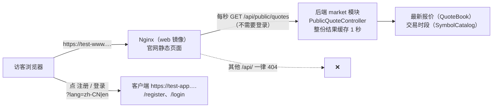

# Quick Come 官网技术方案（v2）
- 版本：v1.0（2026-10-16）
- 变更历史：v1.0（2026-10-16）首次创建，和实现一起提交（分支 `claude/v2-website`）
- 依据：《v2-需求说明书》v2.1 第 2、4、5、6、7、9、10 节；《v2-官网风格调研》方向 A（Amos 选定）和对比稿 `assets/v2/website-research/mockups/`；项目地图约定 19（跨站检查）、20（真实构建不含模拟层）、21（限流）
- 编写：研发；状态：随代码交 Amos 审核（原型在 PR 的 Vercel 预览 `/site/`）

## 一图看懂



这张图想说明：官网是一个独立的静态站点，和客户端、后台放在同一个 Nginx 镜像里，用自己的域名；它只能调用两个接口——公开行情和健康检查，别的接口在官网域名上根本不转发。行情每秒拉一次，后端把整份结果缓存 1 秒，所有访客共用；注册和登录跳到客户端，并带上当前语言。

## 1. 范围
| 做了 | 需求 |
|---|---|
| 首页（8 个区块）+ 服务条款 `/terms`、隐私政策 `/privacy`、风险披露 `/risk` | 4.1、4.3、第 5 节站点地图 |
| 手机（<1024 宽）和电脑（≥1024 宽）两套页面结构 | C64、AC2-06 |
| 中英文，默认跟随浏览器，手动切换后记住 | 4.6、第 10 节 W6、AC2-05 |
| 行情：10 个品种的卖价和当日涨跌幅，约每秒更新，变动闪绿/红，休市显示"休市"，测试环境标"示例行情" | 4.2、AC2-02、AC2-03 |
| 注册、登录跳客户端并带语言；客户端读 `?lang=` | 4.4、AC2-04 |
| 顶部常驻风险提示条、手机底部固定"登录 | 免费注册"、文字 Logo、联系邮箱、页脚"© Quick Come" | 第 10 节 W8、W9、F2-1、F2-3 |
| 测试环境部署（`test-www` 域名）、原型预览（Vercel `/site/`） | 2.1-4、AC2-10 |

不做（需求 2.2）：官网里的注册登录表单、博客、客服、统计和广告代码、牌照和公司信息（写"待提供"）、生产域名。

## 2. 前端 `web/site/`
- 技术：Vite + React 18 + TypeScript，工程配置照搬 `web/client/`（lint 规则、tsconfig、vitest + jsdom）。没有引入路由库和 i18next：只有 4 个页面和静态文案，自己写了 60 行左右（`src/lib/route.ts`、`src/app/router.tsx`、`src/i18n/`），产物 JS 约 72KB（gzip）。
- 视觉：`src/styles/tokens.css` 取客户端深色主题的 token（底色、卡片、文字、青色强调、涨跌色 `--long*` / `--short*` 的默认"绿涨红跌"），`src/styles/site.css` 按对比稿 A 的结构写；字体只用系统字体，数字优先 JetBrains Mono（本机有才用），**不加载任何外部字体或脚本**（AC-29）。Logo 和客户端同一个图形（`web/client/src/components/Icon.tsx` 的 `Logo`）。
- 两套结构：`App.tsx` 用 `useIsDesktop()`（`(min-width: 1024px)`，和客户端一致）选 `HomeDesktop` / `HomeMobile`、`HeaderDesktop` / `HeaderMobile`；手机版另有菜单抽屉和底部固定按钮 `StickyCta`。
- 语言：`src/i18n/lang.ts` 的 `detectLang`：记住的语言（localStorage `qc.site.lang`）优先；否则 `navigator.languages[0]`（没有时 `navigator.language`）以 `zh` 开头用中文，其他一律英文。切换时同步 `<html lang>`、标题和描述。
- 数据只经 `src/api/`，两种模式（`VITE_API_MODE`，和客户端同一个约定）：
  - `real`（默认）：`src/api/quotes.ts` 同源 `GET /api/public/quotes`（不带 Cookie，5 秒超时）；`src/api/envLabel.ts` 调一次 `/api/health`，有 `env` 时顶部显示"测试环境"。
  - `mock`：`src/mocks/quotes.ts` 浏览器内随机游走（加密货币全天，其他品种 UTC 周五 21:00–周日 22:00 休市）。real 构建不含模拟层（`vite.config.ts` 的 `moduleSideEffects`，CI 用 `scripts/check-no-mocks.mjs` 检查，约定 20）。
- 行情轮询 `src/hooks/useQuotes.ts`：每秒一次，上一次没回来不发下一次；标签页不可见时暂停，回来立即取一次；连续 3 秒取不到就把全部品种显示成"暂无报价"（**不显示过期价格**）。每一行的状态在纯函数 `src/lib/quotes.ts` 里算：卖价比上一次高闪绿、低闪红（`flashSeq` 每闪一次加 1，用来重新触发 0.6 秒的动画），非 OPEN 状态清掉价格和走势。电脑版"走势"小图用打开页面以来拿到的卖价（最多 40 个点），不是今日 K 线（见第 8 节）。
- 客户端地址 `src/config.ts` 的 `clientUrl()`：构建变量 `VITE_CLIENT_URL` → 页面里的 `<meta name="qc-client-url">` → 空串（同源相对地址）。部署时**不在构建时写死**，由 Nginx 把 meta 的占位符换成 `https://${APP_DOMAIN}`（见第 4 节），一个镜像适用于测试环境、端到端测试的假域名和以后的生产；原型站没有替换，就用同站点的 `/register`（客户端原型）。注册、登录地址是 `<客户端>/register?lang=<zh-CN|en>`。
- 客户端改动（小）：`web/client/src/i18n/urlLang.ts` 读 `?lang=`（`zh`、`zh-CN`、`en`，不分大小写），`i18n/index.ts` 初始化时有这个参数就用它并记住；`vite.config.ts` 的 Service Worker 不接管 `/site/`（原型站上官网和客户端同一个域名）。
- 法律页正文在 `src/content/legal.ts`（中英文同结构），PM 原创样板，顶部标"需法务审核"，只写系统真实做到的，牌照、监管、公司主体、适用法律、保存期限写"待提供 / 待法务确定"。

## 3. 公开行情接口 `GET /api/public/quotes`
### 3.1 返回
```json
{
  "sample": true,
  "items": [
    { "symbol": "XAUUSD", "nameZh": "黄金", "nameEn": "Gold", "bid": "4126.35", "changePct": "0.62", "time": "2026-10-16T13:00:00.512Z", "status": "OPEN" },
    { "symbol": "NAS100", "nameZh": "纳指 100", "nameEn": "Nasdaq 100", "bid": null, "changePct": null, "time": null, "status": "CLOSED" }
  ]
}
```
- 只有这 8 个字段（AC2-03）。**不返回**买价、加点、中间价、汇率、品种参数（杠杆、合约大小、手续费、是否暂停开仓）、任何账户、持仓、敞口、阈值字段。`PublicQuoteControllerTest` 逐个检查字段名，并用端到端 AC-23 同一份风控字段清单再查一遍；端到端 `e2e/tests/site.spec.ts` 记录官网页面收到的全部接口返回再查一遍。
- `bid`：对客户的卖价（已含加点，和客户端看到的一样），按品种小数位格式化成字符串（不经过浮点）。
- `changePct`：当日涨跌幅（%，两位小数）=（卖价 − 今日开盘卖价）÷ 今日开盘卖价 × 100，按 UTC 日，和客户端 `lib/trading.ts` 的 `changePercent` 同一口径。
- `status`：`OPEN` 开市且有可成交的报价；`CLOSED` 不在交易时段（官网显示"休市"）；`NO_QUOTE` 开市但没收到报价、报价过期（超过 5 秒）或异常（官网显示"暂无报价"）。后两种 `bid`、`changePct`、`time` 都是 null，**不返回过期价格**。
- `sample`：后端报价源是模拟报价源（`FX_MARKET_SOURCE=simulated`，测试环境）时为 true，官网据此标"示例行情"；接 LP 以后为 false，官网显示"行情仅供参考，以交易页面为准"。

### 3.2 配置（`application.yml` 的 `falconx.market.public-quotes`）
| 配置项 | 默认 | 说明 |
|---|---|---|
| `symbols` | `[XAUUSD, XAGUSD, EURUSD, GBPUSD, USDJPY, USDCNH, NAS100, XTIUSD, BTCUSD, ETHUSD]` | 按这个顺序返回；代码和 V4 品种表一致（原油是 `XTIUSD`）；品种表里没有的代码启动时记一条 WARN 并忽略 |
| `cache-ttl` | `1s` | 整份结果的缓存时间 |

以后要改成跟后台"热门"标记走（W5 的"以后"），只要把 `symbols` 换成读 `market_symbol.hot`，接口不变。

### 3.3 安全和负载
- 不需要登录：`account/auth/SessionFilter` 的公开清单加了这一个路径（精确匹配）。只读 GET，跨站检查（约定 19）对它没有影响。
- 缓存：`PublicQuoteController` 把整份结果放在内存里，1 秒内的请求都拿同一份，计算只是读内存里的 10 条最新报价，不查数据库；刷接口不会增加后端负担。响应头 `Cache-Control: no-store`（避免浏览器或中间代理把旧价格当新价格）。
- 限流：受通用限流约束（约定 21）——后端按 IP 每分钟 600 次（`IpRateLimitFilter`，`RateLimitTest` 加了一个用例），Nginx 外层每 IP 每秒 20 次、瞬间 400 次。一个官网页面每分钟 60 次，同一个出口 IP 后面同时开着 10 个官网页面才会碰到后端的上限（大陆移动网络很多人共用出口 IP，见第 9 节待定）。
- 官网域名上的 Nginx 只转发 `/api/public/quotes`（精确匹配，带分号等变体走不到）和 `/api/health`，其他 `/api/` 一律 404，所以官网页面拿不到任何登录后的接口。

### 3.4 为什么用轮询，不用 WebSocket
| | 每秒轮询（选这个） | 公开 WebSocket |
|---|---|---|
| 实现 | 一个普通 GET，前后端各几十行 | 要新加一条公开推送通道、按品种过滤、连接数管理 |
| 负载 | 结果按秒缓存，每次请求只是读内存；Nginx 和后端的限流原样适用 | 每个访客一条长连接，占 Nginx 和后端的连接；现有 WebSocket 握手限流按"每分钟 120 次"设计，不是给匿名访客的 |
| 可靠 | 无状态，断网恢复后下一秒自然继续；中间代理、运营商网络对普通 HTTPS 最友好 | 要处理断线重连、心跳；部分网络会断开空闲长连接 |
| 实时性 | 约 1 秒（需求就是"约每秒"） | 更快，但官网用不到 |

## 4. 部署
- 镜像：`deploy/web.Dockerfile` 多拷一份 `web/site/dist` 到 `/usr/share/nginx/site`；`.dockerignore` 放行 `web/site/dist/`。CI 的 `publish-staging`、`e2e/run-deployed.sh`、`e2e/load/run-ac13.sh` 都先构建官网。
- Nginx：`deploy/nginx/site.conf.template` 新增 `server_name ${WWW_DOMAIN}` 一段：静态页面（找不到的页面路径回到 `index.html`；`assets/` 下带扩展名的文件长期缓存，不存在就 404）；`location = /api/public/quotes`（和客户端接口共用 Nginx 的按 IP 额度）、`location = /api/health`；其他 `/api/`、`/actuator` 404；`sub_filter` 把页面里的 `__QC_CLIENT_URL__` 换成 `https://${APP_DOMAIN}`。用的是同一张证书 `live/falconx`。`nginx -t` 在 `nginx:1.27-bookworm`（就是 web 镜像）里验证过：设了 `WWW_DOMAIN` 和用占位域名两种都通过。
- 变量：`WWW_DOMAIN`（测试环境 `test-www.quickcome.online`）。`deploy/kit/docker-compose.yml` 把它传给 web 容器；**已有服务器的 `.env` 里还没有时用占位域名 `www-not-configured.invalid`**，Nginx 照常启动、官网那一段不生效，所以这次合并到 staging 后的自动更新不会因为缺变量失败。`env.example` 加了这一行；`init-env.sh` 第 4 个参数可以填它；`first-start.sh` 检查它并在第一次申请证书时包含三个域名。
- 已有服务器上加官网的步骤（Amos 在服务器上运行，见《部署方案》第 14 节）：DNS 加 `test-www` → 写进 `.env` → `certbot certonly --webroot … --cert-name falconx --expand -d test-app… -d test-admin… -d test-www…`（证书扩展成三个域名，续期方式不变）→ `docker compose up -d web` 让 Nginx 读到新变量 → `bash deploy/verify.sh test-app… test-admin… "" test-www…` 从外部确认。
- `deploy/verify.sh` 第 4 个参数是官网域名：检查 http 跳 https、证书、首页、三个法律页、页面里的客户端地址、健康检查的测试环境标识、公开行情可用且没有不该有的字段、官网域名上 `/api/me/session`、`/api/admin/me`、`/api/public/quotes;x`、`/actuator/health` 都是 404（AC2-10）。

## 5. 原型预览
`scripts/build-prototype.sh` 用 `SITE_BASE=/site/` 把官网构建到 `dist/site/`；`vercel.json` 加 `/site` → `/site/` 跳转和 `/site/(.*)` → `/site/index.html` 改写。客户端（`/`）、后台（`/admin/`）的原型地址不变。原型里官网的"注册""登录"跳同一个站点的客户端原型 `/register`、`/login`。

## 6. 测试
| 测试 | 内容 |
|---|---|
| `backend/.../market/web/PublicQuoteControllerTest`（5 个） | 不需要登录、按配置顺序、忽略不存在的代码；只有允许的字段、没有风控和账户字段（AC2-03）；卖价和涨跌幅；休市 CLOSED、没有报价和报价异常 NO_QUOTE 都不返回价格；缓存期内不重新计算 |
| `RateLimitTest`（+1 个） | 公开行情不需要登录，也受按 IP 限流约束 |
| `web/site` 单元测试（37 个） | 翻译键一致、英文无中文、占位符一致、没有旧品牌名；默认语言跟随浏览器；法律页中英文结构一致、英文无中文、不写牌照监管公司主体；价格格式、客户端地址和带语言的链接、页面路径（`/` 和 `/site/`）；行情行的闪色、休市清价、断线"暂无报价"；首页 8 个区块、底部按钮、切换英文后没有中文、电脑版导航、分类标签、三个法律页、页脚链接站内切换 |
| `web/client/src/i18n/urlLang.test.ts`（2 个） | `?lang=` 的解析 |
| `e2e/tests/site.spec.ts`（1 个用例，两种形态都跑） | 390 宽默认中文、8 个区块、手机结构、底部注册按钮在视口里、没有横向滚动；10 个品种、加密货币 10 秒内价格变动、闪色层的颜色变量和客户端一致、非 OPEN 不显示价格；公开行情的字段、官网只调两个接口、没有 WebSocket、没有 Google 和其他外部域名；三个法律页；手机首屏"免费注册"跳客户端注册页且客户端是中文；1280、1440 宽默认英文（浏览器语言英文）、电脑结构、没有中文残留、没有横向滚动；切换中文并记住；品种行和导航的注册登录地址带 `lang=en`，点品种到客户端注册页且客户端是英文 |
| `e2e/tests/deployed.spec.ts`（+1 个用例，只在部署形态） | 官网域名：http 跳 https、安全响应头、页面里的客户端地址是客户端域名、公开行情和健康检查经 Nginx 可用、其他接口和带分号的变体 404、页面路由回退 |

## 7. 和需求、验收标准的对应
| 编号 | 怎么满足 | 自动检查 |
|---|---|---|
| AC2-01 8 个区块 | 导航、首屏、产品优势、热门品种、三步开始、资金和安全、常见问题（7 条）、页脚 | `App.test.tsx`、`site.spec.ts` |
| AC2-02 行情跳动 | 10 个品种、每秒轮询、闪色、休市"休市" | `lib.test.ts`、`site.spec.ts`（开市品种 10 秒内变动；休市状态由后端测试覆盖，端到端里只要遇到非 OPEN 就检查不显示价格） |
| AC2-03 不泄露数据 | 接口只有 8 个字段，官网域名只转发两个接口 | `PublicQuoteControllerTest`、`site.spec.ts`、`verify.sh` |
| AC2-04 注册登录入口 | 顶部导航（电脑）、首屏、每个品种、底部固定按钮（手机）、热门品种、最后一屏，都带 `?lang=` | `App.test.tsx`、`site.spec.ts` |
| AC2-05 中英文 | 翻译文件键一致、英文无中文；默认跟随浏览器 | `i18n.test.ts`、`legal.test.ts`、`site.spec.ts` |
| AC2-06 两套结构、无横向滚动 | 1024 切换；390、1280、1440 检查 | `site.spec.ts`；截图人工对照稿子 |
| AC2-07 不依赖 Google | 不加载任何外部资源 | `site.spec.ts`（只访问官网自己的域名） |
| AC2-08 文字页面 | 三个页面、"需法务审核"、风险提示条和页脚风险提示 | `App.test.tsx`、`site.spec.ts` |
| AC2-09 首屏速度 | 首页一个 HTML + 一个 JS（约 72KB gzip）+ 一个 CSS，不依赖接口就能显示标语和行情占位 | 真机（Amos 安排） |
| AC2-10 测试环境地址 | `test-www` 域名、证书扩展、"测试环境"标识 | `verify.sh`（第 4 个参数）、`deployed.spec.ts` |

## 8. 和对比稿（方向 A）不同的地方
1. 电脑版行情面板的"今日走势"小图改成"走势"：公开接口不给 K 线（只给 AC2-03 允许的字段），小图画的是打开页面以来每秒拿到的卖价；刚打开时是空的，几秒后出现。
2. 分类标签多了"能源"（原油单独一类，稿子里原油只出现在"热门"）；标签在手机上放不下时横向滑动（不会让整页横向滚动）。
3. 手机版行情列表显示全部 10 个品种（稿子是 8 个），和需求"10 个品种"一致。
4. 资金和安全是 4 张卡（稿子 3 张）：把"提现多重确认"拆成"提现白名单"和"冷静期和人工审核"，并写了"服务器上不存放充值地址的私钥"（充值方案 D1、项目地图约定 12）。
5. 常见问题 7 条（稿子 5 条）：加了"提现有什么要求""亏损会超过我充的钱吗"；答案按系统真实规则写（2 小时冷静期、3,000 USDT 以上延迟 6 小时、24 小时白名单生效、最小充值 1 USDT）。
6. 去掉了稿子里"三次点击完成下单"这类没法证实的说法；"约 50 个品种"按品种表实际数量保留。
7. 页脚的"联系我们"直接写邮箱 `info@quickcome.online`；版权写"© Quick Come"（不写年份和公司主体，F2-3）。
8. 测试环境的标识：顶部多一条紫色"测试环境"（和客户端一样），行情面板另标"示例行情"。

## 9. 没做的和待定
- 生产域名和 LP 报价能否公开展示（F2-7）：没做；接 LP 后 `sample` 自动变成 false，页面换成"行情仅供参考"的说明，是否允许公开展示要 Amos 和 LP 确认。
- 公开行情的按 IP 上限：沿用通用的每分钟 600 次。如果以后发现大陆移动网络共用出口 IP 的访客被 429，可以把 `/api/public/quotes` 单独计数或调大（结果本来就按秒缓存，调大没有负载问题）。
- 法律页正文是样板，需要法务审核；保存期限、适用法律、公司主体写"待提供 / 待法务确定"。
- 官网没有 PWA、没有 SEO 预渲染（页面是浏览器里渲染的）；需要搜索引擎收录时再做预渲染。
- 首屏 3 秒（AC2-09）要真机测。
