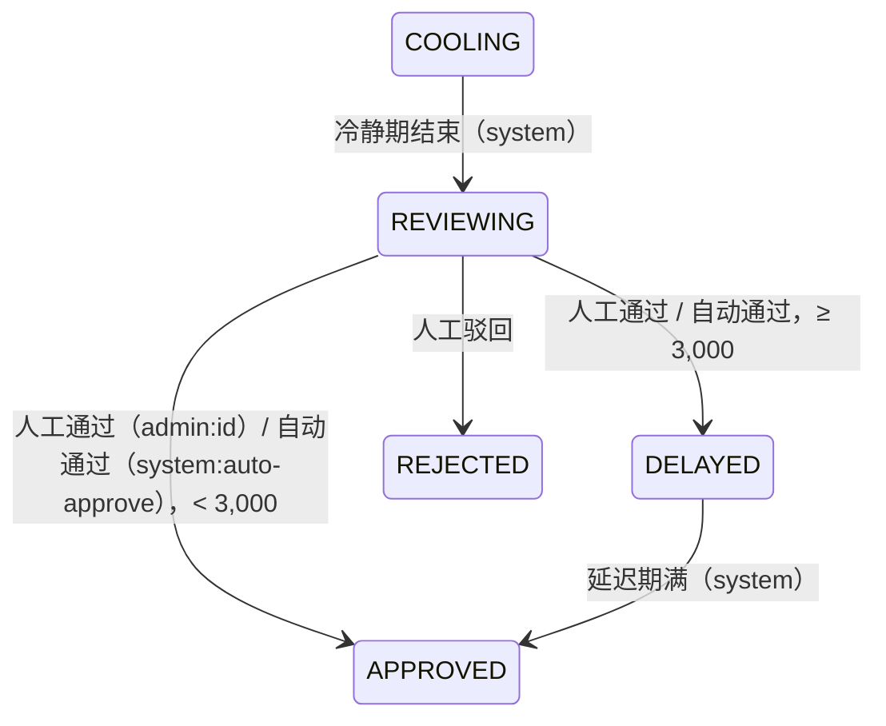

# 提现自动审批（可调整的系统规则）
- 版本：v1.0（2026-10-17）
- 编写：研发（测试、运维确认各自部分）
- 状态：**方案 + 后台原型，等 Amos 审核；后端没有实现**。原型只在原型（模拟数据）模式下显示，真实接口模式下出金审核页看不到任何变化，规则设置页显示"未上线"（第 9 节）。
- 背景：Amos 2026-10-17："客户的提币申请，我要有一个审批的流程，但并不是所有的都要审批……做成可以调整的系统规则。"对研发给的建议回复："按建议，再补充一条：审核记录上要显示出触发了哪几条规则，用以方便审核人员核对。"
- 依据：`技术方案/v1-提现方案.md` v1.2（状态、冷静期、大额延迟、热钱包 W4，已审核）；`技术方案/v1-后台方案.md` v1.6（权限点、高危确认、审计、系统配置 `common_config`，已审核）；`需求文档/v1-需求说明书.md` 第 4.4 节、AC-17 至 AC-21。
- **不改的东西**：2 小时冷静期照旧（自动通过也要冷静期结束后才放款）；≥3,000 USDT 审核通过后延迟 6 小时照旧；白名单 24 小时生效、单笔 10,000 / 当日 30,000 限额照旧。规则**只决定"要不要人工看"**，不放宽任何限额。

## 一图看懂

这张图想说明：新东西只有蓝色三块——提交时预判、冷静期结束时复判、全部通过就由系统代替人点"通过"。复判之后走的完全是现在的路：大额照样延迟 6 小时、照样上链。总开关默认关闭（黄色），关闭时和现在一样全部人工，但规则照常判定、记录结果，方便 Amos 先观察再决定什么时候打开。

## 1. 需要 Amos 确认的事
| 编号 | 事项 | 我的建议 | 为什么 |
|---|---|---|---|
| AA-1 | 判定时机 | **提交时预判 + 冷静期结束时复判，以复判为准**（第 3 节） | 只在提交时判：冷静期里客户改密码、平台额度被别人用掉、热钱包没钱了都看不到；只在冷静期结束时判：冷静期里的 2 小时审核人员看不到"这笔大概会不会转人工"。预判不占额度、不决定结果，只给后台看 |
| AA-2 | 总开关关闭时规则还判不判 | **照常判定并记录**（结果是"总开关关闭"，详情写"如果打开，本笔会触发 N 条 / 会自动通过"） | Amos 打开总开关之前，可以先看几天"如果打开会自动通过多少笔、都是谁"，再决定阈值；不占额度、不影响流程 |
| AA-3 | R2 / R3 累计怎么算 | **只算自动通过的金额**（人工通过的不算），**滚动 24 小时**；自动通过后又上链失败、被紧急取消的**也算**（保守） | 这两条是"系统替人放行的量"的闸门，人工看过的不该占系统的额度；失败退款很少，算进去只会更保守 |
| AA-4 | R8"充值后的交易量"的口径 | 近 30 天入账的充值合计 D（扣掉冲正）；从这些充值里**最早那笔入账**起，客户**开仓**的名义价值（USDT）合计 V；**V ≥ D × N** 才通过；近 30 天没有充值算通过；N = 0 等于不查 | "充值后不交易就提走"是洗钱和刷手续费的典型做法；按 30 天内全部充值算，分几笔小额充值也绕不过去。原型里 R8 暂时关着（演示"未启用"），默认值是开 |
| AA-5 | R9 的"已实现盈亏" | 只算**交易盈亏**（账本 `REALIZED_PNL`），**不扣手续费、隔夜费，不含后台调余额**；累计提现含本笔和进行中的，不含已驳回 / 已撤销 / 失败已退回的 | 不扣手续费是"宽"的一边，误报少；不含调余额，是为了"后台给客户加了钱、客户马上提走"一定转人工。如果 Amos 要更严，改成"充值 + 交易盈亏 − 手续费 − 隔夜费" |
| AA-6 | R10 的"或" | **满足其一就通过**：近 7 天已实现盈利 ≤ 5,000，**或** ≤ 本金 × 50%。本金 = 累计充值（扣冲正）− 累计已完成提现，不小于 0；盈利 ≤ 0 直接通过 | 等于"上限取两者中较大的"：小本金客户按 5,000 卡，大本金客户按比例卡。如果 Amos 的意思是两个都要满足，告诉我改成"且" |
| AA-7 | R11"当天"按哪个时区 | **UTC**（北京时间早上 8 点换天），和现在的当日提现限额同一口径 | 两个"当天"不一致会让客服很难解释；如果要按北京时间，建议两个一起改 |
| AA-8 | R6 的事件和上线初期 | 改密码、忘记密码重置、改邮箱（v1 没有这个功能，先留口径）、冻结、解冻。现在系统里**没有改密码的记录**，要新加一张表（第 6 节）；上线前 48 小时的改密码查不到，所以**建议上线满 48 小时以后再打开总开关**（冻结 / 解冻可以从审计日志补） | 账号被盗后第一件事通常是改密码再提现，R6 是最重要的一条 |
| AA-9 | 权限 | 新增高危权限点 `withdrawal:auto_rule_edit`（改总开关和规则），查看规则和判定结果用已有的 `withdrawal:view`；超级管理员自动拥有，其他角色要在"角色"里勾选。权限点 48 → 49 | 和风控、交易参数一样，不放进系统配置页，否则有 `config:edit` 的人就能绕过去放宽审核 |
| AA-10 | R12 热钱包"余额够" | 该链热钱包的 USDT 余额（用热钱包余额告警已有的 `HotWalletApi.hotBalances()`：每 5 分钟查一次，**超过 10 分钟没查成功或最近一次查询失败算"查不到"**）− 同一条链上"已审核待上链"和"延迟中"的到账金额合计 ≥ 本笔到账金额（金额 − 手续费）；**查不到余额按不通过** | 余额不够时人工通过也只会停在待上链（提现方案 W4），转人工能让运维先补钱 |
| AA-11 | 客户端 | **不变**：客户看到的状态和通知文案和人工审核完全一样（"审核中 → 审核通过"），不显示规则、不显示是不是自动通过 | 告诉客户规则，等于告诉别人怎么拆单绕过；客户关心的只是快不快 |
| AA-12 | 原型 | 看截图（第 9 节），确认设置页、列表、详情的样子 | 原型先行 |

## 2. 规则表（默认值是 Amos 2026-10-17 确认的）
同时满足**全部已启用**的规则才自动通过；任何一条不满足（或判定出错）就转人工审核。每条规则可以单独开关、改数值。

| # | 规则 | 默认值 | 数值能改的范围 |
|---|---|---|---|
| R1 | 单笔金额 | ≤ 500 USDT | 0.01 ~ 1,000,000，最多 2 位小数 |
| R2 | 该客户 24 小时内自动通过的累计金额（含本笔） | ≤ 2,000 USDT | 同上，**不能小于 R1** |
| R3 | 全平台 24 小时内自动通过的累计金额（含本笔） | ≤ 20,000 USDT | 0.01 ~ 100,000,000，**不能小于 R2** |
| R4 | 不是该客户第一笔提现 | 第一笔一律人工 | 没有数值 |
| R5 | 该地址以前成功提现过（不只是在白名单） | 新地址首次提现人工 | 没有数值 |
| R6 | 最近 N 小时内没有改密码、改邮箱、冻结 / 解冻 | 48 小时 | 1 ~ 720 的整数 |
| R7 | 注册满 N 天且 KYC 已通过 | 7 天 | 0 ~ 365 的整数 |
| R8 | 充值后的交易量 ≥ 充值额 × N | 1 倍 | 0 ~ 100，最多 2 位小数 |
| R9 | 累计提现（含本笔）≤ 累计充值 + 已实现盈亏 | 超过就人工 | 没有数值 |
| R10 | 近 7 天已实现盈利 ≤ 上限，或 ≤ 本金的 N% | 5,000 USDT 或 50% | 金额同 R1；百分比 1 ~ 1000 的整数 |
| R11 | 当天提现次数（含本笔） | ≤ 3 次 | 1 ~ 50 的整数 |
| R12 | 系统状态正常 | 无报价偏差告警、无全局暂停、热钱包余额够 | 没有数值 |

## 3. 判定时机、状态机和事件
### 3.1 两次判定
| 时机 | 做什么 | 结果用来干什么 |
|---|---|---|
| **提交时预判**（PRECHECK） | 提交事务提交以后，单独跑一次全部规则（不加全局锁、不占额度），写一条判定记录 | 冷静期中的提现在后台显示"预判 · 可自动通过 / 预判 · 触发 N 条"，审核人员提前心里有数。预判失败（异常）只记日志，不影响提交 |
| **冷静期结束时复判**（FINAL） | 定时任务推进"冷静期 → 待审核"时，**在同一个事务里**用当时的数据和配置再判一次（第 5 节） | **决定**自动通过还是转人工；只有这次占用 R2 / R3 额度 |

为什么要复判、不能只用预判：冷静期 2 小时里会变的东西正是规则要防的——客户改了密码（R6）、平台额度被别的提现用掉（R3）、报价出了偏差告警或热钱包被提空（R12）、运营改了规则。复判的详情里如果和预判结果不同，会写"提交时预判：可自动通过；冷静期内数据有变化，以复判为准"（原型里黄晓明那笔：预判全部通过，冷静期里改了密码，复判触发 R6 转人工）。

### 3.2 状态机（不新增状态）
现有状态不变（冷静期 `COOLING` / 待审核 `REVIEWING` / 已审核待上链 `APPROVED` / 延迟中 `DELAYED` / 上链中 / 已完成 / 已驳回 / 已撤销 / 失败已退回）。自动通过 = **系统代替审核人员做了一次"通过"**：

- 复判通过时，同一个事务里写两条提现事件：`COOLING → REVIEWING`（`system`，"冷静期结束"）和 `REVIEWING → APPROVED / DELAYED`（**`system:auto-approve`**，备注"自动审批通过（判定 #编号，配置第 N 版）"）。谁、什么时候、是系统自动，事件表里一眼能看出来；事件表 `actor` 列是 `VARCHAR(32)`，放得下。
- 提现单记 `review_mode = AUTO`、`reviewed_at = 判定时间`、`reviewer_id` 为空；后台"审核人"显示"系统自动审批"。
- 复判没通过：只写 `COOLING → REVIEWING`，提现单 `review_mode` 先为空，人工通过或驳回时写 `MANUAL`（驳回也写，方便统计）。
- 通知客户：沿用 `WithdrawService.notifyCustomer`——`REVIEWING → APPROVED` 和 `→ DELAYED` 本来就通知"审核通过"，自动通过和人工通过发的是同一条，**客户端和通知模板都不改**（AA-11）。
- 自动通过后的流程和人工通过完全一样：小额立即生成上链任务（`send`），大额延迟 6 小时、可紧急取消。

## 4. 每条规则的精确口径
通用约定：
- "现在"= 判定时刻（UTC，`Clock`）。时间窗口都是**滚动的**（判定时刻往前推），R11 例外（按 UTC 日历日）。
- 金额都用 `DECIMAL` 精确比较，不用浮点；"申请金额"是提现单的 `amount`（含手续费，客户冻结的金额）。
- **边界：写"≤"的等于算通过，写"≥"的等于算通过**；"N 小时内没有"是指时间在 (现在 − N 小时, 现在] 里没有，正好 N 小时前发生的不算"内"。
- 数据读不到（节点查询失败、表不存在等）：这条规则记"无法判定"，**按不通过处理**，整笔转人工（不会因为出错而放行）。

| # | 数据从哪来 | 怎么算 | 通过条件 | 判定记录里存的数值 |
|---|---|---|---|---|
| R1 | 提现单 `amount` | — | `amount ≤ 上限` | 金额、上限 |
| R2 | `wallet_withdrawal`：同一客户、`review_mode = AUTO`、`auto_approved_at` 在 (现在 − 24h, 现在] | 已自动通过合计 U（**所有状态都算**，AA-3） | `U + amount ≤ 上限` | U、本笔、合计、上限 |
| R3 | 同上，不限客户 | 全平台已自动通过合计 U | `U + amount ≤ 上限` | U、合计、上限 |
| R4 | `wallet_withdrawal`：同一客户、`status = COMPLETED` | 已完成笔数 | ≥ 1 | 笔数 |
| R5 | `wallet_withdrawal`：同一客户、同一网络、同一地址（以太坊体系地址按小写比，同白名单的 `address_key`）、`COMPLETED` | 成功笔数 | ≥ 1 | 笔数 |
| R6 | 新表 `account_security_event`（第 6 节）：改密码、重置密码、改邮箱、冻结、解冻 | 窗口 (现在 − N 小时, 现在] 里最近的一条 | 没有 | 最近一条的类型、几小时前、窗口 |
| R7 | `account_user.created_at`；`AccountApi.kycStatus` | 注册时长 = 现在 − 注册时间 | 注册时长 ≥ N × 24 小时 **且** KYC = 已通过 | 注册天数（向下取整）、要求、KYC 状态 |
| R8 | 账本 `DEPOSIT`、`DEPOSIT_REVERSAL`（近 30 天入账）；`trading_order` 的 `FILLED` 订单 `notional_usd`（下单时的 USD 名义价值，USDT 按 1:1） | D = 近 30 天充值 − 冲正；t0 = 其中最早一笔入账时间；V = t0 以后成交的开仓订单名义价值合计 | D = 0 通过；否则 `V ≥ D × N` | V、D、倍数（V / D，两位小数）、要求 |
| R9 | 提现单；账本 `DEPOSIT`、`DEPOSIT_REVERSAL`、`REALIZED_PNL` | W = 该客户所有不是 驳回 / 撤销 / 失败已退回 的提现金额合计（含本笔）；C = 充值 − 冲正 + 交易已实现盈亏 | `W ≤ C` | W、充值、盈亏、C |
| R10 | 账本 `REALIZED_PNL`（近 7 × 24 小时）；本金 = 充值 − 冲正 − 已完成提现（不小于 0） | P7 = 近 7 天已实现盈亏合计 | `P7 ≤ 0`，或 `P7 ≤ 金额上限`，或 `P7 ≤ 本金 × N%`（AA-6） | P7、本金、占比、两个上限 |
| R11 | `wallet_withdrawal`：同一客户，`created_at` 和本笔在**同一个 UTC 日** | 笔数（含本笔；客户自己撤销的不算，紧急取消、驳回的算） | `≤ N` | 第几笔、上限 |
| R12 | ① `MarketApi.quoteDeviationPaused` 对所有品种；② `RiskApi.globalOpenPaused()`；③ 热钱包 USDT 余额（`HotWalletApi.hotBalances()`，热钱包余额告警每 5 分钟查一次；超过 10 分钟没查成功算查不到）− 同链 `APPROVED` + `DELAYED` 的到账金额合计 | 三项分别判 | 三项都正常（AA-10） | 哪几项不正常、余额、需要的金额 |

> R6 里"改邮箱"v1 没有这个功能，口径先定好，以后加功能时一起写事件。

## 5. 并发：R2 / R3 怎么防超额
问题：两笔提现同时冷静期结束，各自看到"全平台已用 19,800"，各加 300 都 ≤ 20,000，一起通过就成了 20,400。

做法（**判定和累计在同一个事务里，用一把全局锁串行**）：
1. 判定不访问网络：热钱包余额（R12 ③）读热钱包余额告警定时查好的值，其余规则都只读数据库。
2. 开事务：`SELECT … FOR UPDATE` 锁住这笔提现单，确认状态还是 `COOLING` 且冷静期已结束（不是就退出，别的节点已经处理了）。
3. 总开关打开时，`SELECT … FOR UPDATE` 锁住新表 `wallet_auto_approve_lock` 里唯一的一行——**所有自动通过的判定在这里排队**。
4. 在锁里用 SQL 现算 R2、R3 的累计（按 `auto_approved_at` 和 `review_mode` 查，有索引），连同其他规则一起判定。
5. 写判定记录（含配置快照）、写提现事件、改提现单状态（全部通过时写 `review_mode = AUTO`、`auto_approved_at`），提交。提交以后才释放全局锁，下一笔看到的累计就包含了这笔。
6. 提交以后再调 `send`（和人工通过一样，不在事务里访问节点）。

为什么不会死锁：顺序固定是"提现单 → 全局锁"，**只有自动审批会拿全局锁**，自动审批也不碰账户（不动钱，放款在之后的上链任务里）。为什么性能够：只有冷静期结束、总开关打开时才排队，每笔几毫秒，提现量是每分钟几笔的级别。多台服务器同时跑定时任务：第 2 步的行锁和"按原状态条件更新"（现有的 `transit`）保证一笔只会被处理一次。

预判不拿全局锁（它的 R2 / R3 只是参考，不占额度）。总开关关闭时也不拿（不占额度，结果是"总开关关闭"）。

## 6. 数据表变更（迁移 V26，staging 当前最大是 V25 `V25__hot_wallet_alert_config.sql`）
| 变化 | 内容 |
|---|---|
| 新表 `wallet_withdraw_rule_check` | 每次判定一行：`id`、`withdrawal_id`、`phase`（`PRECHECK` / `FINAL`）、`outcome`（`AUTO_APPROVED` / `MANUAL` / `MASTER_OFF` / `ERROR`）、`master_enabled`、`failed_rules`（例如 `R1,R5`，显示用）、`config_version`、`config_json`（判定时整份配置的快照）、`results_json`（12 条逐条：编号、状态 passed / failed / disabled / unknown、数值）、`decided_at`。索引 `(withdrawal_id, id)` |
| 新表 `wallet_withdraw_rule_hit` | 没通过的规则一条一行：`check_id`、`withdrawal_id`、`rule_code`；索引 `(rule_code, withdrawal_id)`。只写 FINAL（冷静期中的按预判写，复判后删掉预判的行），给列表"触发了某条规则"筛选用，不用在 JSON 里搜 |
| `wallet_withdrawal` 加列 | `review_mode VARCHAR(8) NULL`（`AUTO` / `MANUAL`）、`auto_approved_at DATETIME(3) NULL`、`last_check_id BIGINT NULL`（列表直接取最近一次判定的摘要）；索引 `(review_mode, auto_approved_at)`、`(user_id, review_mode, auto_approved_at)` |
| 新表 `wallet_auto_approve_lock` | 只有一行（`id = 1`），第 5 节的全局锁 |
| 新表 `account_security_event`（account 模块写） | `user_id`、`type`（`PASSWORD_CHANGE` / `PASSWORD_RESET` / `EMAIL_CHANGE` / `FREEZE` / `UNFREEZE`）、`created_at`；改密码（`/api/auth/password/change`）、重置密码（`/api/auth/password/reset`）、后台冻结 / 解冻时在同一事务里写；`AccountApi` 加 `lastSecurityEventSince(userId, since)` 给钱包模块用（模块边界不变）。迁移里用 `admin_audit_log` 的 `customer.freeze`、`customer.unfreeze` 补最近 7 天的冻结 / 解冻 |
| `common_config` 初始值 | 第 7 节的 23 个键（总开关、12 个规则开关、9 个数值、版本号），**总开关 `false`**；`withdraw.autoApprove.version = 0` |

判定记录只增不改（和审计日志一样）；快照里存的是判定那一刻的阈值和数值，**以后改规则不影响历史记录的解读**。

## 7. 配置存储、接口、权限、审计
### 7.1 存在哪里：复用系统配置 `common_config`
| 选项 | 结论 |
|---|---|
| **复用 `common_config`（建议）** | 已有 5 秒缓存、整表一次读出（同一次读到的值互相一致）、各模块都能读；键都是 `withdraw.autoApprove.` 开头：`enabled`（总开关）、`R1.enabled`、`R1.maxAmount`、`R2.maxUser24h`、`R3.maxPlatform24h`、`R6.hours`、`R7.days`、`R8.multiple`、`R10.maxProfit7d`、`R10.maxProfitPct`、`R11.maxCount`（每条规则一个 `.enabled`）、`version`。`ConfigKey` 里标 `configPage = false`（和风控、交易参数一样，系统配置页不显示），新增单位 `BOOL`、`MULTIPLE` |
| 新表 | 不需要：12 条规则的形状是固定的，没有"新增规则"的需求；新表要自己再做一套缓存和审计 |

一次保存 = 一个事务里改所有变化的键 + `version + 1`。判定时读到的整份配置（含 `version`）原样存进判定记录的 `config_json`。

### 7.2 接口（后台）
| 接口 | 作用 | 权限点 |
|---|---|---|
| `GET /api/admin/withdraw-auto-approve` | 总开关、12 条规则（开关、数值、默认值）、`version`、最后修改人和时间 | `withdrawal:view` |
| `PUT /api/admin/withdraw-auto-approve` | 一次保存全部：`masterEnabled`、`rules[]`、`reason`（必填）、`expectedVersion`（版本不对返回 409 `CONFIG_CHANGED`，防止两个人同时改互相覆盖）；校验：范围、小数位、R1 ≤ R2 ≤ R3；没有变化返回 `NO_CHANGE` | `withdrawal:auto_rule_edit`（新，高危） |
| `GET /api/admin/withdraw-auto-approve/changes` | 最近 20 次修改（从审计日志 `withdrawal.auto_rule_update` 取） | `withdrawal:view` |
| `GET /api/admin/withdrawals` | 每条多 `autoReview`（`phase`、`outcome`、`failed[]`、`decidedAt`，没有判定记录为空）；新筛选参数 `autoReview`（`auto_approved` / `manual` / `master_off` / `none` / `R1`…`R12`） | 原有 |
| `GET /api/admin/withdrawals/{id}` | 多 `autoReviewDetail`：12 条逐条结果和数值、判定时总开关状态、配置版本和这一版的修改人 / 时间、提交时的预判摘要 | 原有 |

字段形状和原型一致：`web/admin/src/api/types.ts` 的 `AutoReviewSummary`、`AutoReviewDetail`、`AutoRuleResult`、`AutoApproveSettings`、`AutoApproveChange`。

### 7.3 审计
- 保存规则：一条高危审计 `withdrawal.auto_rule_update`，原因必填，"修改前 / 修改后"里是变化的键（例如 `R1.maxAmount: 500 → 800`、`master: false → true`），对象是新版本号。
- 自动通过本身不是管理员操作，**不写审计日志**，写在提现事件（`system:auto-approve`）和判定记录里；后台出金详情能看到。
- 运维：总开关被打开 / 关闭时发一封告警邮件给运维和风控（复用现有告警邮件），防止有人悄悄打开。

## 8. 对客户端和其他模块的影响
| 范围 | 影响 |
|---|---|
| 客户端 | **没有变化**（AA-11）：状态、文案、推送、站内信、邮件都一样；自动通过的客户只是更快收到"审核通过" |
| 钱包模块 | `WithdrawService.advance()` 的"冷静期满 → 待审核"换成"冷静期满 → 复判"；新增 `AutoApproveService`（规则判定）、`AutoApproveRules`（读配置）；提交后调预判 |
| account 模块 | 写 `account_security_event`，`AccountApi` 加一个查询 |
| trading / market / risk 模块 | 各自 `api` 包加只读查询（账本合计、开仓名义价值合计；已有 `quoteDeviationPaused`、`globalOpenPaused`） |
| 后台模块 | 3 个新接口、权限点 49 个、出金列表和详情多字段 |
| 定时任务 | 不新增；沿用每 30 秒的提现推进 |

## 9. 后台原型（已做，只在原型模式下显示）
- 入口：出金审核页右上角"自动审批规则"按钮（旁边显示总开关状态）；设置页路由 `/funds/withdrawals/auto-rules`，菜单归在"出金审核"下（不改菜单和权限点清单，前后端清单一致的测试不受影响）。
- **设置页**（`web/admin/src/pages/funds/AutoApprovePage.tsx`）：总开关（标"默认：关闭"）、"规则只决定要不要人工看，不放宽任何限额"说明、12 条规则（编号、名称、说明、开关、数值和单位、默认值、改过的标"已修改"）、数值校验（范围、小数位、R1 ≤ R2 ≤ R3，不合法时保存按钮不可用）、保存走统一的高危确认弹窗（列出每一项"前 → 后"，原因必填、勾选确认）、最近修改记录。原型借用 `config:edit` 判断能不能改（正式版换成 `withdrawal:auto_rule_edit`）。
- **出金审核列表**：新增"规则判定"列——自动通过（绿）/ 触发 N 条（红，下面一行是编号 R1 · R2 · R5，悬停显示每条的名称）/ 冷静期中的"预判 · …"/ 总开关关闭（灰，下面写"如开启：触发 N 条 / 可自动通过"）/ 没有判定记录"—"。新增筛选"规则判定"：按判定结果，或"触发了某条规则"（R1…R12）。
- **出金详情**：规则判定卡片——结果标签、判定时机和时间、判定时用的配置版本（修改人、时间）、结论提示（转人工 / 自动通过 / 总开关关闭 / 预判）、预判和复判不同时的提示、12 条逐条（**未通过的标红放在最上面**，然后是通过的、未启用的），每条带判定时的数值和阈值，例如"单笔 800 > 上限 500"；底部说明"数值和阈值是判定时的快照"。自动通过的提现在"当前状态"里显示"审核：系统自动审批"。
- 模拟数据（`web/admin/src/mocks/data/autoApprove.ts`）覆盖：自动通过（已完成、上链中、第 1 版时自动通过后上链失败——快照里单笔上限是当时的 1,000）、触发 1 条（R1；只有 R6）、触发多条、总开关关闭（本可以自动通过的、会触发多条的）、冷静期中的预判（含金额正好等于上限 500 算通过）、预判和复判不同、没有判定记录（上线前的提现）。
- 真实接口模式：`web/admin/src/config/autoApprove.ts` 的 `AUTO_APPROVE_UI` 为 false，出金审核页不显示列、筛选、卡片和入口，设置页显示"未上线"；接口函数直接返回"这个功能还没上线"；模拟数据不进真实构建（`check-no-mocks` 通过）。后端上线时把开关改成 true，删掉 `api/index.ts` 里的 `notLive`，接上 `real.ts`。
- 截图：设置页、列表、详情（浅色和深色各一套，1440 宽；手机宽度的详情），随方案交 Amos 审核时单独提供（不进仓库）。

## 10. 测试计划（测试工程师确认）
| 层次 | 怎么测 |
|---|---|
| 规则单元测试 | 12 条规则各测：通过、不通过、**正好等于边界**（R1 = 500 通过；R6 正好 48 小时前的改密码通过、47 小时 59 分不通过；R7 正好 7 × 24 小时通过；R11 第 3 笔通过、第 4 笔不通过）、规则关闭时不参与、数据读不到按不通过 |
| 真实 MySQL：并发 | 20 个线程同时对 20 笔各 300 USDT、冷静期都已结束的提现跑复判，R3 上限 5,000：自动通过合计 ≤ 5,000，剩下的全部转人工，没有死锁；两台"节点"同时跑定时推进，每笔只有一组事件 |
| 真实 MySQL：流程 | 自动通过 < 3,000 → 待上链 → 上链；≥ 3,000 → 延迟 6 小时，可紧急取消；总开关关闭 → 全部转人工且有 `MASTER_OFF` 记录、不占额度；冷静期内改密码 → 复判触发 R6；冷静期内改规则 → 复判用新配置，记录里是新版本号和新阈值；判定抛异常 → 转人工、`ERROR` |
| 快照 | 判定后改 R1 上限，旧记录的阈值不变 |
| 后台接口 | 权限（没有 `withdrawal:auto_rule_edit` 返回 403，AC-32 的自动扫描覆盖新接口）、原因必填、版本冲突 409、范围和 R1 ≤ R2 ≤ R3 校验、审计有前后值和原因；列表筛选"触发了 R6"只返回触发 R6 的 |
| 客户端 | 自动通过时客户收到的推送和通知与人工通过一致（现有通知测试加一个自动通过的用例） |
| 端到端 | 打开总开关、一笔 100 USDT 的提现（满足全部规则），用 `POST /api/e2e/wallet/withdrawals/advance` 推进冷静期，不经过后台审核直接到上链中；后台详情显示"自动通过" |
| 前端（已做） | `web/admin/src/autoApprove.test.tsx`（模拟数据覆盖、筛选、快照、判定文字、校验、列表和卡片、设置页保存和权限）、`web/admin/src/autoApproveNotLive.test.tsx`（没上线时全部隐藏） |
| 测试环境验收 | Amos 在测试环境打开总开关，走一笔自动通过、一笔触发 R1、一笔新地址（R5）；关掉总开关后全部转人工 |

## 11. 风险和没有覆盖的
| 风险 / 缺口 | 处理 |
|---|---|
| 规则配错导致放行过多 | 总开关默认关闭；改规则是高危操作、要原因、有审计和告警邮件；R1 ≤ R2 ≤ R3 校验；R3 全平台额度兜底；所有原有限额照旧 |
| 上线初期 R6 看不到以前的改密码 | 上线满 48 小时再开总开关（AA-8）；冻结 / 解冻从审计日志补 |
| 客户拆单（多笔 ≤ 500） | R2 客户 24 小时累计、R11 当天笔数、R3 全平台兜底 |
| 多个账号同一个人 | **没有覆盖**：规则按客户算，同一人多个账号可以各用一份 R2 额度；只有 R3 全平台额度兜底。以后可以加"同设备 / 同 IP / 同提现地址的账号合并计算" |
| 提现地址的链上风险（黑名单地址、混币器） | **没有覆盖**：需要接链上风险服务（第二版） |
| R8、R9、R10 的数据来自账本 | 账本有对账任务；对账有未处理差异时是否应该停掉自动审批——建议作为 R12 的第四项，等 Amos 定 |
| 热钱包余额是定时查询的值 | 最多 10 分钟旧（再旧按查不到、转人工）；余额不够时上链会停在待上链（W4），不会多付钱 |
| 原型的模拟数据 | 部分数值是演示用的（例如"此前已完成提现 3 笔"和详情的"最近出金：无"不一致），以正式实现为准 |

## 跨角色反馈 / 分歧记录
本阶段无。
