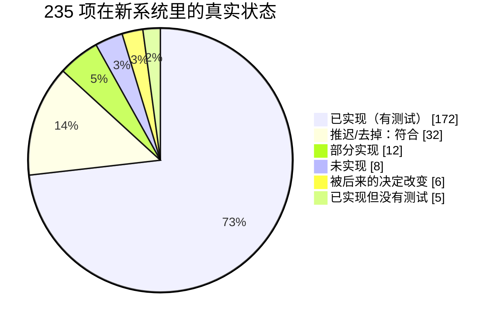

# v1 功能对照表逐条核对（上生产前）
- 版本：v1（2026-10-16）
- 变更历史：v1（2026-10-16）首次创建：对《v1-功能取舍对照表》235 项逐条核对新系统的真实状态
- 编写：测试（只读代码和文档，没有修改产品代码）
- 依据：
  - 新系统 falconx-lite：`origin/staging` 提交 `fba28c6`（Merge PR #38）
  - 原系统 fxsystem：分支 `claude/feature-map-v1` 提交 `b996c10`（功能地图 `docs/功能地图/01`–`08`，用来查每一项原来的做法）
  - 《v1-功能取舍对照表》v1、《v1-需求说明书》v1.5、《v1-UI风格调研》U1–U7、技术方案各篇里"实现时的调整""和原型不同的地方"、《v1-交付说明》v0.2、《v1-安全审查》v1.1、《v1-端到端测试方案》v1.2
- 怎么核对：每一项先在代码里找实现（`项目索引.md` 定位，再读代码），再找覆盖它的测试；"修复后保留"另外确认说明里写的那个修复做了。**依据一栏的代码位置都是代码走查**；测试是否通过见第 4 节（这次实际执行了三套单元/集成测试）。
- 路径写法：后端代码省略 `backend/src/main/java/com/falconx/lite/`，后端测试省略 `backend/src/test/java/com/falconx/lite/`，测试写成"类名.方法名"；`client/` 是 `web/client/src/`，`admin/` 是 `web/admin/src/`；"e2e 主流程"是 `e2e/tests/main-flow.spec.ts` 里的步骤。

## 一图看懂

这张图想说明：九成的功能已经实现并有测试，推迟和去掉的 32 项都确实没做、也没有留下客户能看到的入口；需要处理的是 12 项部分实现和 8 项未实现，其中真正挡住上生产的是**真实行情（LP）没接**、**通用限流**和**生产监控告警**三件事。

| 判定 | 含义 | 数量 |
|---|---|---|
| ✅ 已实现 | 找到实现，也有覆盖它的测试（修复项的修复也做了） | 172 |
| 🟡 已实现，没有测试 | 代码里有，但没有任何自动测试覆盖 | 5 |
| 🟠 部分实现 | 做了一部分，缺什么写在备注里 | 12 |
| ❌ 未实现 | 没有找到实现 | 8 |
| 🔀 被决定改变 | 后来的决定（U4、技术方案某节）改变了做法，备注里引用原文 | 6 |
| ✅ 符合（推迟/去掉） | 新系统里确实没有，也没有残留入口 | 32 |
| ⚠️ 有残留（推迟/去掉） | 推迟或去掉的功能留下了死代码或客户可见的入口 | 0 |
| **合计** | | **235** |

按计划去向看：保留 112、修复后保留 38、简化 34、架构替换 19 共 203 项，其中 172 项 ✅；推迟 7 + 去掉 25 共 32 项，全部 ✅ 符合。

**结论**：交易、资金、风控、通知、后台权限这些和钱、安全直接相关的部分全部实现并有测试，fxsystem 留下的 S1–S6、F1–F6、T1–T7 对应的修复都找到了测试。上生产前必须补的是三件事：LP 行情接入（含报价映射，M-01、M-02、M-04、M-16）、通用限流（P-05，另一个任务在做）、生产环境能送达的监控告警（行情断流、扫块停滞、外部探测，M-32、F-30、P-20）；另外需求说明书 4.2-5 明确要求的 Tick 图、买卖价叠加和指标（M-28）要么补上、要么由 Amos 书面改需求。其余是可以排期的小缺口和需要 Amos 确认的对照表修订。

## 1. 需要处理的清单
工作量：小 = 半天以内；中 = 1–3 天；大 = 3 天以上或依赖外部资源。

### 1.1 上生产前必须做
| # | 编号 | 判定 | 问题 | 建议 | 工作量 |
|---|---|---|---|---|---|
| 1 | M-01、M-02、M-04、M-16 | ❌ ❌ 🟠 🟠 | 只有模拟报价源（`market/quote/SimulatedQuoteSource`，`FX_MARKET_SOURCE` 只有 `none` / `simulated`），没有 LP 接入、订阅白名单热刷新，也没有"源代码 → 平台代码、乘数"的报价映射（品种表只有统一加点 `markup`；后台方案第 9 节："`lpSymbol` … LP 代码在 S20 接 LP 时再定"） | 拿到 LP 账号后按 fxsystem M-01/M-02 搬接入层，只输出 `RawQuote`；品种表加 LP 代码和乘数（新迁移脚本），后台品种页加这两列；用录下来的 LP 报价做回放测试 | 大（依赖 Amos 提供 LP 账号，交付说明第 6 节） |
| 2 | P-05 | 🟠 | 只有客户登录（`account/auth/LoginLimiter`）和发验证码（`account/auth/SendCodeLimiter`）限次；没有全局按 IP、下单、提现等接口的限流，Nginx 也没有 `limit_req` | 另一个子任务正在补；合并后按 fxsystem P-05 的三类（全局 IP / 认证入口 / 交易）核对一遍并补测试 | 中（进行中） |
| 3 | M-32、F-30、P-20 | 🟠 🟠 🟠 | 健康检查只看应用、数据库、Redis 和配置是否齐（`common/web/HealthController`、`wallet/deposit/ChainClientSetup` 只检查"配了节点有没有配合约"）。**行情全部断流（都变成 `NO_QUOTE`/`STALE`）、扫块停滞、节点连不上都不会让健康检查或任何告警变化**；外部探测 `.github/workflows/probe-staging.yml` 只探测试环境，而且要合并到 main 才运行；没有生产的探测 | 加"运行状态"告警（不进健康检查，避免外部故障把整个服务判为不可用，和邮件同一原则）：报价最后到达时间超过 N 秒、某条链扫块进度落后超过 N 个块、节点连续失败，发邮件给 `FX_RISK_ALERT_EMAILS`（或单独的运维邮箱）；生产的外部探测和测试环境同样做；顺带把 M-26（后台看每个品种最后一次报价时间）做了 | 中 |
| 4 | M-28 | 🟠 | `client/components/KChart.tsx` 只有 K 线、MA7/MA25、成交量（报价条数）和 6 个周期；**没有 Tick 图、没有 Bid/Ask 叠加，指标只有 MA**。需求说明书 4.2-5 原文："经典 K 线图（含 Tick 图、Bid/Ask、指标）"；KChart 没有单元测试 | 二选一，请 Amos 定：①补 Tick 图（用 `/api/ws/market` 的报价在内存里攒最近一段，后端不存 Tick，符合 M-09）、Bid/Ask 两条横线、常用指标（EMA、BOLL、MACD、RSI）；②书面把需求改成"K 线 + MA"，同步改对照表 | ① 中；② 小 |

### 1.2 建议做（上生产前做最好，不做要有人知道风险）
| # | 编号 | 判定 | 问题 | 建议 | 工作量 |
|---|---|---|---|---|---|
| 5 | M-11 | 🟠 | K 线存 MySQL（`market_kline`）已做，但"按周期设保留期"没做：`market/kline/KlineService`、`KlineMapper.xml` 里没有任何清理。50 个品种光 1 分钟线每天约 7.2 万行，一年约 2,600 万行，只增不减 | 加一个每天的清理任务，按周期保留（例如 1m 30 天、5m 90 天、15m/1h 1 年、4h/1d 不删），保留期放 `application.yml`；补测试 | 小 |
| 6 | R-17 | ❌ | 后台没有实时推送：后端只有客户的 `/api/ws/trading` 和行情 `/api/ws/market`，后台风控看板只在打开和手动刷新时取数。风控人员靠邮件得知自动禁开 | 最小做法：风控看板每 5–10 秒自动刷新（和 `ExposureMonitor` 的检查周期一致）；要真正推送再加后台 WebSocket（独立 Cookie 鉴权） | 小（轮询）/ 中（推送） |
| 7 | P-07 | 🟠 | 安全响应头有（`deploy/nginx/security.inc`，部署形态端到端测试检查）；**traceId 没做**：没有生成、没有放进日志（没有 MDC），排查时没法把一个请求的日志串起来。`common/package-info.java` 的注释写着"traceId"，但没有对应代码 | 加一个过滤器：读 Nginx 的 `$request_id` 或自己生成，放进 MDC 和响应头 `X-Request-Id`，日志格式里带上；错误响应体里也带上，方便客户报问题 | 小 |
| 8 | M-26 | ❌ | 后台品种列表没有"最后一次报价时间"（`admin/ops/MarketOps.SymbolView` 没有这个字段），运营看不出哪个品种断了；fxsystem 的问题就是这个字段一直为空，计划是修复后保留 | 和第 3 条一起做：`QuoteBook` 里已有每个品种最新报价的时间，`MarketAdminApi` 暴露出来，品种页加一列 | 小 |
| 9 | M-15 | 🟠 | 后台只能改品种参数和启停（`market/admin/MarketAdmin`），**不能新增品种**；对照表写的是"只开放约 50 个品种，后台可增减"。现在加品种要写迁移脚本 | 请 Amos 确认第一版是否需要在后台新增品种；需要就加 `POST /api/admin/symbols`（同时要配交易时段，现在时段只读）；不需要就改对照表为"后台可启停" | 中 / 小 |
| 10 | A-19 | 🟠 | 客户详情有最近登录时间，**没有最近登录 IP**（对照表的修复点）。登录 IP 其实已经写在 `account_session` 里，只是没有查出来 | `CustomerAdminApi` 详情加最近一次会话的 IP，客户详情页加一行 | 小 |
| 11 | M-19 | 🟡 | 每个品种一个统一加点已实现，改品种后会重新加载快照（`MarketAdmin.reloadAfterCommit`），但"后台改加点后立即用新加点报价"（修 fxsystem T2"删除后不同步"）**没有测试**：`AdminMonitorTest.品种_改参数…` 只测了改隔夜费率 | 补一个测试：后台改加点 → 下一条报价的买卖价按新加点 | 小 |
| 12 | F-22 | ✅（附注） | TRC20 出金有完整测试；BSC 出金和 ERC20 共用 `wallet/withdraw/EvmWithdrawSender`（`WithdrawSetup` 按链传 chainId 和精度），**没有 BSC 专门的测试**，BSC USDT 是 18 位精度 | 补一个 BSC 广播测试（18 位精度金额换算、chainId 97/56）；测试网实测仍按交付说明 3.3 节第 14 步 | 小 |

### 1.3 可以推迟（请 Amos 确认后改对照表，或排进第二版）
| # | 编号 | 判定 | 问题 | 建议 | 工作量 |
|---|---|---|---|---|---|
| 13 | A-20 | ❌ | 后台不能编辑客户（账户信息和基础资料）：没有接口也没有页面。需求说明书 5.2 节站点地图的"客户"只写了"列表 · 详情 · 冻结 · 调余额"，两份文档不一致。原来要修的"能通过编辑把状态改成任意值"自然不存在了 | 请 Amos 确认：不需要就把对照表改成"去掉"；需要时只允许改资料（KYC 通过后锁定，和客户自己改资料同一规则），状态只能经冻结/解冻改 | 小（改表）/ 中（做） |
| 14 | M-30 | ❌ | 客户端没有跑马灯。**没有任何文档写明去掉**：U4 说的是"手机底部导航…去掉首页"，而 fxsystem 的跑马灯在电脑版顶栏（功能地图 M-30：`MarketTicker`，宽屏显示）；风格 C 的效果图里也没有跑马灯 | 请 Amos 确认去掉，改对照表（M-22 的"热门"标记已用于"自选"的默认品种） | 小（改表） |
| 15 | C-22 | ❌ | 后台没有深浅主题切换（`admin/components/AppLayout.tsx` 固定浅色）。原型说明第 5 节："后台没有深色主题 \| 正式开发时决定是否需要"，之后没有找到决定 | 请 Amos 确认不做，改对照表 | 小（改表）/ 中（做） |
| 16 | P-15 | 🟠 | 没有雪花 ID，各表用自增主键，对外编号是"前缀 + 自增号"（例如历史记录 `P` + 持仓号）。单实例够用，越权访问有 `CustomerIdorTest` 挡住，但编号能看出业务量 | 请 Amos 确认接受，把对照表改成"简化：自增 ID"；以后多实例或要隐藏业务量时再换 | 小（改表） |
| 17 | P-19 | ❌ | 没有自定义 Micrometer 指标（管理端点只开了 `health`、`info`） | 第 3 条的告警先解决"出事有人知道"；指标和看板第二版做 | 中 |
| 18 | A-25、N-32、C-23 | 🟡 | 客户端个人资料页（`client/pages/me/Profile.tsx`）、新通知 Toast（`client/components/PushListener.tsx`）、后台手机布局（`admin/components/AppLayout.tsx` 的抽屉菜单）都没有前端测试；后端接口有测试 | 各补一个渲染测试 | 小 |
| 19 | P-26 | 🟡 | 部署脚本（`deploy/kit/deploy.sh`、`rollback.sh`、`backup.sh`、`restore.sh`）没有自动测试，只有部署方案 9.1 节的本机演练和测试环境实际自动更新成功的记录；部署形态端到端测试用的是 compose，不跑这些脚本 | 生产上线前在测试服务器上按部署方案演练一次回滚和恢复（S21） | 小 |
| 20 | A-03、A-05、M-08 | 🔀/✅（附注） | 文档不一致：`00-架构方案.md` 3.5 节写 account 模块搬"RSA JWT""Token 黑名单"、3.1 节写"Redis：最新价"；实际是 HttpOnly Cookie 里的随机会话令牌（数据库设计第 6 节）和进程内存里的最新价（`market/quote/QuoteBook`） | 在对照表 A-03、A-05、M-08 的说明里注明实际做法；架构方案是当时的记录，不用改 | 小 |

## 2. 这次新发现的问题（之前没有查到的）
已知缺口（P-05、R-17、P-07、P-19、M-28、M-01/M-02、M-22/M-30/T-24）逐条核对过，结论见第 3 节；其中两处和之前的说法不同：
- **M-30 跑马灯不是随 U4 去掉的**：U4 只管手机底部导航和首页；跑马灯在 fxsystem 里是电脑版顶栏的组件。现在是"没做、也没有决定"，判 ❌，请 Amos 确认后改表。M-22 的"热门"标记**已经实现**（`market_symbol.hot`、后台品种页开关、客户端自选的默认品种），判 ✅，不是去掉。T-24 首页仪表盘确实由 U4 改变（"首页的账户概览移到资产"，资产页 `client/pages/assets/Assets.tsx` 显示余额、净值、可用等），判 🔀。
- **M-28 不只是缺 Tick 图和买卖价叠加**，指标也只有 MA（fxsystem 有 EMA、BOLL、SAR、MACD、RSI、KDJ 等 10 种）。

之前没有查到的：
1. **K 线没有保留期**（M-11）：表只增不减，一年约 2,600 万行 1 分钟线。
2. **行情断流、扫块停滞没有任何告警**（M-32、F-30）：健康检查有意不看外部服务，但也没有别的地方报警。LP 接上以后这是最可能出、又最难发现的故障。
3. **后台看不到每个品种最后一次报价时间**（M-26）：对照表要求修复，没做。
4. **后台不能新增品种**（M-15）。
5. **客户详情没有最近登录 IP**（A-19）、**后台不能编辑客户**（A-20，和需求说明书站点地图不一致）。
6. **后台没有深色主题**（C-22）：原型阶段留了"正式开发时决定"，没有决定。
7. **没有雪花 ID**（P-15）：对照表写"保留"，实际是自增 ID，没有文档记录。
8. **报价映射只有加点**（M-04、M-16）：源代码到平台代码、乘数要随 LP 一起做，不只是"接 LP"。
9. 修复项里有两处**修了但没测**：加点改了立即生效（M-19）、BSC 出金广播（F-22）。
10. `00-架构方案.md` 和实际做法不一致的三处（JWT、Token 黑名单、Redis 最新价），以及 `common/package-info.java` 注释里写了但不存在的 traceId。
11. 和 235 项无关、但上线前要定的：新库上 BTCUSD 默认"暂停开仓"（`backend/src/main/resources/db/migration/V4__market.sql` 里 `open_paused = 1`，交付说明 E2E-1，仍未改）。

## 3. 逐项核对

### 01 账户认证与 KYC（28 项：✅ 20、🟡 1、🟠 1、❌ 1、🔀 2、符合 3）
| 编号 | 功能 | 计划去向 | 判定 | 依据（代码 / 测试） | 备注 |
|---|---|---|---|---|---|
| A-01 | 用户注册（5 项基础资料） | 保留 | ✅ | `account/auth/AuthService`、`AuthRequests`；`AuthFlowTest.注册后已登录_资料和交易账户都建好`、`AuthFlowTest.所有字段错误一次返回`；e2e 主流程"用邮箱验证码注册" | |
| A-02 | 邮箱密码登录（失败锁定） | 修复后保留 | ✅ | `account/auth/LoginLimiter`（Redis 按账号、按 IP 各计数）；`AuthFlowTest.同一账号连续失败5次锁定_换IP仍锁定_锁定期满自动解锁`、`AuthFlowTest.同一IP换不同账号失败5次也锁定该IP` | 修复（按账号 + IP）已做 |
| A-03 | Refresh Token 刷新与轮换 | 保留 | 🔀 | `account/auth/SessionService`（72 小时不访问过期，访问时每分钟最多续期一次）；`AuthFlowTest.登出后会话失效_未登录访问返回401_公开接口不需要登录` | 数据库设计第 6 节："会话：随机令牌放在 HttpOnly、Secure、SameSite=Strict 的 Cookie"。不再有 Refresh Token，"保持登录"由会话续期实现 |
| A-04 | 登出与 Token 失效 | 修复后保留 | ✅ | `SessionService.revoke`、`revokeAll`；`AuthFlowTest.冻结后登录立即失效且不能再登录`、`AdminOpsTest.AC04_冻结后客户登录立即失效_有原因和审计_解冻后清空原因` | 修复（冻结即失效）已做；每次请求查库，不需要黑名单 |
| A-05 | RSA JWT 签发与 claim | 保留 | 🔀 | 同 A-03（没有 JWT） | 同 A-03 的决定；`00-架构方案.md` 3.5 节仍写"RSA JWT"，是当时的记录 |
| A-06 | 网关认证 | 架构替换 | ✅ | `account/auth/SessionFilter`、`common/web/CrossSiteGuard`；`AuthFlowTest.登出后会话失效_未登录访问返回401_公开接口不需要登录`、`CrossSiteGuardTest.路径里的点点不能绕过登录检查` | 认证限流部分见 P-05 |
| A-07 | 用户状态 | 简化 | ✅ | `account/api/UserStatus`（只有 `ACTIVE`、`FROZEN`）；`AuthFlowTest.冻结后登录立即失效且不能再登录` | |
| A-08 | 入金后激活 | 去掉 | ✅ 符合 | 全仓库没有"激活"状态和相关代码；`AuthFlowTest.注册后已登录_资料和交易账户都建好`（注册即可用） | |
| A-09 | 注册后发布事件 | 架构替换 | ✅ | `wallet/address/AddressService.allocateAddresses`（注册事务内分配）；`DepositFlowTest.注册时分配地址_接口返回三条链的地址确认数和最小充值_AC06` | |
| A-10 | 邮箱可信度 | 修复后保留 | ✅ | `account/auth/EmailCodeService`（注册必须验证码）；`AuthFlowTest.验证码错误被拒_试5次后作废_用过不能再用` | 注册必须过邮箱验证码，等于真实的邮箱验证 |
| A-11 | 用户产品组 | 推迟 | ✅ 符合 | 后端、两个前端都没有分组相关代码 | |
| A-12 | 基础资料查询与修改 | 保留 | ✅ | `account/profile/ProfileController`；`KycFlowTest.资料可以查看和修改_字段错误一次返回`、`KycFlowTest.通过后资料锁定_不能再提交_只能审核待审核的申请` | |
| A-13 | KYC 提交 | 修复后保留 | ✅ | `account/kyc/KycService`、`common/storage/ObjectStorage`；`KycFlowTest.提交后审核中_证件号只显示后4位_数据库只存路径_文件在对象存储里`、`KycFlowTest.不是图片_超过2MB_缺文件_证件类型错误都一次返回` | 修复已做；现在的实现是本地目录（`LocalObjectStorage`），生产换对象存储服务（H0） |
| A-14 | KYC 状态查询 | 保留 | ✅ | `account/kyc/KycController`；`KycFlowTest.提交后审核中_…` | |
| A-15 | 后台 KYC 审核 | 保留 | ✅ | `admin/ops/OpsController`（`/api/admin/kyc*`）、`admin/pages/kyc/`；`AdminOpsTest.AC05_KYC列表_详情_看照片_驳回必须填原因_通过后客户收到通知`；`admin/config/menu.test.ts` | 菜单已补 |
| A-16 | KYC 审核事件 | 架构替换 | ✅ | `KycService` 事务内调 `notification.api.NotifyApi`（`KYC_RESULT`）；`AdminOpsTest.AC05_…`、`PushFlowTest` | |
| A-17 | 内部 KYC 等级查询 | 架构替换 | ✅ | `account/api/AccountApi.kycStatus`（`WithdrawService` 调用）；`WithdrawFlowTest.六种拒绝原因_AC17_加上可提金额不足` | |
| A-18 | 后台客户列表 | 保留 | ✅ | `admin/ops/CustomerOps`；`AdminOpsTest.客户列表和详情_按名字搜索_详情有账户持仓流水` | |
| A-19 | 后台客户详情 | 修复后保留 | 🟠 | `CustomerOps` 详情有 `lastLoginAt`（`AuthMapper.xml` 的 `touchLogin` 写入）；`AdminOpsTest.客户列表和详情_…` | **缺最近登录 IP**（对照表点名的字段）；IP 已记在 `account_session.ip`，没查出来 |
| A-20 | 后台编辑客户 | 修复后保留 | ❌ | 未找到：`OpsController` 没有编辑客户的接口，`admin/pages/customers/CustomerDetailPage.tsx` 没有编辑表单 | 需求说明书 5.2 节站点地图只有"列表 · 详情 · 冻结 · 调余额"，和对照表不一致，见第 1.3 节第 13 条 |
| A-21 | 后台冻结 / 解冻 | 修复后保留 | ✅ | `POST /api/admin/customers/{id}/freeze`、`AccountApi.freeze`；`AdminOpsTest.AC04_冻结后客户登录立即失效_有原因和审计_解冻后清空原因` | 按钮和"立即踢下线"都已做 |
| A-22 | 后台调余额 | 修复后保留 | ✅ | `admin/ops/CustomerOps`、`AdjustMapper`（后台方案 G5：单笔 5,000、每人每天 20,000）；`AdminOpsTest.调余额_单笔和每天限额_扣减不能超过可用_记账本和审计`；`admin/utils/validators.test.ts`"余额调整" | |
| A-23 | 内部 RPC 鉴权 | 去掉 | ✅ 符合 | 没有内部接口和内部 Token；`ModuleBoundaryTest.正式代码遵守模块边界` | |
| A-24 | 客户端登录注册页 | 保留 | ✅ | `client/pages/auth/Login.tsx`、`Register.tsx`；`client/lib/validators.test.ts`"注册校验"、`client/api/real/real.test.ts`"登录""注册"、`client/i18n/i18n.test.ts`；e2e 主流程注册、登录 | 中英文已有 |
| A-25 | 客户端个人资料 | 保留 | 🟡 | `client/pages/me/Profile.tsx`；后端有 `KycFlowTest.资料可以查看和修改_…` | 页面没有前端测试，e2e 不经过这页 |
| A-26 | 客户端 KYC | 保留 | ✅ | `client/pages/me/Kyc.tsx`（独立页面，不是弹窗）；`client/lib/validators.test.ts`"KYC 校验"；e2e 主流程"提交 KYC" | |
| A-27 | 客户端会话管理 | 保留 | ✅ | `client/api/http.ts`、`client/api/real/session.ts`（前端不存令牌）；`real.test.ts`"401：通知回到登录页"、"推送偏好关了、退出登录：取消这台设备的订阅" | |
| A-28 | 邮箱验证流程 | 保留（新增） | ✅ | 同 A-10；`AuthFlowTest.邮箱已注册时不能再注册_验证码60秒内不能重发`、`SendCodeLimitTest` 两条；e2e 主流程 | X-01 |

### 02 行情与品种（34 项：✅ 18、🟡 1、🟠 6、❌ 4、🔀 1、符合 4）
| 编号 | 功能 | 计划去向 | 判定 | 依据（代码 / 测试） | 备注 |
|---|---|---|---|---|---|
| M-01 | LP 行情源接入 | 保留 | ❌ | 未找到：`market/MarketProperties` 的报价源只有 `none`、`simulated`；只有 `market/quote/SimulatedQuoteSource` | 已知缺口；数据库设计第 8 节"LP 接入在 S20 联调"，交付说明第 6 节 LP 账号待提供 |
| M-02 | LP 订阅白名单热刷新 | 保留 | ❌ | 未找到（随 M-01） | |
| M-03 | 行情主链路与按品种分区 | 架构替换 | ✅ | `market/quote/QuoteProcessor`（8 个单线程队列，同一品种按顺序）；`MarketFlowTest.加点只加一次_卖价减买价加_订阅者收到报价` | |
| M-04 | 报价映射（源代码 → 平台代码、乘数、加点） | 保留 | 🟠 | 只有加点：`QuoteProcessor`（`markup`）；`MarketFlowTest.加点只加一次_…` | **缺源代码到平台代码的映射和乘数**；后台方案第 9 节："没有前三项（LP 代码在 S20 接 LP 时再定）" |
| M-05 | 报价标准化与口径 | 保留 | ✅ | `market/api/MarketQuote`（bid、ask 含加点，mid 不含）；`MarketFlowTest.加点只加一次_…` | 没有单独的 mark 价，K 线、汇率、敞口都用 mid |
| M-06 | 行情质量守卫（5 态） | 保留 | ✅ | `market/quote/QualityGuard`；`QualityGuardTest` 6 条、`MarketFlowTest.异常报价不更新价格且不可成交` | 阈值照搬 |
| M-07 | 交易时段与交易日历 | 保留 | ✅ | `market/config/SymbolCatalog`；`MarketFlowTest.交易时段_美股周末和盘后休市_加密全天_外汇周五晚收市_休市日全天休市` | |
| M-08 | 最新价缓存 | 保留 | ✅ | `market/quote/QuoteBook`；`MarketFlowTest.接口_品种_报价_K线_今日走势_需要登录` | 放在进程内存，不是 Redis（单实例）；`00-架构方案.md` 3.1 节写的是 Redis |
| M-09 | ClickHouse Tick 存储 | 去掉 | ✅ 符合 | 迁移脚本里没有 Tick 表，只有 `market_kline` | |
| M-10 | K 线聚合 | 保留 | ✅ | `market/kline/KlineService`、`Timeframe`；`MarketFlowTest.K线跨桶时上一根收盘写库_历史接口含当前这一根`、`TimeframeTest.各周期的起点` | 未收盘的一根只在内存，重启会丢（数据库设计第 8 节已记录） |
| M-11 | K 线存储与历史查询 | 架构替换 | 🟠 | `market_kline`（MySQL）、`KlineMapper.xml`；`MarketFlowTest.K线跨桶时…` | **缺"按周期设保留期"**：没有清理任务，见第 1.2 节第 5 条 |
| M-12 | Kafka 行情事件 | 架构替换 | ✅ | `market/api/QuoteListener`（进程内）；`MarketFlowTest.加点只加一次_…_订阅者收到报价` | |
| M-13 | 行情 WebSocket | 保留 | ✅ | `market/web/MarketPush`（`/api/ws/market`）；`MarketPushTest.未登录不能连接`、`MarketPushTest.登录后收到报价推送和订阅的K线`、`CrossSiteGuardTest.WebSocket只接受同源_其他网站的页面连不上` | |
| M-14 | 品种列表与最新报价接口 | 保留 | ✅ | `market/web/MarketController`；`MarketFlowTest.接口_品种_报价_K线_今日走势_需要登录` | |
| M-15 | 品种主表管理 | 简化 | 🟠 | `V4__market.sql`（50 个品种）、`market/admin/MarketAdmin`（改参数、启停）；`MarketFlowTest.五十个品种的配置已加载_…`、`AdminMonitorTest.品种_改参数有前后审计_有持仓不能停用_…` | **后台不能新增品种**，见第 1.2 节第 9 条 |
| M-16 | 报价映射管理 | 简化 | 🟠 | 加点在后台品种页（`admin/pages/market/SymbolsPage.tsx`） | 映射本身随 M-04 缺 |
| M-17 | SymbolSpec 共享快照 | 架构替换 | ✅ | `market/config/SymbolCatalog`、`market/api/SymbolSpec`；`MarketFlowTest.五十个品种的配置已加载_…` | |
| M-18 | 用户组品种可见性 | 推迟 | ✅ 符合 | 没有分组代码 | |
| M-19 | 用户组加点 → 品种统一加点 | 简化 | 🟡 | `market_symbol.markup`、`MarketAdmin.reloadAfterCommit`；`MarketFlowTest.加点只加一次_…`（直接改库） | 修复点"删除后不同步"（后台改加点立即生效）**没有测试**，见第 1.2 节第 11 条 |
| M-20 | 交易时间（周规则 + 特殊交易日） | 保留 | 🔀 | `market_session`、`GET /api/admin/sessions`；`MarketFlowTest.交易时段_…`、`AdminMonitorTest.品种_…_时段和汇率` | 后台方案第 9 节："每个品种自己的一周时段…第一版只读"；"休市日…只有全天休市…提前收市第一版不做"。特殊交易日例外没有 |
| M-21 | 市场假期管理 | 保留 | ✅ | `market_holiday`、`POST/DELETE /api/admin/holidays`；`AdminMonitorTest.品种_…_休市日增删_…`、`MarketFlowTest.交易时段_…_休市日全天休市` | |
| M-22 | 跑马灯热门产品 → 品种"热门"标记 | 简化 | ✅ | `market_symbol.hot`、后台品种页"热门"开关（`SymbolsPage.tsx`）；`client/pages/layouts.test.tsx`"自选：默认是热门品种，可以加入和取消" | 热门标记已用于自选的默认品种；跑马灯本身见 M-30 |
| M-23 | FX 汇率 | 保留 | ✅ | `MarketApi.toUsdRate`；`MarketFlowTest.汇率_直接对_反向对_固定汇率_USDT视同USD` | |
| M-24 | 后台汇率监控 | 保留 | ✅ | `GET /api/admin/fx-rates`、`admin/pages/market/FxPage.tsx`；`AdminMonitorTest.品种_…_时段和汇率` | |
| M-25 | 隔夜费率配置 | 保留 | ✅ | `market_symbol.swap_long`、`swap_short`；`AdminMonitorTest.品种_…`、`SwapTest` | 费率现在都是 0，待 Amos 提供 |
| M-26 | 品种最近 Tick 时间 | 修复后保留 | ❌ | 未找到：`admin/ops/MarketOps.SymbolView` 没有报价时间字段 | 见第 1.2 节第 8 条 |
| M-27 | 客户端行情列表 | 保留 | ✅ | `client/pages/Markets.tsx`、`client/components/SymbolList.tsx`；`layouts.test.tsx`"电脑上是宽表格…""手机上是列表…"、`pages.test.tsx`"行情页显示 50 个品种…" | |
| M-28 | 客户端经典图表 | 保留 | 🟠 | `client/components/KChart.tsx`（K 线、MA7/MA25、量、1m–1d 六个周期） | **缺 Tick 图、Bid/Ask 叠加，指标只有 MA**；没有单元测试；见第 1.1 节第 4 条 |
| M-29 | TradingView 高级图表 | 推迟 | ✅ 符合 | 没有商业版 `charting_library`；用的是开源的 lightweight-charts（Apache-2.0，按许可保留署名，`client/pages/Trade.tsx`） | |
| M-30 | 客户端跑马灯 | 保留 | ❌ | 未找到（客户端没有跑马灯组件） | 没有文档写明去掉，不是 U4 的范围，见第 2 节 |
| M-31 | 客户端行情 WebSocket 连接管理 | 保留 | ✅ | `client/api/ws.ts`（退避重连）、`client/api/real/market.ts`；`real.test.ts`"行情推送：报价缓存、汇率为空时沿用上一次的值" | |
| M-32 | 行情健康检查与可观测指标 | 保留 | 🟠 | `common/web/HealthController`；`HealthControllerTest`、`HealthControllerUnitTest` | **没有行情专门的健康和告警**（断流不报），没有指标；见第 1.1 节第 3 条 |
| M-33 | LP 历史 K 线补数 | 去掉 | ✅ 符合 | 没有 | |
| M-34 | 杠杆档位（边界说明） | 简化 | ✅ | 同 T-05 | |

### 03 交易（31 项：✅ 24、🔀 1、符合 6）
| 编号 | 功能 | 计划去向 | 判定 | 依据（代码 / 测试） | 备注 |
|---|---|---|---|---|---|
| T-01 | 交易账户与快照 | 保留 | ✅ | `trading/order/Funds`、`GET /api/trading/account`；`OrderFlowTest.接口_下单_持仓_挂单_账户_撤单_错误格式`、`PositionFlowTest.浮动盈利不能用来开新仓或追加保证金`；`client/lib/trading.test.ts`"可用余额" | 浮动盈利不计入可用（DF-02） |
| T-02 | 账本流水与查询 | 保留 | ✅ | `trading/ledger/LedgerService`、`GET /api/trading/ledger`；`LedgerServiceTest` 7 条、`ClientLedgerTest` 2 条；e2e 主流程"资金流水" | |
| T-03 | 多币种计价与 FX 换算 | 简化 | ✅ | `trading/order/OrderCalc`；`OrderCalcTest.美元日元卖出_非USD报价按汇率折算`、`OrderFlowTest.非USD报价品种_卖出按bid_按实时汇率折算`、`SwapTest.日元报价品种按汇率折算成USD` | |
| T-04 | 市价开仓 | 保留 | ✅ | `trading/order/OrderService`、`PositionService.openLocked`；`OrderFlowTest.市价买入_按ask成交_保证金手续费强平价和手算一致_手续费记账`、`OrderFlowTest.并发下单不会超出可用余额_账本和余额一致` | |
| T-05 | 杠杆/维持保证金档位 | 简化 | ✅ | `market_symbol.max_leverage`、`maintenance_margin_rate`；`OrderFlowTest.七种拒单原因和报价不可用`（`LEVERAGE_EXCEEDED`）、`PositionFlowTest.追加保证金_按开仓时的维持保证金率重算强平价_T11` | 每个品种一档 |
| T-06 | 挂单 | 简化 | ✅ | `OrderService`（只有市价、限价，全仓库没有止损单类型）；`OrderFlowTest.限价单冻结保证金和手续费_撤单后释放_不能重复撤`、`MatchingEngineTest.买入限价单_…`、`MatchingEngineTest.卖出限价单_…` | |
| T-07 | 订单与成交查询 | 保留 | ✅ | `GET /api/trading/orders`、`/history`；`PositionFlowTest.接口_平仓_止盈止损_追加保证金_改单_历史`；`real.test.ts`"…历史分页" | |
| T-08 | 持仓与未实现盈亏 | 修复后保留 | ✅ | `PositionService`；`OrderFlowTest.加点只加一次_成交价等于对客报价`、`MarketFlowTest.加点只加一次_…` | 修复 T1（加点叠加两次）已做 |
| T-09 | 手动平仓（全额） | 保留 | ✅ | `PositionService.close`；`PositionFlowTest.平仓盈利_多单按bid平_盈亏入账_账本和余额一致`、`PositionFlowTest.同一持仓并发平仓只平一次`；e2e 主流程"手动平仓" | |
| T-10 | 止盈止损 | 修复后保留 | ✅ | 只有持仓字段一套（`trading_position.take_profit`、`stop_loss`）；`PositionFlowTest.修改止盈止损_方向以当前平仓价为基准_可以取消`、`MatchingEngineTest.止盈_…`、`MatchingEngineTest.止损_…` | 修复（只留一套）已做 |
| T-11 | 追加保证金与强平价重算 | 修复后保留 | ✅ | `PositionService.addMargin`；`PositionFlowTest.追加保证金_按开仓时的维持保证金率重算强平价_T11` | 修复已做 |
| T-12 | 保证金模式切换 | 去掉 | ✅ 符合 | 全仓库没有保证金模式 | |
| T-13 | 追保预警 | 保留 | ✅ | `trading/order/MarginCallMonitor`；`MarginCallTest.跌破追保线只通知一次_回到线上再跌破_满5分钟才再通知`、`MarginCallTest.没有持仓不检查_平仓后状态恢复` | |
| T-14 | 逐仓自动强平 | 保留 | ✅ | `trading/order/MatchingEngine`；`MatchingEngineTest.强平优先于止损_跳空越过强平价时亏损封顶_余额不为负_AC14`、`MatchingEngineTest.二十个持仓同时触及强平价_1秒内全部强平_AC13` | |
| T-15 | 全仓账户级强平 | 去掉 | ✅ 符合 | 没有 | |
| T-16 | 强平日志与查询 | 保留 | ✅ | 不另建强平表：持仓 `close_reason = LIQUIDATED`，客户历史和后台持仓列表可查；`MatchingEngineTest.强平优先于止损_…` | |
| T-17 | 隔夜费结算与查询 | 保留 | ✅ | `trading/order/SwapService`；`SwapTest` 7 条 | 周三三倍没做（数据库设计第 12 节，需求没有要求） |
| T-18 | 价格提醒 | 推迟 | ✅ 符合 | 后端、客户端、后台都没有 | |
| T-19 | 行情驱动引擎 | 保留 | ✅ | `MatchingEngine.onQuote`；`MatchingEngineTest` 8 条 | AC-13 压测在本次核对的提交之后已合并（PR #39，`测试报告/v1-压测报告-AC13.md`），不在本次核对范围 |
| T-20 | 交易 WebSocket | 保留 | ✅ | `trading/order/TradingPush`；`TradingPushTest.未登录不能连接`、`TradingPushTest.下单和止盈触发时推送事件_只推给本人`；`real.test.ts`"交易推送：登录后才连接，只转发认识的事件" | 修复 T6（事件名一致）已做 |
| T-21 | 交易领域事件 | 架构替换 | ✅ | `trading/api/UserEventsApi`、`trading/order/TradingEvents`；`TradingPushTest.下单和止盈触发时推送事件_只推给本人` | |
| T-22 | 下单面板 | 简化 | ✅ | `client/components/OrderPanel.tsx`、`OrderSheet.tsx`、`client/hooks/useOrderForm.ts`；`pages.test.tsx`"输入框、预估和确认按钮始终使用同一个手数"、`layouts.test.tsx`"交易页：手机下单抽屉、电脑下单面板"、`validators.test.ts`"下单校验" | |
| T-23 | 交易表格与活动页 | 保留 | ✅ | `client/pages/Positions.tsx`、`client/components/PositionsTabs.tsx`、`PositionDialogs.tsx`；`noUsdRate.test.tsx`"持仓列表：浮动盈亏显示…"；e2e 主流程止盈止损、平仓 | "告警"随价格提醒推迟 |
| T-24 | 客户端仪表盘 | 保留 | 🔀 | `client/pages/assets/Assets.tsx`（余额、提现冻结、净值、挂单冻结、可用）、`client/components/AccountStrip.tsx`（持仓页） | U4："去掉首页。首页的账户概览移到'资产'，持仓单独成一项" |
| T-25 | 后台订单/持仓监控、运营指标 | 保留 | ✅ | `admin/ops/MonitorController`、`TradingOps`、`DashboardOps`；`AdminMonitorTest.交易监控_订单持仓挂单列表_…`、`AdminMonitorTest.仪表盘_今天的数字` | |
| T-26 | 后台挂单监控、强制撤单 | 简化 | ✅ | `POST /api/admin/pending/{id}/cancel`；`AdminMonitorTest.交易监控_…_强制撤单释放冻结_…` | |
| T-27 | 后台手动强平、自动强平开关 | 保留 | ✅ | `POST /api/admin/positions/{id}/liquidate`、`/api/admin/risk/auto-liquidation`；`AdminMonitorTest.交易监控_…_手动强平通知客户_都要原因和高危审计`、`AdminMonitorTest.风控看板和操作_…_自动强平开关_…` | |
| T-28 | 后台交易配置 | 简化 | ✅ | 品种杠杆和维持保证金率（`SymbolsPage.tsx`）、追保线（`admin/pages/params/ParamsPage.tsx`）；`AdminMonitorTest.交易参数_追保线和通知间隔_立即生效_不在系统配置页`、`admin/auth/realMode.test.tsx`"S18b：交易参数页的强平线是说明文字…" | 强平线按后台方案 G6 改为说明文字（逐仓） |
| T-29 | 部分平仓 | 推迟 | ✅ 符合 | 平仓接口只有全额（`POST /api/trading/positions/{id}/close`） | |
| T-30 | 下单预览组件（死代码） | 去掉 | ✅ 符合 | 没有 | |
| T-31 | K 线收盘事件消费（空实现） | 去掉 | ✅ 符合 | 没有 | |

### 04 风控（26 项：✅ 19、❌ 1、符合 6）
| 编号 | 功能 | 计划去向 | 判定 | 依据（代码 / 测试） | 备注 |
|---|---|---|---|---|---|
| R-01 | 品种净敞口与 USD 归一化 | 修复后保留 | ✅ | `trading/order/ExposureQuery`、`risk/switches/RiskSwitchService`；`RiskMonitorTest.敞口按当前中间价折算USD_净敞口是多减空_平台是各品种绝对值之和` | |
| R-02 | 单品种阈值自动禁开 | 简化 | ✅ | `risk/switches/ExposureMonitor`；`RiskMonitorTest.品种净敞口超阈值自动禁开_只通知一次_手动恢复`、`RiskOrderTest.品种自动禁开和手动暂停_都按品种暂停拒单_恢复后可以下单` | 阈值待 Amos 提供（H7） |
| R-03 | 市场大类集中度 | 去掉 | ✅ 符合 | 没有 | |
| R-04 | 方向集中度 | 去掉 | ✅ 符合 | 没有（看板照常显示多空） | |
| R-05 | 相关性组 | 去掉 | ✅ 符合 | 没有 | |
| R-06 | 用户级阈值 → 单用户持仓上限（USD） | 简化 | ✅ | `OrderService`（`POSITION_LIMIT`）、`PUT /api/admin/risk/per-user-limit`；`OrderFlowTest.持仓上限把挂单也算进去`、`AdminMonitorTest.风控看板和操作_…_单客户持仓上限立即生效` | 修复 T4 |
| R-07 | 平台总净敞口 | 简化 | ✅ | `ExposureMonitor`；`RiskMonitorTest.平台总净敞口超阈值_全部自动禁开`、`RiskOrderTest.平台自动禁开时全部拒单_平仓不受影响` | 只能手动恢复，"假恢复"不会再出现 |
| R-08 | 风控动作 | 简化 | ✅ | `risk_switch`、`risk_symbol`；`RiskOrderTest.品种自动禁开和手动暂停_…`、`AdminMonitorTest.风控看板和操作_暂停恢复_…` | 只有暂停品种、全局暂停 |
| R-09 | 下单时的风控拦截 | 保留 | ✅ | `risk/api/RiskApi`；`RiskOrderTest` 4 条 | |
| R-10 | 汇率失效禁开 | 简化 | ✅ | `OrderService`（`RATE_STALE`）；`OrderFlowTest.七种拒单原因和报价不可用` | |
| R-11 | 风控开关（自动强平） | 保留 | ✅ | `RiskApi`；`RiskOrderTest.关闭自动强平后触及强平价不平_止盈照常` | |
| R-12 | 品种风控参数 | 简化 | ✅ | `PUT /api/admin/risk/symbols/{symbol}/threshold`；`AdminMonitorTest.风控看板和操作_…_阈值_…`、`RiskMonitorTest.没有设置阈值的不监控_手动暂停和自动强平开关` | |
| R-13 | StopOut / MarginCall 阈值 | 保留 | ✅ | 追保线和通知间隔（`GET/PUT /api/admin/params`）；`AdminMonitorTest.交易参数_…` | StopOut 按后台方案 G6 是品种的维持保证金率（逐仓） |
| R-14 | 行情质量守卫 | 保留 | ✅ | 同 M-06 | |
| R-15 | 对冲观测与 A-Book | 去掉 | ✅ 符合 | 没有 | |
| R-16 | 风控告警推给客户 | 去掉 | ✅ 符合 | `RiskOrderTest.客户看到的拒单原因不含风控信息_T5`；e2e 主流程"AC-23 风控信息不外泄" | 修复 T5 |
| R-17 | 后台实时推送 | 保留 | ❌ | 未找到：后端只注册了 `/api/ws/trading`（`TradingPush`）和 `/api/ws/market`（`WebSocketConfig`），后台页面没有推送也没有自动刷新 | 已知缺口，见第 1.2 节第 6 条 |
| R-18 | 后台净敞口看板 | 保留 | ✅ | `admin/pages/risk/RiskPage.tsx`、`GET /api/admin/risk`；`AdminMonitorTest.风控看板和操作_…`、`admin/pages/pages.test.tsx`"风控看板（M7）" | |
| R-19 | 后台风控开关页 | 保留 | ✅ | 同上；`pages.test.tsx`"运营身份没有风控权限：开关和按钮置灰" | 合并在风控页 |
| R-20 | 后台风控动作页 | 简化 | ✅ | 同上；`admin/api/real.test.ts`"开关是 {value, reason}…" | |
| R-21 | 后台风控配置页 | 简化 | ✅ | 同上；`AdminMonitorTest.风控看板和操作_…_阈值_…` | |
| R-22 | 后台平台总敞口阈值页 | 简化 | ✅ | `PUT /api/admin/risk/platform-threshold`；`AdminMonitorTest.风控看板和操作_…` | |
| R-23 | 后台用户级阈值页 | 简化 | ✅ | `PUT /api/admin/risk/per-user-limit`；`AdminMonitorTest.风控看板和操作_…_单客户持仓上限立即生效` | |
| R-24 | 后台 StopOut / MarginCall 页 | 保留 | ✅ | `ParamsPage.tsx`；`realMode.test.tsx`"S18b：交易参数页…"、`AdminMonitorTest.交易参数_…` | |
| R-25 | 后台 FX 暂停行为页 | 去掉 | ✅ 符合 | 没有 | |
| R-26 | 风控权限码、高危与审计 | 修复后保留 | ✅ | `admin/security/Permission`、`admin/config/permissions.ts`；`AdminSystemTest.权限点和后台原型一致_高危标记一致`、`AdminMonitorTest.交易监控_…_都要原因和高危审计` | 修复 S6 |

### 05 资金（30 项：✅ 27、🟠 1、符合 2）
| 编号 | 功能 | 计划去向 | 判定 | 依据（代码 / 测试） | 备注 |
|---|---|---|---|---|---|
| F-01 | 入金地址 xpub 派生 | 修复后保留 | ✅ | `wallet/address/Addresses`、`Bip32`；`AddressDerivationTest` 4 条、`DepositFlowTest.注册时分配地址_…_AC06` | ERC20、TRC20、BSC |
| F-02 | 注册后自动分配地址 | 架构替换 | ✅ | `AddressService.allocateAddresses`；`DepositFlowTest.注册时分配地址_…` | |
| F-03 | 入金页幂等申请地址 | 保留 | ✅ | `AddressService.addressOf`（没有就补分配）、`GET /api/wallet/addresses`；`DepositFlowTest.注册时分配地址_…` | 没有单独的 ensure 接口，查询时自动补 |
| F-04 | 地址分配失败死信与重试 | 去掉 | ✅ 符合 | 没有 | |
| F-05 | ETH 链监听 | 简化 | ✅ | `wallet/deposit/EvmChainClient`、`ChainClientSetup`；`DepositFlowTest.假币不入账_F3_AC08`、`DepositFlowTest.没有配置USDT合约的链不扫块_F3`、`ChainClientSetupTest.有节点没合约_健康检查不通过_不扫块` | 修复 F3 |
| F-06 | BSC 链监听 | 修复后保留 | ✅ | 同上；`DepositFlowTest.BSC和ERC20同一个地址_BSC按18位精度_15个确认` | 精度的链上实测在 S21（交付说明 3.3 节第 13 步） |
| F-07 | TRON 链监听 | 保留 | ✅ | `wallet/deposit/TronChainClient`；`DepositFlowTest.TRC20_T开头的地址_19个确认入账_别人的地址不记`、`ChainClientTest.TRON_地址换算_…` | |
| F-08 | SOL 链监听 | 去掉 | ✅ 符合 | `wallet/Chain` 只有三条链（交易品种 SOLUSD 和链无关） | |
| F-09 | 原始入金状态机 | 保留 | ✅ | `wallet/deposit/DepositService`；`DepositFlowTest.确认前区块被回滚_作废不入账`、`DepositFlowTest.同一笔重复扫到只记一次`、`DepositFlowTest.发现待确认的充值就推送_…_E2E2` | |
| F-10 | 入金入账 | 保留 | ✅ | `DepositService` → `LedgerApi`（`DEPOSIT`）；`DepositFlowTest.ERC20_达到12个确认后入账_之前是待确认`；e2e 主流程充值到账 | |
| F-11 | 入金冲正 | 修复后保留 | ✅ | `DepositService`、`trading/api/FundsApi`、`wallet_suspense`；`DepositFlowTest.入账后被回滚_可用余额不够_不扣成负数_挂账并通知风控_AC09`、`ReconTest.冲正_扣的加挂账等于充值金额才对` | 修复 F4 |
| F-12 | 出金白名单 | 修复后保留 | ✅ | `wallet/withdraw/WhitelistService`；`WithdrawFlowTest.白名单_24小时生效_地址格式_去重_最多10个`、`client/pages/assets/Withdraw.test.tsx` 3 条、`real.test.ts`"提现：后端的字段错误…对应到表单字段" | 字段名修复已做（GAP-3） |
| F-13 | 白名单 24 小时冷却 | 保留 | ✅ | `WhitelistService`（按生效时间判断，不需要推进任务）；`WithdrawFlowTest.白名单_24小时生效_…` | |
| F-14 | 出金提交 | 保留 | ✅ | `wallet/withdraw/WithdrawService`；`WithdrawFlowTest.六种拒绝原因_AC17_加上可提金额不足`、`WithdrawFlowTest.并发提交不会超过可提金额` | |
| F-15 | 冷静期与用户取消 | 保留 | ✅ | `WithdrawFlowTest.提交冻结_冷静期内撤销立即退回_过了冷静期不能撤销_AC18` | |
| F-16 | 后台审核通过 / 拒绝 | 保留 | ✅ | `WithdrawFlowTest.小额审核通过_广播_确认后完成_…`、`WithdrawFlowTest.驳回必须填原因_冻结退回`、`AdminOpsTest.出金审核_列表筛选_通过_驳回退回_AC21紧急取消有审计` | |
| F-17 | 大额延迟期与紧急取消 | 修复后保留 | ✅ | `WithdrawFlowTest.大额延迟6小时_到期直接上链_F1`、`WithdrawFlowTest.延迟期内紧急取消_资金退回_有事件记录_AC21` | 修复 F1 |
| F-18 | 出金签名 | 简化 | ✅ | `wallet/withdraw/HotWallet`；`HotWalletTest` 3 条、`SigningTest` 2 条 | 私钥在环境变量 |
| F-19 | nonce 与广播 | 修复后保留 | ✅ | `EvmWithdrawSender`、`wallet_chain_nonce`；`BroadcastFlowTest.ERC20_审核通过后签名广播_nonce从链上同步再由数据库递增_…`、`BroadcastFlowTest.节点明确拒绝_重新同步nonce_重试三次都被拒才退款`、`BroadcastFlowTest.三十分钟没上链_同一nonce加价重发_最多3次后通知人工`、`BroadcastFlowTest.已经发出过的提现不会用新nonce再发_…` | 修复 F6 |
| F-20 | 出金确认与完成 | 保留 | ✅ | `BroadcastFlowTest.ERC20_…_确认12个后完成`；e2e 主流程"提现完成" | |
| F-21 | 出金失败退款 | 保留 | ✅ | `WithdrawFlowTest.热钱包暂时发不了就等_确定没上链才失败退款_AC20`、`BroadcastFlowTest.链上执行失败_转账没发生_退款` | |
| F-22 | TRC20 出金（+ BSC） | 修复后保留 | ✅ | `wallet/withdraw/TronWithdrawSender`；`BroadcastFlowTest.TRC20_节点构造_本地签名_广播_确认19个后完成_F2`、`TRON_*` 3 条；BSC 走 `EvmWithdrawSender`（`WithdrawSetup` 按链传 chainId 和精度） | 修复 F2；BSC 出金没有专门测试，见第 1.2 节第 12 条 |
| F-23 | 入金对账 | 修复后保留 | ✅ | `wallet/recon/ReconService`；`ReconTest.挂账待处理会报_标记已处理后挂账也关闭_不能重复标记_F5` 等 7 条 | 修复 F5 |
| F-24 | 客户端钱包页 | 保留 | ✅ | `client/pages/assets/Assets.tsx`、`DepositCard.tsx`、`client/components/QrCode.tsx`、`Ledger.tsx`；`pages.test.tsx`"充值"2 条；e2e 主流程"三条链的充值地址" | 二维码已加 |
| F-25 | 客户端出金 | 修复后保留 | ✅ | `client/pages/assets/Withdraw.tsx`、`Whitelist.tsx`；`Withdraw.test.tsx` 3 条、`pages.test.tsx`"提现"2 条、`validators.test.ts`"提现校验"；e2e 主流程"提现" | 独立页面，不是抽屉 |
| F-26 | 后台入金记录 | 保留 | ✅ | `GET /api/admin/deposits`；`AdminOpsTest.入金记录_按状态和交易哈希` | |
| F-27 | 后台出金审核工作台 | 修复后保留 | ✅ | `admin/pages/funds/WithdrawalsPage.tsx`；`AdminOpsTest.出金审核_…`、`pages.test.tsx`"出金审核页（M6）"、`menu.test.ts` | 菜单已补 |
| F-28 | 后台调余额 | 保留 | ✅ | 同 A-22 | |
| F-29 | 资金域 Kafka 事件 | 架构替换 | ✅ | `DepositService`、`WithdrawService` 直接调 `LedgerApi`、`UserEventsApi`；`DepositFlowTest`、`WithdrawFlowTest` | |
| F-30 | 外部 RPC 与节点健康 | 保留 | 🟠 | `wallet/chain/JsonRpc`、`TronHttp`（有超时）、`ChainClientSetup`（健康检查只看配置）；`ChainClientTest`、`ChainClientSetupTest` | **节点连不上、扫块停滞不报警**，见第 1.1 节第 3 条 |

### 06 通知与消息（35 项：✅ 26、🟡 1、🔀 2、符合 6）
| 编号 | 功能 | 计划去向 | 判定 | 依据（代码 / 测试） | 备注 |
|---|---|---|---|---|---|
| N-01 | 站内信数据模型 | 保留 | ✅ | `notify_message`（`V14__notification.sql`）；`NotifyFlowTest.站内信按客户当前界面语言显示_未读数_标记已读_只能标记自己的` | |
| N-02 | 通知列表与未读数 | 修复后保留 | ✅ | `notification/service/NotificationController`（`page`、`pageSize`）；`NotifyFlowTest.站内信按…`、`real.test.ts`"站内信按界面语言取；未读数；标记已读"（请求 `page=1&pageSize=20`） | 分页参数修复已做 |
| N-03 | 单条 / 全部已读 | 保留 | ✅ | 同上 | |
| N-04 | 新通知实时推送 | 保留 | ✅ | `NotifyService` 事务提交后经 `/api/ws/trading` 推 `notification`；`TradingPushTest.下单和止盈触发时推送事件_只推给本人` | |
| N-05 | 模板与内置模板 | 简化 | ✅ | `notify_template`（13 个内置）；`AdminOpsTest.通知模板改文案_内置不能停用_只能用列出的变量_手动发送_通知记录` | |
| N-06 | 模板读取与占位符 | 保留 | ✅ | `notification/service/Render`；`RenderTest` 3 条 | 单实例，没有多实例缓存不一致的问题 |
| N-07 | 模板化发送与渠道分发 | 保留 | ✅ | `NotifyService.toUser`；`NotifyFlowTest.三个渠道各一条记录_邮件按客户语言发出_关闭推送或邮件后记已跳过_站内信照常_AC25` | |
| N-08 | 站内信渠道 | 保留 | ✅ | 同上 | |
| N-09 | 邮件渠道 | 修复后保留 | ✅ | `SmtpMailTransport`、`NotifyWorker`；`NotifyFlowTest.邮件发送失败按任务表重试_5次用完记失败_未配置时不重试记失败`、`NotifyFlowTest.验证码邮件按邮箱发_中英文各一份_记录已发送`；e2e 主流程"通知邮件…" | 真实邮箱送达在 S21（AC-01、AC-26） |
| N-10 | Telegram 渠道 | 去掉 | ✅ 符合 | 没有 | |
| N-11 | 旧路径 create() | 去掉 | ✅ 符合 | 没有自拼文案的通道；`NotifyFlowTest.只能用发给客户的模板通知客户` | 后台手动发送是单独的 `NotifyAdminApi.manual` |
| N-12 | KYC 结果通知 | 保留 | ✅ | `AdminOpsTest.AC05_…_通过后客户收到通知`、`PushFlowTest`（`KYC_RESULT`） | |
| N-13 | 出金完成通知 | 保留 | ✅ | `WithdrawService`（`WITHDRAW_STATUS`）；`WithdrawFlowTest`（查 `notify_message`） | |
| N-14 | 出金失败通知 | 保留 | ✅ | `WithdrawFlowTest.热钱包暂时发不了就等_确定没上链才失败退款_AC20` | |
| N-15 | 入金到账通知 | 保留 | ✅ | `DepositFlowTest`（`DEPOSIT_CREDITED`）；e2e 主流程"入金到账"邮件 | |
| N-16 | 价格提醒通知 | 推迟 | ✅ 符合 | 没有 | |
| N-17 | 逐仓强平通知 | 保留 | ✅ | `MatchingEngineTest.强平优先于止损_…`（`LIQUIDATED`）、`AdminMonitorTest.交易监控_…_手动强平通知客户_…` | |
| N-18 | 止盈通知 | 保留 | ✅ | `MatchingEngineTest.止盈_多单bid到止盈价按市价平仓`（`TP_SL_TRIGGERED`） | |
| N-19 | 止损通知 | 保留 | ✅ | `MatchingEngineTest.止损_空单ask到止损价按市价平仓` | |
| N-20 | StopOut 强平通知 | 保留 | 🔀 | 和逐仓强平同一模板 `LIQUIDATED` | 后台方案 G6："保留逐仓…按品种维持保证金率逐仓强平"；数据库设计第 11 节："强平价…和'保证金水平低于强平线'是同一个条件"。不再有单独的 StopOut |
| N-21 | 全仓强平通知 | 去掉 | ✅ 符合 | 没有 | |
| N-22 | 追保预警通知 | 保留 | ✅ | `MarginCallTest`（`MARGIN_CALL`） | |
| N-23 | 风控告警 | 简化 | ✅ | `risk/switches/RiskAlerts` → `MailApi`（`FX_RISK_ALERT_EMAILS`）；`RiskMonitorTest.品种净敞口超阈值自动禁开_只通知一次_手动恢复`、`ReconTest.有新问题时通知风控人员_一致时不通知` | 通知方案 N5：风控人员只收邮件 |
| N-24 | 保证金模式切换通知 | 去掉 | ✅ 符合 | 没有 | |
| N-25 | 后台通知记录 | 修复后保留 | ✅ | `admin/pages/notify/RecordsPage.tsx`、`GET /api/admin/notify/records`；`AdminOpsTest.通知模板改文案_…_通知记录`、`menu.test.ts` | 菜单已补 |
| N-26 | 后台模板管理 | 修复后保留 | ✅ | `admin/pages/notify/TemplatesPage.tsx`；`AdminOpsTest.通知模板改文案_内置不能停用_…` | 只改文案（N-05），菜单已补 |
| N-27 | 后台手动发送 | 保留 | ✅ | `admin/pages/notify/SendPage.tsx`；`AdminOpsTest.通知模板改文案_…_手动发送_…`、`NotifyFlowTest.后台手动发送_原样发送_记录操作人_遵守客户偏好` | |
| N-28 | 通知权限码与审计 | 保留 | ✅ | `AdminSystemTest.权限点和后台原型一致_高危标记一致`、`AdminSecurityTest.每个后台接口都声明了权限点或只要登录_没有遗漏` | |
| N-29 | 顶栏铃铛 + 通知列表 | 修复后保留 | ✅ | `client/components/Layout.tsx`（铃铛和未读角标，点开进通知中心）；`pages.test.tsx`"通知中心：未读数和空状态" | 条数缺陷已修（`client/pages/me/Notifications.tsx` 分页加载更多） |
| N-30 | 通知页 | 修复后保留 | ✅ | `client/pages/me/Notifications.tsx`；同上 | 在"我的 → 通知中心"，没有活动页 |
| N-31 | 首页最近通知卡 | 修复后保留 | 🔀 | 没有首页 | U4："去掉首页" |
| N-32 | 新通知 Toast | 保留 | 🟡 | `client/components/PushListener.tsx`、`client/app/ToastProvider.tsx` | 没有测试 |
| N-33 | 通知偏好 | 简化 | ✅ | `client/pages/me/NotifyPrefs.tsx`、`GET/PUT /api/me/notify-prefs`；`NotifyFlowTest.偏好和语言接口校验`、`NotifyFlowTest.三个渠道…_AC25` | |
| N-34 | 错误码 | 简化 | ✅ | `client/api/errors.ts`、`admin/api/http.ts`；`errors.test.ts`"每个后端错误码和字段错误码都有中英文翻译（AC-27）"、`http.test.ts`"后端代码里的错误码都有映射…" | |
| N-35 | 群发通知 | 推迟 | ✅ 符合 | 只能发单个客户（`SendPage.tsx` 注明第一版不支持群发） | |

### 07 管理后台（23 项：✅ 19、🟡 1、❌ 1、符合 2）
| 编号 | 功能 | 计划去向 | 判定 | 依据（代码 / 测试） | 备注 |
|---|---|---|---|---|---|
| C-01 | 菜单与路由总表 | 修复后保留 | ✅ | `admin/security/Menus`、`admin/config/menu.tsx`；`AdminSystemTest.AC35_菜单和后台原型一致_每个页面都有菜单入口`、`menu.test.ts` 6 条 | 全部菜单已补 |
| C-02 | 管理员登录与失败锁定 | 保留 | ✅ | `admin/security/AdminAuthService`；`AdminSecurityTest.连续失败5次锁30分钟_锁定期间密码对了也不能登录_用户名不存在同样的错误` | |
| C-03 | 令牌与会话 | 保留 | ✅ | `admin_session`、独立 Cookie；`AdminSecurityTest.退出后令牌失效_停用后立即失效_30分钟不操作失效`、`admin/api/real.test.ts`"登录：…响应里没有令牌" | 前端不存令牌 |
| C-04 | 改密码与首次强制改密 | 修复后保留 | ✅ | `AdminInterceptor`（首次登录只放行 `@AdminLoginOnly`）；`AdminSecurityTest.首次登录必须先改密码_改完旧令牌失效_新密码要够强`、`realMode.test.tsx`"首次登录…" | 服务端强制已做 |
| C-05 | 超级管理员自举 | 保留 | ✅ | `admin/security/AdminBootstrap`；`AdminSecurityTest.第一个超级管理员_只在没有管理员时建_密码太弱不建` | |
| C-06 | 后台 IP 白名单 | 修复后保留 | ✅ | `admin/security/AdminInterceptor`、`IpRanges`（只认 `getRemoteAddr()`）；`AdminSecurityTest.IP白名单_不在名单403_伪造X_Forwarded_For不起作用_保存时不能把自己排除在外` | 修复已做；Amos 2026-10-16 决定不填（安全审查 SEC-06），为空时不限制 |
| C-07 | 当前管理员与权限集 | 保留 | ✅ | `GET /api/admin/me`；`real.test.ts`"/me：权限点、是否超管、可见菜单…"、`AdminSecurityTest.AC32_…` | |
| C-08 | 接口级鉴权 | 保留 | ✅ | `@RequiresPermission`、`@AdminLoginOnly`；`AdminSecurityTest.每个后台接口都声明了权限点或只要登录_没有遗漏`、`AdminSecurityTest.AC32_只有出金审核查看权限_只看到对应菜单_其他后台接口都返回403` | |
| C-09 | 高危权限登记 | 修复后保留 | ✅ | `admin/security/Permission`；`AdminSystemTest.权限点和后台原型一致_高危标记一致` | 修复 S6 |
| C-10 | 管理员管理 | 修复后保留 | ✅ | `admin/system/AdminUserService`；`AdminSystemTest.AC33_非超级管理员不能通过任何方式加超级管理员_…`、`AdminSystemTest.管理员列表分页和搜索`、`AdminSystemTest.SEC04_…` | 修复 S4 和"超过 100 人查不到" |
| C-11 | 角色与权限分配 | 保留 | ✅ | `admin/system/RoleService`；`AdminSystemTest.角色_新建修改删除_有成员不能删_超级管理员角色列出全部权限` | |
| C-12 | 菜单管理 | 保留 | ✅ | `admin/pages/system/MenusPage.tsx`；`AdminSystemTest.菜单_改顺序和隐藏_隐藏后不出现在可见菜单_权限不受影响` | 只改顺序和是否显示（后台方案第 7 节） |
| C-13 | 权限点字典 | 保留 | ✅ | `GET /api/admin/permissions`、`PermissionsPage.tsx`；`AdminSystemTest.权限点和后台原型一致_…` | |
| C-14 | 操作审计写入 | 修复后保留 | ✅ | `admin/security/Audit`；`AdminSecurityTest.审计过滤密码字段_任何层级`、`AdminSystemTest.新建管理员返回一次临时密码_…_审计里没有密码_AC34` | 修复 S5 |
| C-15 | 审计日志查询页 | 保留 | ✅ | `admin/system/AuditQuery`、`AuditPage.tsx`；`real.test.ts`"审计日志：分页和筛选参数"、`validators.test.ts`"审计日志不显示密码字段" | |
| C-16 | 运营仪表盘 | 保留 | ✅ | `admin/ops/DashboardOps`；`AdminMonitorTest.仪表盘_今天的数字` | |
| C-17 | 系统配置中心 | 简化 | ✅ | `common/config/SystemConfig`、`ConfigKey`；`AdminSystemTest.系统配置_按单位校验_确认数只能调高_改了各模块立即生效` | |
| C-18 | 平台配置：冷静期与阈值 | 保留 | ✅ | 冷静期在系统配置，追保线在交易参数；`AdminSystemTest.系统配置_…`、`AdminMonitorTest.交易参数_…` | StopOut 见 R-13 |
| C-19 | FX 暂停行为配置 | 去掉 | ✅ 符合 | 没有 | |
| C-20 | 内部调用与内部 Token | 去掉 | ✅ 符合 | 没有；`ModuleBoundaryTest.正式代码遵守模块边界` | |
| C-21 | 跨库只读查询 | 架构替换 | ✅ | 各模块 `*AdminApi`；`ModuleBoundaryTest` 3 条、`AdminOpsTest` | |
| C-22 | 深浅主题切换（后台） | 保留 | ❌ | 未找到：`admin/components/AppLayout.tsx` 固定浅色，没有切换 | 原型说明第 5 节"后台没有深色主题 \| 正式开发时决定是否需要"，没有找到决定 |
| C-23 | 后台手机布局 | 保留 | 🟡 | `AppLayout.tsx`（`Grid.useBreakpoint` + 抽屉菜单）、`admin/components/DataTable.tsx` | 没有测试 |

### 08 平台基础（28 项：✅ 19、🟡 1、🟠 4、❌ 1、符合 3）
| 编号 | 功能 | 计划去向 | 判定 | 依据（代码 / 测试） | 备注 |
|---|---|---|---|---|---|
| P-01 | 服务与存储拓扑 | 架构替换 | ✅ | `FalconxLiteApplication`、`deploy/kit/docker-compose.yml`（应用 + MySQL + Redis + Nginx）；CI `e2e-deployed` | |
| P-02 | 服务间同步调用 | 去掉 | ✅ 符合 | `ModuleBoundaryTest.正式代码遵守模块边界` | |
| P-03 | 网关路由表 | 架构替换 | ✅ | `deploy/nginx/site.conf.template`；`e2e/tests/deployed.spec.ts`（两个域名的路由、http 跳 https） | |
| P-04 | 认证、白名单与身份 | 保留 | ✅ | `SessionFilter`、`AdminInterceptor`、`common/web/CurrentUser`；`AuthFlowTest.登出后会话失效_…`、`AdminSecurityTest.没登录401_客户的Cookie不能用于后台` | |
| P-05 | 限流 | 保留 | 🟠 | `LoginLimiter`、`SendCodeLimiter`；`AuthFlowTest` 登录锁定 2 条、`SendCodeLimitTest` 2 条 | **缺全局 IP 和交易接口限流**；另一个子任务在补，见第 1.1 节第 2 条 |
| P-06 | 熔断、超时与降级 | 架构替换 | ✅ | `JsonRpc`、`TronHttp`（连接和请求超时）、`SmtpMailTransport`（10 秒）、`WebPush`；`BroadcastFlowTest.广播时连不上节点_当作可能已发出_不退款`、`NotifyFlowTest.邮件发送失败按任务表重试_…` | 没有熔断器，靠超时 + 任务表重试 |
| P-07 | traceId、日志格式、安全响应头 | 保留 | 🟠 | 安全响应头 `deploy/nginx/security.inc`；`deployed.spec.ts`"安全响应头" | **traceId 没做**，日志格式没有统一规范，见第 1.2 节第 7 条 |
| P-08 | WebSocket 代理 | 保留 | ✅ | `deploy/nginx/proxy.inc`；部署形态主流程"WebSocket 经 Nginx"（`main-flow.spec.ts`） | 指标见 P-19 |
| P-09 | 动态系统配置客户端 | 简化 | ✅ | `common/config/SystemConfig`；`AdminSystemTest.系统配置_…_改了各模块立即生效` | |
| P-10 | Kafka 主题 | 去掉 | ✅ 符合 | `backend/pom.xml` 没有 Kafka | |
| P-11 | Outbox 与重试 | 简化 | ✅ | `common/task/TaskService`；`TaskServiceTest` 7 条 | |
| P-12 | Inbox、幂等、死信 | 简化 | ✅ | 账本幂等键、`clientOrderId`、任务表；`LedgerServiceTest.同一幂等键只记一次账`、`OrderFlowTest.同一个clientOrderId重复提交只下一次单`、`DepositFlowTest.同一笔重复扫到只记一次` | |
| P-13 | 定时任务 | 保留 | ✅ | `common/schedule/SchedulingConfig` 和各模块的定时任务（项目索引第 6 节）；`SwapTest`、`DepositFlowTest`、`WithdrawFlowTest`、`ReconTest`、`MarginCallTest`、`RiskMonitorTest` | 测试里关掉定时，直接调用每一轮的逻辑 |
| P-14 | 统一响应与错误码 | 保留 | ✅ | `common/web/ApiError`、`GlobalExceptionHandler`（`{code, message, fields}`）；`AuthFlowTest.所有字段错误一次返回`、`CrossSiteGuardTest.SEC05_错误响应不带堆栈和服务器版本_…` | 错误码是字符串（例如 `INSUFFICIENT_BALANCE`），不再按数字分段 |
| P-15 | 雪花 ID 与对外编号 | 保留 | 🟠 | 各表自增主键（迁移脚本 `AUTO_INCREMENT`），对外编号"前缀 + 自增号"；`CustomerIdorTest.客户不能读改别人的持仓_挂单_白名单` | **没有雪花 ID**，没有文档记录这个改变，见第 1.3 节第 16 条 |
| P-16 | Jackson 3 序列化 | 保留 | ✅ | Spring Boot 4.1（`tools.jackson`，例如 `admin/security/Audit`）；所有接口测试间接覆盖 | |
| P-17 | Flyway 迁移 | 简化 | ✅ | `backend/src/main/resources/db/migration/` V1–V19 一套；所有集成测试都在迁移后的新库上跑 | |
| P-18 | Actuator 与健康检查 | 修复后保留 | ✅ | `application.yml`（管理端点 127.0.0.1:8081，只开 health、info）；`HealthControllerTest.应用管理端点不在对外端口上`、`HealthControllerUnitTest` 4 条 | 修复 S3；生产外网扫描（AC-36）在上线时做 |
| P-19 | 自定义指标 | 保留 | ❌ | 未找到：没有 Micrometer 自定义指标 | 已知缺口，见第 1.3 节第 17 条 |
| P-20 | 告警与看板 | 简化 | 🟠 | `common/web/HealthController`、`.github/workflows/probe-staging.yml`（每 15 分钟，失败 GitHub 发邮件）、风控邮件 `RiskAlerts` | 探测只对测试环境、要合并到 main 才运行；没有生产探测；行情、扫块、节点没有告警；见第 1.1 节第 3 条 |
| P-21 | 巡检 CLI | 去掉 | ✅ 符合 | 没有；由 CI 和 `deploy/verify.sh` 承担 | |
| P-22 | 本地基础设施 compose | 架构替换 | ✅ | `deploy/kit/docker-compose.yml`、`e2e/compose.deployed.yml`；CI `e2e-deployed` | |
| P-23 | 演示档 compose（密钥） | 架构替换 | ✅ | `deploy/kit/env.example`（只有变量名）、`deploy/kit/init-env.sh`（在服务器上生成）；CI 密钥扫描（AC-37） | 修复 S2 |
| P-24 | Nginx 按域名分流 | 保留 | ✅ | `deploy/nginx/site.conf.template`；`deployed.spec.ts` | |
| P-25 | Dockerfile 与入口 | 架构替换 | ✅ | `deploy/app.Dockerfile`、`deploy/web.Dockerfile`；CI `e2e-deployed`、`publish-staging` | |
| P-26 | 运维脚本 | 架构替换 | 🟡 | `deploy/kit/deploy.sh`、`rollback.sh`、`backup.sh`、`restore.sh`、`server-setup.sh` | 没有自动测试；部署方案 9.1 节本机演练、测试环境已自动更新成功（文档记录，本次没有执行） |
| P-27 | 测试资产 | 保留 | ✅ | 后端 240、客户端 98、后台 85 个测试，端到端 3 个用例 | 测试是按新代码重写的，不是从 fxsystem 搬过来 |
| P-28 | 环境变量总表 | 保留 | ✅ | `项目索引.md` 第 5 节、`deploy/kit/env.example`；`scripts/check-project-index.mjs`（CI） | 只记变量名 |

## 4. 这次实际运行的测试
| 命令 | 结果 | 说明 |
|---|---|---|
| `npm ci && npm test --prefix web/client` | **实际执行**：13 个文件、98 个测试全部通过 | 本机 Node 22 |
| `npm ci && npm test --prefix web/admin` | **实际执行**：12 个文件、85 个测试全部通过 | 本机 Node 22 |
| `mvn -f backend verify` | **实际执行**：240 个测试全部通过（Failures 0、Errors 0），BUILD SUCCESS | JDK 25（Temurin 25.0.4）、本机 Docker 里的 MySQL 8.4 和 Redis 7，新建的空库 |
| 端到端（`e2e/`） | **没有执行**，引用 CI 和《v1-端到端测试方案》第 8、9.3 节的记录 | 需要构建两个前端和后端 jar、启动 e2e profile |

第 3 节"依据"里的代码位置是代码走查；列出的单元和集成测试都在上面三套里，按本节的结果判断通过与否；端到端的步骤是引用。

## 跨角色反馈 / 分歧记录
| 编号 | 提出方 → 接收方 | 内容 | 状态 |
|---|---|---|---|
| FA-01 | 测试 → PM | 对照表和后来的决定不一致、需要 Amos 确认后改表的：A-20（后台编辑客户）、M-15（后台新增品种）、M-30（跑马灯）、C-22（后台深色主题）、P-15（雪花 ID）；A-03、A-05、M-08 补注实际做法 | 待 Amos 确认 |
| FA-02 | 测试 → 研发 | 第 1.1、1.2 节的缺口（LP 接入和报价映射、监控告警、Tick 图和指标、K 线保留期、traceId、后台品种最后报价时间、客户最近登录 IP、加点立即生效和 BSC 出金的测试） | 待排期 |
