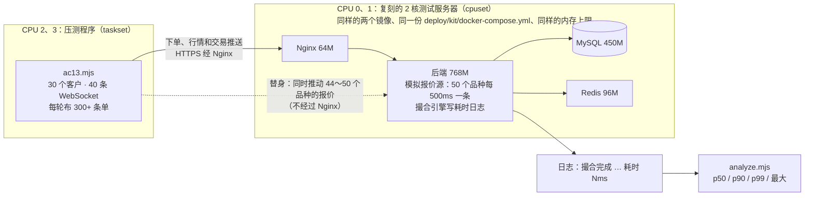

# v1 压测报告：AC-13 触发及时
- 版本：v1.1（2026-10-16）
- 变更历史：v1.0（2026-10-16）首次压测；v1.1（2026-10-16）LT-1 已修
- 编写：测试（压测）、研发（计时口径的修改）
- 依据：`需求文档/v1-需求说明书.md` AC-13；`部署方案/v1-部署方案.md` 第 2、4、9 节；`测试报告/v1-端到端测试方案.md` 第 9 节（部署形态）
- AC-13 原文："挂单成交、止盈止损、强平：从应用收到触发价格到写入成交记录 ≤1 秒。口径：在测试环境 50 个品种同时推送报价的压力下，按应用日志里的两个时间点计算，99% 的触发 ≤1 秒。"

## 一图看懂



这张图想说明：测试服务器上没有替身接口，所以在本机按测试服务器的配置复刻了一套（容器只用 2 个核），压测程序在另外 2 个核上制造"几十个品种同时触发几百条单"的情况，再按 AC-13 的口径从后端日志统计耗时。

**结论：满足 AC-13（在复刻环境上）。** 两次各 10 分钟的压测共 44,783 次触发，p99 分别是 686 ms 和 710 ms；超过 1 秒的有 25 次（0.056%），全部出现在 B 次后端刚启动后约 30 秒、同一个 2 秒的窗口里。**没有在真实的测试服务器上压测**（原因见第 1 节），这一点请 Amos 知悉。

## 1. 为什么在本机复刻，而不是直接压测试服务器
- 测试服务器上没有替身接口（约定 18：测试环境不能开 e2e profile），推不动报价、注入不了充值、取不到验证码，造不出"同时把几十个品种推过触发价"的最坏情况。
- 测试服务器上注册不了几十个账号（要真实收验证码邮件、真实充值）。
- 所以用**同样的两个镜像、同一份 `deploy/kit/docker-compose.yml`**，在本机把所有容器绑在 2 个 CPU 核上，复刻测试服务器。

## 2. 环境：复刻了什么、和测试服务器有什么不同
| 项目 | 测试服务器 | 本次压测 | 一样吗 |
|---|---|---|---|
| 镜像 | CI 推的 `falconx-lite-app`、`falconx-lite-web`（staging 的提交号） | 同样的 `deploy/app.Dockerfile`、`deploy/web.Dockerfile` 在本机构建（本分支提交 `9551383`，比 staging 只多了第 3 节的计时修改） | 一样（代码多一处计时修改） |
| compose | `deploy/kit/docker-compose.yml` | 同一份，叠加 `e2e/compose.deployed.yml`（e2e profile、模拟报价源）和 `e2e/load/compose.load.yml`（绑核、端口、验证码限次） | 一样，多两个覆盖文件 |
| 内存上限 | 后端 768M（JVM 堆 512M、SerialGC）、MySQL 450M（缓存 256M）、Redis 96M、Nginx 64M | 同样（`docker inspect` 核对过：805306368、471859200、100663296、67108864 字节） | 一样 |
| CPU 核数 | 2 核 | 所有容器 `cpuset: "0,1"`；压测程序和 `docker stats` 采样用 `taskset -c 2,3` | 一样（2 个核） |
| CPU 型号 | 阿里云轻量应用服务器（美国），型号未知；轻量服务器可能和别人共享物理核 | Intel Xeon @ 2.80GHz（本机 4 核）；两个核没有被别人抢占的证据，但也没有独占（宿主机上的其他进程仍可能被调度到 0、1 号核） | **不同**，单核性能和争用情况都不一样 |
| 宿主机内存 | 2G（可用约 1.6G）+ 2G 交换分区 | 16G，没有交换分区。容器各自的上限一样，但宿主机本身不缺内存（操作系统缓存、Docker 自己用的内存不受限） | **不同**：测试服务器整机更紧，可能更早用到交换分区 |
| 磁盘 | 40G 云盘 | 本机虚拟磁盘 `/dev/vda`；MySQL 数据在临时目录 | **不同**，每次提交都要写盘，云盘的写入延迟可能更高 |
| 报价源 | 模拟报价源（`FX_MARKET_SOURCE` 默认 simulated） | 模拟报价源，另外用替身推动报价 | 一样（多了替身推动） |
| 邮件、推送 | 真实 SMTP（Resend）；Web Push 是否配置未知 | 邮件由 e2e 替身收下，不出网；Web Push 未配置 | 不同：邮件和推送在异步任务里发，不在撮合事务里，影响应该很小（**未验证**） |
| 访问路径 | 客户 → 公网 → Nginx | 压测程序在同一台机器上 → Nginx（HTTPS） | 不同：AC-13 只算应用内部的时间，网络延迟不影响结果 |
| 数据量 | 测试库，数据很少 | 每次新库，压测中写入几万条订单、持仓、账本、通知 | 压测更重 |

## 3. 先修了计时口径（研发，实际执行）
- **问题（LT-2）**：`MatchingEngine.onQuote` 把"收到时间"单独存在每个品种的状态里（`receivedNanos`），检查线程先读报价、再读这个字段。读完报价、还没读时间时如果又来了新价格，读到的是**新价格的收到时间**，耗时被少算。
- **修改**：收到时间和报价放进同一个不可变对象 `MatchingEngine.Received(quote, nanos)`，用一个 `AtomicReference` 一起替换；检查拿到哪个报价，用的就是那个报价的收到时间。日志格式没有改（`撮合完成：{} id={} 耗时 {}ms`、`撮合耗时超过 1 秒：…`）。
- **测试**：`MatchingEngineTimingTest`（2 个，不连数据库，只替换 `scan`，调度用真实代码）：
  1. 第一次检查进行中又来了两个价格：第一次检查用第一个价格的时间，合并后的第二次检查用最后那个价格和它自己的时间；
  2. 4 个线程各发 2 万个价格（价格值就是收到时间），每次检查拿到的报价和时间都配对。**把旧写法放回去跑，这个测试失败**（本地实际执行过，之后恢复）。
- `mvn -B -o -q clean verify`：后端 242 个测试全部通过（新库 `falconx_load_ut`）。

## 4. 方法（实际执行）
工具在 `e2e/load/`，怎么跑见 `e2e/load/README.md`。一次压测由 `run-ac13.sh` 完成：构建镜像 → 新库启动 → 压测程序 → 统计 → `down -v`。

1. **客户**：30 个（发验证码 → 替身取验证码 → 注册，密码 8–64 位字母加数字），每人用替身注入 100,000 USDT（TRC20）并出块到账。没有做 KYC（下单不需要）。
2. **看行情的人**：20 个客户各开一条 `/api/ws/market` 和一条 `/api/ws/trading`，共 40 条，经 Nginx（TLS）。统计推送里出现过哪些品种。
3. **每一轮**（约 11–12 秒），对每个能开仓的品种布 7 条单，距离当前价 0.25%，手数按名义价值约 2,000 USD：

   | 单 | 什么时候触发 |
   |---|---|
   | 多单带止盈、空单带止损、卖出限价（带止盈） | 所有品种同时推上去 +0.6% |
   | 多单带止损、空单带止盈、买入限价（带止盈）、**最高杠杆多单（强平）**、上一步成交的空单止盈 | 所有品种同时推下来 −1.2% |
   | 上一步成交的多单止盈 | 推回原价 |

   推动报价用替身 `/api/e2e/market/move`，44～50 个品种并发（每次 10～200 ms 推完），推下来那一步每个品种同时触发 5 条，是**集中触发**的最坏情况；模拟报价源的随机游走一直在跑（每 500 ms 50 个品种各一条）。
4. **统计**：`analyze.mjs` 从后端日志取"撮合完成 / 撮合耗时超过 1 秒"两种行（AC-13 的口径：从撮合引擎收到触发价格到成交记录所在事务提交），按类型和合计算次数、p50、p90、p99（最近秩法）、最大值、超过 1 秒的比例；`docker stats` 每 5 秒采样一次。
5. **两次**：
   - **A 次**：真实交易时段（周五 UTC 10:12–10:23）。50 个品种里美股 5 个休市（报价被行情模块丢弃，不在报价表里），BTCUSD 新库默认"暂停开仓"（E2E-1），所以 **45 个品种在推送、44 个能开仓**。
   - **B 次**（`LOAD_ALL_OPEN=1`）：只在这次的临时库里给美股加全天交易时段、取消 BTCUSD 的暂停开仓，重启后端。**50 个品种全部在推送、50 个都能开仓**，这是 AC-13 写的条件。

## 5. 结果（实际执行，2026-10-16）
### 5.1 撮合耗时（毫秒）
**A 次**（44 个品种能开仓、45 个推送；布单 10 分 15 秒，54 轮，下单 16,632 条，全部成功）

| 类型 | 次数 | p50 | p90 | p99 | 最大 | 超过 1 秒 |
|---|---|---|---|---|---|---|
| 挂单成交 | 4,752 | 227 | 455 | 591 | 689 | 0 |
| 止盈 | 9,504 | 239 | 522 | 695 | 907 | 0 |
| 止损 | 4,752 | 291 | 532 | 693 | 934 | 0 |
| 强平 | 2,376 | 331 | 585 | 723 | 910 | 0 |
| **合计** | **21,384** | **259** | **519** | **686** | **934** | **0（0%）** |

**B 次**（50 个品种全部推送、全部能开仓；布单 10 分 10 秒，52 轮，下单 18,199 条，1 条因随机游走越过止盈价被拒，`VALIDATION_FAILED`，属正常校验）

| 类型 | 次数 | p50 | p90 | p99 | 最大 | 超过 1 秒 |
|---|---|---|---|---|---|---|
| 挂单成交 | 5,200 | 243 | 473 | 610 | 1,031 | 1（0.02%） |
| 止盈 | 10,399 | 253 | 545 | 718 | 1,253 | 12（0.12%） |
| 止损 | 5,200 | 307 | 553 | 711 | 1,248 | 6（0.12%） |
| 强平 | 2,600 | 349 | 599 | 771 | 1,251 | 6（0.23%） |
| **合计** | **23,399** | **275** | **540** | **710** | **1,253** | **25（0.11%）** |

- 每条单都只执行了一次（按订单号、持仓号查重，两次都是 0 次重复）；每轮布下的单全部按设计触发（例如 B 次强平 2,600 = 52 轮 × 50 个品种）。
- 最集中的一秒：A 次 216 次、B 次 250 次触发。
- 耗时分布（B 次）：≤100 ms 2,718；101–300 ms 10,125；301–500 ms 7,285；501–700 ms 3,010；701–1000 ms 236；>1000 ms 25。
- **B 次超过 1 秒的 25 次全部在 10:25:02–10:25:03**（后端重启后约 40 秒、第 3 轮"推下来"那一步）。按分钟看 p99：

  | 分钟（UTC） | 10:24 | 10:25 | 10:26 | 10:27 | 10:28 | 10:29 | 10:30 | 10:31 | 10:32 | 10:33 | 10:34 |
  |---|---|---|---|---|---|---|---|---|---|---|---|
  | B 次 p99 | 880 | 1032 | 656 | 671 | 689 | 722 | 648 | 649 | 701 | 653 | 623 |
  | A 次 p99（10:12 起） | 848 | 757 | 659 | 673 | 664 | 644 | 656 | 642 | 659 | 672 | 681 |

  后端刚启动的第一分钟明显慢（A 次也一样，只是没超过 1 秒），之后稳定在 620–720 ms。原因没有确认（日志里没有 GC 记录；可能是 JIT 预热），见 LT-4。
- 正式压测前的一次 40 秒试跑（6 个客户、4 条 WebSocket，后端刚启动）：1,188 次触发，p99 856 ms，1 次超过 1 秒（1,114 ms）。同样是刚启动时。

### 5.2 资源占用（`docker stats` 每 5 秒一次；CPU 100% = 一个核，2 个核的上限 200%）
| 容器 | A 次 CPU 平均 / 最高 | B 次 CPU 平均 / 最高 | A 次内存平均 / 最高 | B 次内存平均 / 最高 | 上限 |
|---|---|---|---|---|---|
| Nginx | 2.5% / 10.7% | 2.5% / 10.1% | 6.2 / 6.7 MiB | 6.3 / 6.8 MiB | 64 MiB |
| 后端 | 38.9% / 139.9% | 45.3% / 157.1% | 394 / 405 MiB | 387 / 396 MiB | 768 MiB |
| MySQL | 39.5% / 94.5% | 45.6% / 100.2% | 250 / 283 MiB | 253 / 292 MiB | 450 MiB |
| Redis | 1.2% / 5.2% | 1.3% / 5.7% | 3.7 / 4.0 MiB | 3.7 / 4.1 MiB | 96 MiB |
| **四个合计** | **82.1% / 198.8%** | **94.7% / 195.0%** | | | |

- 集中触发的时候 2 个核基本用满（合计最高 195–199%），平均不到一半。内存都在上限以内，后端最高 405 MiB / 768 MiB、MySQL 最高 292 MiB / 450 MiB；四个容器合计最高约 0.7 GiB。
- 日志：两次都**没有 ERROR**；WARN 只有启动时的提示（Flyway 的 MySQL 兼容提示、e2e profile 提示、邮件和推送未配置、首个超管已建）和上面 25 条"撮合耗时超过 1 秒"。
- WebSocket：两次都是 40/40 条连上、没有断开、没有错误；A 次收到 117,044 条消息、推送里出现过 45 个品种；**B 次收到 125,069 条、50 个品种都出现过**（每个品种 26,000 次左右）。`/api/market/quotes` 在 B 次列出 50 个、3 秒内都更新过。

## 6. 结论
| 项目 | 结果 | 依据 |
|---|---|---|
| 50 个品种同时推送 | ✅ B 次 50 个都在推（报价表 50 个、推送里 50 个）；A 次是真实交易时段，45 个在推 | 实际执行 |
| 99% 的触发 ≤1 秒 | ✅ A 次 p99 686 ms（0 次超过）；B 次 p99 710 ms（0.11% 超过） | 实际执行（本机复刻环境） |
| 四种触发都覆盖 | ✅ 挂单成交、止盈、止损、强平各上千次 | 实际执行 |
| 在真实测试服务器上满足 | **未验证**：CPU 型号、整机内存、磁盘不同（第 2 节） | — |

**满足 AC-13**（复刻环境、按日志口径）。余量：稳定时 p99 约 0.65–0.72 秒，比 1 秒的线低约 30%；集中触发时 2 个核会被用满，测试服务器的单核性能如果明显比本机差，余量会变小。

建议（不是必须）：Amos 验收时在测试服务器上用 `docker compose -p falconx logs app | grep 撮合` 看一下真实触发的耗时，作为参考。

## 7. 发现的问题
| 编号 | 现象 | 原因 | 处理 |
|---|---|---|---|
| LT-1 | 6 个客户同时发注册验证码，5 个收到 500"服务暂时不可用"，日志是 MySQL 死锁 | `EmailCodeService.send` 在一个事务里先 `SELECT … FOR UPDATE` 查这个邮箱最新的验证码（新邮箱查不到，锁住的是索引间隙），再 `INSERT`；两个新邮箱同时发时各自拿着间隙锁、又要往同一个间隙插入，MySQL 判死锁、回滚其中一个。真实场景里两个人同一时刻注册就会碰到（客户端显示"服务暂时不可用"，重试一次就好） | **已修**（合并前）：发验证码改用不加锁的查询（`latestEmailCodeForSend`），校验时仍加锁；新增 `ConcurrentSendCodeTest`（12 个新邮箱同时发、5 轮），修复前实际复现了死锁，修复后通过。要改的话：查询改成不加锁（发码只需要"60 秒内发过没有"），或者遇到死锁重试一次。请研发 / Amos 决定。压测程序里改成一个一个发验证码 |
| LT-2 | 撮合耗时日志可能偏小 | 第 3 节 | **已修**，有测试 |
| LT-3 | AC-13 说"从应用收到触发价格"算起，日志从撮合引擎收到报价算起 | 代码走查：报价先进行情模块（`QuoteProcessor.submit` 放进品种的处理线程 → 交易时段、质量守卫、加点、K 线、更新报价表），再交给撮合引擎（`MatchingEngine.onQuote`）开始计时。行情处理线程排队的时间不在日志的耗时里 | 只记录。这段只是内存里的计算，估计是毫秒级，**未实测**。要更严格，可以在 `RawQuote` 进入 `submit` 时记下时间一路带到撮合引擎（要改行情模块的接口），请研发 / Amos 决定 |
| LT-4 | 后端刚启动的第一分钟慢：B 次有 25 次超过 1 秒（最长 1,253 ms），A 次和试跑的第一分钟 p99 也在 850 ms 左右 | 没有确认：日志里没有 GC 记录；可能是 JIT 预热（刚启动时代码还在解释执行） | 只记录。测试环境每次合并 staging 都会重启后端，重启后头一分钟遇到集中触发时可能超过 1 秒；不影响"99%"的结论 |

## 8. 没有覆盖的
- 真实测试服务器上的压测（第 1 节）。
- 测试服务器整机 2G 内存、使用交换分区时的表现；云盘的写入延迟。
- 比本次更大的量：更多客户、每个品种更多持仓（本次每次检查最多几十条）、更长时间（本次每次 10 分钟）。
- 从 LP 来的真实报价（v1 测试环境用模拟报价源）。

## 9. 实际运行的命令
```bash
# 后端测试（新库）
cd backend && export JAVA_HOME=<JDK 25>
export PATH=$JAVA_HOME/bin:$PATH
export FX_DB_PASSWORD=<本地测试库密码> FX_DB_URL='jdbc:mysql://127.0.0.1:3306/falconx_load_ut?createDatabaseIfNotExist=true'
mvn -B -o -q clean verify                         # 242 个通过
mvn -B -o -q test -Dtest=MatchingEngineTimingTest -Dsurefire.failIfNoSpecifiedTests=false   # 旧写法放回去时失败，恢复后通过

# 两个前端（真实接口模式，打进 Nginx 镜像）
npm ci --prefix web/client && npm run build --prefix web/client
npm ci --prefix web/admin && npm run build --prefix web/admin

# 压测（jar 和前端已构建）
LOAD_SKIP_BUILD=1 LOAD_DURATION_S=40 LOAD_USERS=6 LOAD_WS=4 bash e2e/load/run-ac13.sh   # 试跑
LOAD_SKIP_BUILD=1 LOAD_NAME=load-a bash e2e/load/run-ac13.sh                             # A 次
LOAD_SKIP_BUILD=1 LOAD_ALL_OPEN=1 LOAD_NAME=load-b bash e2e/load/run-ac13.sh             # B 次
# 每次结束脚本自动 docker compose -p falconx-load down -v 并删除临时目录（含随机密码）；之后 docker ps -a 只剩本机原有的 fx-mysql、fx-redis
```
环境：Docker 29.6.2、Compose 5.3.1、Node 22.22.0；本机 4 核 16G（Intel Xeon @ 2.80GHz）。结果文件在 `e2e/logs/load-a/`、`e2e/logs/load-b/`（不进仓库）。
