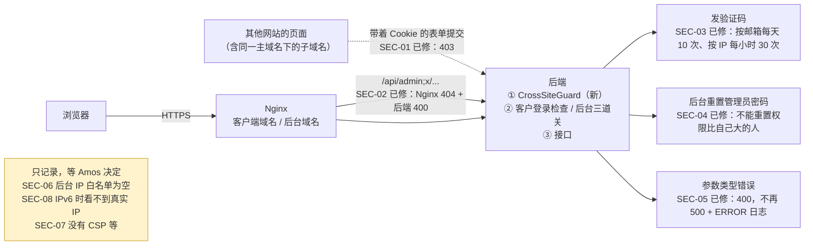

# v1 安全审查（测试环境上公网前）
- 角色：测试工程师 + 研发工程师（规则见 agents 仓库 `测试工程师.md`、`研发工程师.md`）
- 版本：v1.0（2026-10-16）
- 背景：测试环境即将放到公网（美国云服务器，`部署方案/v1-部署方案.md`），上线前对后端（`backend/`）、部署配置（`deploy/`）做一次安全审查，前端只看会泄露数据或 XSS 的地方。依据：`00-架构方案.md` 3.3 ⑤、《项目地图》第 5 节"不能破坏的约定"。
- 处理原则：高、中且修法明确、不改变已审核的产品决定的，直接修并加测试（**测试先在修改前的代码上跑、确认失败，再在修改后通过**）；需要产品决定或改动大的只记录。
- 说明方式：每条发现写明"实际执行"（写了测试、或在本机发了真实请求）还是"代码走查"（只读了代码）。

## 一图看懂

这张图想说明：5 个问题已经在代码里修好并有测试（标"已修"）；另有 12 个问题只记录（黄色框），其中 SEC-06、SEC-08 建议在测试环境上公网前由 Amos 决定。没有发现"高"等级的问题；越权（IDOR）、SQL 注入、文件上传路径穿越、错误信息泄露、风控字段、管理端点、端到端测试接口这几类都检查过，没有问题。

## 1. 发现清单
严重程度：**高** = 不需要任何权限就能拿钱或接管账号；**中** = 有现实可行的攻击路径，但需要一定条件（时间、同一主域名下的网站、某个后台权限）；**低** = 影响小或需要很强的前提。

| 编号 | 严重程度 | 问题 | 处理 | 验证方式 |
|---|---|---|---|---|
| SEC-01 | 中 | 跨站请求伪造：Cookie 是 SameSite=Strict，但同一主域名下的其他子域名算"同站"，那里的页面可以带着客户或后台的 Cookie 提交表单（例如平仓、撤单、标记已读、提交 KYC） | **已修**：`common/web/CrossSiteGuard` | 实际执行（修改前失败、修改后通过） |
| SEC-02 | 中 | 后台域名分离可以绕过：`/api/admin;x/...` 不被 Nginx 的 `location /api/admin/` 拦住，后端 Spring 又忽略分号，请求进到后台接口 | **已修**：Nginx 正则拦截；后端拒绝带分号的路径；`deploy/verify.sh` 加检查 | 实际执行（本机 Nginx 前后对比；后端测试修改前失败、修改后通过） |
| SEC-03 | 中 | 验证码可以无限次换新：每个验证码只能试 5 次，但每 60 秒就能要一个新的，重置密码的验证码一个月约 20% 的概率被猜中，猜中即接管账号；发验证码也没有按 IP 限次 | **已修**：同一邮箱同一用途 24 小时最多 10 次；同一 IP 每小时最多 30 次（**次数待 Amos 确认**） | 实际执行（修改前失败、修改后通过） |
| SEC-04 | 中 | 后台越权：有"编辑管理员"权限的普通管理员可以重置权限比自己大的（非超管）管理员的密码，拿到临时密码登录成对方 | **已修**：对方的权限点必须都在自己的范围内（和"分配角色"同一规则） | 实际执行（修改前失败、修改后通过） |
| SEC-05 | 低 | 路径参数类型不对（例如 `/api/notifications/abc/read`）返回 500，并记一条带堆栈的 ERROR 日志，可以被用来刷日志 | **已修**：返回 400 `BAD_REQUEST` | 实际执行（修改前失败、修改后通过） |
| SEC-06 | 中 | 后台 IP 白名单默认为空，后台域名对整个公网开放，只靠用户名、密码和"5 次锁 30 分钟" | 只记录，**需要 Amos 决定**：建议上公网前在后台"系统配置"填办公网出口 IP | 代码走查 |
| SEC-07 | 低 | 没有 Content-Security-Policy 响应头；目前没有发现 XSS 入口，CSP 是第二道防线 | 只记录：要在两个前端（含 PWA、Service Worker）上实测后再加，改动面较大 | 代码走查 |
| SEC-08 | 中 | 如果测试域名加了 IPv6（AAAA）记录，Docker 默认用用户态代理转发 IPv6 连接，Nginx 看到的来源 IP 都是 Docker 网关：所有 IPv6 客户共用一个"IP"，按 IP 的登录锁定会互相影响，后台 IP 白名单失效 | 只记录，部署配置：**域名只加 IPv4（A）记录**，或给 Docker 打开 IPv6 和 ip6tables；部署方案第 8 节的"真实 IP"手工检查要做 | 代码走查 |
| SEC-09 | 低 | 登录失败按 IP 锁定（5 次 15 分钟）：大陆移动网络很多人共用一个出口 IP，可能误伤 | 只记录：AC-02 的产品决定 | 代码走查 |
| SEC-10 | 低 | 知道别人的邮箱就能连续输错 5 次，把对方锁 15 分钟 | 只记录：AC-02 的产品决定（按账号锁定的代价） | 代码走查 |
| SEC-11 | 低 | 能区分邮箱是否注册过：登录时邮箱不存在不做密码哈希、响应更快；重置密码 60 秒内重发，已注册的邮箱返回"太频繁"、未注册的返回成功 | 只记录：注册发验证码时按产品决定本来就提示"邮箱已注册"，单独修这两处意义不大；SEC-03 的按 IP 限次已经限制了探测速度 | 代码走查 |
| SEC-12 | 低 | 验证码邮件的任务内容（含验证码明文）一直留在任务表 `common_task.payload`，数据库备份里也有（验证码表只存哈希） | 只记录：建议发送成功后清空任务内容；验证码 10 分钟就失效 | 代码走查 |
| SEC-13 | 低 | 客户端分页 `page` 传很大的数（例如 2147483647）时偏移量整数溢出，数据库报错，返回 500 | 只记录：只影响请求者自己 | 代码走查 |
| SEC-14 | 低 | KYC 照片只检查文件头（JPG/PNG），没有重新编码；内容可以是"图片 + 其他格式"的拼接文件 | 只记录：只在后台域名、以固定的图片类型返回，Nginx 加了 `nosniff`；换成对象存储时可以一起做重新编码 | 代码走查 |
| SEC-15 | 低 | 后台登录只按账号锁定，没有按 IP 限次 | 只记录：用户名不公开，按账号 5 次锁 30 分钟；配合 SEC-06 的 IP 白名单即可 | 代码走查 |
| SEC-16 | 低 | Redis 密码出现在 redis 容器的进程参数里（容器内 `ps` 可见） | 只记录：只在容器内可见，容器不对外 | 代码走查 |
| SEC-17 | 信息 | 合并到 staging 后，服务器每分钟用 root 自动同步镜像里的部署脚本并运行：能推镜像的人就能在服务器上执行命令 | 只记录：部署方案已审核的做法；要保护好 GitHub 仓库和 GHCR 的写权限 | 代码走查 |

## 2. 逐项检查结果（没有问题的也写上）
| 范围 | 检查了什么 | 结论 | 验证方式 |
|---|---|---|---|
| 认证：Cookie | 客户 `fx_session`：HttpOnly、Secure（`FX_COOKIE_SECURE`，测试环境 compose 里是 true）、SameSite=Strict、Path=/api、不设 Domain（只发给本域名）；后台 `fx_admin_session` 同样，Path=/api/admin | 正确；SameSite 的不足见 SEC-01 | 代码走查 + 实际执行（测试里读到 Set-Cookie） |
| 认证：会话作废 | 客户：改密（保留当前设备）、重置密码、冻结都作废全部会话，每次请求查库；后台：停用、重置密码、改密都作废，30 分钟不操作失效 | 正确（已有测试 `AuthFlowTest`、`AdminSecurityTest`） | 实际执行（全量测试） |
| 认证：登录锁定 | 客户按账号和 IP 同时计数（Redis）；后台按账号（库里） | 正确；副作用见 SEC-09、SEC-10、SEC-15 | 实际执行（已有测试） |
| 认证：验证码 | 6 位、10 分钟、5 次、用过作废、库里只存哈希、校验失败次数单独提交 | 单个验证码正确；换新验证码不限次 → SEC-03 | 实际执行 |
| 认证：重置密码不暴露邮箱 | 邮箱不存在时返回成功 | 基本正确；旁路见 SEC-11 | 代码走查 |
| 越权（客户） | 持仓（平仓、止盈止损、追加保证金）、挂单（改、撤）、白名单（删、用别人的提现）、提现（取消）、通知（已读）、推送订阅、KYC 照片：SQL 都带 `user_id = 当前用户`；客户端接口不返回 KYC 照片和存储路径 | 没有越权；新增 `CustomerIdorTest` 经接口逐个尝试，全部 404、数据不变 | 实际执行 |
| 越权（后台） | 每个接口都声明权限点（已有扫描测试）、AC-32 菜单和 403、AC-33 不能加超管、最后一个超管不能停用 | 正确；重置密码的越权见 SEC-04 | 实际执行（已有测试 + 新测试） |
| CSRF | 写接口全部是 JSON（跨站表单发不了 JSON），但没有请求体的写接口（平仓、撤单、取消提现、已读、登出）和 multipart 的 KYC 提交可以被表单提交；同站子域名会带 Cookie | SEC-01，已修 | 实际执行 |
| WebSocket | `/api/ws/trading`、`/api/ws/market` 用 Spring 默认的同源检查；交易推送握手时要求登录，只推给本人 | 正确：其他网站的 Origin 握手返回 403 | 实际执行（新测试） |
| SQL 注入 | MyBatis `${}` 只有两处：`LedgerMapper.xml` 的列名（来自固定的 switch）、`WithdrawMapper.xml` 的时间列（代码里写死的两个列名）；模糊搜索都用 `CONCAT('%', #{...}, '%')`；没有拼接 SQL 的 Java 代码 | 没有注入 | 代码走查 |
| 文件上传 | KYC：每张 2MB、一次 7MB（Nginx 8MB）；按文件头只收 JPG/PNG；存储路径由程序生成（`kyc/<用户>/<申请号>-<字段>.<扩展名>`），`LocalObjectStorage` 只允许 `[a-z0-9/_.-]`、拒绝 `..`、检查不出根目录 | 没有路径穿越；见 SEC-14 | 代码走查 |
| 金额和手数 | 下单、改单、止盈止损、追加保证金：只接受 `\d{1,16}(\.\d{1,8})?` 的正数，按品种精度、最小最大手数、步长检查；杠杆 ≥1 且不超过品种上限；提现最多 2 位小数、最小和最大金额、每日限额；负数、科学计数法、超精度都拒绝 | 正确 | 代码走查（已有测试覆盖拒单原因） |
| 错误响应 | 统一 `{code, message, fields}`；内部错误只返回"服务暂时不可用"；Tomcat 自己拒绝的请求（非法编码、`%00`、反斜杠）不带服务器版本和堆栈 | 正确；参数类型错误返回 500 → SEC-05 | 实际执行（新测试） |
| 风控字段（约定 4） | 品种暂停和风控暂停对客户同一个原因 `SYMBOL_PAUSED`；客户端接口和推送里没有阈值、敞口 | 正确（已有测试 `RiskOrderTest` T5、端到端 AC-31 检查） | 实际执行（全量测试） |
| 日志 | 搜了全部 `log.*`：没有密码、验证码、令牌、私钥；SMTP、推送、后台的配置类 `toString` 把密码和私钥换成"(已设置)"；邮件没配置时只记任务号 | 正确；任务表里的验证码见 SEC-12 | 代码走查 |
| 健康检查 | `/api/health` 只返回状态、版本（提交号）、测试环境标识，没有内部地址和密钥 | 正确 | 代码走查（已有测试） |
| 管理端点 | 只监听容器内 127.0.0.1:8081，Nginx 两个域名都不转发 `/actuator` | 正确（已有测试） | 实际执行 |
| 端到端测试接口（约定 18） | `/api/e2e/**` 只在 e2e profile 存在；compose 里没有 `SPRING_PROFILES_ACTIVE`、`FX_E2E_ENABLED`；Nginx 404 | 正确 | 实际执行（已有 `E2eProfileTest`；本机 Nginx） |
| 真实 IP | Nginx 用 `$remote_addr` 覆盖 `X-Forwarded-For`；后端只信任内网代理传来的值；后台 IP 白名单不能伪造（已有测试） | 正确；IPv6 例外见 SEC-08 | 实际执行（新测试模拟 Nginx 转发） |
| Nginx | 不认识的域名断开（`ssl_reject_handshake`）；后台域名只转发 `/api/admin/` 和 `/api/health`；安全响应头 | 正确；分号绕过见 SEC-02；CSP 见 SEC-07 | 实际执行（本机 Nginx） |
| compose | 只有 web 开放 80、443；app 只绑 127.0.0.1:8080；MySQL、Redis 不开端口，Redis 有密码；`.env` 权限 600 | 正确 | 代码走查 |
| 前端 | 两个前端没有 `dangerouslySetInnerHTML`、`innerHTML`、`eval`；真实接口模式不在 localStorage 存令牌；推送点击只打开后端给的站内路径 | 没有发现 XSS 或泄露 | 代码走查 |

## 3. 已修的问题（改了什么、怎么证明）
### SEC-01 跨站写请求
- **怎么触发**：攻击者控制同一主域名下的任何一个子域名（或者那里有 XSS），在页面上放一个自动提交的表单 `POST https://test-app.<域名>/api/trading/positions/<id>/close`。SameSite=Strict 只挡"跨站"，同一主域名下的子域名是"同站"，浏览器会带上客户的 Cookie。没有请求体的写接口（平仓、撤单、取消提现、已读、登出）和 multipart 的 KYC 提交都能这样被调用；以后生产和测试环境如果在同一个主域名下，测试环境就是生产的"同站"。
- **影响**：替客户平仓、撤单、取消提现等。
- **修法**：新增 `backend/src/main/java/com/falconx/lite/common/web/CrossSiteGuard.java`（在登录检查之前）：`/api/` 下的写请求（GET、HEAD、OPTIONS 以外），浏览器带了 `Sec-Fetch-Site` 时只接受 `same-origin`（和 `none`）；老浏览器没有这个头时看 `Origin`，和本站不同就拒绝（用 Spring 的 `WebUtils.isSameOrigin`，和 WebSocket 的同源检查同一个方法；经过 Nginx 时按 `Host` 和 `X-Forwarded-Proto` 判断）。两个头都没有的是非浏览器请求（部署脚本、测试），不受影响。返回 403 `FORBIDDEN`（前端已有翻译）。
- **测试**：`backend/src/test/java/com/falconx/lite/common/web/CrossSiteGuardTest.java`（真实启动服务，用 HTTP 客户端和原始 socket 发请求）：
  - `SEC01_其他网站带着Cookie发来的写请求一律403_同源和非浏览器照常`：外站 Origin、`Origin: null`、`Sec-Fetch-Site: cross-site / same-site` 都是 403；同源、只有 Origin 的老浏览器、非浏览器都通过；读接口不受影响。**修改前**：外站请求返回 200。
  - `SEC01_经过Nginx转发时按Nginx传来的域名和https判断同源`：模拟 Nginx（`Host: test-app.example`、`X-Forwarded-Proto: https`），本站 Origin 通过，`https://test-admin.example`（同一主域名的另一个子域名）和 `http://` 都是 403。
- **对开发和端到端测试的影响**：Vite 开发代理没有改 Host（`changeOrigin` 未开），`e2e/server.mjs` 保留浏览器的 Host，浏览器发的都是 `same-origin`；Playwright 的 `page.request` 不带 `Sec-Fetch-Site`。端到端测试没有在本机跑（本机没有 Playwright 浏览器），由 CI 的 `e2e` job 验证。

### SEC-02 后台接口经客户端域名访问（分号绕过）
- **怎么触发**：`https://test-app.<域名>/api/admin;x/auth/login`。Nginx 的 `location /api/admin/ { return 404; }` 是前缀匹配，`/api/admin;x/` 不以 `/api/admin/` 开头，转发给后端；后端 Spring 匹配接口时把 `;x` 当成路径参数忽略，进到后台登录接口。`%3B`（编码后的分号）同样能过 Nginx。
- **影响**：破坏"后台接口只在后台域名开放"（部署方案第 4 节）。后台仍然要 IP 白名单、后台登录和权限点，所以不是直接越权；但以后在 Nginx 上对后台域名做 IP 限制时，会被这个绕过。
- **修法**：
  - `deploy/nginx/site.conf.template`：客户端域名改用 `location ~* "^/api/(admin|e2e)([/;]|$)" { return 404; }`（正则里有分号，必须加引号，否则 Nginx 启动失败——本机第一次试就是这样失败的）。
  - `CrossSiteGuard`：`/api/` 下路径里有分号一律 400 `BAD_REQUEST`（本系统没有接口用到分号），三处（Nginx、登录检查、Spring）的判断不再不一致。
  - `deploy/verify.sh`：加一项 `https://<客户端域名>/api/admin;x/me` 必须 404。
- **测试**：
  - 后端 `SEC02_路径里带分号的请求一律400_不会进到后台接口`。**修改前**：带客户 Cookie 请求 `/api/admin;x/auth/login` 返回后台的 `INVALID_CREDENTIALS`（说明进到了后台接口）。
  - 本机 Nginx（真实的 web 镜像 + 修改后的配置 + 自签证书 + 返回原始路径的假后端），同样的请求在修改前后对比：

| 客户端域名的请求 | 修改前 | 修改后 |
|---|---|---|
| `/api/admin/me` | 404 | 404 |
| `/api/admin;x/me` | **转发到后端** | 404 |
| `/api/admin%3Bx/me` | **转发到后端** | 404 |
| `/api/e2e;x/mail` | **转发到后端** | 404 |
| `/api/admin` | 转发到后端（后端 404） | 404 |
| `/API/ADMIN/me` | 返回客户端页面 | 404 |
| `/api//admin/me`、`/api/./admin/me` | 404 | 404 |
| `/api/administrators`、`/api/trading/account`、`/api/health` | 转发 | 转发（不受影响） |
| 后台域名 `/api/admin/me` | 转发 | 转发（不受影响） |

### SEC-03 验证码限次
- **怎么触发**：对一个已注册邮箱反复"忘记密码"：每 60 秒要一个新验证码，每个试 5 次。一天 1440 × 5 = 7200 次，猜中 6 位数的概率每天约 0.7%，一个月约 20%；猜中后重置密码、接管账号。另外，一个 IP 可以给任意多个邮箱发验证码（发信费用、发信域名信誉），也可以快速探测哪些邮箱注册过。
- **修法**：
  - `account/auth/EmailCodeService.java`：同一邮箱同一用途 24 小时内最多发 `falconx.auth.code-daily-limit` 次（默认 10，最多 50 次猜测，猜中概率约 0.005%/天）；按 `account_email_code` 表计数（新查询 `countEmailCodesSince`，用已有索引），不新增表。
  - 新增 `account/auth/SendCodeLimiter.java`：同一 IP 每小时最多 `falconx.auth.code-ip-hourly-limit` 次（默认 30，Redis 计数，和登录失败计数一样），邮箱存不存在都算。
  - 超过时返回 429 `CODE_TOO_FREQUENT`（前端已有翻译"发送太频繁"）。
  - **10 次和 30 次是我定的默认值，请 Amos 确认**（在 `application.yml` 里改）。
- **测试**：`backend/src/test/java/com/falconx/lite/account/auth/SendCodeLimitTest.java`（真实 MySQL、Redis；IP 上限在这个测试里设成 3）：`SEC03_同一邮箱同一用途24小时最多发10次_超过的不发_24小时以前的不算`、`SEC03_同一IP每小时超过上限就不再发_不管邮箱存不存在_换IP不受影响`。**修改前**：两个都返回 204（照发）。
- 其他测试都从 127.0.0.1 发请求、共用一个 Redis，`application-test.yml` 把 IP 上限放大；端到端测试只发 1 次验证码，用默认值。

### SEC-04 后台：重置权限比自己大的管理员的密码
- **怎么触发**：管理员甲的角色有"编辑管理员"（`admin:edit`），没有"修改系统配置"；管理员乙（非超管）有"修改系统配置"。甲调用 `POST /api/admin/admins/<乙>/reset-password`，响应里有乙的临时密码，甲用它登录成乙。
- **影响**：绕过后台方案第 9 节"非超级管理员只能分配、编辑权限点都在自己范围内的角色"。超级管理员原来就受保护。
- **修法**：`admin/system/AdminUserService.java` 的 `resetPassword`：操作人不是超管时，对方所有角色的权限点必须都在操作人的权限范围内，否则 `PERMISSION_EXCEEDS_OWN`（后台已有翻译）；审计照常记一条失败。
- **测试**：`AdminSystemTest.SEC04_非超级管理员不能重置权限超出自己的管理员的密码`。**修改前**：返回 200 和临时密码。

### SEC-05 参数类型错误返回 500
- **修法**：`common/web/GlobalExceptionHandler.java` 把 `TypeMismatchException` 映射成 400 `BAD_REQUEST`，不再记 ERROR 日志。
- **测试**：`CrossSiteGuardTest.SEC05_错误响应不带堆栈和服务器版本_参数类型不对返回400而不是500`（同时确认 Tomcat 自己拒绝的请求不带服务器版本和堆栈）。**修改前**：500 `INTERNAL_ERROR`。

## 4. 只记录、没有修的（原因）
| 编号 | 为什么没修 | 建议 |
|---|---|---|
| SEC-06 | 白名单的值只有 Amos 知道，属于部署时的配置，不是代码 | 测试环境上公网前，在后台"系统配置 → 后台 IP 白名单"填办公网出口 IP；保存时系统会检查不能把自己排除在外 |
| SEC-07 | 要在两个前端（Vite 构建、PWA 的 Service Worker、WebSocket、Web Push）上逐页实测，改动面大 | 下一步单独做：先用 `Content-Security-Policy-Report-Only` 观察一段时间再改成强制 |
| SEC-08 | 部署配置，取决于 Amos 的域名设置 | 域名只加 A 记录；部署后按部署方案第 8 节在浏览器里确认后台审计里的 IP 是自己的真实 IP |
| SEC-09、SEC-10 | AC-02 的产品决定 | 上线后看登录锁定的频率再决定是否调整（例如 IP 的阈值放宽到 20 次） |
| SEC-11 | 注册接口按产品决定本来就提示"邮箱已注册" | 如果以后要彻底不暴露，需要改注册流程（产品决定） |
| SEC-12、SEC-13、SEC-14、SEC-15、SEC-16 | 影响小，不在这次"高、中"的范围 | 见第 1 节各行 |
| SEC-17 | 已审核的部署方案 | GitHub 仓库和 GHCR 只给必要的人写权限 |

## 5. 实际运行的命令
| 命令 | 结果 |
|---|---|
| 新测试在**修改前**的代码上：`mvn -o test -Dtest='SendCodeLimitTest,AdminSystemTest#SEC04*,CrossSiteGuardTest'` | 7 个里 5 个失败（SEC-01、SEC-02、SEC-03 两个、SEC-04），失败原因都是预期的漏洞表现；WebSocket 同源、`..` 两个本来就通过（确认现状没问题）；SEC-05 单独在修改前跑过，500 |
| 同样的测试在修改后 | 全部通过 |
| `mvn -B -o -q clean verify`（后端全量，共用的 `falconx_test` 库） | 238 个里 20 个出错，原因和本次改动无关：共用测试库里客户 ID 已经超过 2^31（`TradingTestSupport.newUser` 每次用"最大 ID + 100 万以上"建用户，多次运行后累积），注册时派生充值地址报"用户 ID 超出派生序号范围"。CI 每次用新库，不受影响；没有删库 |
| 同样的命令，`FX_DB_URL` 指向新建的空库 `falconx_sec_review` | **238 个全部通过**（Maven 汇总），0 失败、0 跳过 |
| 本机 Nginx：`nginx -t`（真实 web 镜像 + 修改后的配置） | 通过 |
| 本机 Nginx 修改前后对比请求（第 3 节 SEC-02 的表） | 修改前 3 条绕过，修改后全部 404，正常路径不受影响 |
| `node scripts/check-project-index.mjs` | 通过 |
| gitleaks（`origin/staging..HEAD`） | 0 发现 |

## 6. 测试数
后端新增 10 个测试：`CrossSiteGuardTest` 6 个、`SendCodeLimitTest` 2 个、`CustomerIdorTest` 1 个、`AdminSystemTest` 1 个。没有删除或跳过已有测试。前端没有改动，没有跑前端测试。
