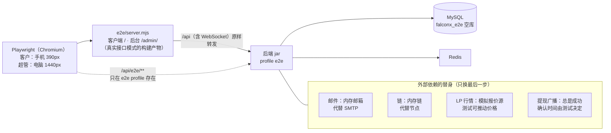
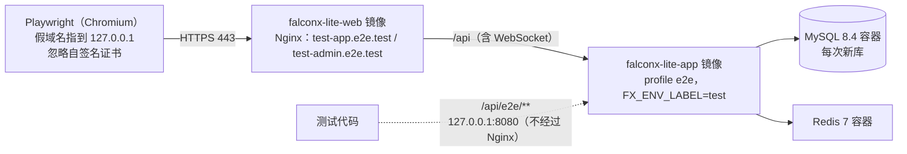

# v1 端到端测试方案（S19）
- 角色：测试工程师（规则见 agents 仓库 `测试工程师.md`）
- 版本：v1.3（2026-10-16）
- 变更历史：v1.0（2026-10-16）首次创建（S19）；v1.1（2026-10-16）E2E-2 已修，主流程充值一步不再刷新页面；v1.2（2026-10-16）新增第 9 节"部署形态"：同一个主流程经过测试环境用的镜像和 Nginx 跑一遍；两种形态的地址分成三个变量；系统配置改为在后台页面里调用；v1.3（2026-10-16）AC-13 对照指向压测报告 `测试报告/v1-压测报告-AC13.md`
- 对应任务：`需求文档/v1-任务清单.md` S19「端到端测试：注册 → 充值 → 下单 → 止盈止损 → 平仓 → 提现，在 CI 里跑」，验收：CI 里端到端测试通过；AC 逐条对照
- 代码：`e2e/`（Playwright + TypeScript；两种运行形态：默认经 `e2e/server.mjs`，部署形态经 Nginx 镜像，见第 9 节）；后端替身在各模块里以 `E2e` 开头的类（只在 Spring profile `e2e` 下存在）；CI 的 `e2e` job 在 `.github/workflows/ci.yml`

## 一图看懂



这张图想说明：浏览器操作的是和测试环境一样的真实页面、真实接口、真实数据库；只有邮件服务商、区块链节点、LP 行情、热钱包广播这四个外部依赖换成了后端里的替身，替身只接在"最后一步"，业务链路（通知任务、扫块入账、报价处理和撮合、提现状态机）都是真实代码。

## 1. 跑什么流程
一个用例（`e2e/tests/main-flow.spec.ts`）把客户和超管两个浏览器串起来，共 19 步，每步有自己的超时，失败时错误开头写"卡在：第几步 名字"：

| 步 | 谁 | 做什么 | 检查 |
|---|---|---|---|
| 01 | 超管（电脑） | 用 `FX_ADMIN_INIT_*` 登录；新库要求首次改密码，就改成另一个一次性值；在系统配置里把冷静期、白名单生效时间改成 0 | 进入后台首页；配置接口返回成功 |
| 02 | 客户（手机 390px） | 注册页发验证码 → 从邮件替身取验证码 → 填资料注册 | 跳到行情页；注册页没有横向滚动 |
| 03 | 客户 | 退出登录，再用邮箱和密码登录 | 回到行情页 |
| 04 | 客户 | 资产页依次选 ERC20、BSC、TRC20 | 三个地址格式正确，ERC20 和 BSC 相同（AC-06） |
| 05 | 客户 | 替身链上向 TRC20 地址转 1000 USDT → 刷新看到"待确认 n/19" → 再出 25 个块 | "已到账"、余额 1,000.00、收到"充值已到账"提示（AC-07 的流程部分） |
| 06 | 客户 | 提交 KYC：护照、证件号、3 张 PNG | 状态"审核中" |
| 07 | 超管 | KYC 审核页找到这位客户 → 看到证件照片 → 通过 | 状态"已通过" |
| 08 | 客户 | 品种页（ETHUSD）点"买入"→ 抽屉里选 0.01 手 → 确认 | 持仓页有 1 笔持仓 |
| 09 | 客户 | 持仓卡片"止盈止损"：止盈 = 当前卖价 +0.4%，止损 = −1% | 提示"止盈止损已更新" |
| 10 | 测试 | 把 ETHUSD 原始卖价推到 +0.7% | 持仓自动平掉，历史里是"止盈" |
| 11 | 客户 | 再买 0.01 手 → 平仓 → 确认 | "已平仓"，历史里有"手动平仓" |
| 12 | 客户 | 资金流水页 | 有充值、手续费、平仓盈亏 |
| 13 | 客户 | 白名单页加一个 ERC20 地址 | "已生效" |
| 14 | 客户 | 提现 100 USDT → 确认 → 立即跑一次提现定时推进 | 记录从"冷静期中"变成"待审核" |
| 15 | 超管 | 出金审核页选中这笔 → 通过 | 客户看到"上链中"（广播替身立即成功） |
| 16 | 测试 | 替身确认这笔链上交易 | 客户看到"已完成"，资金流水有"提现" |
| 17 | 超管 | 客户列表按邮箱查询 → 详情 | KYC 已通过，有最近资金流水 |
| 18 | 测试 | 读邮件替身收到的标题 | 验证码、充值已到账、身份认证结果、止盈止损已触发、提现状态更新都发到客户邮箱 |
| 19 | 测试 | 检查全程记录 | 客户收到的接口返回和推送里没有风控字段（AC-23）；没有请求任何 Google 域名（AC-29） |

- **每轮新数据**：新邮箱（`e2e-<时间和随机数>@example.com`）、新证件号；不依赖上一轮。超管密码是唯一跨轮的状态：新库走"首次改密码"，库里已经改过就直接用新密码登录（本机重复跑时）。
- **品种用 ETHUSD**：加密货币 7×24 小时交易，任何时间跑都在交易时段内。不用 BTCUSD 的原因见第 6 节问题 E2E-1。
- **价格只推动不到 1%**：行情质量守卫把 60 秒内波动超过 5% 的报价判为异常、不能成交（`QualityGuard`），推太多止盈反而不会触发。
- **手机宽度**：客户全程用 390×844（`isMobile`），每个主要页面检查没有横向滚动（AC-31 的自动部分）。超管用 1440×900。
- 密码：客户 `e2eTest1234`（8–64 位、含字母和数字）；超管初始和新密码都是 `ci_only_…` 形式的一次性测试值，写在 `ci.yml` 和 `e2e/tests/support.ts`，不是任何环境的密钥。

## 2. 怎么启动
| 组件 | 怎么来 | 说明 |
|---|---|---|
| MySQL 8.4、Redis 7 | CI：GitHub 服务容器；本机：Docker | 用**单独的空库** `falconx_e2e`，和后端单元测试的 `falconx_test` 分开；Flyway 启动时建表 |
| 后端 | `mvn -f backend package -DskipTests` 后 `bash e2e/start-backend.sh` | 脚本设 `SPRING_PROFILES_ACTIVE=e2e`、`FX_E2E_ENABLED=true`、`FX_COOKIE_SECURE=false`（http），后台启动 jar，等 `/api/health` 通过；日志在 `e2e/logs/backend.log` |
| 客户端、后台 | `npm run build`（`web/client`、`web/admin`），不设 `VITE_API_MODE`，即真实接口模式 | 和测试环境同一种构建产物 |
| 站点 | `e2e/server.mjs`（Playwright 的 `webServer` 自动启动） | 只用 Node 自带模块：`/` 客户端、`/admin/` 后台（浏览器路由回到各自 `index.html`），`/api`（含 WebSocket）原样转发到后端并保留 Host 头，相当于测试环境的 Nginx |
| Playwright | `e2e/`：`npm ci`；CI 里 `npx playwright install --with-deps chromium` | 版本固定 1.56.1；本机用预装的 Chromium（`PLAYWRIGHT_BROWSERS_PATH`），不用再下载 |

本机完整步骤：
```bash
# 1. 准备空库（Docker 里的 MySQL）
docker exec fx-mysql mysql -uroot -p<本机密码> -e 'DROP DATABASE IF EXISTS falconx_e2e; CREATE DATABASE falconx_e2e'
# 2. 构建
mvn -f backend package -DskipTests
npm ci --prefix web/client && npm run build --prefix web/client
npm ci --prefix web/admin && npm run build --prefix web/admin
npm ci --prefix e2e
# 3. 启动后端（e2e profile）
FX_DB_URL=jdbc:mysql://127.0.0.1:3306/falconx_e2e FX_DB_USERNAME=root FX_DB_PASSWORD=<本机密码> FX_REDIS_HOST=127.0.0.1 \
FX_ADMIN_INIT_USERNAME=e2e_admin FX_ADMIN_INIT_PASSWORD=ci_only_admin_init_1 bash e2e/start-backend.sh
# 4. 跑测试（失败时 npx playwright show-report 看 trace、截图、录像）
cd e2e && npx playwright test
# 5. 停后端
kill "$(cat e2e/logs/backend.pid)"
```

CI（`ci.yml` 的 `e2e` job，最长 30 分钟）：按上面的顺序执行；失败时上传 `e2e-failure` 附件（HTML 报告、trace、截图、录像、后端日志，保留 14 天）。

## 3. 外部依赖怎么替身
原则：替身只代替"和外部世界打交道的最后一步"，前面的业务代码一行不改、照常执行。所有替身类名以 `E2e` 开头、标了 `@Profile("e2e")`。

| 外部依赖 | 真实环境 | 替身 | 测试怎么用 | 经过的真实代码 |
|---|---|---|---|---|
| 邮件服务商（验证码、通知邮件） | `SmtpMailTransport` | `notification/service/E2eMailbox`：`@Primary` 的 `MailTransport`，把邮件存在内存（每个邮箱最近 20 封） | `GET /api/e2e/mail/code?email=` 取最近一封验证码；`GET /api/e2e/mail/subjects?email=` 取全部邮件标题 | `MailApi` / `NotifyApi` → 通知记录、`MAIL_SEND` 任务 → `NotifyWorker`（每 2 秒）→ 模板渲染 |
| 区块链节点（扫块） | `EvmChainClient`、`TronChainClient` | `wallet/deposit/E2eChain`：三条链各一条内存链，启动时注册给 `ChainClients`；区块哈希固定、只返回配置合约的转账 | `POST /api/e2e/wallet/deposit {chain, address, amount}` 在下一块转账并扫一次（待确认）；`POST /api/e2e/wallet/mine {chain, blocks}` 出块并扫块确认 | `DepositService.run`：扫块 → 识别地址 → 确认数 → 核对区块哈希 → `LedgerApi` 入账 → 到账通知 |
| LP 行情 | S20 接入 | 模拟报价源（`FX_MARKET_SOURCE=simulated`，e2e 配置打开），`SimulatedQuoteSource.moveTo` 把某品种移到指定价格后继续随机游走 | `GET /api/e2e/market/quote?symbol=` 取对客报价；`POST /api/e2e/market/move {symbol, bid}` 推动原始卖价 | `QuoteProcessor`：交易时段、质量守卫、加点、K 线、推送 → `MatchingEngine` 止盈止损 |
| 热钱包签名广播 | `EvmWithdrawSender`、`TronWithdrawSender` | `wallet/withdraw/E2eWithdraw`：三条链都注册，广播总是成功（假交易哈希），测试说确认了才算确认 | `POST /api/e2e/wallet/withdrawals/advance` 立即跑一次定时推进；`POST /api/e2e/wallet/withdrawals/{id}/confirm` 确认这笔 | `WithdrawService`：冷静期 → 待审核 → 审核通过 → 广播 → 上链中 → 完成，`LedgerApi` 冻结和扣款，状态通知 |
| 充值地址派生 | Amos 的 xpub | `application-e2e.yml` 用 BIP39 公开测试助记词的 xpub（和后端测试同一组，没有任何价值）、三条链官方 USDT 合约的公开地址 | — | `AddressService` 派生地址 |

冷静期（2 小时）和白名单生效（24 小时）不靠替身：超管在第 01 步用后台的系统配置接口改成 0（会写审计）。这两条规则本身由 `WithdrawFlowTest` 覆盖（AC-17、AC-18）。

## 4. e2e profile 的保护
`/api/e2e/**` 不需要登录就能注入充值、改报价、读验证码，绝不能出现在测试环境和生产。保护有三层：
1. **默认不存在**：所有替身和 `/api/e2e/**` 接口只在 profile `e2e` 下创建。`E2eProfileTest` 证明默认配置里没有任何 `/api/e2e/**` 映射和 `E2e*` bean，访问 `/api/e2e/...` 照常返回 401（登录过滤器只在 e2e profile 下放行这个前缀）。
2. **启动检查**（`common/e2e/E2eGuard`，在创建任何业务对象、连数据库之前执行），有一条不满足就**拒绝启动**：
   - 必须同时设置 `FX_E2E_ENABLED=true`（`falconx.e2e.enabled`），只带 profile 不够，防止误带；
   - 不能同时打开 `prod`、`production`、`staging` profile；
   - 不能配置热钱包私钥（`FX_WALLET_*_HOT_KEY`）、链节点地址（`FX_WALLET_*_RPC_URL`）、SMTP 服务器（`FX_MAIL_HOST`）——这些只在测试环境和生产才有，出现了说明是在真实配置上误开了 e2e。
3. **醒目警告**：通过检查后日志打印一个星号框，写明"端到端测试模式，只能用于 CI 和本机"。

S20 部署时：测试环境和生产不设 `SPRING_PROFILES_ACTIVE=e2e` 和 `FX_E2E_ENABLED`；即使误设，因为配了节点、热钱包或 SMTP，也会拒绝启动。

## 5. AC 逐条对照
"端到端"指本方案第 1 节的步骤；"后端"指 `backend/src/test/java/**` 的测试类（真实 MySQL、Redis）；"前端"指 `web/*/src/**/*.test.ts(x)`。S20/S21 指部署测试环境、Amos 验收时才能验的部分。

| AC | 内容 | 端到端（S19） | 已由单元/集成测试覆盖 | 要到 S20/S21 |
|---|---|---|---|---|
| AC-01 | 邮箱验证码注册 | ✅ 02：验证码经真实通知链路发出，注册成功 | `AuthFlowTest`、`NotifyFlowTest`（验证码邮件中英文） | QQ、163、Gmail 真实收信、60 秒送达（真机） |
| AC-02 | 登录失败锁定 | — | `AuthFlowTest`（5 次锁定、换 IP 仍锁、期满解锁） | — |
| AC-03 | 忘记密码、改密码后其他设备失效 | — | `AuthFlowTest` | — |
| AC-04 | 冻结客户 | — | `AuthFlowTest`、`AdminOpsTest` | — |
| AC-05 | KYC 提交和审核 | ✅ 06、07、18：上传 3 张图、后台看到照片、通过、客户收到"身份认证结果"邮件 | `KycFlowTest`（格式、大小、库里无图片、驳回必填）、`AdminOpsTest` | — |
| AC-06 | 三条链充值地址 | ✅ 04：三个地址，ERC20 = BSC | `DepositFlowTest`、`AddressDerivationTest` | 二维码真机扫描 |
| AC-07 | 充值到账 | ✅ 05、18（替身链）：待确认 → 到账、余额、流水、站内信和邮件 | `DepositFlowTest`（三条链确认数、精度） | 测试网真实转账（S20） |
| AC-08 | 假币不入账 | —（替身链只返回配置合约） | `DepositFlowTest` 假币不入账_F3_AC08 | 测试网（S20） |
| AC-09 | 冲正不出现负余额 | — | `DepositFlowTest` | — |
| AC-10 | 市价单计算 | ✅ 08 流程（不核对数值） | `OrderCalcTest`、`OrderFlowTest`（手算对比、USDJPY） | — |
| AC-11 | 限价单和止盈止损 | ✅ 09（持仓上设止盈止损） | `OrderFlowTest`、`PositionFlowTest`、`MatchingEngineTest` | — |
| AC-12 | 7 种拒单原因 | — | `OrderFlowTest`、`RiskOrderTest`；前端 `errors.test.ts`（中英文） | — |
| AC-13 | 触发 ≤1 秒 | ✅ 10 流程（止盈触发） | `MatchingEngineTest`（20 个持仓 1 秒内强平） | 50 品种压测：已完成（本机复刻测试服务器），见 `测试报告/v1-压测报告-AC13.md` |
| AC-14 | 强平不穿仓 | — | `MatchingEngineTest`、`PositionFlowTest` | — |
| AC-15 | 追保预警 | — | `MarginCallTest` | — |
| AC-16 | 隔夜费 | — | `SwapTest` | — |
| AC-17 | 提现 6 种限制 | ✅ 14 只走 KYC 已通过、白名单地址的正常路径 | `WithdrawFlowTest` 六种拒绝原因_AC17 | — |
| AC-18 | 冷静期撤销 | —（冷静期设为 0） | `WithdrawFlowTest` | — |
| AC-19 | 提现上链 | ✅ 14–16（替身广播）：审核通过 → 上链中 → 已完成、客户收到状态邮件 | `WithdrawFlowTest`、`BroadcastFlowTest`（签名、nonce、加价重发、TRON） | 三条链测试网大小额各一笔（S20） |
| AC-20 | 上链失败退款 | — | `WithdrawFlowTest`、`BroadcastFlowTest` | — |
| AC-21 | 紧急取消 | — | `WithdrawFlowTest`、`AdminOpsTest` | — |
| AC-22 | 自动禁开 | — | `RiskMonitorTest`、`RiskOrderTest` | — |
| AC-23 | 风控信息不外泄 | ✅ 19：记录客户页面收到的全部 `/api` 返回和 WebSocket 推送，检查没有敞口、阈值、自动禁开等字段 | `RiskOrderTest`（拒单原因不含风控信息） | — |
| AC-24 | Web Push 真机 | — | `PushFlowTest`、`WebPushCryptoTest` | 真机（S20/S21） |
| AC-25 | 通知偏好 | — | `NotifyFlowTest`、`PushFlowTest` | — |
| AC-26 | 邮件进收件箱 | — | — | 真实邮件服务商（S20/S21） |
| AC-27 | 中英文 | —（全程中文界面） | 前端 `i18n.test.ts`（两端键一致）、`errors.test.ts` | 人工翻看英文界面（S21） |
| AC-28 | 添加到主屏幕 | — | — | 真机（S21） |
| AC-29 | 不依赖 Google | ✅ 19：记录客户和后台页面的全部请求域名，没有 Google | — | 大陆网络实测（S21，AC-30） |
| AC-30 | 大陆访问速度 | — | — | Amos 安排人员（S21） |
| AC-31 | 手机完成主流程 | ✅ 02–16 全程 390px，注册、行情、资产、持仓、流水、提现页检查没有横向滚动 | 前端 `layouts.test.tsx` | 真机点按（S21） |
| AC-32 | 权限 | — | `AdminSecurityTest` | — |
| AC-33 | 不能越权加超管 | — | `AdminSystemTest` | — |
| AC-34 | 审计 | —（01 改配置会写审计，未检查） | `AdminSystemTest` | — |
| AC-35 | 菜单完整 | — | `AdminSystemTest`、后台 `menu` 单元测试 | — |
| AC-36 | 端口不暴露 | — | `HealthControllerTest`（管理端点不在对外端口） | 外网扫描生产服务器（S22） |
| AC-37 | 仓库无密钥 | — | CI 密钥扫描（gitleaks） | — |
| AC-38 | 现有问题全部修复 | — | 各测试类里以 F/S/T 编号命名的用例 | 逐条清单在 S21 前整理 |
| AC-39 | 手机和电脑分开设计 | 部分：手机结构（底部下单按钮、抽屉）在主流程里实际使用 | 前端 `layouts.test.tsx` | 1280、1440 截图检查（可在 S20 补端到端） |
| AC-40 | 主题和涨跌色 | — | 前端主题测试 | — |
| AC-41 | 最小充值 | — | `DepositFlowTest` 最小充值1USDT_低于的不入账_AC41 | 测试网（S20） |

## 6. 发现的问题（只记录，没有修改产品代码）
| 编号 | 现象 | 影响 | 位置 | 建议 |
|---|---|---|---|---|
| E2E-1 | 迁移脚本 V4 里 BTCUSD 的初始状态是"暂停开仓"（`open_paused = 1`，沿用原型的演示数据），新库上客户不能开 BTCUSD 新仓 | 生产首次上线时 BTCUSD 不能交易，除非运营在后台解除 | `backend/src/main/resources/db/migration/V4__market.sql` | 请 PM / Amos 确认上线时哪些品种默认暂停；如果是误带的演示数据，加一个新迁移脚本改回 0（已合并的脚本不能改） |
| E2E-2 | 发现新的待确认充值时后端不推送事件，客户在资产页看不到"待确认"记录，要刷新页面才出现（到账时会推送，能自动刷新） | 客户转账后以为没识别到 | `wallet/deposit/DepositService.java`（scan 只记库）、`web/client/src/pages/assets/DepositCard.tsx` | **已修（v1 小缺口修补）**：充值记录每次变化（发现、确认数变化、到账、作废、冲正）都推 `deposit` 事件，资产页收到后重新拉取；主流程用例去掉了刷新页面，不刷新也能看到"待确认"；单元测试 `DepositFlowTest` 发现待确认的充值就推送_…、前端 `pages.test.tsx` |
| E2E-3 | 资金流水里手动平仓的"平仓盈亏"一行显示 `平仓盈亏 · CLOSED`（内部的平仓原因代码），止盈那一行什么都不显示 | 客户看到英文代码，几种平仓口径不一致 | `trading/order/TradingController.java` 的 `ref`：取账本备注的最后一个词；平仓的备注是"平仓盈亏 <品种> <原因>"（`PositionService`），所以取到的是原因：`CLOSED`、`LIQUIDATED` 会显示，`TP`、`SL` 只有 2 个字母不显示 | **已修（S19 PR 里）**：`ref` 改为取备注第二段（品种或网络），后台调余额不显示；单元测试 `ClientLedgerTest` |
| E2E-1 补充 | 原型的模拟数据里 BTCUSD 也标了 `paused: true`（`web/client/src/mocks/data/symbols.ts`），V4 是照原型数据生成的 | — | — | 同 E2E-1 |

## 7. 还没覆盖的
- 拒绝路径（KYC 驳回、出金拒绝、提现撤销、广播失败退款、紧急取消）只在后端测试里覆盖，端到端只走成功路径。
- 电脑布局（≥1024）的客户端主流程、英文界面、挂单（限价单）和改单撤单、追加保证金、通知中心和通知偏好页面。
- 两个以上客户同时操作、真实的报价压力（AC-13 的 50 品种）。
- 真实链、真实邮件、真实推送、真机：S20、S21。
- 后台只用了超管；按角色的菜单和 403（AC-32）由后端测试覆盖，没有在浏览器里走。

## 8. 运行结果
本机（2026-10-16，实际执行；MySQL 8.4、Redis 7 在 Docker 里，Chromium 1194，Playwright 1.56.1）：
- 空库首次运行：1 个用例通过，用时约 22–26 秒（超管走了"首次登录改密码"）。
- 同一个库连续再跑 `--repeat-each=3`：3 个通过，共 68 秒，每轮 18–26 秒（超管直接用新密码登录）；之后按 CI 方式（`CI=1`）再跑 1 次通过，17.8 秒。
- 每轮记录到客户接口返回约 160 条、WebSocket 推送 60–75 条，没有风控字段；全程只访问了 `127.0.0.1`。

CI 的结果看 PR 页面的 `e2e` job（每个 PR 都会跑）。

## 9. 部署形态（经过 Nginx 和镜像）
默认形态用 `e2e/server.mjs` 当网站，没有经过测试环境真正用的 Nginx 和镜像。部署形态让**同一个主流程用例**跑在和测试环境一样的结构上，第一次真实部署前就在真浏览器里验证 Nginx 路由、Cookie 的 Secure、WebSocket、Service Worker、测试环境标识条。



这张图想说明：浏览器走的路径和测试环境完全一样（镜像、Nginx 配置、`deploy/kit/docker-compose.yml` 都是同一份）；只有测试代码调用替身接口时绕过 Nginx，因为 Nginx 在客户端域名上故意把 `/api/e2e/` 返回 404，这个限制不为测试放开。

### 9.1 怎么跑
```bash
bash e2e/run-deployed.sh            # 需要 Docker、JDK 25 + Maven、Node 22、openssl；本机 80、443、8080 空闲
# 本机离线时：E2E_MVN_ARGS=-o；已经构建过 jar 和前端：E2E_SKIP_BUILD=1；排查时保留容器：E2E_KEEP=1
```

脚本依次：
1. 检查本机 80、443、8080 没被占用（被占用就报错退出，不去停别人的进程），compose 项目 `falconx-e2e` 不存在；
2. 构建 jar、两个前端（真实接口模式）；
3. 用 `deploy/app.Dockerfile`、`deploy/web.Dockerfile` 构建两个镜像（标签 `e2e-local`，`FX_VERSION` = 当前提交号；只打包已构建好的产物，构建时不访问外网）；
4. 在临时目录生成 `.env`（数据库、Redis、第一个超管的密码都随机生成）、`state/image.env`、一张包含两个假域名的自签名证书（路径和 Let's Encrypt 一样：`live/falconx/`）、数据目录（证件照片目录和 `server-setup.sh` 一样交给 uid 10001）；
5. `docker compose -p falconx-e2e -f deploy/kit/docker-compose.yml -f e2e/compose.deployed.yml up`，等健康检查返回当前提交号、Nginx 能访问；
6. 跑 Playwright（`E2E_MODE=deployed`）；
7. 收尾：各容器日志和内存写到 `e2e/logs/deployed/`，`docker compose down -v`，删除临时目录（含 `.env` 和证书）。

| 设置 | 怎么做 | 原因 |
|---|---|---|
| e2e profile | 只在覆盖文件 `e2e/compose.deployed.yml` 里加 `SPRING_PROFILES_ACTIVE=e2e`、`FX_E2E_ENABLED=true`、`FX_MARKET_SOURCE=simulated`、`FX_ENV_LABEL=test` | 测试环境的 `deploy/kit/docker-compose.yml` 一行不改；`E2eGuard` 照常检查（`.env` 里没有节点、热钱包、SMTP） |
| 域名 | `test-app.e2e.test`、`test-admin.e2e.test`（`.test` 是保留顶级域名）；Chromium 用 `--host-resolver-rules` 指到 127.0.0.1，并加进 `no_proxy` | 两个域名的 Nginx `server` 块原样生效；机器上配了 https 代理时，Chromium 会把假域名交给代理 |
| 证书 | 临时自签名；`ignoreHTTPSErrors` + `--ignore-certificate-errors`（只在部署形态） | 后者让 Service Worker 脚本也能在自签名证书下注册 |
| 三个地址 | `E2E_CLIENT_URL`（浏览器访问客户端）、`E2E_ADMIN_URL`（浏览器访问后台）、`E2E_STUB_URL`（测试代码访问替身接口），见 `e2e/tests/targets.ts` | 默认形态三个都是 `http://127.0.0.1:4173`；部署形态分别是两个 https 域名和 `http://127.0.0.1:8080`（compose 只把 8080 绑在本机） |
| 后台改系统配置 | 在后台页面里同源 `fetch`（`e2e/tests/admin.ts`） | 假域名只有浏览器能解析；也和页面自己调接口的路径一致 |

### 9.2 多检查了什么
| 检查 | 在哪里 |
|---|---|
| 主流程 19 步全部经过 Nginx（HTTPS、HTTP/2），WebSocket 推送经 Nginx 升级（访问日志里 `/api/ws/*` 都是 101） | `main-flow.spec.ts` |
| 登录后 `fx_session`、`fx_admin_session` 都带 `Secure` 和 `HttpOnly` | `main-flow.spec.ts`（只在部署形态） |
| 客户端和后台顶部都有"测试环境"标识条 | `main-flow.spec.ts`（只在部署形态，或设 `E2E_EXPECT_ENV_BANNER=1`） |
| http 跳 https；HSTS、nosniff、禁止嵌入；健康检查 `env=test`；客户端域名 `/api/e2e/`、`/api/admin/`、`/actuator` 是 404；后台域名只开放后台接口和健康检查；页面路由（含 `/assets*`）直接打开都回到页面；脚本长期缓存、不存在的脚本 404 | `deployed.spec.ts` |
| Service Worker 经 HTTPS 注册并接管页面；推送脚本 `push-sw.js` 能取到；被接管后 `/api/health` 仍由后端返回 JSON（不被换成页面） | `deployed.spec.ts` |

### 9.3 运行结果（本机，2026-10-16，实际执行）
Docker 29.6、Compose 5.3；镜像 `nginx:1.27-bookworm`、`eclipse-temurin:25-jre-noble`、`mysql:8.4`、`redis:7`；4 核 16G 开发机。每次都是新的数据目录（新库，超管走"首次登录改密码"）。

| 次 | 内容 | 结果 | 用时 |
|---|---|---|---|
| 1 | 修复 D-1 后，完整构建 + 新库 | 3 个用例通过（主流程 36 秒） | 共 148 秒（构建 54 秒、启动到健康检查 39 秒、Playwright 42 秒） |
| 2 | 完整构建 + 新库 | **主流程失败**：卡在 05（充值到账），见 D-2 | — |
| 3 | 加上"先等推送连上"后，完整构建 + 新库 | 3 个用例通过（主流程 19 秒） | 共 94 秒（构建 38 秒、启动到健康检查 23 秒、Playwright 23 秒） |
| 4 | 完整构建 + 新库，`--repeat-each=3` | 9 个通过（主流程 3 轮 16–21 秒；第 2、3 轮超管直接用新密码登录） | 共 128 秒（Playwright 66 秒） |
| 5 | 合并 staging 的安全审查（`CrossSiteGuard`、发验证码限次）和小缺口修补后，完整构建 + 新库 | 3 个用例通过（主流程 22 秒）；经 Nginx 的 30 个写请求（POST、PUT）全部 2xx，没有被 `CrossSiteGuard` 拦下 | 共 106 秒 |
| 6 | 同上，完整构建 + 新库，`--repeat-each=3` | 9 个通过（主流程 18–22 秒；3 轮发验证码没有碰到限次） | 共 133 秒（Playwright 72 秒） |

跑完以后各容器的内存（`docker stats`，和部署方案第 4 节的上限对照）：

| 容器 | 第 3 次（1 轮） | 第 4 次（3 轮） | 第 6 次（3 轮） | 上限 |
|---|---|---|---|---|
| web（Nginx） | 4.3 MB | 4.8 MB | 4.3 MB | 64 MB |
| app（后端） | 386 MB | 425 MB | 407 MB | 768 MB |
| mysql | 170 MB | 208 MB | 173 MB | 450 MB |
| redis | 3.7 MB | 3.7 MB | 3.6 MB | 96 MB |

默认形态（`server.mjs`）在改动后也重跑了一次（本机临时 MySQL、Redis 容器，后端另起端口）：主流程通过，`deployed.spec.ts` 两个用例按设计跳过。

CI：`ci.yml` 的 `e2e-deployed` job（见 9.5）。

### 9.4 部署形态下发现的问题
| 编号 | 现象 | 原因 | 处理 |
|---|---|---|---|
| D-1 | 客户直接打开或刷新资产页 `/assets` 得到 Nginx 的 **403**，`/assets/ledger`（资金流水）、`/assets/withdraw`（提现）、`/assets/whitelist`（白名单）得到 **404**（页面内点击跳转正常，所以 `server.mjs` 和本机演练都没发现） | 客户端的资产页路由和 Vite 构建目录 `assets/` 同名：`location /assets/` 把页面路由当成静态文件；`/assets` 被 `try_files $uri/` 当成目录 | **已修**（`deploy/nginx/site.conf.template`）：只把 `assets/` 下带扩展名的文件当静态资源（找不到就 404），其余回到 `index.html`；`try_files` 不再按目录查找。`deployed.spec.ts` 检查 |
| D-2 | 刷新资产页后马上入账，页面一直停在"待确认"，收不到"已到账"（第 2 次运行，当时主流程充值一步还会刷新页面；E2E-2 修复后不再刷新，但页面刚打开时的窗口仍在） | 客户端交易推送（`web/client/src/api/real/events.ts`）只在**断线重连**后通知页面重新拉取，**第一次连上**时不拉取；页面先用接口取数据、推送连接后建立，中间发生的变化收不到推送。经过 Nginx 和 TLS 时连接建立更慢（本机约 0.2–0.5 秒），更容易碰上；测试服务器在美国，从国内访问会更明显 | **只记录，没有改产品代码**（要改的话：第一次连上也通知页面拉取一次，代价是打开页面时多一次请求；`real.test.ts` 里"第一次连上不通知"的断言要一起改）。请研发 / Amos 决定。测试里转账前先等交易推送连上（`support.ts` 的 `waitSocketOpen`），不把这个窗口当失败（**合并前已修**：每次连上都重新拉取，`web/client/src/api/real/events.ts`） |
| D-3 | 构建镜像时把整个仓库（含 `node_modules`、本机 `.env`）发给 Docker | 仓库没有 `.dockerignore` | **已修**：新增 `.dockerignore`，构建上下文只放 jar、两个前端产物、`deploy/nginx/`、`deploy/kit/` |

### 9.5 CI
`ci.yml` 新增 `e2e-deployed` job（ubuntu-latest，超时 20 分钟；在本分支上手动触发实测整个 job 约 3 分钟，含从 Docker Hub 拉 mysql、redis），执行 `bash e2e/run-deployed.sh`，失败时上传报告、trace 和各容器日志（`e2e-deployed-failure`）；`publish-staging` 要等它通过才推镜像。原来的 `e2e` job 不变。

### 9.6 还没覆盖的
- 证书是自签名的，没有验证 Let's Encrypt 申请和续期（首次部署时验证）；
- 镜像从本机构建，没有从 GitHub 镜像仓库拉取；没有经过 `deploy.sh` 的更新、回滚（这些在部署方案 9.1 的本机演练里做过）；
- 只有 Chromium；没有真机、没有 Web Push 真实推送（测试环境没配 VAPID 时推送关闭）；
- 后台 IP 白名单经 Nginx 的真实 IP 只在部署方案 9.1 里用 curl 验证过，浏览器里没有测；
- 内存是开发机上的数字，2 核 2G 服务器上的实测见部署方案 9.2（部署后填写）。

