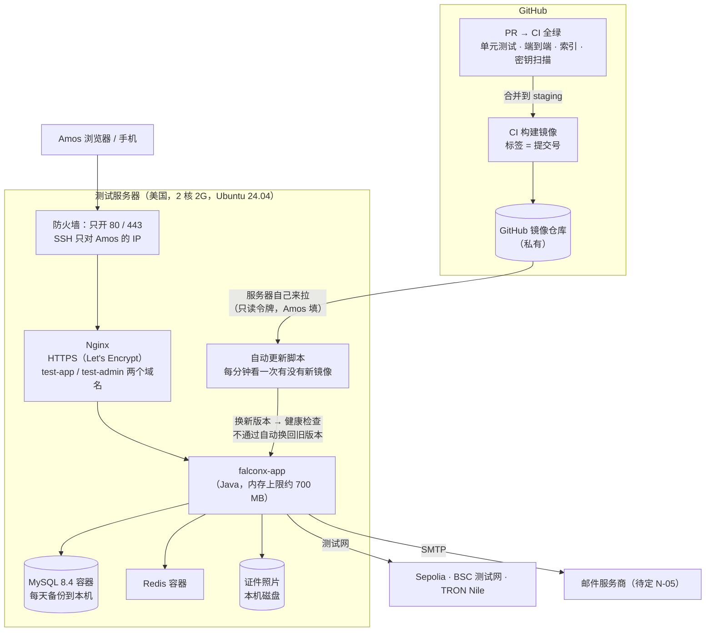
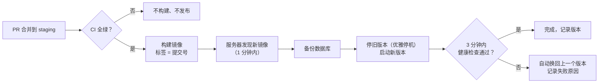
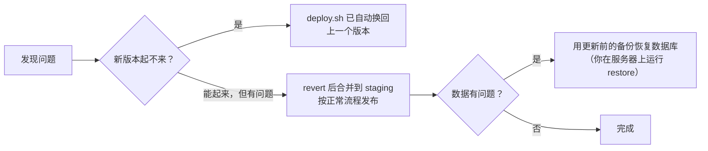

# FalconX Lite 部署方案（S20：测试环境）
- 版本：v1.12（2026-10-17）
- 变更历史：v1（2026-10-16）首次创建，交 Amos 审核；v1.1（2026-10-16）Amos 回复"按建议，是轻量应用服务器，机器已经清空"，补审核记录（第 13 节）；v1.2（2026-10-16）S20 实现：第 6 节写成具体步骤，第 7 节写实际做法（和 v1.1 不同的 4 处见 7.1），第 9 节补本机演练结果；更正 D3 的"其他选择"（验证码不会写进日志）；v1.3（2026-10-16）9.1 补部署形态端到端测试的结果（浏览器经过 Nginx 镜像跑主流程），修复资产页路由被 Nginx 当成静态目录（D-1），加 `.dockerignore`；v1.4（2026-10-16）Amos 选择"在控制台命令助手里粘贴命令"（办法 B）；新增 init-env.sh 在服务器上生成内部密码和推送密钥，第 6 节第 9、10 步改为运行它；v1.5（2026-10-16）测试环境上线，补第 9.2 节实测；v1.6（2026-10-16）发信地址改为 email.quickcome.online 子域名；第一次自动更新成功；v1.7（2026-10-16）新增第 4.1 节限流（功能取舍对照表 P-05：Nginx 外层 + 后端三层），第 7 节加一行；v1.8（2026-10-16）新增第 14 节官网（v2）：`test-www` 域名、Nginx 一段、`WWW_DOMAIN`、证书扩展成三个域名、`verify.sh` 官网检查；v1.9（2026-10-16）v2 E8–E11：新增第 15 节监控告警（健康检查的 `alerts` 不让部署回滚，只在后台域名返回）、追踪号、指标；第 5 节加 `FX_ALERT_EMAILS`（默认 `info@quickcome.online`，写在部署配置里）、`FX_ID_NODE`；第 8 节加追踪号和告警的检查；第 10 节写明自动回滚只看 `status`；v1.10（2026-10-17）新增第 16 节接入报价源（AllTick 主、iTick 备）：Amos 拿到 token 后怎么填、怎么重启、怎么确认生效，新告警项 `quote.*`；v1.11（2026-10-17）新增第 16.6 节打开币安报价（10 个加密货币币安主、AllTick 备，开关 `FX_QUOTE_BINANCE_ENABLED` 默认关闭），16.3–16.5 补币安；v1.12（2026-10-17）新增第 17 节热钱包余额告警：没有新的环境变量，6 个下限在后台系统配置页设置，默认 0 = 不告警；第 15.1 节加 `hot.*` 告警项
- 状态：**Amos 2026-10-16 审核通过**（D1–D7 按建议）。域名（D2）和邮件服务商（D3）的具体选择还要 Amos 告知。
- 范围：**只写测试环境**（`staging` 分支）。生产环境（`main`）另写，等生产服务器定了（H0）再补。
- 依据：`00-架构方案.md` v1.1 第 4 节；agents 仓库《协作总则》第五节"其他服务器"的沟通清单、《运维工程师》v0.10、PR #15《平台规范：香港服务器》草稿（H1–H7 已按默认确认）；Amos 2026-10-16："用这台做测试环境……这台机器在美国"。
- 编写：运维；研发确认第 7 节的代码改动

## 一图看懂



这张图想说明：
- 代码合并到 `staging`、CI 全绿以后，**测试服务器自己去拉新版本**，GitHub 不需要能登录服务器，所以 SSH 不用对外开放。
- 公网只能访问 80 和 443。数据库、Redis、应用的管理端口都不对外。
- 新版本启动后健康检查不通过，会自动换回上一个版本。
- 我（AI）不持有服务器的登录方式。服务器上的一次性准备工作，由你按第 6 节分步操作。

## 1. 和架构方案不同的地方（请确认）
| 项目 | 架构方案 v1.1 | 本方案 | 影响 |
|---|---|---|---|
| 地点 | 香港 | **美国**（Amos 2026-10-16 确认） | 从国内访问会慢一些（延迟估计 150–250 毫秒，到服务器上实测）。测试环境可以接受。生产仍按 H0 另定。 |
| 配置 | 约 4 核 8G | **2 核 2G，40G 云盘** | 内存很紧，要按第 4 节调小各部分内存、加 2G 交换分区。只适合测试环境，不能当生产。 |
| 部署方式 | GitHub Actions 推送到服务器（H1） | **服务器自己拉取**（第 3 节 D1） | SSH 不用对外开放，GitHub 里不存服务器的登录密钥。 |
| 对象存储 | 托管对象存储 | 测试环境放本机磁盘 | 代码已经支持（`FX_STORAGE_DIR`）。生产再换对象存储。 |

## 2. 实测的内存（2026-10-16，在开发机上，不是在这台服务器上）
| 组件 | 实测 | 本方案的上限 |
|---|---|---|
| 后端 Java | 空闲约 410 MB；跑完一遍完整业务流程后约 510 MB | JVM 堆 512 MB，进程总量约 700 MB |
| MySQL | 默认配置约 700 MB | 调小缓存（256 MB），关闭性能监控，约 350–400 MB |
| Redis | 约 10 MB | 上限 64 MB |
| Nginx | 未实测，估计 10–20 MB | — |
| Ubuntu 系统 | 估计约 300 MB | — |
| **合计** | — | **约 1.4–1.5 GB**，加 2 GB 交换分区兜底 |

部署后在服务器上实测一次，写进第 9 节。如果长期超过 1.8 GB，再请你升配置。

## 3. 已经定了的和需要你决定的
### 3.1 已经定了的（2026-10-14，你对 H1–H7 回复"按默认"，agents PR #15《平台规范：香港服务器》草稿）
| 编号 | 结论 | 本方案怎么做 |
|---|---|---|
| H1 | AI 不持有服务器登录方式；需要手动操作时分步指导你 | 照做：首次准备由你按第 6 节操作 |
| H2 | 密钥只由你填进服务器的环境变量文件和 GitHub Secrets；仓库只有变量名清单 | 照做：第 5 节 |
| H3 | 合并到 staging 并且 CI 通过 → 自动部署测试环境 | 照做，但部署方式改了，见 D1 |
| H4 | 镜像按提交号打标签，保留最近 10 个，5 分钟内回滚，上线前演练一次 | 照做：第 10 节 |
| H5 | 独立测试服务器、独立数据库、只连测试网、密钥和生产分开、页面显示"测试环境" | 照做 |
| H6 | 生产用托管 MySQL 和对象存储 | 生产时照做；测试环境用容器里的 MySQL 和本机磁盘（架构方案 4.1 的测试环境也是容器 MySQL） |
| H7 | 健康检查 + 外部定时探测 + 告警邮件；接收邮箱待定 | 照做，见 D6 |

### 3.2 需要你决定的
| 编号 | 问题 | 建议 | 其他选择 |
|---|---|---|---|
| **D1** | **部署方式**（和 H1 的写法不同，请确认） | **服务器自己拉取**。CI 把镜像放进 GitHub 的私有镜像仓库；服务器每分钟检查一次 `staging` 有没有新镜像，有就更新。GitHub 里不存服务器的 SSH 密钥，SSH 也不用对 GitHub 开放。服务器上只存一个**只能读镜像**的 GitHub 令牌。 | 按 H1 原来的写法：GitHub Actions 用 SSH 登录服务器部署，SSH 密钥存在 GitHub Secrets。缺点是 SSH 要对 GitHub 的大量 IP 开放；密钥泄露的话，别人能登录服务器。 |
| **D2** | **域名** | 需要两个子域名，比如 `test-app.<你的域名>`、`test-admin.<你的域名>`，解析到 47.251.87.158。**必须有域名**：浏览器推送、PWA、登录 Cookie 都要求 HTTPS，免费的 HTTPS 证书要域名才能申请。请告诉我域名，以及它在哪家服务商解析。 | 先用 IP 和 HTTP 临时看页面。推送、添加到主屏幕不能用，Cookie 要改成不安全模式。不建议。 |
| **D3** | **邮件**（N-05） | 测试环境必须能发邮件，否则注册收不到验证码，没法验收。请选一家支持 SMTP 的服务商。候选：阿里云邮件推送、Amazon SES、腾讯企业邮箱。 | ~~暂时不配，验证码从日志里查~~（v1.2 更正：后端出于安全不把验证码写进日志，没配邮件时**客户无法注册**。所以邮件不配，只能验后台和页面。） |
| **D4** | **区块链和行情** | 分两步：先上线，不接链（代码已支持：没配置的链不扫块），行情用模拟报价，走通页面和交易；再接测试网节点、测试热钱包和 LP。 | 资源全部到位再一次部署。会晚一些。 |
| **D5** | **备份** | MySQL 每天凌晨备份到本机，保留 7 天；每次更新前也备份一次。测试环境的数据可以丢，不做异地备份。 | 再上传到对象存储。测试环境不需要。 |
| **D6** | **告警（H7）** | 用 GitHub Actions 定时任务每 15 分钟从外部访问一次健康检查，失败时 GitHub 发邮件到你的 GitHub 邮箱。不用另买服务。H7 的告警邮箱定了以后可以改。 | 用云厂商自带的监控，要在它的控制台配置。 |
| **D7** | **SSH 的来源 IP** | 安全组只允许你常用的出口 IP 登录 SSH。如果你的 IP 经常变，改成"平时关闭，要用时在云控制台临时打开"。 | — |

### 3.3 请确认的账号信息（规则 C24，不靠猜）
- **云厂商和产品**：~~ECS 还是轻量应用服务器~~ → **阿里云轻量应用服务器**（Amos 2026-10-16 确认）。防火墙在轻量应用服务器控制台的"防火墙"页设置（不是 ECS 的安全组）。
- **这台机器上有没有别的程序** → **已经清空**（Amos 2026-10-16 确认），专门给本项目用。
- **GitHub 套餐**：Amos 没有说明有变化，按架构方案记录的免费版处理。私有镜像仓库免费版也能用，有存储额度，只保留最近 10 个镜像。

## 4. 服务器上的布局
```
/opt/falconx/
  docker-compose.yml   ← 从仓库 deploy/ 复制，不含任何密钥
  .env                 ← 只有这个文件放密钥，权限 600，只有 root 能读；由你填写（变量清单见第 5 节）
  nginx/               ← Nginx 配置（仓库 deploy/nginx/）
  data/mysql/          ← 数据库文件
  data/storage/        ← 证件照片
  backup/              ← 每天的数据库备份（保留 7 天）
  deploy.sh            ← 自动更新脚本（每分钟由 systemd 定时器运行）
  rollback.sh          ← 手动回滚到指定版本
  logs/                ← 部署记录
```

容器（`docker compose`）：

| 容器 | 镜像 | 内存上限 | 对外端口 |
|---|---|---|---|
| `nginx` | `nginx:1.27`（版本固定） | 64 MB | 80、443 |
| `app` | `ghcr.io/dollar3651314/falconx-lite:<提交号>` | 768 MB（JVM `-Xmx512m`） | 不对外。8080 只给 Nginx 用；管理端口 8081 只在容器内 127.0.0.1 |
| `mysql` | `mysql:8.4` | 450 MB（`innodb_buffer_pool_size=256M`、`performance_schema=OFF`） | 不对外 |
| `redis` | `redis:7`（`maxmemory 64mb`、设密码） | 96 MB | 不对外 |

- 前端（客户端、后台）的静态文件打进 Nginx 镜像，或者作为 `app` 镜像里的文件由 Nginx 读取，在实现时选简单的一种。同一个提交号对应同一套前后端，回滚时一起回滚。
- `test-app.<域名>` → 客户端页面，`/api/` 和 WebSocket 转发给 app；`test-admin.<域名>` → 后台页面，`/api/admin/` 转发给 app。
- **真实 IP**：Nginx 用 `X-Forwarded-For $remote_addr` **覆盖**客户端自带的请求头（不是追加），后端只信任内网代理传来的值（`server.forward-headers-strategy: native`，已在代码里）。后台 IP 白名单、登录失败按 IP 计数都依赖这一点，部署后专门验证（第 8 节）。
- **HTTPS**：Let's Encrypt 免费证书，用 certbot 自动续期。HTTP 自动跳转到 HTTPS。
- **测试环境标识**：页面顶部显示"测试环境"标识，邮件标题前加"[测试]"，避免和以后的生产混淆（第 7 节的代码改动）。
- **磁盘（40G）**：系统和 Docker 约 10G；镜像保留最近 10 个版本约 3–4G；日志按大小轮转（每个容器最多 50 MB × 3 个）；数据库和照片开始时很小。部署后磁盘使用超过 80% 时健康检查告警。

### 4.1 限流（P-05，v1.7）
原系统有"全局 IP / 认证入口 / 交易"三层限流（`需求文档/v1-功能取舍对照表.md` P-05），这里分两道：

| 哪一道 | 规则 | 默认值 | 改在哪里 |
|---|---|---|---|
| Nginx（第一道，只防明显的洪水） | `/api/`（客户端和后台两个域名合计）按来源 IP | 每秒 20 个，瞬间最多多出 400 个；同时处理中的请求 200 个 | `deploy/web.Dockerfile` 的 `FX_NGINX_API_RATE`、`FX_NGINX_API_BURST`、`FX_NGINX_API_CONN` |
| Nginx | `/api/ws/`（WebSocket）按来源 IP：只数握手，已建立的长连接不计数、不会被断开 | 每秒 5 次握手，瞬间最多多出 100 次；同时打开 500 条 | `FX_NGINX_WS_RATE`、`FX_NGINX_WS_BURST`、`FX_NGINX_WS_CONN` |
| 后端：全局 IP | `/api/**` 按 IP（不含 `/api/health` 和 WebSocket 握手） | 每分钟 600 次 | `application.yml` 的 `falconx.rate-limit.ip-per-minute` |
| 后端：WebSocket 握手 | 行情、交易推送的握手按 IP 单独计数（防止反复重连刷连接） | 每分钟 120 次 | `ws-handshake-per-minute` |
| 后端：交易 | 下单、改单、撤单、平仓、改止盈止损、追加保证金、提现提交、白名单增删，按客户合计（换 IP 也算同一个额度） | 每分钟 60 次 | `user-write-per-minute` |
| 后端：认证入口 | 后台登录按 IP（成功失败都算，安全审查 SEC-15）；客户登录失败锁定、发验证码限次原来就有（AC-02、SEC-03） | 15 分钟 20 次 | `admin-login-per-ip`、`admin-login-window` |

- 超限一律返回 429，错误码 `RATE_LIMITED`，带 `Retry-After`（Nginx 那一道固定 1 秒），两个前端显示"操作太频繁，请稍后再试"。
- 后端计数在 Redis（固定窗口，和登录失败计数同一种写法）。**Redis 不可用时放行**并记一条警告，之后 30 秒内不再访问 Redis；Redis 命令超时设为 2 秒（原来默认 60 秒），Redis 卡住时不会把请求一直挂着。
- IP 是 Nginx 看到的来源 IP，经 `X-Forwarded-For $remote_addr` 覆盖后传给后端（后端用 `request.getRemoteAddr()`）；客户端自己带的请求头不起作用。IPv6 的注意事项见安全审查 SEC-08。
- 大陆移动网络很多人共用一个出口 IP：按 IP 的上限留了余量（每分钟 600 次接口约等于 10 个人同时频繁操作）。上线后如果在 Nginx 日志（`limiting requests`）或后端 429 里看到误伤，先调大按 IP 的值，按客户的不用动。
- 测试：后端 `RateLimitTest`、`RateLimitWebSocketTest`、`RateLimiterUnitTest`（很小的上限）；后端测试和端到端测试（e2e profile，含压测 `e2e/load/`）把后端上限调大；压测的 `e2e/load/compose.load.yml` 把 Nginx 的阈值调大。部署形态的端到端测试用 Nginx 的默认值。
- 本机实测（2026-10-16，开发机上的 Docker：真实 web 镜像 + 修改后的配置 + 自签名证书 + 假后端，不是在测试服务器上）：`nginx -t` 通过；同一 IP 瞬间 700 个接口请求，432 个通过、268 个 429（响应体 `{"code":"RATE_LIMITED",...}`、`Retry-After: 1`、安全响应头都在）；额度用完时静态页面、后台页面、`/api/health` 照常 200；后端自己返回的 429（验证码冷却）原样转发；2 秒后恢复；瞬间 150 次 WebSocket 握手，101 次成功、49 次 429，之前建好的长连接照常收消息；换成压测的阈值后 1500 个请求、150 次握手全部通过。

## 5. 要你填进服务器 `.env` 的变量
**只写变量名。值由你直接填进服务器，不发到对话里，也不进仓库**。仓库里会有 `deploy/.env.example`，只有变量名和说明。

| 变量 | 什么时候需要 | 说明 |
|---|---|---|
| `FX_DB_PASSWORD`、`MYSQL_ROOT_PASSWORD` | 第一步 | 数据库密码，自己随机生成（第 6 节给生成命令，结果不带换行，C26） |
| `FX_REDIS_PASSWORD` | 第一步 | 同上 |
| `FX_ADMIN_INIT_USERNAME`、`FX_ADMIN_INIT_PASSWORD` | 第一步 | 第一个超级管理员；首次登录必须改密码，建好以后可以从 `.env` 删掉 |
| ~~`GHCR_READ_TOKEN`~~ | 第一步 | v1.2 改为：GitHub 只读令牌（`read:packages`）**不写进 `.env`**，在第 6 节第 6 步用 `docker login` 输入一次，由 Docker 保存在服务器 root 用户的配置里 |
| `FX_MAIL_HOST`、`FX_MAIL_PORT`、`FX_MAIL_USERNAME`、`FX_MAIL_PASSWORD`、`FX_MAIL_FROM` | D3 定了以后 | SMTP |
| `FX_PUSH_VAPID_PUBLIC_KEY`、`FX_PUSH_VAPID_PRIVATE_KEY`、`FX_PUSH_VAPID_SUBJECT` | 第一步（可以晚点） | 浏览器推送的密钥对，在你自己电脑上生成（通知方案 N2，第 6 节给命令）。**测试环境单独一对，不能和生产共用** |
| `FX_RISK_ALERT_EMAILS` | H7 定了以后 | 风控告警收件人 |
| `FX_ALERT_EMAILS` | 可以不填 | 监控告警收件人（v2 E8：行情断流、扫块停滞、节点不通、邮件连续失败），逗号分隔。**默认 `info@quickcome.online`**（Amos 2026-10-16 定的联系邮箱），默认值写在 `deploy/kit/env.example` 和 `docker-compose.yml`，代码里没有；H7 定了以后在 `.env` 里改。告警邮件走同一个 SMTP（D3），邮件没配好时只写日志 |
| `FX_ID_NODE` | 不用填 | 雪花 ID 节点号（v2 第 11.4 节），单实例默认 1；以后多实例时每个实例填不同的值（0–1023） |
| `WWW_DOMAIN` | 加官网时（v2，第 14 节） | 官网域名，测试环境 `test-www.quickcome.online`；没填时官网那一段 Nginx 配置不生效，其他照常 |
| `FX_WALLET_*_RPC_URL`、`FX_WALLET_*_USDT_CONTRACT`、`FX_WALLET_*_XPUB`、`FX_WALLET_*_HOT_KEY`、`FX_WALLET_*_HOT_ADDRESS`、`FX_WALLET_*_CHAIN_ID` | D4 第二步 | **全部用测试网**：节点服务的测试网地址、测试网 USDT 合约、测试用的 xpub 和测试热钱包。**测试热钱包里只放测试币，不能和生产用同一套** |

部署配置里固定写好、不需要你填的：`FX_MARKET_SOURCE=simulated`、`FX_COOKIE_SECURE=true`、`FX_STORAGE_DIR`、`FX_DB_URL`、`FX_REDIS_HOST`。
**不能设的**：`SPRING_PROFILES_ACTIVE=e2e`、`FX_E2E_ENABLED`。即使误设了，配了 SMTP 或节点时后端也会拒绝启动（S19 的 `E2eGuard`）。

## 6. 首次准备：你要做的步骤（我在对话里一步一步带你做）
第一次带你操作某个界面时，如果界面和我的描述不一致，请截图，以你看到的为准。密码、令牌只填进服务器，不发到对话里。

**前提**：域名（D2）已经告诉我；`staging` 上已经有一次 CI 全绿后推出的镜像（本 PR 合并后就有）。

| 步骤 | 在哪里 | 做什么 | 怎么确认 |
|---|---|---|---|
| 1 | — | ~~确认机器可以清空~~：已清空（2026-10-16） | — |
| 2 | 轻量应用服务器控制台 →"防火墙" | 入方向只留 80、443；22 只对你的 IP（不知道自己的 IP 时，我教你查）。其他规则删除 | 截图给我看规则列表 |
| 3 | 域名服务商 | 加两条 A 记录：`test-app`、`test-admin` → 47.251.87.158 | 我从外部查解析 |
| 4 | GitHub → Settings → Developer settings → Personal access tokens (classic) | 新建令牌，只勾 `read:packages`，有效期 1 年。只复制到第 6 步的服务器上，不发给我 | — |
| 5 | 服务器（控制台"命令助手"，Shell、root、超时 600 秒） | 装 Docker（Docker 官方安装脚本）：`curl -fsSL https://get.docker.com \| sh` | `docker --version` 有输出 |
| 6 | 服务器 | 登录镜像仓库：`docker login ghcr.io -u <你的 GitHub 用户名>`，密码处粘贴第 4 步的令牌（屏幕上不显示） | 显示 Login Succeeded |
| 7 | 服务器 | 取出部署工具包：`sudo mkdir -p /opt/falconx && sudo docker run --rm --entrypoint sh -v /opt/falconx:/out ghcr.io/dollar3651314/falconx-lite-web:staging -c 'cp -r /falconx-kit/. /out/'` | `ls /opt/falconx` 能看到 `deploy.sh` 等文件 |
| 8 | 服务器 | 一次性准备：`sudo bash /opt/falconx/server-setup.sh`（装 certbot、2G 交换分区、日志轮转、自动安全更新、目录、定时器；可以先 `less` 看内容） | 最后显示"准备完成" |
| 9 | 服务器（命令助手） | 生成不需要你提供的值：`sudo bash /opt/falconx/init-env.sh test-app.<域名> test-admin.<域名> <证书提醒邮箱>`。数据库、Redis 密码、浏览器推送密钥对、超管（用户名 admin、随机初始密码）直接写进 `.env`，**屏幕上不显示**；超管初始密码由你在"远程连接"里运行 `sudo grep ^FX_ADMIN_INIT_PASSWORD= /opt/falconx/.env` 查看 | 输出"完成"，列出还空着的变量 |
| 10 | 服务器（远程连接） | 邮件服务商定了以后，`sudo nano /opt/falconx/.env` 填 `FX_MAIL_*`；区块链测试网的 `FX_WALLET_*` 之后再填 | — |
| 11 | 服务器 | 第一次启动：`sudo bash /opt/falconx/first-start.sh`（检查 `.env` → 申请证书 → 启动 → 证书自动续期 → 打开每分钟更新和每天备份） | 最后显示"完成"和版本号 |
| 12 | — | 我从外部运行 `deploy/verify.sh`（第 8 节） | 全部通过 |
| 13 | 浏览器 | 打开 `https://test-admin.<域名>`，用超管登录、改初始密码；之后可以把 `.env` 里的 `FX_ADMIN_INIT_*` 两行删掉 | 能进后台，顶部有"测试环境"标识条 |

预计你要花 30–60 分钟，大部分是复制粘贴。

## 7. 代码改动（S20 已完成，本机演练通过）
| 改动 | 文件 | 说明 |
|---|---|---|
| 镜像 | `deploy/app.Dockerfile`、`deploy/web.Dockerfile` | 后端镜像（Temurin 25 JRE，uid 10001，堆最多 512MB）；前端 + Nginx 1.27 镜像（带部署工具包） |
| Nginx | `deploy/nginx/` | 第 4 节的路由和安全设置；在 `nginx:1.27` 上 `nginx -t` 通过；v1.3：客户端只把 `assets/` 下带扩展名的文件当静态资源（资产页路由 `/assets*` 和构建目录同名，见 9.1 的 D-1） |
| 构建上下文 | `.dockerignore` | v1.3：只把 jar、两个前端产物、`deploy/nginx/`、`deploy/kit/` 发给 Docker |
| 构建和推送镜像 | `.github/workflows/ci.yml` 的 `publish-staging` job | 只在推送到 staging 且检查全部通过后运行；标签 = 提交号，再移动 `staging` 标签；镜像仓库保留 10 个版本 |
| 服务器端工具包 | `deploy/kit/`（compose、deploy、rollback、backup、restore、server-setup、first-start、systemd 定时器、env.example） | 第 4、6、10 节的行为；shellcheck 通过 |
| 外部验证 | `deploy/verify.sh` | 第 8 节的自动检查部分 |
| 外部探测 | `.github/workflows/probe-staging.yml` | 每 15 分钟（D6），见 7.1 第 3 条 |
| 健康检查带版本号 | 后端 `/api/health` 的 `version`（`FX_VERSION`） | 镜像构建时写入提交号 |
| 测试环境标识 | 后端 `FX_ENV_LABEL=test` → 健康检查 `env`；前端顶部紫色标识条；邮件和推送标题加"[测试]"/"[TEST]"，站内信不加 | 生产不设，返回和以前完全一样 |
| 限流（v1.7） | `deploy/nginx/site.conf.template`、`deploy/web.Dockerfile`（Nginx 阈值）；后端 `common/ratelimit/` | 第 4.1 节；在 `nginx:1.27-bookworm` 上 `nginx -t` 通过，本机实测见 4.1 |

### 7.1 和 v1.1 写法不同的地方
1. **镜像里不再编译代码**：jar 和前端在 CI 里先构建好，Dockerfile 只负责打包。原因：省时间，也不再依赖 Docker Hub 的 Maven 镜像（演练时 Docker Hub 限流）。
2. **推镜像写在 `ci.yml` 里**，不是单独的 `deploy-staging.yml`：GitHub 的 `workflow_run` 触发只认默认分支（main）上的文件，写在单独文件里，staging 上不会触发。
3. **外部探测（D6）要合并到 main 后才开始定时运行**：GitHub 的定时任务也只认 main 上的文件。在那之前：
   - 每次合并到 staging，CI 会等测试环境换成新版本，15 分钟没换成就失败，GitHub 会发邮件（要先在仓库变量里设 `FX_STAGING_APP_URL`）；
   - 平时宕机没有自动告警。需要的话，可以在轻量应用服务器控制台打开云监控告警（免费），由你决定。
4. **推送也加了"[TEST]"前缀**：推送显示在系统通知栏，看不到页面上的标识条。

## 8. 怎么确认部署成功（从外部验证，脚本 `deploy/verify.sh`）
| 检查 | 方法 | 通过标准 |
|---|---|---|
| 版本 | `https://test-app.<域名>/api/health` | 状态正常，提交号等于 staging 最新提交 |
| HTTPS | 访问 http 地址；查看证书 | 自动跳转到 https，证书有效 |
| 端口 | 从外网扫描 47.251.87.158 | 只有 80、443 开放（22 只对你的 IP 开放），3306、6379、8080、8081 都不通（AC-36） |
| 管理端点不对外 | 访问 `/actuator/**`（含 `/actuator/prometheus` 指标） | 404 |
| 追踪号 | 看 `/api/health` 的响应头 `X-Request-Id` | 32 位十六进制（Nginx 生成），每次不同 |
| 业务告警 | 后台域名 `/api/health` 的 `alert`、`alerts`；客户端域名、官网的 `/api/health` 里**没有**这两个字段 | `OK` 最好；`ALERT` **不算部署失败**，只提示去看告警邮件（第 15 节） |
| e2e 接口不存在 | 访问 `/api/e2e/mail/code` | 401 或 404 |
| 真实 IP | 后台 IP 白名单填一个别的 IP，再用你自己的 IP 访问；请求头里伪造 `X-Forwarded-For` | 被拒绝；伪造的请求头不起作用 |
| 页面 | 打开客户端和后台的首页 | 能打开，有"测试环境"标识，没有横向滚动 |
| 冒烟流程 | 注册 → 登录 → 看行情 → 下一笔单 → 平仓 | 成功（**需要先配好邮件 D3**，否则收不到注册验证码） |
| WebSocket | 登录后看行情页价格在跳 | 价格持续更新 |
| 内存 | 服务器上运行 `free -m`、`docker stats` | 总占用低于 1.8 GB，填进第 9 节 |

## 9. 实测记录
### 9.1 本机演练（2026-10-16，开发机上的 Docker，不是在测试服务器上）
按服务器的目录（`/opt/falconx`）、真实镜像、自签名证书、两个假域名演练。**实际执行**：

| 演练 | 结果 |
|---|---|
| 第一次启动（空数据库，含 19 个迁移） | 23 秒健康检查通过，版本号对得上 |
| Nginx 路由 | 客户端页面 200；客户端域名下 `/api/admin/`、`/api/e2e/`、`/actuator` 都是 404；后台 `/` 跳到 `/admin/`，页面 200；后台域名下客户接口 404；直接用 IP 访问 443 被断开；http 跳 https |
| 响应头 | HSTS、nosniff、禁止嵌入、Referrer-Policy 都有；页面不缓存，`/assets/` 缓存 30 天 |
| 真实 IP | 带伪造的 `X-Forwarded-For: 1.2.3.4` 登录后台，会话和审计日志记录的是实际来源地址，不是 1.2.3.4 |
| WebSocket | `/api/ws/market` 经过 Nginx 到达后端，未登录时后端返回 401。v1.3：部署形态端到端测试里登录后的行情和交易推送都经 Nginx 升级成功（101），见下面"部署形态端到端测试" |
| 故意放一个起不来的版本 | 3 分钟后自动换回旧版本，记下这个版本不再重试，期间约 3 分钟不可用 |
| 正常更新 | 11 秒完成，更新前自动备份 |
| 手动回滚 `rollback.sh` | 11 秒完成；之后自动更新跳过 staging 当前版本 |
| 备份和恢复 | 备份包含 44 张表；恢复后备份之后新增的数据没有了，迁移记录完整，健康检查通过 |
| 内存（空闲） | Nginx 3 MB、后端 347 MB、MySQL 214 MB、Redis 4 MB，合计约 570 MB（都在上限以内） |
| 后端容器用户 | uid 10001（不是 root） |

**部署形态端到端测试**（v1.3，2026-10-16，实际执行；详细见 `测试报告/v1-端到端测试方案.md` 第 9 节）：`bash e2e/run-deployed.sh` 用同样的两个镜像、`deploy/kit/docker-compose.yml`（加只给测试用的覆盖文件 `e2e/compose.deployed.yml` 打开 e2e profile）、自签名证书和两个假域名，在真浏览器（Chromium）里跑 S19 的主流程：

| 项目 | 结果 |
|---|---|
| 主流程 19 步（注册到提现完成、后台审核） | 经 Nginx（HTTPS、HTTP/2）全部通过；修复后连续 2 次完整构建、新库运行都通过（第 2 次连跑 3 轮） |
| 登录 Cookie | `fx_session`、`fx_admin_session` 都带 Secure、HttpOnly（`FX_COOKIE_SECURE=true`），经 HTTPS 正常保存 |
| WebSocket | 登录后行情、交易推送经 Nginx 升级（101），止盈触发、提现状态等实时更新正常 |
| Service Worker | 经 HTTPS 注册并接管页面；被接管后 `/api/` 仍由后端返回 |
| 测试环境标识条 | 客户端和后台顶部都显示"测试环境" |
| Nginx 路由 | 客户端域名 `/api/e2e/`、`/api/admin/`、`/actuator` 404；后台域名只开放后台接口；http 跳 https |
| 发现并修复 | **D-1**：直接打开或刷新资产页 `/assets` 得到 403，资金流水、提现、白名单页 404（资产页路由和构建目录同名），已改 `site.conf.template`；**D-3**：没有 `.dockerignore`，构建镜像时整个仓库（含 `node_modules`）发给 Docker，已加 |
| 发现并已修（产品代码） | **D-2**：客户端第一次连上交易推送时不重新拉取数据，连上之前的变化会漏掉（经过 Nginx、TLS 更容易碰上）；已改为每次连上都重新拉取 |
| 用时 | 完整构建 + 启动 + 测试共 94–148 秒（启动到健康检查通过 23–39 秒） |
| 内存（跑完 3 轮主流程后） | Nginx 4.8 MB、后端 425 MB、MySQL 208 MB、Redis 3.7 MB（都在上限以内） |

**没有验证**：
- certbot 申请和续期证书：需要真实域名，首次部署时验证；
- 从 GitHub 镜像仓库拉取：演练用的是本机镜像（`FX_OFFLINE_TEST=1`）；
- `server-setup.sh`：开发机不是 Ubuntu 24.04 虚拟机，只做了语法检查；
- 轻量应用服务器的防火墙。

### 9.2 测试服务器上的实测
2026-10-16，版本 `d0bb515`。地址：https://test-app.quickcome.online 、https://test-admin.quickcome.online（域名在 Cloudflare 解析，只开 DNS，不开代理）。邮件：Resend SMTP（`smtp.resend.com:465`，发信 `noreply@email.quickcome.online`；Resend 里验证的是子域名 `email.quickcome.online`。最初填成 `noreply@quickcome.online`，Resend 返回 403"API key not authorized for this domain"，改发信地址后正常，Amos 已收到验证码邮件）。

| 项目 | 结果 | 怎么得到的 |
|---|---|---|
| 首次准备和启动 | Amos 按方案 B 在控制台（远程连接）粘贴命令完成：装 Docker → 登录镜像仓库 → 取工具包、`server-setup.sh`、`init-env.sh` → 填邮件 → `first-start.sh` | Amos 截图 |
| 外部验证 `deploy/verify.sh` | 全部通过：健康检查 UP、`env=test`、版本对得上；http 跳 https；两个页面 200；客户端域名下 `/api/admin/`、`/api/admin;x/`、`/api/e2e/`、`/actuator` 都是 404；3306、6379、8080、8081 不通 | 实际执行（从开发环境） |
| 浏览器 | 390、1280 宽：两个站点能打开、有测试环境标识条、没有横向滚动，直接打开 `/assets` 正常 | 实际执行（Chromium） |
| 内存（刚启动、空闲） | 系统可用 1613 MB，已用 1081 MB，可用 531 MB，交换分区未使用；后端 354 MB / 768 MB、MySQL 226 MB / 450 MB、Redis 12 MB、Nginx 7 MB | Amos 截图（`free -m`、`docker stats`） |
| 磁盘 | 40G，已用 7.5G（20%） | Amos 截图（`df -h`） |
| 超管 | Amos 已登录后台并改掉初始密码 | Amos 告知 |
| 自动更新 | PR #37 合并到 staging → CI 全绿 → 推镜像 → 服务器自己换成 `2813384`，没有人登录服务器 | 实际执行（从外部看健康检查的版本号） |
| 邮件 | Amos 注册时收到验证码邮件 | Amos 告知 |

**开发环境验证不了的**（开发环境的出口会解密 TLS、并且不能连 22 端口）：证书签发方（请 Amos 在浏览器看）、22 端口是否只对 Amos 的 IP 开放。从国内打开页面的延迟在 S21 由 Amos 实测（AC-30）。

## 10. 发布和回滚



这张图想说明：只有 CI 全绿的代码才会到测试环境；新版本起不来会自动换回旧版本。

- **停机时间**：单实例，每次更新约 30 秒到 1 分钟不能交易（架构方案 K-04，已接受）。
- **自动回滚**：新版本 3 分钟内健康检查没通过，`deploy.sh` 自动换回上一个镜像。"通过"只看应用本身：HTTP 200、`"status":"UP"`、`version` 是新提交号（`deploy/kit/lib.sh` 的 `wait_healthy`，在服务器本机直连后端）；**业务告警（`alerts`）不算**，行情断流、节点不通换版本也解决不了，有告警时只在 `deploy.log` 里记一行（第 15 节）。
- **手动回滚**：你在服务器上运行 `rollback.sh <提交号>`，或者在仓库里 revert 后合并到 staging（推荐，不用登录服务器）。约 2–5 分钟。
- **数据库变更不能自动回滚**：Flyway 迁移只往前走。所以：
  - 每次更新前自动备份数据库；
  - 迁移脚本要兼容上一个版本的代码（只加列和表，删除放到下一个版本）；
  - 真要回退数据，用更新前的备份恢复。测试环境会丢失备份之后的数据，可以接受。



## 11. 风险
| 编号 | 风险 | 应对 |
|---|---|---|
| R1 | 2G 内存不够，进程被系统杀掉 | 每个容器设内存上限，加 2G 交换分区，容器异常退出自动重启；健康检查告警；长期不够就请你升配置 |
| R2 | 首次部署脚本没在真实服务器上跑过 | 先在本机同版本 Docker 里跑通；首次部署逐步执行、逐步验证 |
| R3 | 防火墙配错把你锁在服务器外面 | 只在轻量应用服务器控制台的"防火墙"页配置，不改服务器系统里的防火墙；控制台的"远程连接"可以兜底 |
| R4 | 测试环境被当成生产用 | 页面和邮件都有"测试"标识；只用测试网和测试密钥 |
| R5 | GitHub 只读令牌泄露 | 只能读镜像，不能改代码；有效期 1 年，泄露时在 GitHub 上撤销重建 |
| R6 | 美国机房从国内访问慢 | 测试环境可以接受；部署后实测延迟，作为生产选机房（H0）的参考 |

## 12. 审核后的步骤
1. 你确认第 3.2 节 D1–D7 和 3.3 节的账号信息（可以只回"按建议"，再写上不同意的项）。
2. 我做第 7 节的代码改动，在本机 Docker 里跑通，合并到 staging。
3. 按第 6 节一步一步带你准备服务器。
4. 第 8 节外部验证全部通过，填写第 9 节。
5. 邮件（D3）、测试网和 LP（D4）资源到位后再分别接上。
6. 进入 S21：你在测试环境验收。
7. 服务器从香港改到美国，部署方式也有变化（D1），agents 仓库 PR #15 的《平台规范：香港服务器》草稿要跟着改（例如改名为"云服务器"，H0 补上这台测试服务器）。本方案审核通过后，我更新那个 PR 交你确认。

## 13. 审核记录
| 日期 | Amos 的回复 | 结论 |
|---|---|---|
| 2026-10-16 | "用这台做测试环境，开始写部署方案　这台机器在美国" | 测试环境用这台美国服务器 |
| 2026-10-16 | "按建议，是轻量应用服务器，机器已经清空" | D1–D7 按建议；阿里云轻量应用服务器；机器已清空。待告知：域名（D2）、邮件服务商（D3） |

## 14. 官网（v2，v1.8）
技术方案见《技术方案/v2-官网技术方案.md》。

### 14.1 改了什么
| 位置 | 改动 |
|---|---|
| `deploy/web.Dockerfile`、`.dockerignore` | web 镜像多一份官网的构建产物 `web/site/dist` → `/usr/share/nginx/site` |
| `deploy/nginx/site.conf.template` | 新增 `server_name ${WWW_DOMAIN}` 一段：静态页面；只转发 `/api/public/quotes`（精确匹配，和客户端接口共用按 IP 的限流额度）和 `/api/health`；其他 `/api/`、`/actuator` 404；页面里的客户端地址由 `sub_filter` 填成 `https://${APP_DOMAIN}`。用同一张证书 `live/falconx` |
| `deploy/kit/docker-compose.yml` | web 容器加 `WWW_DOMAIN`；`.env` 里没有时用占位域名 `www-not-configured.invalid`，Nginx 照常启动（已有服务器合并后的自动更新不会失败） |
| `deploy/kit/env.example`、`init-env.sh`、`first-start.sh` | 新变量 `WWW_DOMAIN`；`init-env.sh` 第 4 个参数可以填它；`first-start.sh` 要求它，第一次申请证书时包含三个域名 |
| `deploy/verify.sh` | 第 4 个参数是官网域名：http 跳 https、证书、首页、三个法律页、页面里的客户端地址、健康检查标识、公开行情可用且字段正确、官网域名上的其他接口 404（AC2-10） |

`nginx -t` 在 `nginx:1.27-bookworm`（web 镜像本身）里验证：设了 `WWW_DOMAIN` 和用占位域名两种都通过（实际执行，开发机）。

### 14.2 已有的测试服务器加官网（Amos 在服务器上做，一次）
前提：这次的代码已经合并到 staging，服务器已经自动更新到新版本（新版本在 `.env` 里没有 `WWW_DOMAIN` 时照常运行，只是官网不能访问）。

1. **DNS**：在域名服务商那里加一条 A 记录 `test-www` → 测试服务器的公网 IP（和 `test-app`、`test-admin` 一样）。等几分钟，在自己电脑上 `ping test-www.quickcome.online` 能看到这个 IP。
2. **写进 `.env`**（在控制台命令助手里粘贴）：
   ```bash
   sudo bash -c 'cd /opt/falconx && grep -q "^WWW_DOMAIN=" .env && sed -i "s|^WWW_DOMAIN=.*|WWW_DOMAIN=test-www.quickcome.online|" .env || echo "WWW_DOMAIN=test-www.quickcome.online" >> .env; grep ^WWW_DOMAIN= .env'
   ```
3. **扩展证书到三个域名**（Nginx 正在 80 端口提供验证目录，不用停服务；`--expand` 在原来的证书 `falconx` 上加域名，续期方式不变）：
   ```bash
   sudo certbot certonly --webroot -w /var/www/certbot --cert-name falconx --expand -n \
     -d test-app.quickcome.online -d test-admin.quickcome.online -d test-www.quickcome.online \
     --deploy-hook "docker exec falconx-web-1 nginx -s reload"
   ```
   成功时最后会显示 `Successfully received certificate`。确认证书里有三个域名：`sudo certbot certificates --cert-name falconx`（`Domains:` 一行）。
4. **让 Nginx 读到新变量**（只重建 web 容器，后端不重启）：
   ```bash
   sudo bash -c 'cd /opt/falconx && docker compose --project-name falconx --env-file .env --env-file state/image.env up -d web'
   ```
5. **从外部确认**（任何能上网的电脑，在仓库目录里）：
   ```bash
   bash deploy/verify.sh test-app.quickcome.online test-admin.quickcome.online "" test-www.quickcome.online
   ```
   全部通过后，用手机和电脑浏览器打开 https://test-www.quickcome.online 看一遍。

出问题时：第 3 步失败多半是 DNS 还没生效（certbot 的报错里有 `NXDOMAIN` 或 `Timeout`），等一会儿重试；证书没扩展成功时旧证书照常有效，客户端和后台不受影响。第 4 步之后官网打不开，看 `sudo docker compose -p falconx logs web --tail 50`。

### 14.3 以后新建的服务器
按第 6 节的步骤做；`init-env.sh` 运行时多传一个参数：`sudo bash /opt/falconx/init-env.sh <客户端域名> <后台域名> <证书提醒邮箱> <官网域名>`，`first-start.sh` 第一次申请证书时就包含三个域名。

### 14.4 本机验证（2026-10-16，开发机）
- 实际执行：web 镜像构建、两种 `nginx -t`；端到端测试默认形态（`e2e/server.mjs` 的 4174 端口提供官网）跑过官网用例和主流程。部署形态的结果见《技术方案/v2-官网技术方案.md》第 6 节和交付汇报。
- 未验证：在测试服务器上扩展证书（要 Amos 在服务器上做）。

## 15. 监控告警、追踪号和指标（v2 E8–E10，v1.9）
### 15.1 健康检查分两层：存活和业务告警
| 层 | 字段 | 看什么 | 异常时 |
|---|---|---|---|
| 存活 | `status`（和 HTTP 状态码）、`db`、`redis`、`wallet`、`push` 等 | 应用本身：数据库、Redis、模块配置（例如配了节点没配合约） | 503；`deploy.sh` 判新版本失败、自动换回 |
| 业务告警 | `alert`（`OK` / `ALERT`）、`alerts`（每项 `UP` / `DOWN`） | 外部服务：行情、链节点、扫块、邮件 | **仍然 200、`status` 仍是 UP**，部署不回滚；给告警邮箱发邮件 |

为什么分开：行情断流、节点不通、邮件服务商故障是外部的问题，换回旧版本也一样；如果让它们把健康检查变成 503，每次 LP 或节点抖动都会让刚发布的新版本被自动换回，还会跳过这个版本。

**业务告警只给后台域名和服务器本机**（Amos 2026-10-16 决定）：客户端域名、官网的 `/api/health` 只返回存活信息（`status`、`version`、`env` 和各项 UP/DOWN），不返回 `alert`、`alerts`，不对外暴露配了哪些链、行情是否正常。做法：
- Nginx：`deploy/nginx/proxy.inc` 默认把内部头 `X-Fx-Health-Alerts` 设为空（不发这个头，客户端自己带的同名头也被覆盖掉）；只有后台域名的 `location = /api/health` 在 include 之后设成 `1`。
- 后端（`common/web/HealthController.showAlerts`）：请求带 Nginx 设的 `X-Real-IP`（经过 Nginx）时，只有 `X-Fx-Health-Alerts: 1` 才返回告警；没有 `X-Real-IP`（不经过 Nginx、在服务器本机直连 `127.0.0.1:8080`，例如 `deploy.sh`）时返回。`X-Real-IP` 总是由 Nginx 用 `$remote_addr` 设置，客户端去不掉；后端端口不对公网开放。
- 取舍：没有选"后台单独一个需要登录的告警接口"，因为部署脚本和服务器上排查时不经过 Nginx、也没有后台登录，直连后端就能看到告警更简单；代价是告警依赖 Nginx 配置正确（部署形态端到端测试检查客户端域名和官网的 health 里没有 `alerts`、伪造头无效，后台域名有）。
- `deploy/verify.sh`：从后台域名读告警（只提示），并检查客户端域名、官网的 health 里没有 `alert`。`deploy/kit/lib.sh`：本机直连，照样能在 `deploy.log` 里记告警。

`alerts` 里的项（**只出现配置了的**：测试环境没配链时没有 `node.*`、`scan.*`；`FX_MARKET_SOURCE=none` 时没有 `market`；模拟报价源算报价源）：
| 项 | 什么时候 DOWN | 阈值（`application.yml` 的 `falconx.alert`） |
|---|---|---|
| `market` | 现在开市的品种里，没有任何一个在 30 秒内收到报价（全部休市时不检查） | `market-silence: 30s` |
| `node.<链>` | 连续 3 次连不上节点（扫块每 15 秒一次，约 45 秒） | `node-failures: 3` |
| `scan.<链>` | 扫块 10 分钟没推进，或者落后的区块数 × 出块间隔超过 10 分钟 | `scan-stall: 10m` |
| `mail` | 连续 5 封邮件发送失败（没配 SMTP 时不检查） | `mail-failures: 5` |
| `hot.<链>.usdt`、`hot.<链>.gas`（v1.12） | 热钱包 USDT / 手续费币余额低于后台设置的下限（下限 0 = 不告警，这一项不出现；见第 17 节） | 后台系统配置页 `hotWallet.*`（不在 `application.yml`） |

阈值 Amos 2026-10-16 确认按建议。健康检查只返回 UP / DOWN，不返回说明；说明写在日志（`监控告警：…`）和告警邮件里。

### 15.2 告警邮件
- 每 15 秒检查一次（`notification/service/AlertMonitor`）。某项变成 DOWN 时发"告警：…"，恢复时发"已恢复：…"（模板 `OPS_ALERT`、`OPS_RECOVERED`，中英文各一份，测试环境标题带"[测试]"），写成邮件任务，2 秒内发出，失败按任务表重试。
- **节流**：同一项 30 分钟内只发一封告警（`throttle: 30m`）；反复断开又恢复时不刷屏，异常一直持续到 30 分钟满会再发一封。没发过告警的那次异常，恢复时也不发恢复邮件。
- 收件人 `FX_ALERT_EMAILS`，默认 `info@quickcome.online`（部署配置里，代码里没有默认邮箱）；为空时只写日志。
- 状态只在内存里：应用重启后，还在异常的项会重新发一封。
- 测试环境实测（AC2-20 要求一次）：待 Amos 在测试环境配好邮件后，停一次模拟报价源（或把某条链的节点地址填错）确认收到邮件——**未做**。

### 15.3 追踪号（traceId）
- Nginx 每个请求生成 `$request_id`（32 位十六进制），**覆盖**客户端自己带的 `X-Request-Id` 传给后端（`deploy/nginx/proxy.inc`，三个域名都经过它），Nginx 访问日志最后一列也是它，Nginx 自己返回的 429 也带这个响应头。
- 后端（`common/trace/`）沿用它（格式不对时自己生成），写进日志（级别后面的 `[追踪号]`）、响应头 `X-Request-Id`、错误响应体的 `traceId`。WebSocket 连接沿用握手请求的追踪号；定时任务每次执行一个 `job-…`。
- 客户报问题时给出错误里的追踪号，在服务器上：`docker compose -p falconx logs app | grep <追踪号>`。

### 15.4 指标
- 只在后端容器里的 `127.0.0.1:8081`（管理端口，Nginx 不转发，公网访问 `/actuator/**` 一律 404）：`/actuator/prometheus`（Prometheus 格式）、`/actuator/metrics`。在服务器上看（后端镜像里没有 curl，用 bash 自带的 `/dev/tcp`）：`docker compose -p falconx exec app bash -c 'exec 3<>/dev/tcp/127.0.0.1/8081; printf "GET /actuator/prometheus HTTP/1.0\r\n\r\n" >&3; cat <&3' | grep ^fx_`。
- 自定义指标：`fx_quotes_received_total`（收到的报价数）、`fx_quote_age_seconds{symbol}`（各品种最后报价距今的秒数）、`fx_matching_latency_seconds{type}`（撮合耗时直方图，AC-13 同一口径）、`fx_orders_placed_total{kind}`（下单数）、`fx_chain_scan_lag_blocks{chain}`（扫块落后的区块数）、`fx_chain_node_failures{chain}`（连续连不上节点的次数）、`fx_tasks_backlog`（到期没处理的邮件和推送任务数）。另外有 Spring Boot 自带的 JVM、HTTP、数据库连接池指标。
- 现在没有部署 Prometheus 和看板（2G 内存放不下），指标给排查时手动看；以后要看板时再加采集。

## 16. 接入报价源（v2，v1.10）
方案见 `技术方案/v2-报价源接入.md`。代码里只有变量名；**token 只由 Amos 填进服务器的 `/opt/falconx/.env`**，不发到对话里、不进仓库。

### 16.1 现在的状态
- 两个 token 都空着：测试环境和以前完全一样，全部是模拟报价，官网显示"示例行情"。
- 只填一家：这家接管它覆盖的品种（AllTick 50 个、iTick 49 个），其余品种继续模拟。两家都填：AllTick 主、iTick 备，主备切换和交叉校验生效。
- **条款提醒**：两家的标准条款都禁止未授权的再分发和公开展示。客户端（登录后）看到的就是交易报价，所以测试环境用试用 token 做内部验收之前，先确认试用条款允许；**生产必须先拿到两家的书面授权**（差价合约定价 + 公开展示）。官网默认不显示真实价（`FX_PUBLIC_QUOTES_SOURCE=simulated`），拿到展示授权以后才改成 `live`。

### 16.2 Amos 拿到 token 后在服务器上做（一次）
前提：服务器已经部署了包含本功能的版本（合并到 `staging` 后自动更新；`docker-compose.yml` 由部署工具包一起更新）。确认方法：`sudo grep -c FX_QUOTE_ALLTICK_TOKEN /opt/falconx/docker-compose.yml` 输出 1 以上。

| 步 | 在哪里 | 做什么 |
|---|---|---|
| 1 | 服务器（远程连接） | `sudo nano /opt/falconx/.env`，在末尾加一行或两行（只填拿到的那家）：`FX_QUOTE_ALLTICK_TOKEN=<AllTick 后台 API keys 里的 token>`、`FX_QUOTE_ITICK_TOKEN=<iTick 的 token>`。值前后不要有空格和引号。保存后 `sudo chmod 600 /opt/falconx/.env` |
| 2 | 服务器 | 重启后端让它读到新变量：`sudo bash -c 'cd /opt/falconx && docker compose --project-name falconx --env-file .env --env-file state/image.env up -d app'`（只重建 app 容器，数据库、Redis 不动；大约 1 分钟） |
| 3 | 服务器 | 看连接日志：`sudo docker compose -p falconx logs --since 5m app \| grep 报价源`。正常时有"报价源 alltick 的 fx 连接已建立（…，45 个品种）"、"真实报价源接管 50 个品种"；token 错误时是"握手被拒绝，HTTP 401"，每次间隔翻倍重试（最长 60 秒）。日志里没有 token 的值 |
| 4 | 浏览器 | 后台域名 `https://test-admin.quickcome.online/api/health`：`alerts` 里出现 `quote.alltick`（和 `quote.itick`；两家都配时还有 `quote.failover`、`quote.deviation`），都应该是 `UP`。`status` 一直是 `UP`——报价源连不上**不会**让健康检查失败、不会让部署回滚（约定 24），只会亮这几项并发告警邮件 |
| 5 | 后台 | 品种页"最后报价"一列：时间在跳，后面显示"AllTick"（或"iTick（备）"、"模拟"）。开市却一直"暂无报价"的品种，多半是映射里的代码不对（`application.yml` 的 `falconx.market.feeds.routes`，技术方案第 2 节标【推断】的几项），告诉研发改 |
| 6 | 官网 | 仍然显示"示例行情"、模拟价（默认 `FX_PUBLIC_QUOTES_SOURCE=simulated`）。拿到书面展示授权后，在 `.env` 加 `FX_PUBLIC_QUOTES_SOURCE=live`，按第 2 步重启 |

停用：把 token 那一行删掉（或改成空），按第 2 步重启，就回到全部模拟。

### 16.3 新变量
| 变量 | 默认（`docker-compose.yml`） | 说明 |
|---|---|---|
| `FX_QUOTE_ALLTICK_TOKEN`、`FX_QUOTE_ITICK_TOKEN` | 空 | 空 = 不用这家 |
| `FX_QUOTE_ALLTICK_FX_URL`、`FX_QUOTE_ALLTICK_STOCK_URL`、`FX_QUOTE_ITICK_URL` | 两家官方地址 | 一般不用改 |
| `FX_QUOTE_PRIMARY` | `alltick` | 改成 `itick` 时所有品种主备对调 |
| `FX_QUOTE_FAILOVER_AFTER`、`FX_QUOTE_FAILBACK_AFTER` | `10s`、`30s` | 切备源、切回主源 |
| `FX_QUOTE_MAX_DEVIATION` | `0.005` | 两家偏差超过 0.5% 该品种暂停成交 |
| `FX_QUOTE_USDT_USD_RATE` | `1` | USDT 按 1:1 当 USD（Amos 已确认） |
| `FX_PUBLIC_QUOTES_SOURCE` | `simulated` | 官网用模拟价还是真实价 |
| `FX_MARKET_SOURCE`（已有） | `simulated` | 新增 `live`：只用真实报价源（生产用，测试环境不改） |
| `FX_QUOTE_BINANCE_ENABLED`（v1.11） | `false` | 币安现货开关（币安不要 token），见第 16.6 节 |
| `FX_QUOTE_BINANCE_SPOT_WS_URL`（v1.11） | `wss://data-stream.binance.vision` | 一般不用改 |
| `FX_QUOTE_BINANCE_FUTURES_ENABLED`、`FX_QUOTE_BINANCE_FUTURES_WS_URL`（v1.11） | `false`、`wss://fstream.binance.com/public` | 币安永续：Amos 决定不用，保持关闭 |

### 16.4 告警和指标
- 健康检查 `alerts`（只在后台域名，见第 15.1 节）新增：`quote.alltick`、`quote.itick`、`quote.binance`（打开币安后才有）（有连接没连上，或开市品种 60 秒没收到这家的报价）、`quote.failover`（有品种在用备源）、`quote.deviation`（有品种两家偏差过大、暂停成交）。告警邮件规则同第 15.2 节。
- 指标（第 15.4 节的方法）：`fx_quote_feed_connected{feed,channel}`、`fx_quote_feed_messages_total{feed}`、`fx_quote_feed_quotes_total{feed}`、`fx_quote_feed_reconnects_total{feed}`、`fx_quote_feed_last_message_age_seconds{feed}`、`fx_quote_route_backup`、`fx_quote_route_deviation`。

### 16.5 网络和套餐
- 服务器要能出站访问 `quote.alltick.co:443` 和 `api.itick.org:443`（WebSocket over TLS，云防火墙默认放行出站）。2026-10-17 从开发机（美国）不带 token 握手，两家都返回 401，说明地址可达【证实】；测试服务器上**未验证，等 token**。
- 币安：出站访问 `data-stream.binance.vision:443`。2026-10-17 从开发机（美国）实际连上并收到 10 个加密货币的报价【证实】；测试服务器上**未验证**（同一个域名，预计一样）。币安主站 `api.binance.com`、`fapi.binance.com` 对美国返回 451，我们不用。打开币安后 iTick 不再订阅加密货币（只剩外汇、指数、美股 3 条连接）。
- 连接数：AllTick 用 2 条（外汇一条、美股一条，基础版允许）；iTick 用 4 条（外汇、指数、加密货币、美股），**Professional 套餐（6 条）够，Basic 买之前确认连接数**。

### 16.6 打开币安报价（v1.11，Amos 决定后做）
方案见 `技术方案/v2-报价源接入.md` 第 12 节。币安公开行情**不需要 token**，只有一个开关，默认关闭。打开后 **10 个加密货币改成"币安主、AllTick 备"**（AllTick 没填 token 时 iTick 当备源；两家都没填时只有币安），外汇、指数、贵金属、原油、美股不变（没有 token 的继续模拟）。贵金属、原油、美股**不用**币安永续（Amos 2026-10-17 决定），`FX_QUOTE_BINANCE_FUTURES_ENABLED` 保持不填。

**条款提醒**：币安公开数据是非商业许可，商业使用要另签书面企业数据许可。测试环境打开只用于内部验收；**生产要先拿到币安书面许可**；官网仍然只显示"示例行情"（`FX_PUBLIC_QUOTES_SOURCE` 不要改）。

前提：服务器已经部署了包含本功能的版本。确认方法：`sudo grep -c FX_QUOTE_BINANCE_ENABLED /opt/falconx/docker-compose.yml` 输出 1 以上。

| 步 | 在哪里 | 做什么 |
|---|---|---|
| 1 | 服务器（远程连接） | `sudo nano /opt/falconx/.env`，在末尾加一行：`FX_QUOTE_BINANCE_ENABLED=true`。保存后 `sudo chmod 600 /opt/falconx/.env` |
| 2 | 服务器 | 重启后端：`sudo bash -c 'cd /opt/falconx && docker compose --project-name falconx --env-file .env --env-file state/image.env up -d app'`（只重建 app 容器，大约 1 分钟） |
| 3 | 服务器 | 看连接日志：`sudo docker compose -p falconx logs --since 5m app \| grep 报价源`。正常时有"报价源 binance 的 spot 连接已建立（wss://data-stream.binance.vision/stream，10 个品种）"，"真实报价源接管 … 个品种（…，报价源 [… binance]）"。连不上时是"握手被拒绝，HTTP 451"（地区限制）或连接错误，每次间隔翻倍重试（最长 60 秒）；这种情况把开关改回去，告诉研发 |
| 4 | 浏览器 | 后台域名 `https://test-admin.quickcome.online/api/health`：`alerts` 里出现 `quote.binance`，应该是 `UP`；`status` 一直是 `UP`（币安连不上不会让部署回滚，约定 24） |
| 5 | 后台 | 品种页"最后报价"一列：BTCUSD 等 10 个加密货币后面显示"币安"，时间每秒在跳；币安断了 10 秒以上会显示"AllTick（备）"（AllTick 填了 token 时）。其他品种不变 |
| 6 | 客户端 | 加密货币的价格和币安网站上的 `BTCUSDT` 等对得上（加上每边 10 点的加点：BTCUSD 每边 1.0、ETHUSD 每边 0.10、DOGEUSD 每边 0.00010 等） |

停用：把那一行改成 `FX_QUOTE_BINANCE_ENABLED=false`（或删掉），按第 2 步重启，加密货币回到原来的"AllTick 主、iTick 备"（都没 token 时回到模拟）。

**大约 23 小时一次**日志里会有"报价源 binance 的 spot 连接已用满 1380 分钟，主动换新连接"：币安规定一条连接最多 24 小时，这是正常的。

## 17. 热钱包余额告警（v1.12，2026-10-17）
方案见 `技术方案/v1-提现方案.md` 第 6 节。Amos 2026-10-17："告警的默认下限让我可以设置，现在设置成零"。

- **没有新的环境变量**，服务器 `.env` 不用改。合并到 `staging` 自动更新后生效（迁移 V25 自动建好 6 个下限，都是 0）。
- 后端每 5 分钟查一次已配置热钱包的余额（`FX_WALLET_ETH_HOT_ADDRESS`、`FX_WALLET_TRON_HOT_ADDRESS` 和对应链的节点、USDT 合约都填了才查；不需要私钥）。查询间隔在 `application.yml` 的 `falconx.wallet.hot-balance.interval`（5m），一般不用改。
- **看余额**：后台 → 资金 → 入金对账，页面上方"热钱包余额"：每条链的 USDT 和手续费币（ETH / BNB / TRX）当前余额、告警下限、状态、最后查询时间。
- **设下限（开始告警）**：后台 → 系统 → 系统配置，分组"热钱包余额告警"的 6 项，点"编辑"填新值和原因（高危操作，写审计，需要 `config:edit`）。填 0 = 这一项不告警（默认）。保存后 5 秒内生效。建议值和依据见技术方案第 6 节（主网：每条链 USDT 1,000、ETH 0.02、BNB 0.01、TRX 1,000）。
- **告警**：余额低于下限时，后台域名的 `/api/health` 里 `alerts` 出现对应的 `hot.<链>.usdt` / `hot.<链>.gas` = DOWN，`FX_ALERT_EMAILS` 收到"告警：ERC20 热钱包 USDT 余额不足"之类的邮件（写了链、币、余额、下限、热钱包地址）；补钱后下一次查询（最多 5 分钟）恢复并发"已恢复"邮件。**`status` 不受影响，不会让部署回滚**。下限改回 0 时告警项消失，不发恢复邮件。
- 节点连不上时不算余额低（只记日志 `热钱包余额查询失败`，后台显示"最近一次查询失败"），节点问题看 `node.<链>` 告警。
- 测试环境：热钱包还没配（Amos 待办 T5），现在对账页显示"没有配置热钱包"，`alerts` 里没有 `hot.*`。
