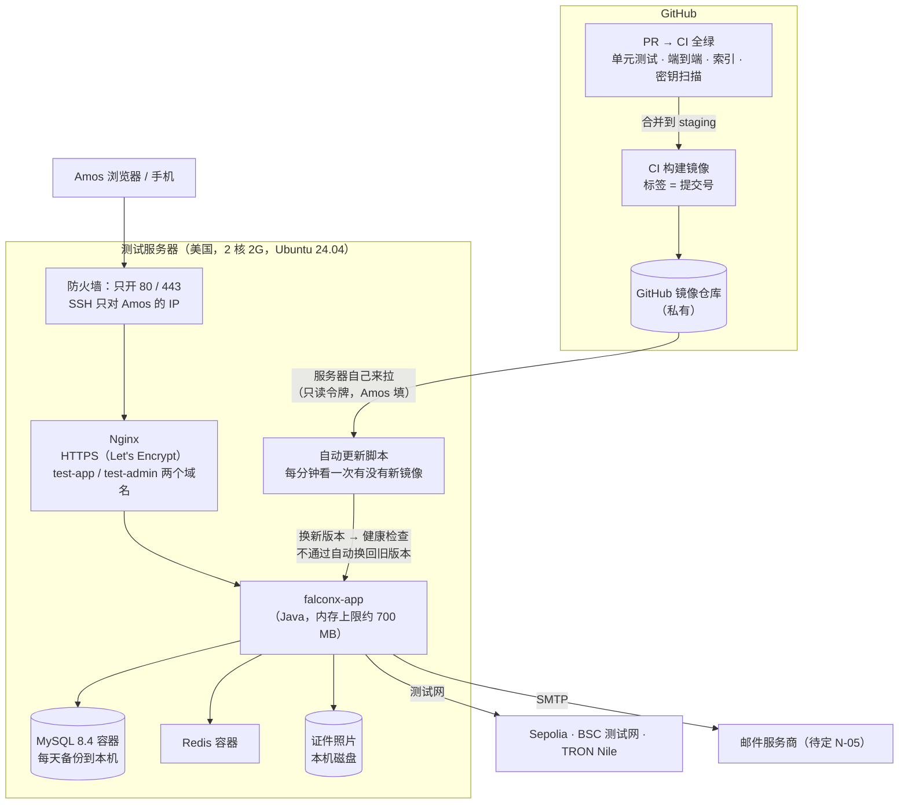
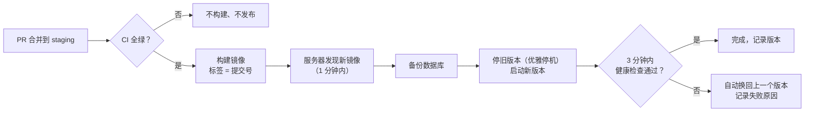
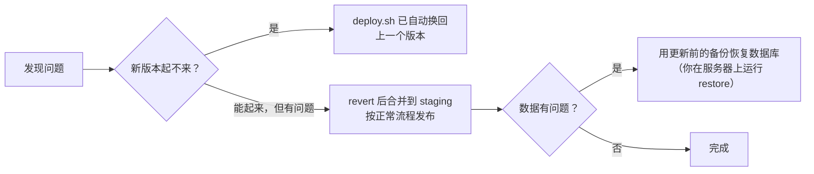

# FalconX Lite 部署方案（S20：测试环境）
- 版本：v1.1（2026-10-16）
- 变更历史：v1（2026-10-16）首次创建，交 Amos 审核；v1.1（2026-10-16）Amos 回复"按建议，是轻量应用服务器，机器已经清空"，补审核记录（第 13 节）
- 状态：**Amos 2026-10-16 审核通过**（D1–D7 按建议）。域名（D2）和邮件服务商（D3）的具体选择还要 Amos 告知。
- 范围：**只写测试环境**（`staging` 分支）。生产环境（`main`）另写，等生产服务器定了（H0）再补。
- 依据：`00-架构方案.md` v1.1 第 4 节；agents 仓库《协作总则》第五节"其他服务器"的沟通清单、《运维工程师》v0.10、PR #15《平台规范：香港服务器》草稿（H1–H7 已按默认确认）；Amos 2026-10-16："用这台做测试环境……这台机器在美国"。
- 编写：运维；研发确认第 7 节的代码改动

## 一图看懂



这张图想说明：
- 代码合并到 `staging`、CI 全绿以后，**测试服务器自己去拉新版本**，GitHub 不需要能登录服务器，所以 SSH 不用对外开放。
- 公网只能访问 80 和 443。数据库、Redis、应用的管理端口都不对外。
- 新版本启动后健康检查不通过，会自动换回上一个版本。
- 我（AI）不持有服务器的登录方式。服务器上的一次性准备工作，由你按第 6 节分步操作。

## 1. 和架构方案不同的地方（请确认）
| 项目 | 架构方案 v1.1 | 本方案 | 影响 |
|---|---|---|---|
| 地点 | 香港 | **美国**（Amos 2026-10-16 确认） | 从国内访问会慢一些（延迟估计 150–250 毫秒，到服务器上实测）。测试环境可以接受。生产仍按 H0 另定。 |
| 配置 | 约 4 核 8G | **2 核 2G，40G 云盘** | 内存很紧，要按第 4 节调小各部分内存、加 2G 交换分区。只适合测试环境，不能当生产。 |
| 部署方式 | GitHub Actions 推送到服务器（H1） | **服务器自己拉取**（第 3 节 D1） | SSH 不用对外开放，GitHub 里不存服务器的登录密钥。 |
| 对象存储 | 托管对象存储 | 测试环境放本机磁盘 | 代码已经支持（`FX_STORAGE_DIR`）。生产再换对象存储。 |

## 2. 实测的内存（2026-10-16，在开发机上，不是在这台服务器上）
| 组件 | 实测 | 本方案的上限 |
|---|---|---|
| 后端 Java | 空闲约 410 MB；跑完一遍完整业务流程后约 510 MB | JVM 堆 512 MB，进程总量约 700 MB |
| MySQL | 默认配置约 700 MB | 调小缓存（256 MB），关闭性能监控，约 350–400 MB |
| Redis | 约 10 MB | 上限 64 MB |
| Nginx | 未实测，估计 10–20 MB | — |
| Ubuntu 系统 | 估计约 300 MB | — |
| **合计** | — | **约 1.4–1.5 GB**，加 2 GB 交换分区兜底 |

部署后在服务器上实测一次，写进第 9 节。如果长期超过 1.8 GB，再请你升配置。

## 3. 已经定了的和需要你决定的
### 3.1 已经定了的（2026-10-14，你对 H1–H7 回复"按默认"，agents PR #15《平台规范：香港服务器》草稿）
| 编号 | 结论 | 本方案怎么做 |
|---|---|---|
| H1 | AI 不持有服务器登录方式；需要手动操作时分步指导你 | 照做：首次准备由你按第 6 节操作 |
| H2 | 密钥只由你填进服务器的环境变量文件和 GitHub Secrets；仓库只有变量名清单 | 照做：第 5 节 |
| H3 | 合并到 staging 并且 CI 通过 → 自动部署测试环境 | 照做，但部署方式改了，见 D1 |
| H4 | 镜像按提交号打标签，保留最近 10 个，5 分钟内回滚，上线前演练一次 | 照做：第 10 节 |
| H5 | 独立测试服务器、独立数据库、只连测试网、密钥和生产分开、页面显示"测试环境" | 照做 |
| H6 | 生产用托管 MySQL 和对象存储 | 生产时照做；测试环境用容器里的 MySQL 和本机磁盘（架构方案 4.1 的测试环境也是容器 MySQL） |
| H7 | 健康检查 + 外部定时探测 + 告警邮件；接收邮箱待定 | 照做，见 D6 |

### 3.2 需要你决定的
| 编号 | 问题 | 建议 | 其他选择 |
|---|---|---|---|
| **D1** | **部署方式**（和 H1 的写法不同，请确认） | **服务器自己拉取**。CI 把镜像放进 GitHub 的私有镜像仓库；服务器每分钟检查一次 `staging` 有没有新镜像，有就更新。GitHub 里不存服务器的 SSH 密钥，SSH 也不用对 GitHub 开放。服务器上只存一个**只能读镜像**的 GitHub 令牌。 | 按 H1 原来的写法：GitHub Actions 用 SSH 登录服务器部署，SSH 密钥存在 GitHub Secrets。缺点是 SSH 要对 GitHub 的大量 IP 开放；密钥泄露的话，别人能登录服务器。 |
| **D2** | **域名** | 需要两个子域名，比如 `test-app.<你的域名>`、`test-admin.<你的域名>`，解析到 47.251.87.158。**必须有域名**：浏览器推送、PWA、登录 Cookie 都要求 HTTPS，免费的 HTTPS 证书要域名才能申请。请告诉我域名，以及它在哪家服务商解析。 | 先用 IP 和 HTTP 临时看页面。推送、添加到主屏幕不能用，Cookie 要改成不安全模式。不建议。 |
| **D3** | **邮件**（N-05） | 测试环境必须能发邮件，否则注册收不到验证码，没法验收。请选一家支持 SMTP 的服务商。候选：阿里云邮件推送、Amazon SES、腾讯企业邮箱。 | 暂时不配，验证码只写进服务器日志，你登录服务器查。只适合第一天冒烟检查。 |
| **D4** | **区块链和行情** | 分两步：先上线，不接链（代码已支持：没配置的链不扫块），行情用模拟报价，走通页面和交易；再接测试网节点、测试热钱包和 LP。 | 资源全部到位再一次部署。会晚一些。 |
| **D5** | **备份** | MySQL 每天凌晨备份到本机，保留 7 天；每次更新前也备份一次。测试环境的数据可以丢，不做异地备份。 | 再上传到对象存储。测试环境不需要。 |
| **D6** | **告警（H7）** | 用 GitHub Actions 定时任务每 15 分钟从外部访问一次健康检查，失败时 GitHub 发邮件到你的 GitHub 邮箱。不用另买服务。H7 的告警邮箱定了以后可以改。 | 用云厂商自带的监控，要在它的控制台配置。 |
| **D7** | **SSH 的来源 IP** | 安全组只允许你常用的出口 IP 登录 SSH。如果你的 IP 经常变，改成"平时关闭，要用时在云控制台临时打开"。 | — |

### 3.3 请确认的账号信息（规则 C24，不靠猜）
- **云厂商和产品**：~~ECS 还是轻量应用服务器~~ → **阿里云轻量应用服务器**（Amos 2026-10-16 确认）。防火墙在轻量应用服务器控制台的"防火墙"页设置（不是 ECS 的安全组）。
- **这台机器上有没有别的程序** → **已经清空**（Amos 2026-10-16 确认），专门给本项目用。
- **GitHub 套餐**：Amos 没有说明有变化，按架构方案记录的免费版处理。私有镜像仓库免费版也能用，有存储额度，只保留最近 10 个镜像。

## 4. 服务器上的布局
```
/opt/falconx/
  docker-compose.yml   ← 从仓库 deploy/ 复制，不含任何密钥
  .env                 ← 只有这个文件放密钥，权限 600，只有 root 能读；由你填写（变量清单见第 5 节）
  nginx/               ← Nginx 配置（仓库 deploy/nginx/）
  data/mysql/          ← 数据库文件
  data/storage/        ← 证件照片
  backup/              ← 每天的数据库备份（保留 7 天）
  deploy.sh            ← 自动更新脚本（每分钟由 systemd 定时器运行）
  rollback.sh          ← 手动回滚到指定版本
  logs/                ← 部署记录
```

容器（`docker compose`）：

| 容器 | 镜像 | 内存上限 | 对外端口 |
|---|---|---|---|
| `nginx` | `nginx:1.27`（版本固定） | 64 MB | 80、443 |
| `app` | `ghcr.io/dollar3651314/falconx-lite:<提交号>` | 768 MB（JVM `-Xmx512m`） | 不对外。8080 只给 Nginx 用；管理端口 8081 只在容器内 127.0.0.1 |
| `mysql` | `mysql:8.4` | 450 MB（`innodb_buffer_pool_size=256M`、`performance_schema=OFF`） | 不对外 |
| `redis` | `redis:7`（`maxmemory 64mb`、设密码） | 96 MB | 不对外 |

- 前端（客户端、后台）的静态文件打进 Nginx 镜像，或者作为 `app` 镜像里的文件由 Nginx 读取，在实现时选简单的一种。同一个提交号对应同一套前后端，回滚时一起回滚。
- `test-app.<域名>` → 客户端页面，`/api/` 和 WebSocket 转发给 app；`test-admin.<域名>` → 后台页面，`/api/admin/` 转发给 app。
- **真实 IP**：Nginx 用 `X-Forwarded-For $remote_addr` **覆盖**客户端自带的请求头（不是追加），后端只信任内网代理传来的值（`server.forward-headers-strategy: native`，已在代码里）。后台 IP 白名单、登录失败按 IP 计数都依赖这一点，部署后专门验证（第 8 节）。
- **HTTPS**：Let's Encrypt 免费证书，用 certbot 自动续期。HTTP 自动跳转到 HTTPS。
- **测试环境标识**：页面顶部显示"测试环境"标识，邮件标题前加"[测试]"，避免和以后的生产混淆（第 7 节的代码改动）。
- **磁盘（40G）**：系统和 Docker 约 10G；镜像保留最近 10 个版本约 3–4G；日志按大小轮转（每个容器最多 50 MB × 3 个）；数据库和照片开始时很小。部署后磁盘使用超过 80% 时健康检查告警。

## 5. 要你填进服务器 `.env` 的变量
**只写变量名。值由你直接填进服务器，不发到对话里，也不进仓库**。仓库里会有 `deploy/.env.example`，只有变量名和说明。

| 变量 | 什么时候需要 | 说明 |
|---|---|---|
| `FX_DB_PASSWORD`、`MYSQL_ROOT_PASSWORD` | 第一步 | 数据库密码，自己随机生成（第 6 节给生成命令，结果不带换行，C26） |
| `FX_REDIS_PASSWORD` | 第一步 | 同上 |
| `FX_ADMIN_INIT_USERNAME`、`FX_ADMIN_INIT_PASSWORD` | 第一步 | 第一个超级管理员；首次登录必须改密码，建好以后可以从 `.env` 删掉 |
| `GHCR_READ_TOKEN` | 第一步 | GitHub 令牌，**只有读取镜像的权限**（`read:packages`），让服务器能拉私有镜像。第 6 节教你在 GitHub 上生成 |
| `FX_MAIL_HOST`、`FX_MAIL_PORT`、`FX_MAIL_USERNAME`、`FX_MAIL_PASSWORD`、`FX_MAIL_FROM` | D3 定了以后 | SMTP |
| `FX_PUSH_VAPID_PUBLIC_KEY`、`FX_PUSH_VAPID_PRIVATE_KEY`、`FX_PUSH_VAPID_SUBJECT` | 第一步（可以晚点） | 浏览器推送的密钥对，在你自己电脑上生成（通知方案 N2，第 6 节给命令）。**测试环境单独一对，不能和生产共用** |
| `FX_RISK_ALERT_EMAILS` | H7 定了以后 | 风控告警收件人 |
| `FX_WALLET_*_RPC_URL`、`FX_WALLET_*_USDT_CONTRACT`、`FX_WALLET_*_XPUB`、`FX_WALLET_*_HOT_KEY`、`FX_WALLET_*_HOT_ADDRESS`、`FX_WALLET_*_CHAIN_ID` | D4 第二步 | **全部用测试网**：节点服务的测试网地址、测试网 USDT 合约、测试用的 xpub 和测试热钱包。**测试热钱包里只放测试币，不能和生产用同一套** |

部署配置里固定写好、不需要你填的：`FX_MARKET_SOURCE=simulated`、`FX_COOKIE_SECURE=true`、`FX_STORAGE_DIR`、`FX_DB_URL`、`FX_REDIS_HOST`。
**不能设的**：`SPRING_PROFILES_ACTIVE=e2e`、`FX_E2E_ENABLED`。即使误设了，配了 SMTP 或节点时后端也会拒绝启动（S19 的 `E2eGuard`）。

## 6. 首次准备：你要做的步骤（审核通过后，我在对话里一步一步带你做）
第一次带你操作某个界面时，如果界面和我的描述不一致，请截图，以你看到的为准。

1. ~~确认机器可以清空~~：Amos 2026-10-16 确认已清空。
2. **轻量应用服务器控制台的"防火墙"**：入方向只放行 80、443，以及只对你的 IP 开放的 22。其他端口全部关闭。
3. **SSH 登录服务器**，复制粘贴我给的一段安装命令：
   - 装 Docker（官方源）和 certbot；
   - 建 2G 交换分区；
   - 打开系统自动安全更新；
   - 建 `/opt/falconx` 目录。
   这段命令会先放进仓库 `deploy/server-setup.sh`，你可以先看内容再运行。
4. **GitHub 上生成只读令牌**（`read:packages`，有效期 1 年），只复制到服务器的 `.env`，不发给我。
5. **生成密码和 VAPID 密钥**：在你自己电脑上运行我给的命令，结果直接填进服务器的 `.env`。
6. **域名解析**：在域名服务商那里加两条 A 记录，指向 47.251.87.158。
7. **申请证书并启动**：运行 `deploy/first-start.sh`。它会申请证书、拉取镜像、启动全部容器、等健康检查通过。
8. 我从外部检查（第 8 节）。全部通过后，你用超级管理员登录后台、修改初始密码，S20 第一步完成。

预计你要花 30–60 分钟，大部分是复制粘贴。

## 7. 部署前要做的代码改动（研发和运维，走 PR 合并到 staging）
| 改动 | 目录 | 说明 |
|---|---|---|
| 后端和前端的镜像构建 | `deploy/Dockerfile`、`deploy/nginx/` | 多阶段构建；镜像标签用提交号；Nginx 配置先在同版本的 `nginx:1.27` 上跑 `nginx -t` 做语法检查 |
| 构建和推送镜像 | `.github/workflows/deploy-staging.yml` | 只在 `staging` 的 CI 全绿后运行，推到 GitHub 私有镜像仓库，同时打 `staging` 标签 |
| 服务器端脚本 | `deploy/docker-compose.yml`、`deploy.sh`、`rollback.sh`、`backup.sh`、`server-setup.sh`、`first-start.sh`、systemd 定时器、`.env.example` | 第 4、6、10 节描述的行为 |
| 外部健康探测 | `.github/workflows/probe-staging.yml` | 每 15 分钟访问一次测试环境的健康检查（D6） |
| 健康检查带版本号 | 后端 `/api/health` | 返回当前运行的提交号（不含任何敏感信息），用来从外部确认新版本已经生效 |
| 测试环境标识 | 前端、通知模块 | 页面顶部显示"测试环境"标识，邮件标题前加"[测试]"；由部署配置的一个开关控制，生产不显示 |

这些脚本**没有在真实服务器上运行过**。我会先在本机的 Docker 里按同样的版本跑通（包括内存上限），首次部署时再逐步执行、逐步验证（运维规则"部署前验证"）。

## 8. 怎么确认部署成功（从外部验证，脚本 `deploy/verify.sh`）
| 检查 | 方法 | 通过标准 |
|---|---|---|
| 版本 | `https://test-app.<域名>/api/health` | 状态正常，提交号等于 staging 最新提交 |
| HTTPS | 访问 http 地址；查看证书 | 自动跳转到 https，证书有效 |
| 端口 | 从外网扫描 47.251.87.158 | 只有 80、443 开放（22 只对你的 IP 开放），3306、6379、8080、8081 都不通（AC-36） |
| 管理端点不对外 | 访问 `/actuator/**` | 404 |
| e2e 接口不存在 | 访问 `/api/e2e/mail/code` | 401 或 404 |
| 真实 IP | 后台 IP 白名单填一个别的 IP，再用你自己的 IP 访问；请求头里伪造 `X-Forwarded-For` | 被拒绝；伪造的请求头不起作用 |
| 页面 | 打开客户端和后台的首页 | 能打开，有"测试环境"标识，没有横向滚动 |
| 冒烟流程 | 注册 → 登录 → 看行情 → 下一笔单 → 平仓 | 成功（邮件配好之前，验证码从服务器日志里取） |
| 内存 | 服务器上运行 `free -m`、`docker stats` | 总占用低于 1.8 GB，填进第 9 节 |

## 9. 部署后的实测记录
（部署后填写：日期、提交号、各容器内存、磁盘、从国内打开页面的延迟。）

## 10. 发布和回滚



这张图想说明：只有 CI 全绿的代码才会到测试环境；新版本起不来会自动换回旧版本。

- **停机时间**：单实例，每次更新约 30 秒到 1 分钟不能交易（架构方案 K-04，已接受）。
- **自动回滚**：新版本 3 分钟内健康检查没通过，`deploy.sh` 自动换回上一个镜像。
- **手动回滚**：你在服务器上运行 `rollback.sh <提交号>`，或者在仓库里 revert 后合并到 staging（推荐，不用登录服务器）。约 2–5 分钟。
- **数据库变更不能自动回滚**：Flyway 迁移只往前走。所以：
  - 每次更新前自动备份数据库；
  - 迁移脚本要兼容上一个版本的代码（只加列和表，删除放到下一个版本）；
  - 真要回退数据，用更新前的备份恢复。测试环境会丢失备份之后的数据，可以接受。



## 11. 风险
| 编号 | 风险 | 应对 |
|---|---|---|
| R1 | 2G 内存不够，进程被系统杀掉 | 每个容器设内存上限，加 2G 交换分区，容器异常退出自动重启；健康检查告警；长期不够就请你升配置 |
| R2 | 首次部署脚本没在真实服务器上跑过 | 先在本机同版本 Docker 里跑通；首次部署逐步执行、逐步验证 |
| R3 | 防火墙配错把你锁在服务器外面 | 只在轻量应用服务器控制台的"防火墙"页配置，不改服务器系统里的防火墙；控制台的"远程连接"可以兜底 |
| R4 | 测试环境被当成生产用 | 页面和邮件都有"测试"标识；只用测试网和测试密钥 |
| R5 | GitHub 只读令牌泄露 | 只能读镜像，不能改代码；有效期 1 年，泄露时在 GitHub 上撤销重建 |
| R6 | 美国机房从国内访问慢 | 测试环境可以接受；部署后实测延迟，作为生产选机房（H0）的参考 |

## 12. 审核后的步骤
1. 你确认第 3.2 节 D1–D7 和 3.3 节的账号信息（可以只回"按建议"，再写上不同意的项）。
2. 我做第 7 节的代码改动，在本机 Docker 里跑通，合并到 staging。
3. 按第 6 节一步一步带你准备服务器。
4. 第 8 节外部验证全部通过，填写第 9 节。
5. 邮件（D3）、测试网和 LP（D4）资源到位后再分别接上。
6. 进入 S21：你在测试环境验收。
7. 服务器从香港改到美国，部署方式也有变化（D1），agents 仓库 PR #15 的《平台规范：香港服务器》草稿要跟着改（例如改名为"云服务器"，H0 补上这台测试服务器）。本方案审核通过后，我更新那个 PR 交你确认。

## 13. 审核记录
| 日期 | Amos 的回复 | 结论 |
|---|---|---|
| 2026-10-16 | "用这台做测试环境，开始写部署方案　这台机器在美国" | 测试环境用这台美国服务器 |
| 2026-10-16 | "按建议，是轻量应用服务器，机器已经清空" | D1–D7 按建议；阿里云轻量应用服务器；机器已清空。待告知：域名（D2）、邮件服务商（D3） |
