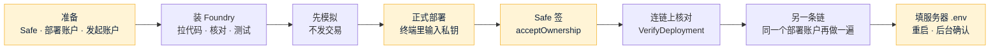

# 资金归集合约部署：给 Amos 的操作说明（以太坊、BSC）
- 版本：v1.0（2026-10-20）
- 编写：运维、研发
- 对应：`技术方案/v2-半自动归集.md` v1.2 第 4.13.5 节（部署合约由谁签名）、第 4.14 节（字节码核对）；《Amos 待办》T24、T25、T27；合约说明 `contracts/README.md`。
- **私钥只在你自己的电脑上输入**：脚本用 `--interactives 1`（运行时在终端里输入，不显示、不保存）或硬件钱包（`--ledger` / `--trezor`）。**不要**把私钥写进任何文件、命令行参数（`--private-key`）或发给任何人（包括我）。
- 先在**测试网**（Sepolia、BSC 测试网）完整做一遍，跑通测试环境的归集，再做主网。

## 一图看懂



这张图想说明：黄色的四步需要你本人操作（钱包、私钥、Safe 签名、服务器）；其余是在你电脑上运行脚本、看结果。

## 0. 先准备好（《Amos 待办》T24、T25）

| 要什么 | 说明 | 这次要用到的地方 |
|---|---|---|
| Safe 冷钱包地址 | 2-of-3 多签；**以太坊和 BSC 必须是同一个地址**（Safe 网页创建时选多条网络）。测试网如果 BSC 测试网建不了 Safe，测试网可以先用一个普通地址演练（脚本只在主网强制要求是合约） | `SWEEP_PARENT` |
| 部署账户 | **新建**的普通账户，只用来部署；两条链上都**没有发过任何交易**（nonce = 0，两条链部署出的合约地址才相同）；测试网领一点测试币，主网约 0.02 ETH + 0.01 BNB【估算：实测整套部署约 388 万 gas】 | 运行脚本时输入私钥 |
| 发起账户地址 | **新建**的普通账户（不是热钱包），服务器用它发归集交易，只付手续费；测试网领测试币，主网约 0.05 ETH + 0.02 BNB【估算】 | `SWEEP_OPERATOR`；私钥以后填进服务器 `.env` |
| 节点地址 | 测试网用《Amos 待办》R5 的公共节点（`https://ethereum-sepolia-rpc.publicnode.com`、`https://bsc-testnet-rpc.publicnode.com`）；主网可以用 `https://ethereum-rpc.publicnode.com`、`https://bsc-rpc.publicnode.com`【未核实：主网公共节点的稳定性，部署那天再测】 | `--rpc-url` |
| 区块浏览器 API Key（可选） | 在 etherscan.io 注册拿一个 API Key（V2 的 Key 以太坊和 BSC 都能用）【官网：etherscan.io/apis】，用来"验证源码"（让别人能在浏览器上看到源码）。这不是钱包密钥，但也不要发给我 | 第 5 步 |

## 1. 安装 Foundry（只做一次）

macOS 或 Linux 的终端（Windows 用 WSL）：

```bash
curl -L https://foundry.paradigm.xyz | bash      # 安装 foundryup
# 关掉终端再打开一个
foundryup --install v1.5.1                       # 和 CI 用同一个版本
forge --version                                  # 应该显示 1.5.1
```

## 2. 拉代码、核对、跑测试

```bash
git clone https://github.com/dollar3651314/falconx-lite.git
cd falconx-lite
git checkout <我告诉你的提交号>                   # 和测试环境上线的是同一个版本
cd contracts
git submodule update --init                      # 拉 forge-std（只用于测试）
bash script/check-vendor.sh --upstream           # 和 BitGo、OpenZeppelin 官方仓库逐字节比较
forge test                                       # 全部测试，约 1 分钟
```

看到这三行就对了：
- `lib/ 原样源码：sha256 全部一致`
- `和上游 BitGo 9566bcd4…、OpenZeppelin v5.0.0（932fddf6…）逐字节一致`
- `30 tests passed, 0 failed`

## 3. 先模拟（不发交易、不需要私钥）

把下面的地址换成你的（都是公开地址）：

```bash
export SWEEP_PARENT=0x你的Safe地址
export SWEEP_OPERATOR=0x你的发起账户地址
export RPC=https://ethereum-sepolia-rpc.publicnode.com    # 先做 Sepolia
forge script script/Deploy.s.sol --rpc-url $RPC --sender 0x你的部署账户地址
```

最后应该看到 `== 全部通过` 和 5 行 `FX_SWEEP_EVM_…=`。如果报错：
- `部署账户的 nonce 不是 SWEEP_EXPECT_NONCE`：这个部署账户在这条链上发过交易，换一个新账户（两条链都要是新的）。
- `部署账户没有手续费币`：先给部署账户转一点测试币 / 主网币。

## 4. 正式部署（终端里输入私钥）

在上一步的命令后面加 `--broadcast --interactives 1`：

```bash
forge script script/Deploy.s.sol --rpc-url $RPC --sender 0x你的部署账户地址 --broadcast --interactives 1
```

终端提示 `Enter private key:` 时粘贴**部署账户**的私钥（屏幕上不显示），回车。用硬件钱包时把 `--interactives 1` 换成 `--ledger`（或 `--trezor`），在设备上确认 4 笔交易。

完成后会打印：
- 4 笔交易都成功（`ONCHAIN EXECUTION COMPLETE & SUCCESSFUL`）；
- `== 全部通过`（字节码和参数核对）；
- 一段 `FX_SWEEP_EVM_FACTORY= …`、`FX_SWEEP_EVM_IMPLEMENTATION= …`、`FX_SWEEP_EVM_BATCHER= …`、`FX_SWEEP_EVM_PARENT= …`、`FX_SWEEP_EVM_OPERATOR_ADDRESS= …`：**把这 5 行发给我**（都是公开地址）。

`contracts/broadcast/` 下会留一份交易记录（公开信息，可以发给我）；`contracts/cache/` 下的文件不要发、用完可以删。

## 5. 在区块浏览器验证源码（可选，建议做）

```bash
export ETHERSCAN_API_KEY=你的浏览器APIKey
forge verify-contract --chain sepolia --watch 0x实现合约地址 lib/eth-multisig-v4/contracts/ForwarderV4.sol:ForwarderV4
forge verify-contract --chain sepolia --watch 0x工厂地址 lib/eth-multisig-v4/contracts/ForwarderFactoryV4.sol:ForwarderFactoryV4 \
  --constructor-args $(cast abi-encode "constructor(address)" 0x实现合约地址)
forge verify-contract --chain sepolia --watch 0x批量合约地址 src/SweepBatcher.sol:SweepBatcher \
  --constructor-args $(cast abi-encode "constructor(address,address,address)" 0x工厂地址 $SWEEP_PARENT $SWEEP_OPERATOR)
```

BSC 测试网把 `--chain sepolia` 换成 `--chain bsc-testnet`；主网是 `mainnet` 和 `bsc`。三条都显示 `Pass - Verified` 就好。

## 6. Safe 接受批量合约的所有权（2-of-3 签名）

部署脚本已经把批量合约的所有权"转给"Safe，Safe 要签一笔"接受"才生效（Ownable2Step，防止转错地址）：

1. 打开 https://app.safe.global ，选你的 Safe 和对应网络。
2. New transaction → Transaction Builder。
3. 地址填**批量合约地址**；ABI 粘贴：`[{"inputs":[],"name":"acceptOwnership","outputs":[],"stateMutability":"nonpayable","type":"function"}]`。
4. 方法选 `acceptOwnership`，Add transaction → Create batch → 第一个签名人签名 → 第二个签名人确认并执行。

测试网如果用的是普通地址当 parent（没有 Safe），用那个地址的钱包直接调用 `acceptOwnership`（或者跳过，测试网演练不影响归集）。

## 7. 连链上核对（只读，不需要私钥）

```bash
SWEEP_FACTORY=0x工厂地址 SWEEP_IMPLEMENTATION=0x实现合约地址 SWEEP_BATCHER=0x批量合约地址 \
SWEEP_PARENT=$SWEEP_PARENT SWEEP_OPERATOR=$SWEEP_OPERATOR \
forge script script/VerifyDeployment.s.sol --rpc-url $RPC
```

要看到 `== 全部通过`，并且**没有**"Safe 还没有接受所有权"的提示（第 6 步做完以后）。把整段输出发给我，我记进交付记录（方案第 4.14 节）。

能在区块浏览器上找到 BitGo 自己部署的 ForwarderV4 实现合约时（例如某个 BitGo 收款地址的代理指向的合约），加 `BITGO_REFERENCE_FORWARDER=0x那个地址` 再跑一次，会比较两边去掉元数据后的字节码。找不到不影响（BitGo 仓库里没有公布部署地址）。

## 8. 另一条链再做一遍

用**同一个部署账户**、同样的 `SWEEP_PARENT` 和 `SWEEP_OPERATOR`，把 `RPC` 换成 BSC 测试网（主网时换成 BSC 主网），重复第 3–7 步。**打印出的三个合约地址必须和第一条链完全一样**；不一样就停下来告诉我（说明部署账户在其中一条链上发过交易）。

## 9. 填服务器 `.env`、重启、确认

```bash
sudo nano /opt/falconx/.env
```

加上（地址用第 4 步打印的；**私钥只由你填**）：

```
FX_SWEEP_EVM_FACTORY=0x…
FX_SWEEP_EVM_IMPLEMENTATION=0x…
FX_SWEEP_EVM_PARENT=0x…（Safe）
FX_SWEEP_EVM_BATCHER=0x…
FX_SWEEP_EVM_OPERATOR_ADDRESS=0x…（发起账户地址）
FX_SWEEP_EVM_OPERATOR_KEY=发起账户的私钥
```

保存后 `sudo /opt/falconx/deploy.sh`（或等下一次自动更新）。然后：
1. `https://test-admin.quickcome.online/api/health` 的 `status` 仍是 UP；`alerts` 里 `sweep.config` 是 UP（DOWN 时 `detail` 写着原因，例如私钥和地址对不上）。
2. 后台"资金 → 入金对账 → 资金归集 → 归集设置"：合约地址、冷钱包、发起账户都显示出来，没有黄色的配置问题提示。
3. 客户端"充值"页的 ERC20 / BEP20 地址变成新的合约地址（老地址停用，继续扫块 30 天、照常入账）。

**注意**：四个合约地址填进去以后，以太坊体系的充值地址就是由它们算出来的，**以后不能随便改**（改任何一个，新客户的地址都会变；老客户的地址仍然只能用老的批量合约归集，方案第 4.13.2 节）。

## 10. 测试网验收（Amos 在测试环境）

1. 用测试账号在客户端拿到新的 ERC20 充值地址，用 Aave 水龙头（R5）往这个地址转 150 测试 USDT（ERC20 门槛 100）。
2. 等后台"入金"里这笔变成"已到账"，再等 2 倍确认数（Sepolia 约 5 分钟）。
3. 后台"资金归集 → 生成 / 执行归集"选 ERC20：这个地址"这次归集"、"首次部署"；点"执行归集"，填原因。
4. 批次详情里状态变成"已完成"，Safe 里 USDT 余额增加 150；地址显示已部署。
5. 同一个地址再充一次、再归集：这次"已部署"，手续费更低。
6. BSC 测试网同样做一遍（BSC 门槛 10 USDT）。

## 11. 出问题时

| 情况 | 处理 |
|---|---|
| 发起账户私钥可能泄露 | 方案第 4.13.4 节：Safe 调用批量合约 `setOperator(旧地址, false)`、`setOperator(新地址, true)`，服务器换 `FX_SWEEP_EVM_OPERATOR_*`；客户地址不用换 |
| 批量合约出问题 | Safe 可以自己对每个地址调用工厂 `createForwarder(parent, 批量合约地址, 盐)`（没部署的）和转发合约的 `flushTokens(USDT)`（`contracts/README.md` 第 4 节实测过） |
| 部署到一半失败 | 停下来把终端输出发给我；部署账户 nonce 已经变了的话，两条链要换一个新的部署账户重新来 |
