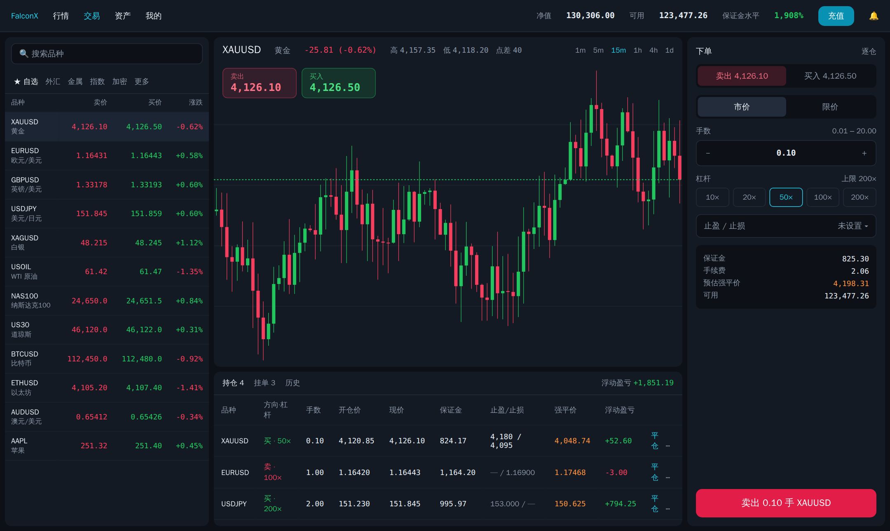
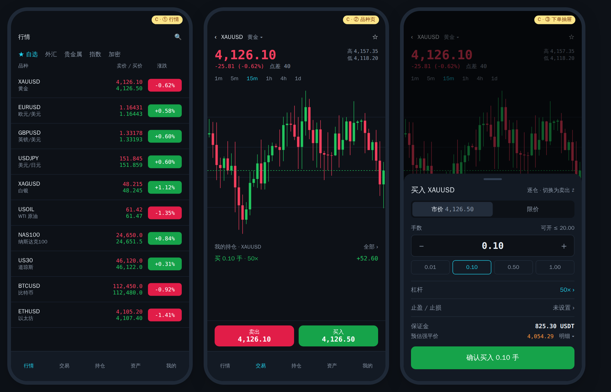
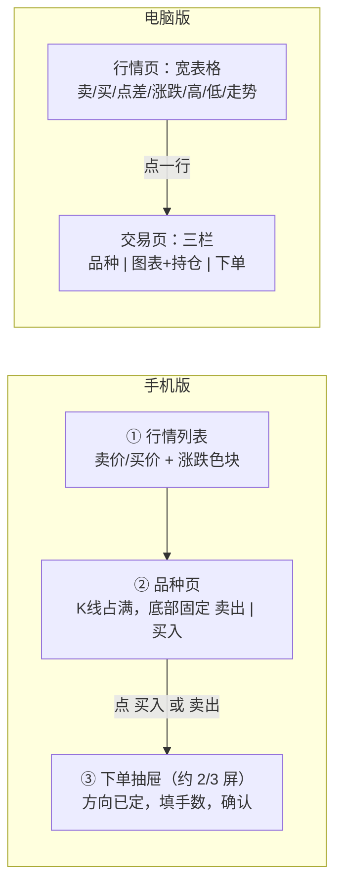
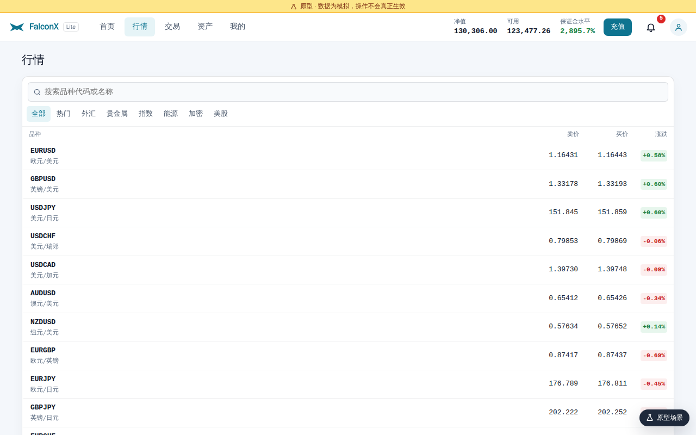
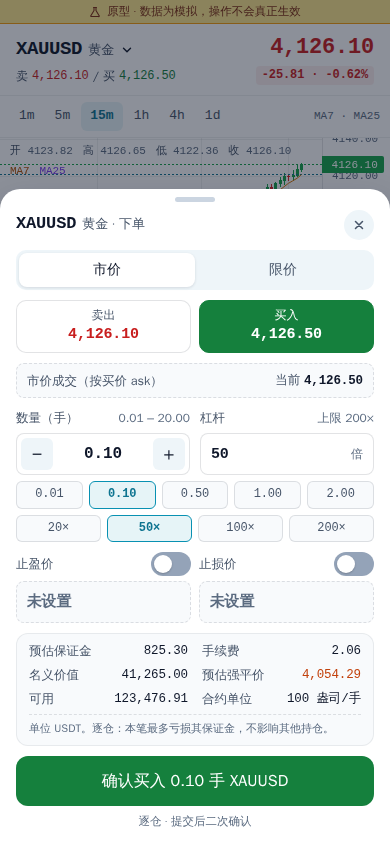
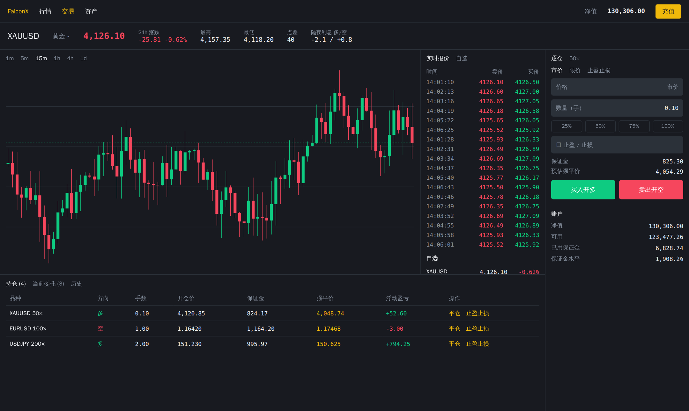
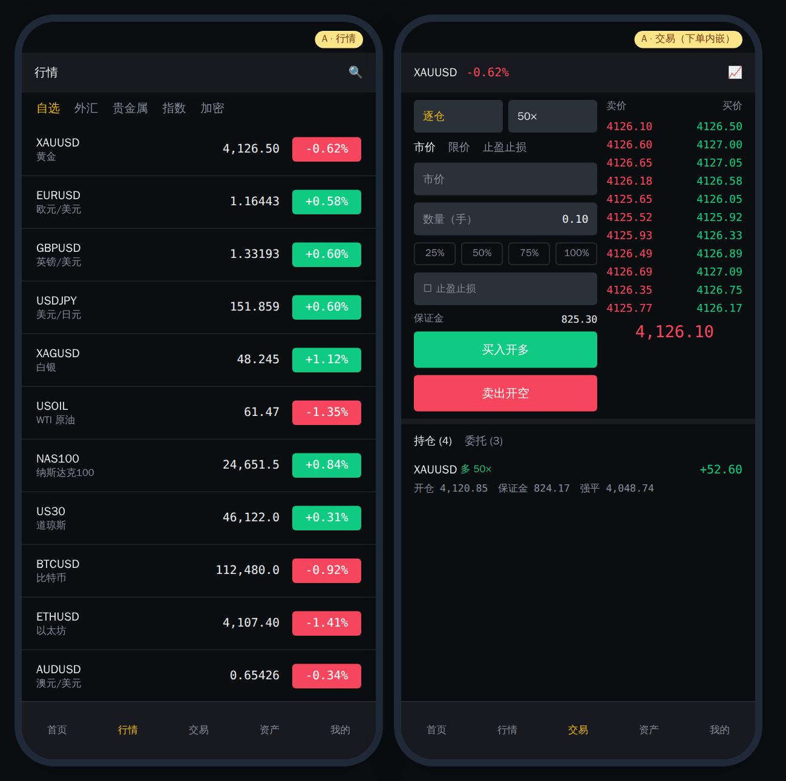
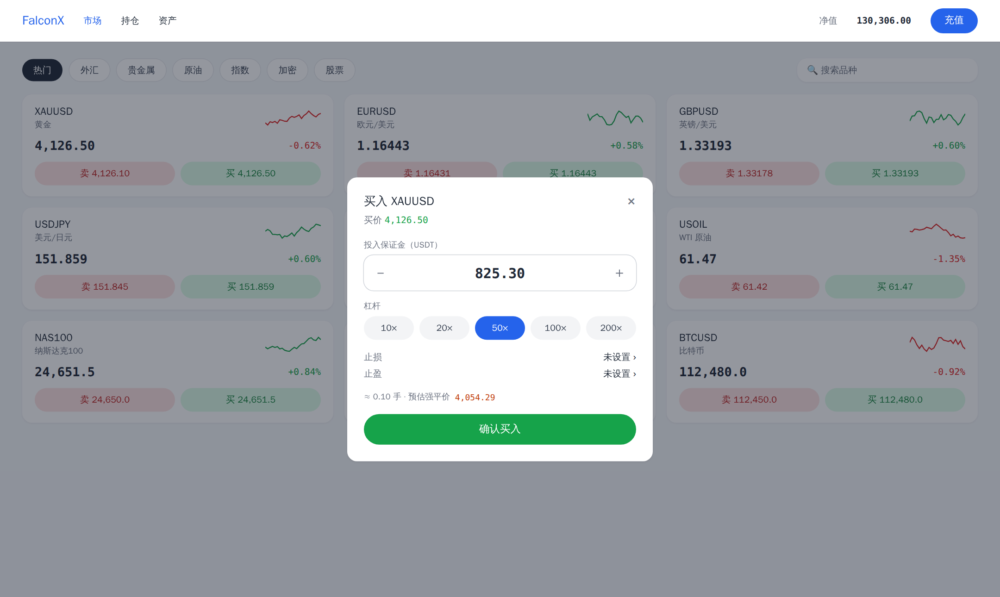
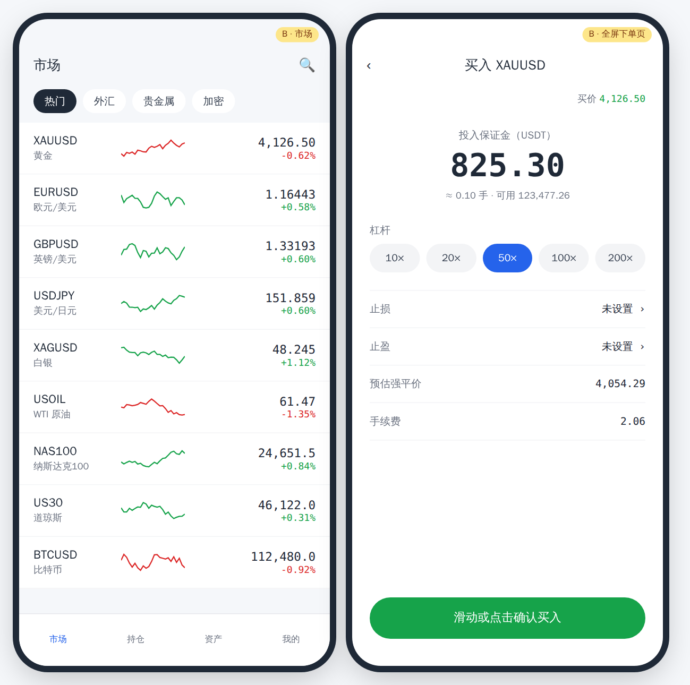
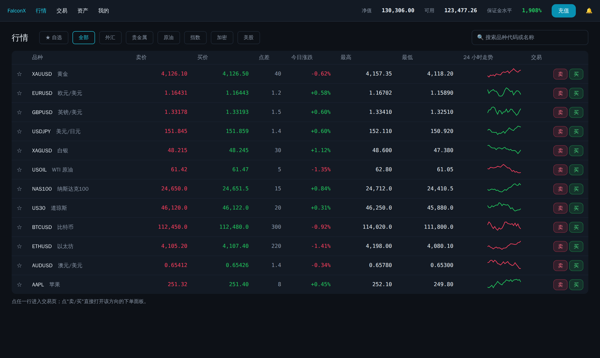

# 客户端 UI 风格调研：移动版和电脑版分开设计
- 版本：v1（2026-10-15）
- 变更历史：v1（2026-10-15）首次创建
- 起因：Amos 看完原型后的反馈（2026-10-15）——后台原型可以；客户端现在是"一套界面响应式拉伸"，电脑上行情页一堆品种排得很怪，手机上下单很怪。要求**移动版和电脑版分开设计**，先调研主流同类产品，再讨论风格。
- 编写：PM（调研和建议）；研发（对比图）
- 状态：**等待 Amos 讨论和选择**（第 5 节的 7 个选择）。选定前不改原型代码。
- 范围：只涉及客户端（`web/client/`）。后台不变。业务逻辑、接口、计算全部不变，只改界面结构和视觉。

## 一图看懂：推荐方向 C（CFD 终端的骨架 + 现代深色视觉）

**电脑版交易页**：左栏常驻品种列表，中间是 K 线和持仓，右栏是下单面板。卖价和买价按钮直接显示在图表上。

**手机版**：分三步走，每一屏只做一件事。①行情列表 → ②品种页（底部固定"卖出 / 买入"两个按钮） → ③点了买入才弹出下单抽屉。抽屉里方向已经确定，只需填手数。

这张图想说明：两端共用同一套数据和计算，但**页面结构各自设计**。手机按"一屏一件事"拆开，电脑按"一屏看全"合并。

## 1. 现在的问题（PM 复核）
| 现象 | 截图 | 原因 |
|---|---|---|
| 电脑上行情页：品种名在最左、价格在最右，中间一大片空白；只有卖价、买价、涨跌三列 |  | 这是手机的列表直接拉宽到 1280 像素，没有为大屏增加信息 |
| 电脑交易页左栏：分类标签被截断（"指数"只露出一半） | 见原型 `/trade/XAUUSD` | 左栏宽度是按手机内容定的 |
| 手机下单：抽屉几乎占满全屏，信息很挤 |  | 把电脑的下单面板原样塞进了抽屉。已经点了"买入"，抽屉里还要再选一次买卖；手数和杠杆快捷键占两行；还有 6 个预估数字 |

结论：问题出在**布局结构**，不在配色。所以本次要分开设计两端的页面结构；视觉风格同时确定。

## 2. 调研了哪些产品
调研范围：电脑网页版和手机版的布局、下单方式、主题、涨跌色。资料来源是官方帮助中心和评测文章，链接见第 7 节。

- 标【证】：查到资料证实。
- 标【推】：按行业常识推断，**未验证**。
- 没有截取别人产品的图片，对比图都是按调研结果自己画的示意图。

| 产品 | 类型 | 电脑版布局 | 手机版怎么下单 | 默认主题 | 涨跌色 |
|---|---|---|---|---|---|
| MetaTrader 5 | CFD 终端 | 左报价表、中图表、底部持仓【证】；弹窗下单【推】 | 独立全屏下单页【推】 | 浅色，可选夜间【证】 | 可自定义 |
| cTrader | CFD 终端 | 顶部下拉选品种、右侧下单面板、底部持仓【证】 | 未查到 | 未查到 | 未查到 |
| **Exness Terminal / App** | **CFD，与我们最接近** | 左自选栏、中图表（右上角有卖/买）、右下单、底部持仓【证】 | 品种页点卖/买 → 订单表单【证】；底部抽屉【推】 | 浅/深/跟随系统【证】 | 未查到 |
| eToro | 社交券商 | 左导航、弹窗下单【推】 | 交易窗口，可按金额下单，杠杆选档位【证】 | 浅色【推】 | 绿涨红跌【推】 |
| Plus500 | CFD 券商 | 左菜单、列表、右侧订单面板【证】 | 持仓窗口，止盈止损是勾选框【证】 | 未查到 | 未查到 |
| TradingView | 图表 + 券商接入 | 图表 + 底部交易面板【证】 | 底部悬浮卖/买，或下单面板【证】 | 可切换 | 可自定义 |
| Binance / OKX / Bybit / Bitget | 加密合约 | K 线 + 盘口 + 右下单 + 底部持仓【证】 | 交易页内嵌下单表单【证】 | 深色【推】 | 默认绿涨红跌，可切换【证：Binance、OKX】 |
| 富途 moomoo | 股票券商 | — | — | — | 帮助中心有"如何设置绿涨红跌"，推断中文版默认红涨【推】 |

几个对我们有用的发现：
1. **CFD 平台都不放盘口**（MT5、Exness、cTrader）。CFD 是报价模式，没有挂单簿。加密交易所的"盘口栏"在我们这里会是空的。
2. **大屏上品种列表常驻侧栏**（MT5、Exness），切换品种不用离开交易页。
3. **手机上"先选方向，再填数量"**（Exness、TradingView、Plus500）。下单表单里不再重复让人选买卖。
4. **涨跌色都可以切换**（Binance、OKX 已证实），而且买卖按钮的颜色跟着一起变。
5. **简洁/专业双模式**都是功能多了以后才加的（Binance、OKX、Bybit）。

## 3. 三种风格方向

### A. 加密交易所风格（深色、高密度）
代表产品：Binance、OKX、Bitget。

- 适合：币圈老用户、短线交易者。大陆用户最熟悉这种界面。
- 电脑版：K 线 + 报价栏 + 右侧下单 + 底部持仓。
- 手机版：下单表单直接内嵌在交易页左边，右边是报价。
- 缺点：
  - 盘口栏只能放"报价流水"，信息价值低。
  - 手机上左单右报价两栏很挤，新手容易被吓到。

### B. 券商 App 风格（浅色、简洁）
代表产品：eToro、Plus500、moomoo。

- 适合：新手、低频交易者。
- 电脑版：行情卡片网格，点卡片弹窗下单。
- 手机版：全屏下单页，按"投入保证金金额"下单。
- 缺点：
  - 电脑大屏浪费；看图、下单、看持仓要来回切换。
  - 喜欢看图做短线的用户会嫌慢。

### C. CFD 终端骨架 + 现代深色视觉（推荐）
代表产品：Exness Terminal、cTrader。

- 电脑版交易页：三栏。
  - 左：品种列表常驻，可搜索、分类、自选。
  - 中：K 线（卖价/买价按钮在图表左上角），下方是持仓/挂单/历史。
  - 右：下单面板。
  - 一屏看全，不用切页。
- 电脑版行情页：改成宽表格。
  - 列：卖价、买价、点差、今日涨跌、最高、最低、24 小时走势、卖/买按钮。
  - 大屏多出来的宽度用来放信息，不再留白。
- 手机版：一屏一件事。
  - 行情列表每行显示卖价/买价两个价格 + 涨跌色块。
  - 品种页 K 线占主体，底部固定"卖出 / 买入"按钮，按钮上直接显示价格。
  - 点了才弹出下单抽屉（约 2/3 屏）。抽屉里方向已定，只显示：
    - 市价/限价、手数（加减键 + 4 个快捷值）；
    - 杠杆、止盈止损：各一行，点开再设；
    - 保证金、预估强平价，其余明细折叠。
- 为什么推荐：
  - 天然匹配 CFD 的"报价 + 点差"模式，而且与调研里最接近我们业务的产品（Exness）一致。
  - 视觉用深色、高对比，贴近大陆用户熟悉的交易所观感。
  - 手机下单从现在的"一屏 20 多个控件"减到约 10 个，常用操作 3 次点击完成：买入 → 选手数 → 确认。

### 三种方向对比
| | A 交易所 | B 券商 App | **C 推荐** |
|---|---|---|---|
| 电脑版信息密度 | 高 | 低 | 高 |
| 手机下单难度 | 中（两栏挤） | 低 | 低 |
| 适合 CFD 报价模式 | 一般（盘口空） | 好 | 好 |
| 大陆用户熟悉度 | 高 | 中 | 中高（深色外观像交易所） |
| 改造工作量（相对现在） | 大 | 中 | 中 |

## 4. 颜色和主题（单独讨论）
对比图统一用"绿涨红跌"，只为方便比较布局，**不代表已经定了**。

| 选项 | 依据 | 风险 |
|---|---|---|
| 默认绿涨红跌，可切换 | Binance、OKX 默认如此【证】；MT5 等 CFD 平台惯例；"买入 = 绿色"符合 CFD 习惯 | 习惯 A 股的用户会觉得反 |
| 默认红涨绿跌，可切换 | 大陆股票、期货习惯【推】 | 买入按钮变红，和 CFD、加密平台的习惯相反 |

不管默认选哪种：
- "我的 → 设置"里都可以切换；
- 切换时 K 线、涨跌数字、买卖按钮一起变（Binance 的做法【证】）。

主题：推荐默认深色，保留浅色可切换。现在的原型默认浅色。

## 5. 请你选择（讨论用）
| 编号 | 问题 | 选项 | 建议 |
|---|---|---|---|
| U1 | 整体风格方向 | A 交易所 / B 券商 App / **C CFD 终端 + 深色** | C |
| U2 | 默认主题 | **深色** / 浅色（两者都可切换） | 深色 |
| U3 | 默认涨跌色 | **绿涨红跌** / 红涨绿跌（两者都可切换） | 绿涨红跌。理由：买入为绿符合 CFD 和加密平台习惯。但客户里股民多的话选红涨 |
| U4 | 手机底部导航 | **行情 / 交易 / 持仓 / 资产 / 我的**（去掉首页）；或保持现在的首页 / 行情 / 交易 / 资产 / 我的 | 去掉首页。首页的账户概览移到"资产"，持仓单独成一项，查持仓少点一次 |
| U5 | 电脑版行情页 | **保留，改成宽表格**（C 行情页图）/ 去掉，只用交易页左栏 | 保留宽表格 |
| U6 | 下单数量的单位 | **手数**（现在的做法，显示对应保证金）/ 投入保证金金额（B 的做法） | 手数。和合约大小、强平价计算一致；按金额下单以后可加 |
| U7 | 简洁/专业双模式 | V1 不做 / 做 | V1 不做 |

## 6. 选定后怎么做（研发预估，未开始）
- **分开的是页面结构，不分开的是逻辑**。
  - 共用：`src/api/`、`src/lib/`（下单计算、校验）、`src/hooks/`、翻译文件、设计 token。这样计算口径只有一份。
  - 分开写：行情页、交易页、下单面板和抽屉、持仓列表、底部导航和顶栏。手机版和电脑版各一套组件，按屏幕宽度（1024 像素为界）选择加载哪一套。
  - 资产、我的、登录注册等表单页本来就简单，只调整宽度和排版，不拆两套。
- 新增"设置"项：主题、涨跌色。
- 测试：
  - 现有 42 个单元测试保留，新增两套布局的页面渲染测试；
  - 截图检查在 390 和 1280（再加 1440）宽度下各跑一遍；
  - PM 按真实操作走查两端。
- 交付：仍在原型 PR #2 上更新，Vercel 预览地址不变。改完再请你看一次原型（总则 4.5）。
- 对比图的来源文件：`assets/v1/ui-research/src/gen.cjs`。运行 `node gen.cjs` 生成 HTML，再用无头浏览器截图（工作量小，不放进 CI）。

## 7. 参考链接（调研时实际打开或搜到的）
- MetaTrader 5：https://www.metatrader5.com/en/terminal/help/startworking/interface ，https://www.metatrader5.com/en/trading-platform/web-trading ，https://www.metatrader5.com/en/mobile-trading/iphone/help/quotes
- cTrader：https://help.ctrader.com/ctrader-web/interface/active-symbol-panel
- Exness：https://get.exness.help/hc/en-us/articles/360013671560-Exness-Terminal-Trading-guide ，https://get.exness.help/hc/en-us/articles/360020596239-Exness-Trade-Trading-guide
- eToro：https://help.etoro.com/s/article/How-do-I-set-leverage-on-a-trade?language=en_GB
- Plus500：https://www.plus500.com/en-at/tradingacademy/tradersguide/how-to-trade-with-plus500~3
- IG：https://www.ig.com/uk/new-platform-faqs
- TradingView：https://www.tradingview.com/support/solutions/43000707412-how-to-place-orders-in-the-mobile-app/ ，https://www.tradingview.com/support/solutions/43000776264-one-tap-trading-mode-in-ios-and-android-mobile-apps/
- Binance：https://www.binance.com/en/support/faq/how-to-customize-the-binance-futures-trading-interface-a784518335b0492a9ebfa4a72e1ca092 ，https://www.binance.com/en/blog/ecosystem/color-your-trading-binance-adds-support-for-color-vision-deficiencies-421499824684903930
- OKX：https://www.okx.com/en-us/help/trading-settings-faq ，https://www.okx.com/en-us/help/how-do-i-adjust-the-color-theme-of-the-trading-interface
- Bitget：https://www.bitget.com/zh-CN/support/articles/12560603808135
- 富途 moomoo：https://www.moomoo.com/my/hans/support/topic3_601
