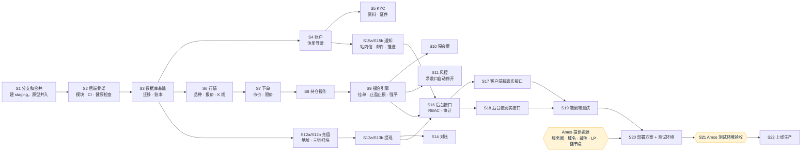

# FalconX Lite 第一版任务清单（分步执行）
- 版本：v1.4（2026-10-15）
- 变更历史：v1（2026-10-15）首次创建；v1.1（2026-10-15）Amos 明确合并到 `staging` 不需要他同意（C34，agents v0.10 C63），S1 和第 4 节相应修改；v1.2（2026-10-15）Amos 审核充值方案时同意 S12 拆成 S12a、S12b（《v1-充值方案》D6）；v1.3（2026-10-15）Amos 审核提现方案时同意 S13 拆成 S13a、S13b（《v1-提现方案》W5）；v1.4（2026-10-15）Amos 审核通知方案时同意 S15 拆成 S15a、S15b（《v1-通知方案》N7）
- 依据：agents main `4025297`（v0.9）总则第 5 步；`需求文档/v1-需求说明书.md` v1.3；`00-架构方案.md` v1.1；`技术方案/v1-原型说明.md` v1.2（Amos 2026-10-15 回复"确认继续"）
- 编写：PM（拆解、依赖、分配）；研发、测试、运维各自确认自己的任务
- 状态：Amos 2026-10-15 确认。进度看 Issue #3。

## 执行方式（Amos 2026-10-15 要求）
大模型额度有限，不能连续自动运行。所以：
1. 全部工作拆成下面的**步骤**（S1、S2……），一次只做一个步骤。
2. **每做完一个步骤就停下**，汇报结果，等 Amos 回复"继续"才开始下一步。合并到 `staging` 不需要 Amos 同意（C34），CI 通过后即可合并；停下等的是"开始下一步"。
3. 每一步都在 GitHub 上留痕：
   - **进度看板**：GitHub Issue「v1 开发进度」（链接见下方）。每个步骤开始时标为"进行中"，结束时填上 PR 链接、CI 结果、实际做了什么，然后标为"待确认"。**当前做到哪一步，以这个 Issue 为准。**
   - **步骤内容**：本文件第 3 节，只写计划，不写进度（避免两处不一致）。
   - **代码和文档**：每个步骤一个开发分支、一个 PR。
4. **中途停止**：Amos 随时可以说"暂停"。如果额度在步骤中途用完：
   - 已完成的部分会在 Issue 里写清楚，推送到该步骤的分支上；
   - 恢复时，新会话先读 Issue 和本文件，从"进行中"那一步的未完成部分接着做。
5. 每个步骤标了大致**工作量**（小 / 中 / 大），方便 Amos 按剩余额度决定做不做。工作量是估计，不是实测。

进度看板：https://github.com/dollar3651314/falconx-lite/issues/3

## 一图看懂：步骤和依赖

这张图想说明：S1–S19 只需要代码和 CI，可以先做；S20 起需要 Amos 提供服务器等资源。黄色是需要 Amos 本人参与的节点。每个方框做完都会停下等 Amos 确认。

## 1. 优先级
- **P0**（核心交易闭环，缺一不可）：S1–S4、S6–S9、S12、S13、S16、S17、S19–S22
- **P1**（第一版必须有，但可以排在后面）：S5、S10、S11、S14、S15、S18

## 2. 需要 Amos 提供的资源（不阻塞 S1–S19）
| 资源 | 哪一步需要 | 现状 |
|---|---|---|
| 香港服务器：云厂商和配置（H0）、告警邮箱（H7） | S20 | 待提供（agents PR #15） |
| 测试和生产域名（N-13） | S20 | 待提供 |
| 邮件服务商（N-05） | S15 联调、S20 | 待提供；用通用 SMTP（通知方案 N1），没配置时只记录不发 |
| Web Push 密钥（VAPID，测试和生产各一对） | S15b 联调、S20 | Amos 在自己电脑上生成后填进服务器（通知方案 N2） |
| LP 行情接入的账号（密钥只由 Amos 填进服务器） | S6 联调、S20 | 待提供；S6 先用模拟行情源 |
| 三条链的节点服务（RPC）、热钱包 | S12、S13 联调、S20 | 待提供；先用测试网和替身 |
| 隔夜费率 | S10 | 待提供；先按 0 配置 |
| 合规文案（N-12） | S20 前 | 待提供 |

密钥、密码一律由 Amos 填进服务器或 GitHub Secrets，不经过对话（底线）。

## 3. 步骤
每一步都包括：代码 + 单元测试 + 更新《项目地图》和《项目索引》+ CI 通过 + 在进度看板汇报。"负责"一栏写主要角色，测试角色在每一步都做验证。

| 步骤 | 内容 | 负责 | 依赖 | 优先级 | 工作量 | 完成标准 |
|---|---|---|---|---|---|---|
| S1 | 建 `staging` 分支（从 `main`）；原型 PR #2 改为合并到 `staging` 并合并；以后每步的 PR 都合并到 `staging` | 运维 | — | P0 | 小 | `staging` 上有两个前端的原型代码，CI 通过 |
| S2 | 后端骨架：`backend/` 的 Maven 项目（Java 25、Spring Boot 4），7 个模块的包结构，ArchUnit 模块边界测试，健康检查接口；CI 增加 Maven 测试（MySQL、Redis 容器） | 研发 | S1 | P0 | 中 | `mvn test` 在 CI 通过；ArchUnit 能拦住跨模块调用 |
| S3 | 数据库基础：迁移工具和第一批表（用户、账户、账本、任务表）；余额和账本同事务的公共方法 | 研发 | S2 | P0 | 中 | 账本测试覆盖"余额变动必有账本记录"（项目地图约定 1） |
| S4 | 账户：注册（邮箱验证码，邮件先用替身）、登录、登出、忘记和修改密码、登录态 | 研发 | S3 | P0 | 中 | 对应 AC 的接口测试通过 |
| S5 | KYC：资料、证件上传（对象存储先用替身）、审核状态 | 研发 | S4 | P1 | 中 | 只在提现前要求 KYC（需求 4.1-6）有测试 |
| S6 | 行情：品种配置、报价接入适配层（先接模拟行情源，LP 联调放 S20）、报价推送（WebSocket）、K 线聚合和存储 | 研发 | S3 | P0 | 大 | 报价推送和 K 线测试通过；质量守卫逻辑照搬现有系统 |
| S7 | 下单：市价、限价，保证金、手续费、汇率折算，持仓上限按 USD 名义价值 | 研发 | S6 | P0 | 大 | 计算和原型 `lib/trading.ts` 口径一致；加点只加一次（T1）有测试 |
| S8 | 持仓操作：全额平仓、修改止盈止损、追加保证金（按开仓时维持保证金率重算强平价） | 研发 | S7 | P0 | 中 | T-11 有测试 |
| S9 | 撮合引擎：行情驱动的挂单成交、止盈止损触发、强平（1 秒内） | 研发 | S8 | P0 | 大 | 强平时延和并发测试通过 |
| S10 | 隔夜费：每日结算，费率可配置 | 研发 | S9 | P1 | 小 | 结算和账本测试通过 |
| S11 | 风控：净敞口超阈值自动停开新仓并通知风控人员；风控数据不发给客户（T5） | 研发 | S9 | P1 | 中 | 阈值触发和恢复有测试 |
| S12a | 充值（一）：从 xpub 派生地址、注册时分配、充值地址接口、扫块和入账框架（链替身） | 研发 | S3 | P0 | 中 | 地址和独立工具一致；重复入账、假币、合约未配置、最小充值等场景有测试 |
| S12b | 充值（二）：三条链真实扫块客户端、入账后回滚的冲正和挂账（F4）、充值记录接口、健康检查报合约未配置 | 研发 | S12a | P0 | 中 | 冲正余额不足时挂账（AC-09）有测试 |
| S13a | 提现（一）：白名单、提交和限额、冻结、冷静期撤销、审核和驳回、大额延迟和紧急取消、退款（签名用替身） | 研发 | S12b、S5 | P0 | 中 | 状态流转全部有测试（AC-17、AC-18、AC-20、AC-21） |
| S13b | 提现（二）：三条链真实签名广播、nonce、确认和超时、热钱包检查 | 研发 | S13a | P0 | 中 | 签名用公开测试数据核对；超时不自动退款 |
| S14 | 对账：链上和账本对账 | 研发 | S13 | P1 | 中 | 差异能被发现并告警 |
| S15a | 通知（一）：模板、站内信、通知偏好、邮件（SMTP）、各业务事件接入、追保预警、通知记录 | 研发 | S4 | P1 | 中 | 每种通知都有触发测试（AC-05、AC-07、AC-15、AC-20、AC-25） |
| S15b | 通知（二）：Web Push 订阅、加密和发送、失效订阅清理 | 研发 | S15a | P1 | 中 | 加密用 RFC 8291 官方测试数据核对；真机（AC-24）在 S20 |
| S16 | 后台接口：可配置的 RBAC（角色、菜单、权限点）、审计日志、出金审核、客户管理、交易监控、参数配置 | 研发 | S9、S13、S15 | P0 | 大 | 每个接口都有权限测试 |
| S17 | 客户端接真实接口：替换 `src/mocks/`，保留原型场景面板的开关用于测试环境 | 研发 | S16 | P0 | 大 | 客户端测试通过；页面和原型一致 |
| S18 | 后台接真实接口 | 研发 | S16 | P1 | 大 | 后台测试通过 |
| S19 | 端到端测试：注册 → 充值 → 下单 → 止盈止损 → 平仓 → 提现，在 CI 里跑 | 测试 | S17、S18 | P0 | 中 | CI 里端到端测试通过；AC 逐条对照 |
| S20 | 部署方案和测试环境：香港服务器、Nginx、Docker、CI 自动部署到测试环境；LP、链节点、邮件联调 | 运维 | S19、Amos 资源 | P0 | 大 | 测试环境可以访问，自动化检查通过 |
| S21 | Amos 在测试环境验收（合并节点 ②） | Amos、PM | S20 | P0 | — | Amos 验收通过 |
| S22 | 上线生产、冒烟检查、交付说明 | 运维、测试、PM | S21 | P0 | 中 | 生产冒烟检查通过 |

## 4. 每一步的固定动作（研发、测试、运维共同遵守）
1. 开始前：重新拉取 agents main（C62）；在进度看板把这一步标为"进行中"。
2. 从 `staging` 拉开发分支，名字是 `claude/v1-s<编号>-<简称>`。
3. 做完后：本地跑测试 → 推送 → 开 PR 到 `staging` → 等 CI 通过。
4. 在进度看板写：PR 链接、CI 运行链接、做了什么、**实际执行**还是**代码走查**、没做完的部分。
5. CI 通过后合并 PR 到 `staging`（不需要 Amos 同意），确认 `staging` 上的 CI 通过，然后**停下**，等 Amos 回复"继续"再开始下一步。

## 跨角色反馈 / 分歧记录
| 编号 | 提出方 → 接收方 | 内容 | 状态 |
|---|---|---|---|
| （暂无） | | | |
