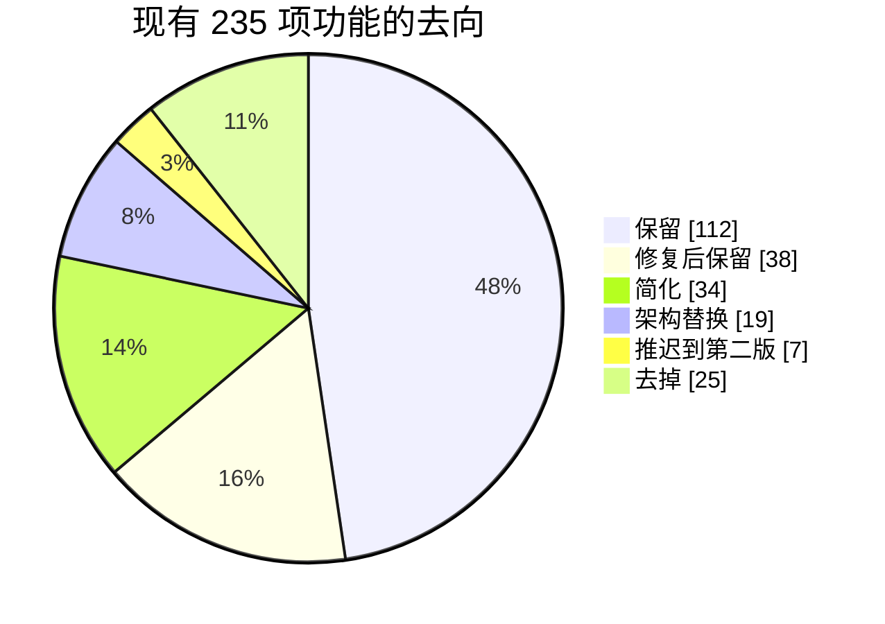

# FalconX Lite 功能取舍对照表（现有 235 项 → 新系统）
- 版本：v1（2026-10-14）
- 变更历史：v1（2026-10-14）首次创建
- 依据：现有系统功能地图（fxsystem PR #2，`docs/功能地图/01`–`08` 各分册的"功能清单"），逐项对照；Amos 在《v1-需求澄清问题》中确认的决定
- 用途：相当于规则 C35 的"字段对照表"——现有系统的**每一项**功能都在这里有去向，测试预审时逐行核对，保证不遗漏。编号沿用功能地图，细节（字段、公式、代码位置）查对应分册。

## 一图看懂

这张图想说明：大部分功能保留（含修复和简化），真正去掉和推迟的约占 14%；"架构替换"的功能业务上仍然存在，只是技术做法变了。

| 去向 | 数量 | 含义 |
|---|---|---|
| 保留 | 112 | 照搬现有逻辑 |
| 修复后保留 | 38 | 照搬，同时修掉功能地图里查出的问题 |
| 简化 | 34 | 保留业务目的，做法变简单或范围变小 |
| 架构替换 | 19 | 业务不变，技术实现随单体架构改变（例如不再用 Kafka） |
| 推迟 | 7 | 第二版再做 |
| 去掉 | 25 | 不再需要 |
| **合计** | **235** | |

另有 9 项**新增**功能，不在现有系统里，见《v1-需求说明书》第 4.6 节。

## 逐项对照

### 01 账户认证与 KYC

| 编号 | 现有功能 | 现状 | 新系统 | 说明 |
|---|---|---|---|---|
| A-01 | 用户注册（含 5 项基础资料） | 已实现 | **保留** | 注册资料沿用 5 项 |
| A-02 | 邮箱密码登录（含 IP 级失败锁定） | 已实现 | **修复后保留** | 失败锁定改为按账号 + 按 IP 双维度（现状只按 IP） |
| A-03 | Refresh Token 刷新与轮换 | 已实现 | **保留** |  |
| A-04 | 登出与 Access Token 黑名单 | 已实现 | **修复后保留** | 冻结用户时同时让其登录失效（现状不会） |
| A-05 | RSA JWT 签发与 claim 结构 | 已实现 | **保留** |  |
| A-06 | 网关认证（验签、公开路由、透传头、状态拦截、认证限流） | 已实现 | **架构替换** | 单体应用内统一鉴权，不再有独立网关服务 |
| A-07 | 用户状态 `UserStatus` 与状态机 | 部分实现 | **简化** | 状态只保留：正常、冻结；去掉"待入金激活"等中间态 |
| A-08 | 入金后激活（消费 `deposit.credited`）与 inbox 清理 | 已实现 | **去掉** | 不再用"入金后激活"；注册即可用，入金和出金按 KYC 控制 |
| A-09 | 注册后发布 `user.registered` | 已实现 | **架构替换** | 注册后直接在同一应用内分配充值地址，不再发事件 |
| A-10 | 邮箱可信度 `email_verified` | 部分实现 | **修复后保留** | 改为真实的邮箱验证流程（见新增 X-03） |
| A-11 | 用户产品组 `groupCode` | 已实现 | **推迟** | 用户分组（不同组不同报价和可见品种）推迟到第二版；第一版所有客户一个默认组 |
| A-12 | 用户基础资料查询与修改（`/api/v1/me/profile`） | 部分实现 | **保留** |  |
| A-13 | KYC 提交 | 已实现 | **修复后保留** | 证件改存对象存储，不再以 base64 存数据库 |
| A-14 | KYC 状态查询 | 已实现 | **保留** |  |
| A-15 | 管理端 KYC 审核（列表、详情、通过、驳回） | 已实现 | **保留** | 补上后台菜单 |
| A-16 | `kyc.reviewed` 事件发布 | 已实现 | **架构替换** | 同一应用内直接触发通知 |
| A-17 | 内部 KYC 等级查询（供出金门禁） | 已实现 | **架构替换** | 同一应用内直接读取 |
| A-18 | 管理端客户列表 | 已实现 | **保留** |  |
| A-19 | 管理端客户详情 | 部分实现 | **修复后保留** | 补齐"最近登录 IP"等未写入的字段 |
| A-20 | 管理端编辑客户（账户元数据 + 基础资料） | 已实现 | **修复后保留** | 不能再通过编辑把状态改成任意值 |
| A-21 | 管理端冻结 / 解冻客户 | 部分实现 | **修复后保留** | 后台补上冻结/解冻按钮，冻结立即踢下线 |
| A-22 | 管理端调余额 | 已实现 | **修复后保留** | 限额以代码为准写进需求：单笔和每日上限由 Amos 确认（见澄清 N-07） |
| A-23 | identity 内部 RPC 鉴权（`X-Internal-Token`） | 已实现 | **去掉** | 单体应用没有内部接口，也就没有内部 Token（根除 S1） |
| A-24 | 客户端登录注册页 | 已实现 | **保留** | 加中英文 |
| A-25 | 客户端个人资料面板 | 已实现 | **保留** |  |
| A-26 | 客户端 KYC 弹窗 | 已实现 | **保留** |  |
| A-27 | 客户端会话管理（存储、自动刷新、登出） | 已实现 | **保留** |  |
| A-28 | 邮箱验证流程（发验证邮件、验证端点） | 不做 | **保留** | 原为"不做"，改为第一版新增（见 X-03） |

### 02 行情与品种

| 编号 | 现有功能 | 现状 | 新系统 | 说明 |
|---|---|---|---|---|
| M-01 | LP Socket.IO 行情源接入（握手加密、订阅、Snappy 解析、重连） | 已实现 | **保留** | LP 行情源接入照搬 |
| M-02 | LP 订阅白名单热刷新 | 已实现 | **保留** |  |
| M-03 | 行情接入主链路编排与按 symbol 分区异步下游 | 已实现 | **架构替换** | 同一应用内直接分发，不经 Kafka |
| M-04 | 报价映射（源 symbol → 平台 symbol，乘数与绝对加点） | 已实现 | **保留** |  |
| M-05 | 报价标准化与报价口径（bid/ask/mid/mark） | 已实现 | **保留** |  |
| M-06 | 行情质量守卫（5 态） | 已实现 | **保留** | 行情质量守卫照搬 |
| M-07 | 交易时段守卫与交易日历判断 | 已实现 | **保留** |  |
| M-08 | Redis 最新价 / 参考价缓存 | 已实现 | **保留** |  |
| M-09 | ClickHouse `quote_tick` 批量写入与历史 Tick 查询 | 已实现 | **去掉** | 不再存全量 Tick 历史（去掉 ClickHouse）；Tick 图只用最近一段内存/Redis 数据 |
| M-10 | K 线聚合（周期与聚合规则） | 已实现 | **保留** |  |
| M-11 | ClickHouse `kline` 存储、去重与历史 K 线查询 | 已实现 | **架构替换** | K 线改存 MySQL，按周期设保留期 |
| M-12 | Kafka 行情事件（`market.price.tick` / `market.kline.update`）与 Outbox | 已实现 | **架构替换** | 不再用 Kafka |
| M-13 | 行情 WebSocket `/ws/v1/market` | 已实现 | **保留** | 行情推送 |
| M-14 | 品种列表与最新报价北向接口 | 已实现 | **保留** |  |
| M-15 | LP 源 Symbol 主表 `t_symbol` 管理 | 部分实现 | **简化** | 只开放约 50 个品种，后台可增减 |
| M-16 | 报价映射管理（系统 Symbol 配置真源） | 已实现 | **简化** | 报价映射保留，界面合并进品种管理 |
| M-17 | `SymbolSpec` 共享快照 | 已实现 | **架构替换** | 同一应用内直接读取，不再需要跨服务共享快照 |
| M-18 | 用户组品种可见性 | 已实现 | **推迟** | 随用户分组推迟 |
| M-19 | 用户组加点（group markup） | 已实现 | **简化** | 改为每个品种一个统一加点（点差），按组加点推迟；修复"删除后不同步"的问题 |
| M-20 | 交易时间（周规则 + 特殊交易日例外）管理与快照 | 已实现 | **保留** |  |
| M-21 | 市场假期管理 | 已实现 | **保留** |  |
| M-22 | 跑马灯热门产品配置与读取 | 已实现 | **简化** | 品种上加"热门"标记，不再单独配置页 |
| M-23 | FX 汇率子域（多币种换算汇率） | 已实现 | **保留** | 非美元报价品种的盈亏折算需要 |
| M-24 | 管理端 FX 汇率监控 | 已实现 | **保留** |  |
| M-25 | 隔夜费率配置表 `t_swap_rate`（配置侧） | 已实现 | **保留** |  |
| M-26 | 品种最近 Tick 时间（last-tick） | 部分实现 | **修复后保留** |  |
| M-27 | 客户端行情列表（Watchlist） | 已实现 | **保留** |  |
| M-28 | 客户端经典图表（K 线 / Tick / Bid/Ask 叠加 / 指标 / 周期） | 已实现 | **保留** |  |
| M-29 | 客户端 TradingView 高级图表 | 已实现 | **推迟** | TradingView 是商业授权库，是否已购买授权需 Amos 确认（见澄清 N-02）；第一版默认只用经典图表 |
| M-30 | 客户端跑马灯 | 已实现 | **保留** |  |
| M-31 | 客户端行情 WebSocket 连接管理 | 已实现 | **保留** |  |
| M-32 | 行情健康检查与可观测指标 | 已实现 | **保留** |  |
| M-33 | LP 历史 K 线 API 补数 | 不做 | **去掉** |  |
| M-34 | 杠杆档位 tier（边界说明） | 已实现（owner 为 trading-core，细节见 03） | **简化** | 见 T-05 |

### 03 交易

| 编号 | 现有功能 | 现状 | 新系统 | 说明 |
|---|---|---|---|---|
| T-01 | 交易账户与账户快照（余额/冻结/占用/可用/净值/保证金水平） | 已实现 | **保留** |  |
| T-02 | 账本流水 `t_ledger`（biz_type 18 种）与查询 | 已实现 | **保留** |  |
| T-03 | 多币种计价与 FX 换算（QC→AC） | 部分实现 | **简化** | 账户只有 USDT；保留非美元报价品种的盈亏按汇率折算 |
| T-04 | 市价开仓（下单前校验、取价、保证金、手续费、落库） | 已实现 | **保留** |  |
| T-05 | 杠杆/MM 双重档位 `t_symbol_leverage_tier` 解析与查询 | 已实现 | **简化** | 每个品种一档：最大杠杆 + 维持保证金率；按名义价值分档推迟 |
| T-06 | 挂单 LIMIT / STOP / STOP_LIMIT（创建、修改、撤单、触发） | 部分实现 | **简化** | 只保留限价单；去掉止损单和止损限价单 |
| T-07 | 订单 `t_order` 与成交 `t_trade` 查询 | 已实现 | **保留** |  |
| T-08 | 持仓 `t_position`、未实现盈亏、持仓汇总 | 已实现 | **修复后保留** | 修复组加点叠加两次的问题 |
| T-09 | 手动平仓（全额） | 已实现 | **保留** |  |
| T-10 | 止盈止损 TP/SL（持仓字段 + SL_TP 挂单双轨） | 部分实现 | **修复后保留** | 只保留一套止盈止损实现（现状两套并行） |
| T-11 | 追加逐仓保证金与强平价重算 | 部分实现 | **修复后保留** | 强平价重算按品种的维持保证金率，不用默认值 |
| T-12 | 账户保证金模式切换（STAGE-14D1） | 已实现 | **去掉** | 只做逐仓，不需要模式切换 |
| T-13 | 保证金水平分级与 MarginCall 告警（STAGE-14C1） | 已实现 | **保留** | 追保预警 |
| T-14 | ISOLATED 自动强平（强平价 + 单仓 StopOut 双触发） | 已实现 | **保留** | 逐仓自动强平照搬 |
| T-15 | CROSS 账户级强平（STAGE-14D2） | 部分实现 | **去掉** | 不做全仓 |
| T-16 | 强平日志 `t_liquidation_log` 与强平查询 | 已实现 | **保留** |  |
| T-17 | Swap 隔夜利息结算与查询 | 已实现 | **保留** | 隔夜费 |
| T-18 | 价格提醒（10 条上限、3 次 × 5 分钟节流） | 已实现 | **推迟** | 价格提醒推迟到第二版（如需第一版保留请告知，见澄清 N-03） |
| T-19 | 行情驱动引擎 `QuoteDrivenEngine` | 已实现 | **保留** | 行情驱动引擎照搬：每个价格到达即检查挂单、止盈止损、强平 |
| T-20 | 交易 WebSocket `/ws/v1/trading`（用户 + 管理端频道） | 已实现 | **保留** | 交易推送；修复强平事件名前后端不一致 |
| T-21 | 交易领域事件（Outbox → Kafka） | 已实现 | **架构替换** | 不再用 Kafka |
| T-22 | 客户端下单面板 OrderTicket | 已实现 | **简化** | 下单面板去掉止损单、止损限价单和保证金模式选择 |
| T-23 | 客户端交易表格（持仓/历史/挂单/订单/成交/告警）与活动页 | 已实现 | **保留** |  |
| T-24 | 客户端仪表盘看板 | 已实现 | **保留** |  |
| T-25 | 管理端订单/持仓监控、平台持仓汇总、运营指标 | 已实现 | **保留** |  |
| T-26 | 管理端挂单监控/强制撤单、价格告警监控/强制删除 | 已实现 | **简化** | 保留挂单监控和强制撤单；价格提醒监控随价格提醒推迟 |
| T-27 | 管理端手动强平、自动强平开关 | 已实现 | **保留** |  |
| T-28 | 管理端交易配置（档位、冷静期、StopOut/MarginCall、FX_PAUSED 类目、全仓开关） | 部分实现 | **简化** | 只保留：品种杠杆和维持保证金率、追保线和强平线 |
| T-29 | 部分平仓 / 净持仓模型 | 不做 | **推迟** | 部分平仓推迟到第二版 |
| T-30 | 下单面板预览组件 `OrderTicketPreview` | 占位 | **去掉** | 死代码 |
| T-31 | K 线收盘事件消费 | stub/骨架 | **去掉** | 空实现 |

### 04 风控

| 编号 | 现有功能 | 现状 | 新系统 | 说明 |
|---|---|---|---|---|
| R-01 | 品种净敞口计算与 USD 归一化（`t_risk_exposure`） | 已实现 | **修复后保留** | 净敞口看板，显示多空金额；统一换算 USD |
| R-02 | 单品种对冲阈值观测（`t_hedge_log`）与自动 `REJECT_OPEN` | 已实现 | **简化** | 改为唯一一条自动规则：品种净敞口超阈值 → 自动禁止该品种新开仓 + 通知风控 |
| R-03 | 市场大类集中度（`t_risk_market_config`，`AUTO_CONCENTRATION`） | 已实现 | **去掉** | 市场大类集中度 |
| R-04 | 方向集中度（多/空 USD 失衡比，`AUTO_DIRECTION_IMBALANCE`） | 部分实现 | **去掉** | 方向集中度（看板照常显示多空，不自动处理） |
| R-05 | 跨品种相关性组（`AUTO_CORRELATION`） | 部分实现 | **去掉** | 相关性组 |
| R-06 | 用户级 USD 敞口阈值（含盈利用户独立阈值） | 部分实现 | **简化** | 改为单用户持仓上限（按 USD 名义价值，不按笔数） |
| R-07 | 平台总净敞口阈值与 `GLOBAL_PAUSE` 5 秒调度 | 已实现（有推送缺陷） | **简化** | 平台总净敞口超阈值 → 自动禁止全部新开仓 + 通知风控；修复"假恢复"推送 |
| R-08 | 四级风控动作模型（`t_risk_control_action`）与手工激活/停用 | 部分实现 | **简化** | 只保留：暂停品种（禁止新开仓）、全局暂停；去掉"只减仓" |
| R-09 | 下单时的风控拦截点 | 已实现 | **保留** |  |
| R-10 | FX 暂停行为（`t_fx_pause_behavior`） | 部分实现 | **简化** | 汇率失效时，相关品种自动禁止新开仓；不再按类目配置 |
| R-11 | 风控开关（`t_trading_risk_switch`） | 部分实现 | **保留** | 自动强平开关 |
| R-12 | 品种风控参数 `t_risk_config` 与管理端 CRUD | 已实现（语义需注意） | **简化** | 只保留品种净敞口阈值和单用户持仓上限 |
| R-13 | 平台行：StopOut / MarginCall 阈值与冷静期配置 | 已实现 | **保留** |  |
| R-14 | 行情质量守卫（5 种状态、点差/跳变/波动规则） | 已实现 | **保留** | 同 M-06 |
| R-15 | 对冲观测事件 `TradingHedgeAlertEvent` 与 A-Book 对冲出口 | 进程内事件已实现；A-Book 对冲 不做 | **去掉** | 不做 A-Book 对冲 |
| R-16 | `risk.warning` 推送与风控站内信触发 | 部分实现 | **去掉** | 风控告警不再推给客户（现状会泄露平台敞口），只推给风控人员 |
| R-17 | 管理端实时推送（`admin.exposure.update` / `admin.risk-action.changed` / `admin.risk-switch.changed`） | 部分实现 | **保留** | 后台实时推送 |
| R-18 | 管理端：净敞口看板 | 已实现 | **保留** |  |
| R-19 | 管理端：风控开关页 | 已实现 | **保留** |  |
| R-20 | 管理端：风控动作页 | 已实现 | **简化** | 见 R-08 |
| R-21 | 管理端：风控配置页与市场集中度页 | 已实现 | **简化** | 见 R-12 |
| R-22 | 管理端：平台总敞口阈值页 | 部分实现 | **简化** | 见 R-07 |
| R-23 | 管理端：用户级阈值页 | 已实现 | **简化** | 见 R-06 |
| R-24 | 管理端：StopOut / MarginCall 阈值页 | 已实现 | **保留** |  |
| R-25 | 管理端：FX 暂停行为页 | 已实现 | **去掉** | 见 R-10 |
| R-26 | 风控权限码、高危操作与审计 | 已实现 | **修复后保留** | 高危权限登记补全 |

### 05 资金

| 编号 | 现有功能 | 现状 | 新系统 | 说明 |
|---|---|---|---|---|
| F-01 | 入金地址 xpub 派生（ERC20 / TRC20 / 其他链） | 部分实现 | **修复后保留** | USDT：ERC20、TRC20、BSC 三条链 |
| F-02 | 注册后自动预分配入金地址（消费 `identity.user.registered`） | 已实现 | **架构替换** | 注册时同一应用内直接分配 |
| F-03 | 入金页幂等申请地址（`POST /api/v1/wallet/deposit-addresses/ensure`） | 已实现 | **保留** |  |
| F-04 | 地址预分配失败 DLQ 与管理端重试 | 已实现 | **去掉** | 同步分配后不再需要失败队列，分配失败时下次打开页面重试 |
| F-05 | 链上监听：ETH（原生 ETH + ERC20 USDT/USDC） | 已实现 | **简化** | ETH 链只收 USDT；去掉原生 ETH 和 USDC；必须配置合约地址才扫块（修复假币入账） |
| F-06 | 链上监听：BSC | 部分实现 | **修复后保留** | BSC 链 USDT 补全（地址派生、合约、精度实测） |
| F-07 | 链上监听：TRON（TRC20） | 部分实现 | **保留** | TRON 链 USDT |
| F-08 | 链上监听：SOL | stub/骨架 | **去掉** | SOL 链 |
| F-09 | 原始入金状态机与 detected / confirmed / reversed 事件发布 | 已实现 | **保留** |  |
| F-10 | 入金入账（trading-core）与 `deposit.credited` | 已实现 | **保留** |  |
| F-11 | 入金撤回（reversal）处理 | 部分实现 | **修复后保留** | 冲正不能把余额扣成负数，改为挂账并通知风控 |
| F-12 | 出金地址白名单（增 / 查 / 软删，10 条上限） | 部分实现 | **修复后保留** | 修复前后端字段名不一致 |
| F-13 | 白名单 24 小时冷却推进调度 | 已实现 | **保留** |  |
| F-14 | 出金提交（限额、KYC、陌生地址、冻结） | 已实现 | **保留** |  |
| F-15 | 出金冷静期推进与用户取消 | 已实现 | **保留** |  |
| F-16 | 管理端审核：通过 / 拒绝 | 已实现 | **保留** |  |
| F-17 | 大额延迟期（APPROVED_DELAYED）推进与紧急取消 | 部分实现 | **修复后保留** | 修复大额出金延迟期结束后不上链的问题 |
| F-18 | 出金签名（LocalKmsSigner / KmsSignerStub） | 部分实现 | **简化** | 第一版签名私钥由 Amos 放在服务器环境变量；接入真正的 KMS 推迟 |
| F-19 | nonce 管理与 ERC20 广播 | 部分实现 | **修复后保留** | nonce 回收和广播超时处理 |
| F-20 | 出金链上确认（12 confirmations）与完成结算 | 部分实现 | **保留** |  |
| F-21 | 出金失败退款 | 已实现 | **保留** |  |
| F-22 | TRC20 出金 | stub/骨架 | **修复后保留** | TRC20 出金补全；BSC 出金新增 |
| F-23 | 入金对账（4 类差异、标记 resolved） | 部分实现 | **修复后保留** | 修复"标记已处理"判断写反 |
| F-24 | 客户端钱包页（余额、入金地址、资金流水） | 已实现 | **保留** | 加充值地址二维码 |
| F-25 | 客户端出金抽屉（提交、记录、白名单） | 部分实现 | **修复后保留** |  |
| F-26 | 管理端入金记录（列表 / 详情 / 入账状态拼接） | 已实现 | **保留** |  |
| F-27 | 管理端出金审核工作台（列表 / 详情 / 三种操作） | 部分实现 | **修复后保留** | 补上后台菜单 |
| F-28 | 管理端调整客户余额（限额计数 + 账本） | 已实现 | **保留** | 同 A-22 |
| F-29 | 资金域 Kafka 事件与 wallet 发件箱 | 已实现 | **架构替换** | 不再用 Kafka |
| F-30 | 外部 RPC 依赖与 ETH RPC 健康检查 | 已实现 | **保留** |  |

### 06 通知与消息

| 编号 | 现有功能 | 现状 | 新系统 | 说明 |
|---|---|---|---|---|
| N-01 | 站内信数据模型（`t_notification`） | 已实现 | **保留** |  |
| N-02 | 用户通知列表与未读数接口 | 已实现 | **修复后保留** | 修复分页参数名不一致（只能看到 20 条） |
| N-03 | 单条已读 / 全部已读 | 已实现 | **保留** |  |
| N-04 | WebSocket 实时推送 `notification.created` | 已实现 | **保留** |  |
| N-05 | 通知模板数据模型与 14 个内置模板 | 已实现 | **简化** | 内置模板只能改文案，不能禁用（现状禁用会导致出金结算失败） |
| N-06 | 模板读取、缓存和占位符替换 | 已实现（多实例缓存不一致，见正文） | **保留** |  |
| N-07 | 模板化发送 `send()` 与渠道分发 SPI | 已实现 | **保留** |  |
| N-08 | IN_APP 渠道（落库 + 推送） | 已实现 | **保留** |  |
| N-09 | EMAIL 渠道 | stub/骨架 | **修复后保留** | 邮件真正发出去（服务商见澄清 N-05） |
| N-10 | TELEGRAM 渠道 | stub/骨架 | **去掉** | Telegram |
| N-11 | 旧路径 `create()`（producer 自拼文案） | 已实现（当前无任何调用方，遗留代码） | **去掉** | 遗留代码 |
| N-12 | 触发点：KYC 通过 / 驳回 | 已实现 | **保留** |  |
| N-13 | 触发点：出金完成 | 已实现 | **保留** |  |
| N-14 | 触发点：出金失败 | 已实现 | **保留** |  |
| N-15 | 触发点：入金到账 | 已实现 | **保留** |  |
| N-16 | 触发点：价格提醒触发 | 已实现 | **推迟** | 随价格提醒推迟 |
| N-17 | 触发点：逐仓强平 `POSITION_LIQUIDATED` | 已实现（落库可靠性未验证） | **保留** |  |
| N-18 | 触发点：止盈 `POSITION_TP_HIT` | 已实现（落库可靠性未验证） | **保留** |  |
| N-19 | 触发点：止损 `POSITION_SL_HIT` | 已实现（落库可靠性未验证） | **保留** |  |
| N-20 | 触发点：StopOut 保证金强平 `STOP_OUT_TRIGGERED` | 已实现 | **保留** |  |
| N-21 | 触发点：CROSS 账户级强平 `CROSS_STOP_OUT_TRIGGERED` | 已实现 | **去掉** | 不做全仓 |
| N-22 | 触发点：追保预警 `MARGIN_CALL_TRIGGERED` | 已实现 | **保留** |  |
| N-23 | 触发点：风控告警 `RISK_ACTION_TRIGGERED`（对冲敞口告警） | 已实现 | **简化** | 只发给风控人员，不发给客户 |
| N-24 | 触发点：保证金模式切换 `ACCOUNT_MODE_CHANGED` | 已实现 | **去掉** | 不做保证金模式切换 |
| N-25 | 管理端：用户通知列表 / 详情 | 部分实现 | **修复后保留** | 补上后台菜单 |
| N-26 | 管理端：模板管理（增删改查、启停） | 部分实现 | **修复后保留** | 补上后台菜单 |
| N-27 | 管理端：手动发送（单个用户） | 部分实现 | **保留** |  |
| N-28 | 管理端：权限码、高危登记与审计 | 已实现 | **保留** |  |
| N-29 | 客户端：顶栏铃铛 + 通知抽屉 | 已实现（列表条数有缺陷） | **修复后保留** |  |
| N-30 | 客户端：活动页“通知”tab | 部分实现 | **修复后保留** |  |
| N-31 | 客户端：首页“最近通知”卡 | 已实现（条数有缺陷） | **修复后保留** |  |
| N-32 | 客户端：新通知 Toast | 已实现 | **保留** |  |
| N-33 | 客户端：通知偏好设置 | 占位 | **简化** | 通知偏好：客户可以分别开关推送和邮件 |
| N-34 | 错误码 `30060-30065` / `90880-90887` | 部分实现 | **简化** | 只保留实际会用到的错误码 |
| N-35 | 群发通知（批量用户） | 不做 | **推迟** | 群发 |

### 07 管理后台

| 编号 | 现有功能 | 现状 | 新系统 | 说明 |
|---|---|---|---|---|
| C-01 | 管理端菜单与路由总表（DB 动态菜单） | 部分实现 | **修复后保留** | 补齐全部菜单 |
| C-02 | 管理员登录与失败锁定 | 已实现 | **保留** |  |
| C-03 | Token 与会话（签发、刷新、登出、前端存储） | 已实现 | **保留** |  |
| C-04 | 修改密码与首次登录强制改密 | 部分实现 | **修复后保留** | 服务端强制改密，不只靠前端跳转 |
| C-05 | 超级管理员自举（DefaultSuperAdminInitializer） | 已实现 | **保留** |  |
| C-06 | 管理端 IP 白名单 | 部分实现 | **修复后保留** | IP 白名单不能被伪造请求头绕过 |
| C-07 | 当前管理员信息与权限集（`/admin/me*`） | 已实现 | **保留** |  |
| C-08 | 接口级鉴权 `@RequiresPermission`、SUPER_ADMIN 放行、字典自动注册、按钮级控制 | 已实现 | **保留** |  |
| C-09 | 高危权限码注册表（HighRiskPermissionRegistry） | 部分实现 | **修复后保留** | 高危权限登记补全 |
| C-10 | 管理员管理（admin-users） | 部分实现 | **修复后保留** | 修复"可以给任何人加超级管理员"、超过 100 人查不到 |
| C-11 | 角色管理与权限分配（admin-roles） | 已实现 | **保留** | 完整 RBAC |
| C-12 | 菜单管理（admin-menus） | 部分实现 | **保留** |  |
| C-13 | 权限点字典查询（admin-permissions） | 已实现 | **保留** |  |
| C-14 | 操作审计写入（OperationAuditAspect） | 部分实现 | **修复后保留** | 审计里不再记录明文密码 |
| C-15 | 审计日志查询页 | 已实现 | **保留** |  |
| C-16 | 平台运营仪表盘 | 已实现 | **保留** |  |
| C-17 | 系统配置中心（`t_system_config`） | 部分实现 | **简化** | 只保留真正会生效的配置项 |
| C-18 | 平台配置：冷静期与 StopOut/MarginCall 阈值 | 已实现 | **保留** |  |
| C-19 | 平台配置：FX 暂停行为（按类目） | 已实现 | **去掉** | 见 R-10 |
| C-20 | 调用下游：InternalRpcClient 与内部 Token | 已实现 | **去掉** | 单体应用不需要内部调用 |
| C-21 | 跨 schema 只读 SELECT 与用户信息补全 | 已实现 | **架构替换** | 同一个数据库，直接查询 |
| C-22 | 深浅主题切换 | 已实现 | **保留** |  |
| C-23 | 移动端布局 | 已实现 | **保留** |  |

### 08 平台基础

| 编号 | 现有功能 | 现状 | 新系统 | 说明 |
|---|---|---|---|---|
| P-01 | 服务清单、端口与存储拓扑 | 已实现 | **架构替换** | 1 个后端应用 + 1 个 MySQL + Redis |
| P-02 | 服务间同步调用（internal RPC） | 已实现 | **去掉** | 没有服务间调用 |
| P-03 | 网关 HTTP 路由表 | 已实现 | **架构替换** | 路由由反向代理和应用自身处理 |
| P-04 | 网关 JWT 认证、白名单与身份头透传 | 已实现 | **保留** | 认证逻辑并入应用 |
| P-05 | 网关限流（全局 IP / 认证入口 / 交易） | 已实现 | **保留** | 限流 |
| P-06 | 网关熔断、超时与 fallback | 部分实现 | **架构替换** |  |
| P-07 | traceId 生成与全链路透传、日志格式、安全响应头 | 部分实现 | **保留** | traceId 和日志规范 |
| P-08 | 网关 WebSocket 代理（`/ws/v1/market`、`/ws/v1/trading`）及指标 | 已实现 | **保留** | 行情和交易推送 |
| P-09 | 动态系统配置客户端（SystemConfigClient） | 部分实现 | **简化** | 见 C-17 |
| P-10 | Kafka 主题总表 | 部分实现 | **去掉** | 不用 Kafka |
| P-11 | Outbox 发件箱与重试策略 | 部分实现 | **简化** | 需要可靠投递的地方（例如出金上链）用数据库任务表，不用 Kafka |
| P-12 | Inbox 与消费端幂等、重试、死信 | 部分实现 | **简化** | 同上 |
| P-13 | 定时任务总表 | 已实现 | **保留** | 定时任务：隔夜费、出金调度、扫块 |
| P-14 | 统一响应 `ApiResponse` 与错误码分段 | 已实现 | **保留** |  |
| P-15 | 雪花 ID 与对外编号 | 部分实现 | **保留** |  |
| P-16 | Jackson 3 序列化约定 | 已实现 | **保留** |  |
| P-17 | Flyway 共享迁移与 ClickHouse 迁移 | 已实现 | **简化** | 一个数据库一套迁移脚本 |
| P-18 | Actuator 端点与 HealthIndicator | 已实现 | **修复后保留** | 管理端点加鉴权，不对外暴露（修复 S3） |
| P-19 | 自定义 Micrometer 指标 | 已实现 | **保留** |  |
| P-20 | Prometheus 告警规则、Alertmanager、Grafana 看板 | 部分实现 | **简化** | 健康检查 + 外部探测 + 邮件告警；告警必须能送达 |
| P-21 | falconx-canary 巡检 CLI（7 个命令） | 部分实现 | **去掉** | 改由 CI 和上线后冒烟检查承担 |
| P-22 | 本地基础设施 `docker-compose.yml` | 已实现 | **架构替换** |  |
| P-23 | 演示档 `docker-compose.prod.yml`（资源限制） | 已实现 | **架构替换** | 密钥一律不进仓库（修复 S2） |
| P-24 | nginx edge（按 Host 分流）与前端 nginx | 已实现 | **保留** | 按域名分流客户端和管理后台 |
| P-25 | Dockerfile 与容器入口脚本 | 已实现 | **架构替换** |  |
| P-26 | `scripts/` 与 `tools/` 运维脚本 | 已实现 | **架构替换** |  |
| P-27 | 测试资产概况 | 已实现 | **保留** | 现有测试随代码一起搬迁 |
| P-28 | 环境变量总表 | 已实现 | **保留** | 只记变量名 |

## 跨角色反馈 / 分歧记录
见《v1-需求说明书》"跨角色反馈"一节（测试预审对本表的意见一并记录在那里）。
