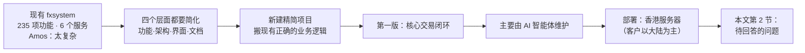

# FalconX Lite 需求澄清记录
- 版本：v1.1（2026-10-14）
- 变更历史：v1（2026-10-14）首次创建，记录 2026-10-07 至 10-14 与 Amos 在对话中的澄清结果，以及仍待回答的问题；v1.1（2026-10-14）Amos 回复"其他问题全部按默认"，N-01～N-14 按默认值确认（N-12 合规、N-13 域名仍需 Amos 提供实际结论，见第 3 节）
- 依据：agents main `4025297`（v0.9）；现有系统功能地图见 fxsystem PR #2（`docs/功能地图/`）
- 说明：已回答的问题记录 Amos 的原话或选择；待回答的问题都附默认值，可以一句"全部按默认"确认。

## 一图看懂：决策是怎么一步步定下来的

这张图想说明：已经定下的方向是"新建一个精简的系统，第一版只做核心交易闭环，部署在香港"；还剩第 2 节的问题要 Amos 回答。

## 1. 已确认的问题

| 编号 | 问题 | Amos 的回答 | 日期 |
|---|---|---|---|
| 简化-1 | "简洁"指哪些层面 | 功能范围、技术架构、界面和操作、文档和规则，四个都要 | 10-14 |
| 简化-2 | 用什么方式重新设计 | 保留逻辑，新建精简项目 | 10-14 |
| 简化-3 | 第一版范围 | 核心交易闭环 | 10-14 |
| 简化-4 | 由谁维护 | 主要由 AI 智能体维护 | 10-14 |
| Q1 / D4 | 新项目仓库 | Amos 新建 `dollar3651314/falconx-lite`（私有） | 10-14 |
| Q2 / D1 | 部署平台 | 先选"混合（前端 Vercel + 常驻服务器）"；得知大陆访问 Vercel 不稳定后，改为**香港服务器**。Vercel 只用于给 Amos 看原型 | 10-14 |
| Q3 | 演示服务器上有没有真实客户和资金 | 按默认：没有，新系统从空库开始，不迁移旧数据 | 10-14 |
| Q4 | 技术栈 | 按默认：后端 Java + Spring Boot，合并成 1 个应用；1 个 MySQL + Redis；去掉 Kafka、ClickHouse；前端沿用现有 React 代码精简后复用 | 10-14 |
| Q5 | 品种 | 按默认：只开放约 50 个主流品种，后台可增减 | 10-14 |
| Q6 | 下单方式 | 按默认：市价、限价、止盈止损 | 10-14 |
| Q7 | 保证金模式 | 按默认：只做逐仓 | 10-14 |
| Q8 | 入金和出金 | "ERC20、TRC20、BSC 支持三条链吧"：只支持 USDT，三条链都能入金和出金 | 10-14 |
| Q9 | KYC | 按默认：人工审核，证件存对象存储 | 10-14 |
| Q10 | 风控 | 听完解释后按修改后的默认值：保留人工暂停品种、全局暂停、单用户持仓上限、自动强平开关，以及**一条自动规则**（品种或平台净敞口超阈值 → 自动禁止新开仓并通知风控）；去掉方向集中度、相关性组、只减仓 | 10-14 |
| Q11 | 通知 | "页面要支持手机浏览器访问，通过添加到桌面建立快捷图标，需要有消息推送"：做成 PWA + Web Push；保留站内信和邮件 | 10-14 |
| Q12 | 后台权限 | "需要有自由配置角色、菜单、权限点"：保留完整 RBAC | 10-14 |
| Q13 | 界面语言 | 按默认：中文和英文 | 10-14 |
| Q14 | 品牌名 | 按默认：沿用 FalconX | 10-14 |
| 地区 | 客户主要在哪里 | "客户主要在中国大陆，海外也有，但是没有中国大陆多" | 10-14 |
| D2 | 推送方案 | 按默认：第一版 iPhone 和海外安卓用 Web Push，所有人有站内信和邮件；第二版做安卓 App 外壳 + 国内推送 | 10-14 |
| D3 | 加不加 Telegram 机器人 | 按默认：不加 | 10-14 |
| H1–H7 | 香港服务器的 7 项沟通 | 按默认（见 agents 仓库 `平台规范/香港服务器.md` 草稿） | 10-14 |

## 2. 第二轮问题（2026-10-14 Amos："其他问题全部按默认"）

| 编号 | 问题 | 确认结果（按默认） | 影响 |
|---|---|---|---|
| N-01 | 第一版开放哪约 50 个品种？ | PM 按类别给建议清单：外汇主要货币对和交叉盘约 20 个、贵金属 2 个（XAUUSD、XAGUSD）、指数约 10 个、能源 2 个、加密货币约 10 个、其余留给热门股票。清单在架构方案阶段随品种配置一起交你确认 | 品种配置 |
| N-02 | TradingView 高级图表的商业授权，公司是否已经购买？ | 未购买，第一版只用经典 K 线图 | 客户端图表 |
| N-03 | 价格提醒放在第一版还是第二版？ | 第二版 | 第一版范围 |
| N-04 | KYC 是入金前就要，还是只在出金前要？ | 只在出金前要（沿用现状）；入金和交易不需要 KYC | 注册转化和合规 |
| N-05 | 邮件服务商用哪家？ | 架构方案阶段再定。要求：能稳定送达 QQ 邮箱、163 邮箱和 Gmail | 通知 |
| N-06 | 手续费和点差规则 | 沿用现状：开仓按品种费率收手续费，平仓不收；点差靠品种加点 | 收入 |
| N-07 | 后台调整客户余额的限额 | 沿用现有代码的值（单笔 100,000、每日 1,000,000 USDT），以后台配置为准。注意现有文档写的是 5,000 / 20,000，与代码不一致 | 资金安全 |
| N-08 | 出金限额 | 沿用现有代码的值：最小 10、单笔 ≤10,000、当日累计 <30,000 USDT；冷静期 2 小时；≥3,000 审核通过后延迟 6 小时；新白名单地址 24 小时后生效 | 资金安全 |
| N-09 | 各品种的最大杠杆和维持保证金率 | 沿用现有杠杆档位表中各品种的第一档 | 风险 |
| N-10 | 部分平仓推迟到第二版，可以吗？ | 可以 | 交易体验 |
| N-11 | 用户分组（不同组不同报价和可见品种）推迟到第二版，可以吗？ | 可以；第一版所有客户一个组，每个品种一个统一加点 | 收入策略 |
| N-12 | 面向中国大陆居民的合规 | **需要你和法务确认**，不影响设计，但影响能否上线和上线方式（公司主体、服务条款、限制注册地区等） | 上线 |
| N-13 | 客户端和后台用什么域名？ | 请你提供新域名（PWA 和推送都要求 HTTPS 和固定域名）。默认：客户端 `app.<你的域名>`，后台 `admin.<你的域名>` | 部署 |
| N-14 | 新增：忘记密码、修改密码、邮箱验证放进第一版，可以吗？ | 可以。现有系统缺这三项，真实上线必须有 | 账户安全 |

## 3. 按默认后仍需 Amos 提供的事项
"按默认"之后，下面几项的默认值本身就是"请 Amos 提供"，所以仍然待办：

| 编号 | 事项 | 什么时候之前需要 |
|---|---|---|
| N-12 | 合规结论（服务地区、签约主体、服务条款、风险提示、隐私政策，需法务审核） | 上线前 |
| N-13 | 客户端和后台的域名 | 部署测试环境前 |
| H0 | 香港服务器的云厂商和配置（agents PR #15） | 部署测试环境前 |
| H7 | 告警邮件的接收邮箱（agents PR #15） | 部署测试环境前 |
| N-05 | 邮件服务商（架构方案阶段给出候选，交 Amos 选择） | 部署测试环境前 |

## 跨角色反馈 / 分歧记录
本阶段无。
