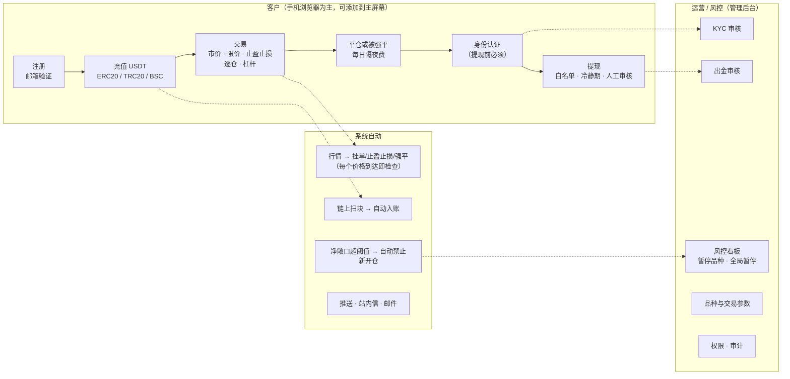
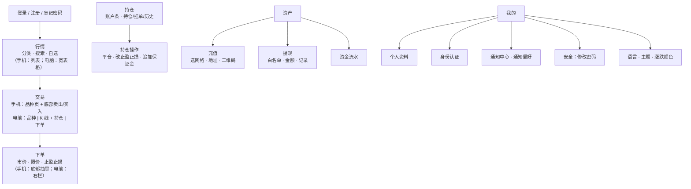
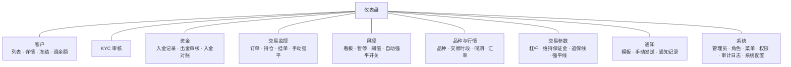
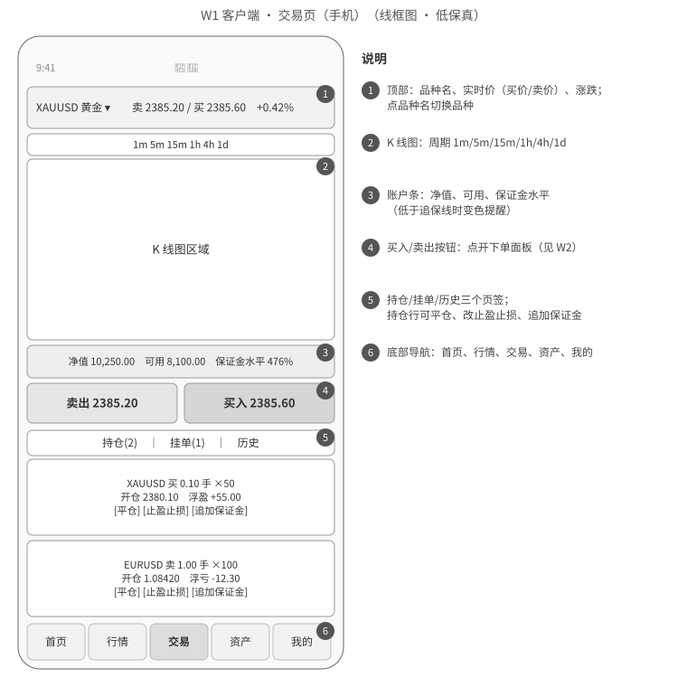
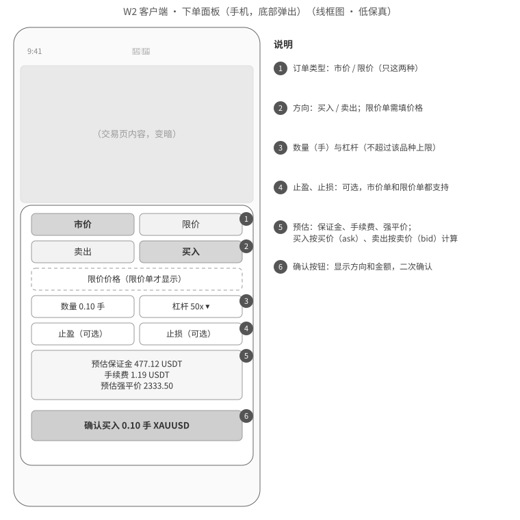
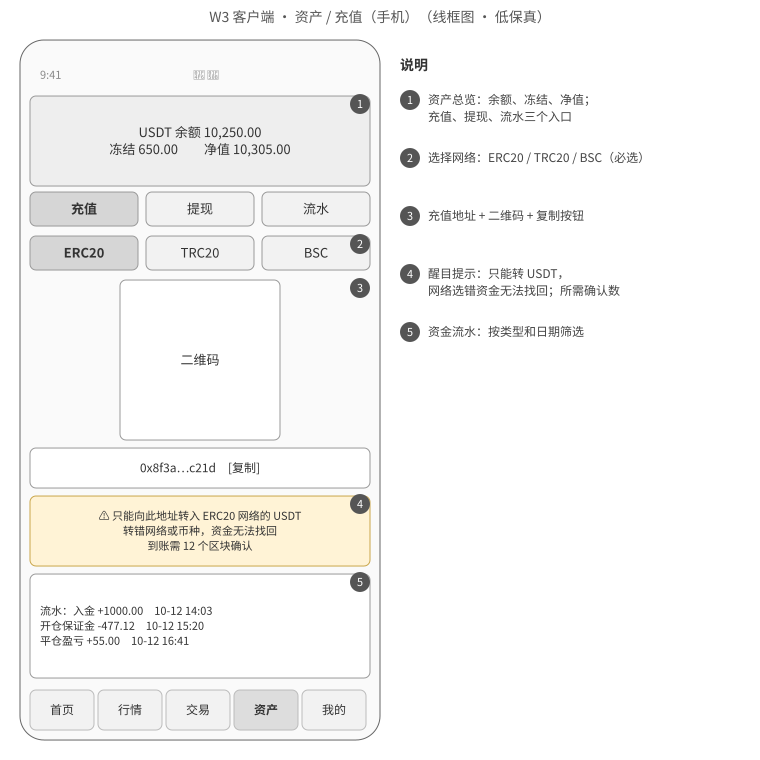
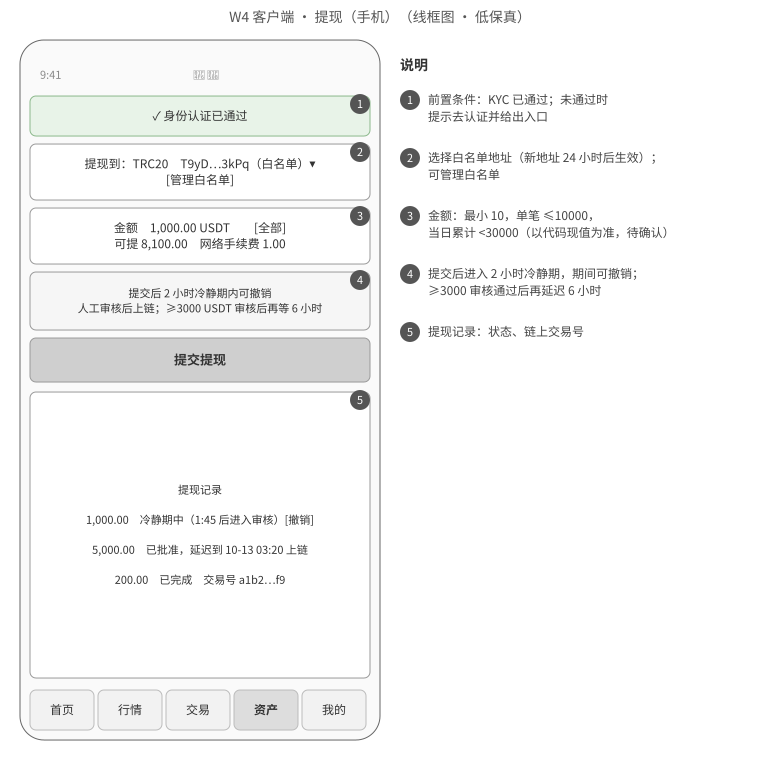
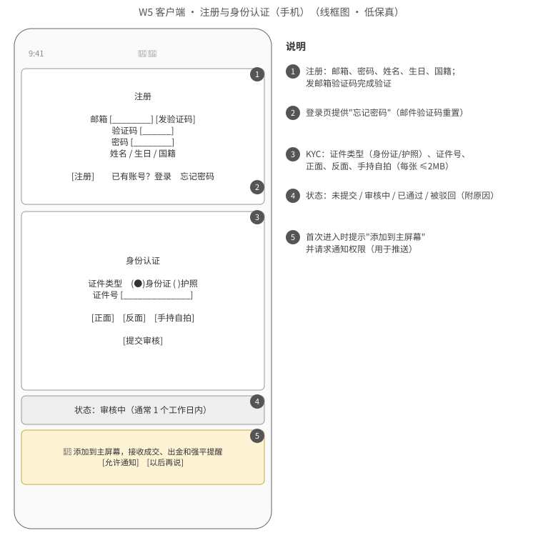
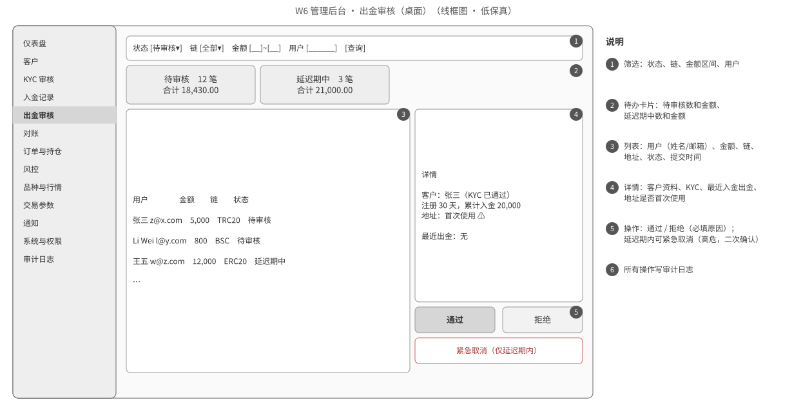
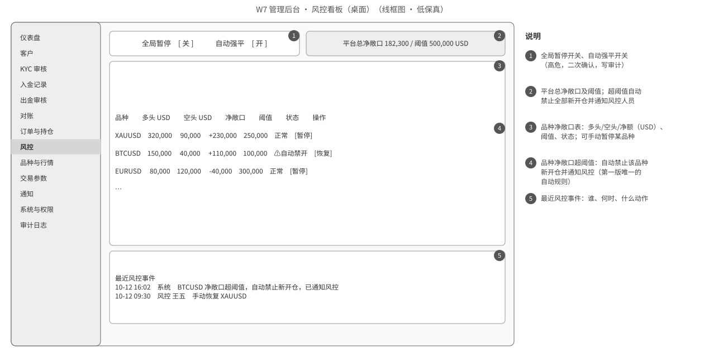

# FalconX Lite 需求说明书
- 版本：v1.4（2026-10-15）
- 变更历史：
  - v1（2026-10-14）初稿
  - v1.1（2026-10-14）按测试预审意见修订：给 7 条验收标准补上判定口径和测试方式（见"跨角色反馈"TQ-01～TQ-07）
  - v1.2（2026-10-14）Amos 对 N-01～N-14 回复"全部按默认"，正文里的确认标记一并更新，结论以《v1-需求澄清问题》v1.1 为准
  - v1.3（2026-10-15）Amos 看原型后选定客户端 UI 风格 C（U1–U7，见《v1-UI风格调研》）：手机和电脑分开设计、去掉首页、底部导航加"持仓"、新增自选（X-10）、主题和涨跌色设置（X-11）；站点地图、AC-30 和新增 AC-39、AC-40 随之更新
  - v1.4（2026-10-15）Amos 审核充值方案时确定最小充值 1 USDT（《v1-充值方案》D4）：4.4-1 补充规则，新增 AC-41
- 依据：agents main `4025297`（v0.9）；《v1-需求澄清问题》；《v1-功能取舍对照表》；现有系统功能地图（fxsystem PR #2）
- 状态：需求已定稿（测试预审完成，澄清问题已确认），随架构方案一起交 Amos 审核（合并节点 ①）。合规（N-12）、域名（N-13）仍待 Amos 提供。

## 一图看懂

这张图想说明：第一版只做一条主线——**充值 → 交易 → 提现**，加上支撑这条主线的后台和自动处理；其他功能推迟或去掉（见《v1-功能取舍对照表》）。

## 1. 目标

| 编号 | 目标 | 怎么衡量 |
|---|---|---|
| G1 | 系统更简单，AI 智能体能可靠地维护 | 后端只有 1 个应用；中间件只有 MySQL 和 Redis；每个 PR 都有 CI；项目地图和项目索引完整（规则 C53、C54） |
| G2 | 资金和安全问题清零 | 现有系统功能地图第 5 节的 S1–S6、F1–F6、T1–T7 在新系统里都有对应的测试，全部通过 |
| G3 | 大陆客户能稳定使用 | 大陆三家运营商网络下打开行情页（登录后第一屏）≤3 秒；页面不加载任何 Google 资源 |
| G4 | 客户在手机上能完成全部主流程 | 注册、充值、交易、提现都能在 390px 宽的手机浏览器上完成；可添加到主屏幕 |
| G5 | 交易和风控准确、及时 | 挂单、止盈止损、强平从价格到达到成交 ≤1 秒（口径见 AC-13） |

## 2. 范围

### 2.1 做什么
- **客户端**（手机优先，桌面也能用）：注册登录、邮箱验证、忘记和修改密码、个人资料、身份认证（KYC）、行情和 K 线、下单（市价、限价、止盈止损）、持仓和挂单管理、追加保证金、资产（三链 USDT 充值、提现、流水）、通知（站内信、推送、邮件）、中英文、深浅主题、添加到主屏幕。
- **管理后台**：客户管理、KYC 审核、入金记录、出金审核、入金对账、订单持仓和挂单监控、手动强平、风控看板（净敞口、暂停品种、全局暂停、自动强平开关、阈值）、品种和行情配置、交易参数、通知模板和手动发送、管理员、角色、菜单、权限、审计日志、仪表盘。
- **系统自动**：LP 行情接入、K 线、行情驱动的挂单/止盈止损/强平、追保预警、每日隔夜费、三条链扫块入账、出金签名和广播、净敞口自动规则、推送和邮件。

### 2.2 明确不做（第一版）
| 不做 | 去向 |
|---|---|
| 全仓保证金、保证金模式切换 | 去掉 |
| 止损单、止损限价单 | 去掉 |
| 部分平仓 | 推迟（N-10） |
| 价格提醒 | 推迟（N-03） |
| 用户分组（不同组不同报价和可见品种） | 推迟（N-11） |
| TradingView 高级图表 | 推迟（未购买授权，N-02） |
| 多币种账户（账户只有 USDT） | 去掉；非美元报价品种的盈亏仍按汇率折算 |
| SOL 链、原生 ETH、USDC | 去掉 |
| A-Book 对冲、方向集中度、相关性组、"只减仓" | 去掉 |
| Telegram 通知、群发通知 | 去掉 / 推迟 |
| 大陆安卓用户的推送 | 第二版做安卓 App 外壳 + 国内推送通道 |
| 两步验证（2FA）、法币出入金、第三方 KYC、真实 KMS | 推迟 |
| 旧系统数据迁移 | 不做（见第 8 节） |

## 3. 使用者和场景

| 使用者 | 典型场景 |
|---|---|
| 客户（大陆为主，iPhone 和安卓都有） | 在手机浏览器打开网址 → 注册 → 添加到主屏幕 → 用 TRC20 转入 USDT → 下单黄金 → 收到止盈推送 → 认证身份 → 提现 |
| 运营 | 每天处理 KYC 审核和出金审核；查看客户、入金和对账 |
| 风控 | 盯净敞口看板；收到"自动禁止新开仓"的通知后判断是否恢复；大行情前手动暂停品种或全局暂停 |
| 超级管理员（Amos） | 配置角色和权限、品种和交易参数；查看审计日志和仪表盘 |

## 4. 功能需求

现有功能的逐项去向见《v1-功能取舍对照表》（235 项）。本节按模块写新系统的要求，细节规则以现有系统功能地图对应条目为准（括号里是编号），本文只写和现有系统不同的地方。

### 4.1 账户与身份认证
1. 注册：邮箱 + 邮箱验证码 + 密码 + 5 项资料（名、中间名、姓、出生日期、国籍）（A-01，新增邮箱验证）。
2. 登录：失败锁定同时按**账号**和**IP**计数（现状只按 IP，A-02）。
3. 忘记密码（邮件验证码重置）、修改密码（需原密码）。成功后，该账号在其他设备上的登录全部失效。
4. 用户状态只有"正常"和"冻结"（A-07）。冻结后立即失效所有登录，不能下单和提现；已有持仓保留，强平照常（A-04、A-21）。
5. KYC：身份证或护照、证件号、正面、反面、手持自拍（每张 ≤2MB）；证件文件存对象存储，数据库只存路径（A-13）。审核结果通过站内信、推送和邮件通知客户。
6. **只在提现前要求 KYC 通过**；注册、充值、交易不需要（N-04）。

### 4.2 行情与品种
1. 行情来自现有 LP，接入和质量守卫逻辑照搬（M-01、M-06）。
2. 只开放约 50 个品种，后台可增减（M-15）。具体清单随架构方案交 Amos 确认（N-01）。
3. 每个品种配置：报价映射、交易时段和假期、统一加点（点差）、最大杠杆、维持保证金率、开仓手续费率、隔夜费率、是否热门（新客户"自选"的默认品种）。
4. K 线周期 1m、5m、15m、1h、4h、1d；K 线存 MySQL，按周期设保留期。不再保存全量 Tick 历史（M-09 去掉）。
5. 客户端：行情列表（分类、搜索、自选）、经典 K 线图（含 Tick 图、Bid/Ask、指标）。手机和电脑分开设计（UI 风格 C）：手机是"行情列表 → 品种页 → 下单抽屉"，电脑行情页是宽表格、交易页是三栏（品种 | K 线 + 持仓 | 下单）。

### 4.3 交易（只做逐仓）
1. 订单类型：**市价单、限价单**；两种都可以同时设止盈止损（现状挂单不支持，T-06）。
2. 取价：买入按卖方报价（ask）加点，卖出按买方报价（bid）加点；**加点只加一次**（修复 T1）。
3. 保证金 = 名义价值 ÷ 杠杆；非美元报价品种按实时汇率折算成 USDT。手续费 = 费率 × 名义价值，开仓收、平仓不收（沿用现状，N-06）。
4. 杠杆不能超过品种上限；单用户持仓上限按 **USD 名义价值**计算（现状按笔数，T4）。
5. 持仓：全额平仓、修改止盈止损、追加保证金。追加后，强平价按该持仓开仓时的维持保证金率重算（修复 T-11）。
6. 强平：持仓保证金水平低于强平线，或价格触及强平价时自动平仓；客户余额不会被扣成负数。
7. 追保预警：保证金水平低于追保线时通知客户一次，节流规则沿用现状。
8. 隔夜费：每个交易日固定时点结算，写入流水。
9. 下单被拒时，显示具体原因：交易时段外、品种已暂停、全局暂停、汇率失效、超过杠杆上限、超过持仓上限、余额不足。
10. 实时推送：报价、浮动盈亏、账户、订单、持仓、强平事件；前后端事件名必须一致（修复 T6）。

### 4.4 资金：充值与提现
1. 充值：注册时一次生成 ERC20、TRC20、BSC 三个 USDT 地址（ERC20 和 BSC 是同一个地址）。资产页先选网络，再显示地址、二维码，以及"只能转 USDT、选错网络无法找回、需要多少个确认、最小充值 1 USDT"的提示。**最小充值 1 USDT**：低于 1 USDT 的转账不入账，充值记录里显示"低于最小充值金额"（Amos 2026-10-15 确认）。
2. 扫块：只认配置好的 USDT 合约，其他代币一律不入账（修复 F3）；达到确认数后自动入账，并通知客户。BSC 上 USDT 的精度要上链实测确认（不同链精度不同）。
3. 链上回滚（冲正）：如果余额不够扣，不扣成负数，改为挂账并通知风控（修复 F4）。
4. 提现：KYC 已通过；只能提到白名单地址，新地址 24 小时后生效，最多 10 个；最小 10、单笔 ≤10,000、当日累计 <30,000 USDT（沿用现有代码的值，N-08）。
5. 提现流程：提交 → 2 小时冷静期（可撤销）→ 人工审核 → 通过后上链；≥3,000 USDT 审核通过后再延迟 6 小时，延迟期内可紧急取消。三条链都要能完整走完（修复 F1、F2）。
6. 上链失败自动退款；nonce 要回收，广播后要有超时处理（修复 F6）。
7. 入金对账：列出链上和账上不一致的记录，可标记为已处理（修复 F5）。

### 4.5 风控（第一版）
1. 风控看板：每个品种的多头、空头、净敞口（统一换算成 USD）、阈值、状态；平台总净敞口和阈值。
2. 人工操作：暂停某个品种（禁止新开仓）、恢复、全局暂停、自动强平开关。都是高危操作，要二次确认并写审计。
3. **唯一一条自动规则**：品种净敞口超过阈值 → 自动禁止该品种新开仓；平台总净敞口超过阈值 → 自动禁止全部新开仓。两种情况都通知风控人员（站内信 + 邮件 + 推送）。恢复由风控人员手动操作。
4. 单用户持仓上限（USD 名义价值）。
5. 汇率失效时，相关品种自动禁止新开仓。
6. **任何风控信息都不发给客户**（修复 T5）；客户只会看到"该品种暂停开仓"这类拒单原因。

### 4.6 新增功能（现有系统没有）
| 编号 | 功能 |
|---|---|
| X-01 | 邮箱验证（注册时） |
| X-02 | 忘记密码、修改密码 |
| X-03 | PWA：可添加到主屏幕，有图标和名称，全屏打开 |
| X-04 | Web Push 推送：入金到账、出金状态变化、挂单成交、止盈止损触发、追保预警、强平、KYC 结果 |
| X-05 | 通知偏好：客户可以分别开关推送和邮件 |
| X-06 | 中英文界面，所有页面都能切换 |
| X-07 | 充值地址二维码 |
| X-08 | BSC 链 USDT 充值和提现 |
| X-09 | 风控人员接收风控通知（通知对象是管理员，不是客户） |
| X-10 | 自选品种：客户可以把品种加入或移出"自选"，默认是热门品种。V1 只存在当前浏览器，换设备不同步 |
| X-11 | 主题（默认深色，可切换浅色）和涨跌颜色（默认绿涨红跌，可切换红涨绿跌；买卖按钮颜色跟随） |

### 4.7 通知
- 渠道：站内信（所有人）、Web Push（iPhone 添加到主屏幕后、海外安卓）、邮件（所有人）。
- 已知限制：**中国大陆的安卓用户收不到 Web Push**（推送依赖的 Google 通道在大陆不可用），只能收到站内信和邮件；第二版做安卓 App 外壳解决。
- 内置模板只能改文案，不能禁用（现状禁用会导致出金结算失败）。

### 4.8 管理后台
- 完整 RBAC：管理员、角色、菜单、权限点都可以自由配置（C-10～C-13）。
- 修复：不能通过编辑接口给人加超级管理员（S4）；审计里不记录明文密码（S5）；高危权限全部登记（S6）；所有页面都有菜单入口；IP 白名单不能被伪造的请求头绕过。
- 仪表盘：在线客户、今日入金和出金、持仓数、平台盈亏、净敞口。

### 4.9 非功能要求
| 编号 | 要求 |
|---|---|
| NF-01 | 部署在香港服务器（大陆线路优化），客户端和后台用自己的域名并启用 HTTPS（域名由 Amos 提供，N-13） |
| NF-02 | 页面不加载任何 Google 域名的资源（字体、统计、人机验证）；所有静态资源放在自己的服务器 |
| NF-03 | 公网只开放 80 和 443 端口；数据库、Redis、管理端点都不对外 |
| NF-04 | 仓库里不出现任何密钥的值；CI 自动扫描 |
| NF-05 | 测试环境和生产环境完全隔离：服务器、数据库、钱包、密钥都分开；测试环境只连区块链测试网 |
| NF-06 | 每个 PR 跑全部单元测试和端到端测试，CI 不通过不能合并 |
| NF-07 | 金额一律用定点小数，不用浮点 |

## 5. 站点地图

### 5.1 客户端

这张图想说明：手机底部有 5 个入口（行情、交易、持仓、资产、我的），手机上一只手能操作；电脑顶部导航是行情、交易、资产、我的（持仓在交易页里）。登录后第一屏是行情。

### 5.2 管理后台

这张图想说明：后台 10 个一级菜单，现有系统的 33 个菜单合并到这里，每个页面都有菜单入口。

## 6. 关键页面线框图

低保真线框图，只表达页面上有什么、怎么操作；视觉效果图由研发在架构方案阶段给出。

> v1.3 起，W1、W2（交易页、下单面板）的**布局**以 UI 风格 C 为准：手机见 `assets/v1/ui-research/C-手机.png`，电脑见 `C-桌面-交易页.png`、`C-桌面-行情页.png`。下表线框图保留作为当时的记录；页面上有哪些信息和操作仍以线框图和第 4 节为准。

| 编号 | 页面 | 线框图 |
|---|---|---|
| W1 | 客户端 · 交易页（手机） |  |
| W2 | 客户端 · 下单面板（手机） |  |
| W3 | 客户端 · 资产与充值（手机） |  |
| W4 | 客户端 · 提现（手机） |  |
| W5 | 客户端 · 注册与身份认证（手机） |  |
| W6 | 后台 · 出金审核（桌面） |  |
| W7 | 后台 · 风控看板（桌面） |  |

## 7. 验收标准

测试方式：**自动** = CI 或测试环境的自动化测试；**真机** = 测试人员用真实手机验证；**Amos** = 需要 Amos 或其安排的人员执行。

| 编号 | 验收标准 | 判定口径 | 测试方式 |
|---|---|---|---|
| AC-01 | 用邮箱验证码完成注册 | QQ 邮箱、163 邮箱、Gmail 各注册一次，验证码邮件 60 秒内送达，注册成功 | 自动 + 真机 |
| AC-02 | 登录失败锁定 | 同一账号连续失败达到阈值即锁定（阈值沿用现值，技术方案写明）；换 IP 仍锁定；锁定期满自动解锁 | 自动 |
| AC-03 | 忘记密码、修改密码 | 重置或修改成功后，该账号在其他设备上的登录 5 秒内失效 | 自动 |
| AC-04 | 冻结客户 | 后台冻结后 5 秒内，该客户所有登录失效，下单和提现被拒；已有持仓仍会正常强平 | 自动 |
| AC-05 | KYC 提交和审核 | 3 张图（JPG/PNG，≤2MB）上传后，后台能查看；数据库里没有图片内容；审核通过或驳回（驳回必须填原因）后，客户收到站内信和邮件 | 自动 |
| AC-06 | 三条链充值地址 | 新注册客户在资产页能看到 ERC20、TRC20、BSC 三个地址和二维码；ERC20 和 BSC 地址相同 | 自动 |
| AC-07 | 充值到账 | 在测试网向三条链各转一笔 USDT，达到确认数后 2 分钟内入账，金额和链上一致，流水有记录，客户收到通知 | 自动（测试网） |
| AC-08 | 假币不入账 | 向充值地址转一个名字叫 USDT 但合约不在配置里的代币，不入账，有日志 | 自动（测试网） |
| AC-09 | 冲正不出现负余额 | 模拟已入账的充值被链上回滚，而客户余额已不足：余额不为负，生成挂账记录并通知风控 | 自动 |
| AC-10 | 市价单计算正确 | 买入按 ask+加点、卖出按 bid+加点成交，加点只加一次；保证金、手续费、强平价与手算一致，误差 ≤0.01 USDT；覆盖 USD 报价和非 USD 报价（如 USDJPY）品种 | 自动 |
| AC-11 | 限价单和止盈止损 | 限价单可以带止盈止损；改单、撤单后冻结金额正确 | 自动 |
| AC-12 | 下单拒绝原因 | 交易时段外、品种暂停、全局暂停、汇率失效、超杠杆、超持仓上限、余额不足 7 种情况，各返回对应的中英文原因 | 自动 |
| AC-13 | 触发及时 | 挂单成交、止盈止损、强平：**从应用收到触发价格到写入成交记录 ≤1 秒**。口径：在测试环境 50 个品种同时推送报价的压力下，按应用日志里的两个时间点计算，99% 的触发 ≤1 秒 | 自动（压测） |
| AC-14 | 强平不穿仓 | 价格跳空越过强平价时，平仓后余额不为负 | 自动 |
| AC-15 | 追保预警 | 保证金水平低于追保线时客户收到一次通知，节流期内不重复 | 自动 |
| AC-16 | 隔夜费 | 跨过结算时点的持仓按费率扣除或返还，流水可查；没有跨过的不收 | 自动 |
| AC-17 | 提现限制 | KYC 未通过、非白名单地址、白名单未满 24 小时、低于最小额、超单笔、超当日累计：6 种情况都被拒并提示原因 | 自动 |
| AC-18 | 冷静期撤销 | 冷静期内撤销后，冻结金额立即释放；冷静期过后不能撤销 | 自动 |
| AC-19 | 提现上链 | 三条链各走完一笔小于 3,000 和一笔大于等于 3,000 的提现：审核通过（大额则延迟期结束）后 5 分钟内广播，确认后状态变为已完成 | 自动（测试网） |
| AC-20 | 上链失败退款 | 模拟广播失败：订单变为失败，冻结金额全部退回，客户收到通知 | 自动 |
| AC-21 | 紧急取消 | 大额提现延迟期内紧急取消，资金退回，审计有记录 | 自动 |
| AC-22 | 自动禁开 | 把品种净敞口推过阈值，10 秒内该品种新开仓被拒，风控人员收到通知；平台总净敞口同理 | 自动 |
| AC-23 | 风控信息不外泄 | 记录端到端测试中客户能收到的所有接口返回和推送消息，自动检查其中不包含敞口、阈值等风控字段 | 自动 |
| AC-24 | Web Push | iPhone（iOS 16.4 以上，已添加到主屏幕）和海外安卓真机，X-04 的 7 类事件都收到推送；**大陆网络下 iPhone 的结果如实记录**，收不到时作为已知限制交 Amos | 真机 |
| AC-25 | 通知偏好 | 关闭推送后不再收到推送，站内信照常；关闭邮件同理 | 自动 |
| AC-26 | 邮件送达 | QQ 邮箱、163 邮箱、Gmail 各发 5 封，每家至少 4 封进收件箱（不在垃圾箱） | 真机 |
| AC-27 | 中英文 | 所有页面切换英文后没有中文残留，切回中文没有英文残留；CI 自动检查缺失的翻译键 | 自动 |
| AC-28 | 添加到主屏幕 | iPhone Safari 和安卓 Chrome 都能添加，图标和名称正确，从图标打开是全屏 | 真机 |
| AC-29 | 不依赖 Google | 端到端测试记录所有网络请求，没有任何 Google 域名 | 自动 |
| AC-30 | 大陆访问 | 电信、联通、移动三家网络各一处，打开行情页（登录后第一屏）≤3 秒，连续 3 天，每天早中晚各一次 | Amos 安排人员 |
| AC-31 | 手机完成主流程 | 390px 宽的手机上完成注册、充值、下单、平仓、提现，没有横向滚动，按钮都能点到 | 自动 + 真机 |
| AC-32 | 权限 | 新建只有"出金审核查看"权限的角色：该管理员只看到对应菜单，调用其他后台接口返回 403 | 自动 |
| AC-33 | 不能越权加超管 | 非超级管理员不能通过任何接口给别人（或自己）加超级管理员角色 | 自动 |
| AC-34 | 审计 | 所有高危操作都写审计，审计记录里没有明文密码 | 自动 |
| AC-35 | 菜单完整 | 后台每个页面都能从菜单进入 | 自动 |
| AC-36 | 端口不暴露 | 从外网扫描生产服务器，只有 80 和 443 开放；管理端点从外网访问返回 404 或 403 | 自动 |
| AC-37 | 仓库无密钥 | CI 的密钥扫描通过 | 自动 |
| AC-38 | 现有问题全部修复 | 功能地图第 5 节 S1–S6、F1–F6、T1–T7 每一条都有对应的测试并通过 | 自动 |
| AC-39 | 手机和电脑分开设计 | 宽度 <1024 显示手机结构（底部 5 个导航、品种页底部固定卖出/买入、点了才弹出下单抽屉）；≥1024 显示电脑结构（行情宽表格、交易页三栏）；390、1280、1440 三种宽度截图检查无横向溢出 | 自动 + 真机 |
| AC-40 | 主题和涨跌颜色 | 默认深色、绿涨红跌；切换为红涨绿跌后，K 线、涨跌数字、买卖按钮一起变色，错误提示仍是红色；设置刷新后保留 | 自动 |
| AC-41 | 最小充值 | 转入 0.99 USDT 不入账，充值记录显示"低于最小充值金额"；转入 1 USDT 正常入账 | 自动 |

每条验收标准都会在任务清单里对应至少一个任务（规则 C30）。

## 8. 已有的数据怎么办（规则 C55）
- 新系统**从空数据库开始**，不迁移旧系统的客户、余额、持仓和流水（Amos 确认：演示服务器上没有真实客户和资金）。
- 旧系统的运营配置（品种映射、交易时段、杠杆档位、隔夜费率）作为新系统的**初始配置来源**：只导入第一版开放的约 50 个品种，导入前交 Amos 确认清单。
- 旧系统在新系统上线前继续运行，**其安全问题 S1、S2 仍需 Amos 先处理**。

## 9. 需要 Amos 确认的事实性内容
| 内容 | 需要确认的点 |
|---|---|
| 公司主体和服务条款 | 面向哪些地区提供服务、以哪个主体签约（N-12，**需法务审核**） |
| 风险提示文案 | 杠杆交易风险、加密货币风险的提示文字（**需法务审核**） |
| 隐私政策 | 收集哪些个人信息、证件存在哪里、保存多久（**需法务审核**） |
| 品牌 | 沿用 FalconX 名称和现有 Logo |

## 跨角色反馈 / 分歧记录

**测试预审（v1 → v1.1）**：测试逐条检查了 v1 初稿的验收标准能不能测，提出 7 条意见，PM 全部采纳并修订进 v1.1。

| 编号 | 提出方 → 接收方 | 内容 | 状态 |
|---|---|---|---|
| TQ-01 | 测试 → PM | v1 的"触发 ≤1 秒"没有说从哪个时刻算到哪个时刻，也没说在什么负载下 | 已采纳：AC-13 写明"应用收到触发价格 → 写入成交记录"，50 个品种同时推送报价，99% ≤1 秒 |
| TQ-02 | 测试 → PM | v1 的"推送能收到"没有考虑大陆 iPhone 能否收到还没实测，可能无法判定 | 已采纳：AC-24 改为如实记录大陆 iPhone 的结果，收不到时作为已知限制交 Amos |
| TQ-03 | 测试 → PM | "大陆可访问"测试智能体在境外，无法实际执行 | 已采纳：AC-30 写明由 Amos 安排人员执行，给出次数和时间段 |
| TQ-04 | 测试 → PM | "邮件不进垃圾箱"受发信域名信誉影响，单次结果不稳定 | 已采纳：AC-26 改为每家 5 封、至少 4 封进收件箱 |
| TQ-05 | 测试 → PM | "计算正确"没有误差口径，也没说覆盖哪类品种 | 已采纳：AC-10 写明误差 ≤0.01 USDT，覆盖 USD 和非 USD 报价品种 |
| TQ-06 | 测试 → PM | "风控信息不外泄"需要可执行的检查方法 | 已采纳：AC-23 改为记录客户可见的全部返回和推送，自动检查字段 |
| TQ-07 | 测试 → PM | 对照表里"修复后保留"的条目要能逐条验证 | 已采纳：新增 AC-38，S/F/T 问题逐条对应测试 |
| TQ-08 | 测试 → PM | 对照表 235 行逐行核对：每行都有去向；"推迟"7 项都在第 2.2 节"明确不做"里 | 已关闭：核对无遗漏 |

**其他**：本阶段没有角色之间的分歧。
