# Quick Come 官网：竞品调研和风格方向
- 版本：v1（2026-10-16）
- 变更历史：v1（2026-10-16）首次创建
- 依据：agents main `2697d91`（v0.10：C64 手机和电脑分开设计、C65 竞品调研和风格方向、C66 调研结论标明出处）；《v1-需求说明书》（产品范围、NF-02 / AC-29 不用 Google 资源）；《v1-UI风格调研》（客户端风格 C）；客户端设计 token `web/client/src/styles/tokens.css`。
  - 说明：本机的工作区限制不允许直接对 agents 仓库执行 git 命令，提交号是通过 GitHub 接口读取 `dollar3651314/agents` 的 main 得到的，规则正文也是从这个提交读取。
- 编写：PM（调研和建议）；研发（对比图）
- 状态（v1.1）：**Amos 2026-10-16 选定方向 A**，默认语言改为跟随浏览器；其余按默认。原状态：**等待 Amos 选择**（第 6 节）。选定方向前不写官网代码。
- 范围：新需求"Quick Come 官网"。一个首页 + 服务条款、隐私政策、风险披露三个单独页面。"注册""登录"跳到现有客户端的 `/register`、`/login`，官网不做表单。原来的产品名 FalconX 改成 Quick Come。

## 一图看懂：推荐方向 A（和客户端同一套深色视觉）

**电脑版（1440 宽）**：左边品牌、标语、注册/登录；右边一块"实时行情"面板，样子和客户端的行情表一样（品种、今日走势、卖价、今日涨跌色块），面板右上角标"示例行情"。往下依次是产品优势、热门品种、三步开始、资金和安全、常见问题、页脚。

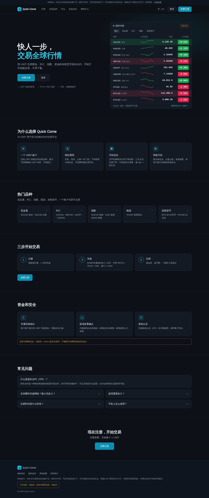

**手机版（390 宽）**：先是标语和两个大按钮，第二屏就是行情列表（8 个品种，每行是名称 + 卖价 + 涨跌色块，和客户端手机行情页一样）；各模块改成单列；底部固定"登录 | 免费注册"两个按钮，滑到哪里都能注册。

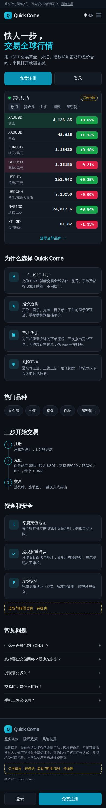

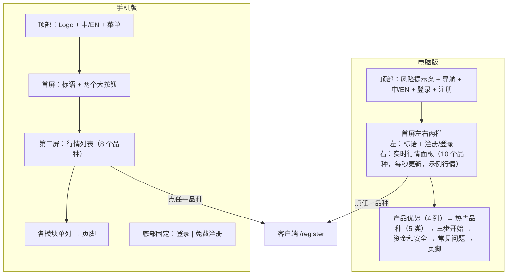

这张图想说明：两端的内容一样，但**页面结构分开设计**（C64）。电脑版首屏就把行情面板放在标语旁边；手机版把行情放到第二屏，并用底部固定按钮代替电脑版顶部的注册按钮。行情面板直接沿用客户端的样子，客户从官网点进客户端时看到的是同一套界面。

## 1. 怎么调研的
- 用无头浏览器（Playwright + Chromium）实际打开各家官网首页，电脑版 1440×900、手机版 390×844（iPhone 的浏览器标识），截首屏和整页，并保存页面文字。
- 判断"行情是否跳动"：同一页面打开后隔 15 秒读两次价格文字，并记录 8 秒内页面上数字的变化次数。
- **本机网络出口在美国**：Exness、Bitget、Doo Prime 都弹出了"美国用户不提供服务"的提示，OKX、Plus500 被直接转到美国站。所以截图是这些网站的**美国访客版本**，中国大陆用户看到的页面可能不同（**推断，未验证**）。
- 标注方式（C66）：
  - 【证】查到资料证实：本次实际打开页面看到的，或截图里能看到的。
  - 【推】推断，未验证。
  - 没查到的写"未查到"。
- 竞品截图只放在仓库里做内部调研对比，不会用到官网上。

### 1.1 打开情况
| 网站 | 打开的地址 | 结果 |
|---|---|---|
| Exness | https://www.exness.com/ | 打开。先弹出"不向美国居民提供服务"，勾选确认后看到完整首页 |
| IC Markets | https://www.icmarkets.com/global/en/ | 打开。被转到 https://www.ic.com/en/ （品牌现在叫 IC） |
| Pepperstone | https://pepperstone.com/en/ | 打开。顶部提示"按你的位置，另一个牌照的网站可能更适合你" |
| Mitrade | https://www.mitrade.com/ | 打开。被转到 https://www.mitrade.com/en |
| eToro | https://www.etoro.com/ | 打开 |
| Bitget（中文） | https://www.bitget.com/zh-CN | 部分打开。弹出"受限 IP"（美国），首屏轮播没有加载出来，下面的模块正常 |
| XM | https://www.xm.com/ 、https://www.xmglobal.com/ | **未能打开**（两个地址都返回 403） |
| Bybit | https://www.bybit.com/en/tradfi/ 、https://www.bybit.com/en/ | **未能打开**（返回 503，推断是地区限制） |
| Vantage | https://www.vantagemarkets.com/ | **未能打开**（Cloudflare 验证页，403） |
| OKX | https://www.okx.com/ | 打开，但被转到美国站 https://www.okx.com/en-us ，只有现货买币，没有差价合约内容，**不纳入对比** |
| Plus500 | https://www.plus500.com/ | 打开，但被转到美国站 https://us.plus500.com/en/ ，内容是期货和预测市场，**不纳入对比** |
| Doo Prime | https://www.dooprime.com/ | 打开，弹出司法辖区提示；品种行情模块是空白，**不纳入对比** |

纳入对比的是前 6 家：5 家差价合约券商（Exness、IC、Pepperstone、Mitrade、eToro）+ 1 家做传统金融合约的加密交易所（Bitget 中文版）。

## 2. 竞品对比
截图（压缩后，电脑版是整页最上面一段缩小一半，手机版是整页最上面 2400 像素）：

| | 电脑版 | 手机版 |
|---|---|---|
| Exness | 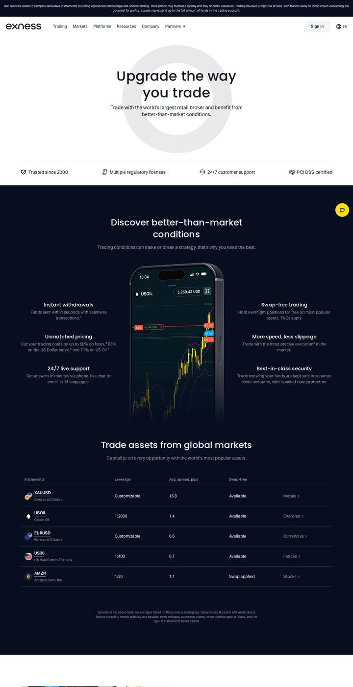 | 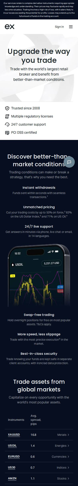 |
| IC | 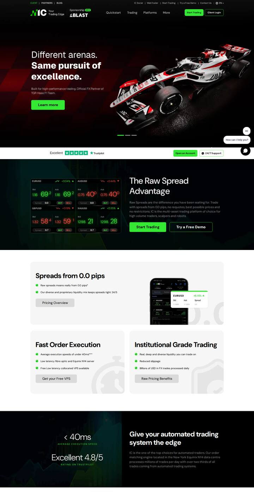 | 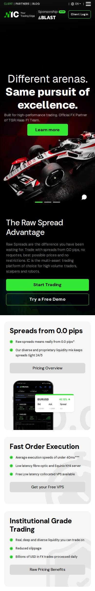 |
| Pepperstone | 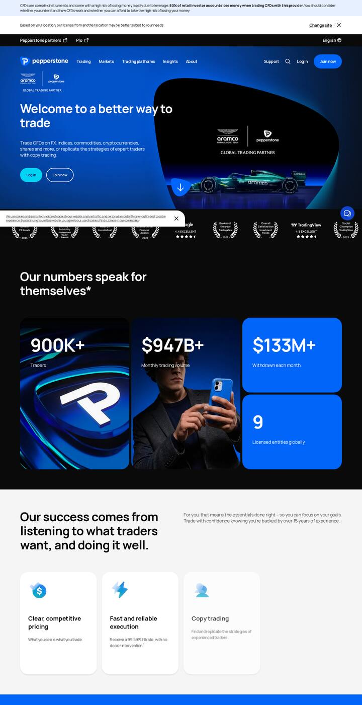 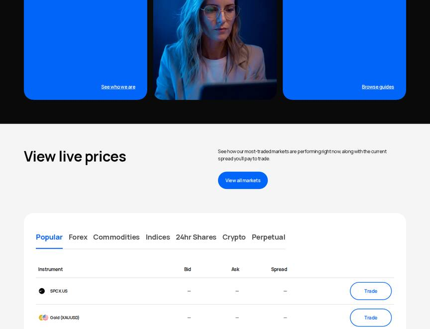 | 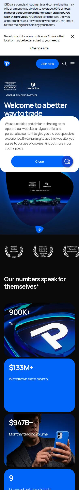 |
| Mitrade | 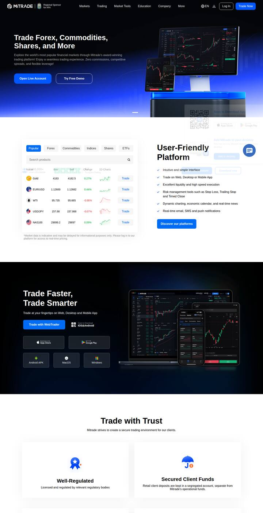 |  |
| eToro |  | 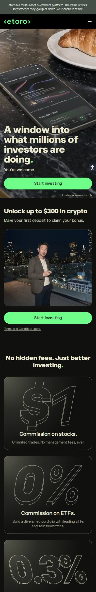 |
| Bitget | 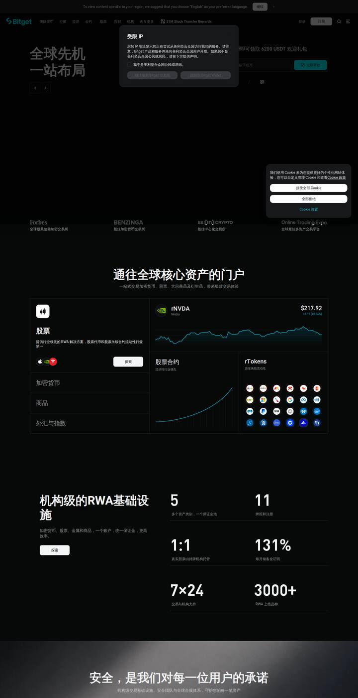 | 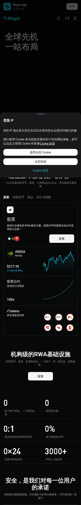 |

### 2.1 首屏结构、注册入口、配色
| 网站 | 首屏结构 | 注册入口 | 配色 |
|---|---|---|---|
| Exness | 居中大标题 + 一句说明，下面一排 4 个信任点（成立年份、多个牌照、24/7 客服、PCI DSS）【证】 | 顶部只有"Sign in"，首屏没有大注册按钮【证】 | 白底首屏，往下切换成深海军蓝；品牌黄只用在小按钮上【证】 |
| IC | 全屏大图轮播（赞助赛事），底部一排大数字（0.0 点差、1:5000 杠杆等）【证】 | 顶部右上角"Start Trading"（荧光绿）+"Client Login"【证】 | 黑底 + 荧光绿【证】 |
| Pepperstone | 左文字右大图（赞助 F1），下面是奖项条和"数字说话"卡片【证】 | 顶部"Log in" + "Join now"，首屏再放一组【证】 | 品牌蓝 + 黑【证】 |
| Mitrade | 左文字 + 两个按钮（开真实账户 / 免费模拟），右边是电脑和手机的产品图【证】 | 首屏"Open Live Account"大按钮 + 顶部"Trade Now"【证】 | 首屏深蓝渐变，往下白底，蓝色按钮【证】 |
| eToro | 全屏生活方式大图 + 大标题 + 一个绿色按钮【证】 | 顶部"Log in" + "Start Investing"（绿色）【证】 | 深灰绿 + 亮绿【证】 |
| Bitget | 左边大标题，右边是注册送礼包 + 邮箱/手机号输入框（从页面文字看到，首屏图片没加载出来）【证】 | 顶部"登录""注册"；首屏直接放注册输入框【证】 | 纯黑 + 青色【证】 |

### 2.2 行情怎么展示、会不会跳动
| 网站 | 首页有没有行情 | 实测是否跳动 |
|---|---|---|
| Exness | 有一张"热门品种"表，但只有杠杆、平均点差、是否免隔夜费，**没有实时价格**【证】 | 不跳（表里没有价格）【证】 |
| IC | 电脑版有 2×2 的报价小卡（买价/卖价大字、点差、BUY/SELL 按钮、涨跌幅）【证】 | 不跳：15 秒内两次读到的数字相同，黄金显示 1298 明显不是当前价格，判断是静态示意【证 + 推】 |
| Pepperstone | "View live prices"表：分类标签（热门/外汇/商品/指数…）+ 买价、卖价、点差 + Trade 按钮【证】 | 本机打开时价格一栏全部显示"—"，没有加载出来；是否跳动**未验证** |
| Mitrade | 首页第二屏是行情表：分类标签 + 搜索 + 买价、卖价、涨跌幅、当日走势小图 + Trade 按钮；表下注明"行情仅供参考，可能有延迟"【证】 | 每次打开是最新价格（两次打开数字不同），但同一页面 15 秒内没有变化，**不是逐秒跳动**【证】 |
| eToro | 没有独立行情表；产品图里的手机界面上有价格【证】 | 未验证（只是产品图的一部分） |
| Bitget | "通往全球核心资产的门户"模块：一张股票卡片显示价格、涨跌和走势图【证】 | **会跳**：15 秒内价格从 $217.85 变成 $217.91【证】 |

结论：
1. 差价合约券商的官网普遍**只放"一张行情表"**，而且大多不逐秒跳动（Mitrade 打开时取最新、IC 是静态示意）【证】。逐秒跳动的只看到 Bitget 一家【证】。Quick Come 要做的"每秒更新、闪绿/红"在这几家里是少见的做法，能体现"实时"，但也要有对应的接口和服务器负载（见 5.1）【推】。
2. 行情表的通用结构：**分类标签 + 品种名 + 价格 + 涨跌幅 + 去交易的按钮**，Mitrade 和 Pepperstone 都是这样【证】。
3. 显示行情的几家都写了"行情仅供参考、可能有延迟"这类说明（Mitrade）【证】。我们测试环境是模拟行情，本来就要标"示例行情"。

### 2.3 信任要素（资金安全、监管）怎么放
| 网站 | 放在哪里 | 怎么写 |
|---|---|---|
| Exness | 首屏标题下一排 4 个信任点；中间"你的安全是我们的首要任务"一块；页脚逐个列出各地公司和牌照号【证】 | 资金放在独立客户账户、负余额保护【证】 |
| IC | 首屏下面 Trustpilot 评分条；页脚写公司和牌照号【证】 | 以"执行速度、点差"为主，安全写得少【证】 |
| Pepperstone | 页面最顶部常驻风险提示（"80% 的散户账户亏损"）；"数字说话"卡片里有"9 个持牌实体"；页脚写公司和牌照【证】 | 强调在澳洲、英国受监管【证】 |
| Mitrade | 第三屏"Trade with Trust"：受监管、客户资金隔离两张卡片；页脚列出 6 个地区的公司和牌照【证】 | 客户资金放在隔离账户【证】 |
| eToro | "Regulated entities"一节列出监管机构名称；页面顶部常驻一行风险提示【证】 | 客户资金在大银行的隔离账户【证】 |
| Bitget | "安全，是我们对每一位用户的承诺"一节：保护基金、储备金证明、风控中心【证】 | 加密交易所的写法：储备金证明、保护基金【证】 |

结论：
1. **风险提示放在页面最顶部、常驻一行**：Exness、Pepperstone、eToro 都这样做【证】。Quick Come 三个方向都放了。
2. **牌照和公司信息都放在页脚**，首页中间只放一句概括【证】。Quick Come 现在没有这些信息，所以三个方向都在"资金和安全"和页脚放了带虚线框的"监管与牌照信息：待提供"，**不编写任何牌照、监管、公司资质**。
3. 我们可以如实写的安全点来自产品本身：专属充值地址、提现白名单 + 冷静期 + 人工审核、提现前必须身份认证（见《v1-需求说明书》4.4）。

### 2.4 手机版的做法
| 网站 | 手机版和电脑版的区别 |
|---|---|
| Exness | 顶部 Logo 缩成"ex"，只留"Sign in"和菜单；品种表从 5 列减到 3 列（去掉杠杆和免隔夜费）【证】 |
| IC | 电脑版的报价小卡在手机上**直接去掉**；按钮改成整行宽【证】 |
| Pepperstone | 顶部只留"Join now"、搜索、菜单，"Log in"收进菜单；数字卡片改成单列【证】 |
| Mitrade | 顶部只留"Log in"和菜单；行情表去掉走势小图和每行的 Trade 按钮，表下放一个整行宽的"Trade"按钮；品种名过长时截断【证】 |
| eToro | 顶部只有 Logo 和菜单，注册按钮放到首屏，整行宽【证】 |
| Bitget | 顶部多一条"打开 Bitget App"的横幅；模块改成单列【证】 |

结论：
1. 手机上**顶部只留一个按钮**（登录或注册二选一）+ 菜单，大按钮放在首屏、整行宽【证】。
2. 手机行情表**减列**：保留"名称 + 价格 + 涨跌"，去掉走势图和每行的按钮【证：Exness、Mitrade】。
3. 没有看到哪家在手机上固定底部注册按钮【证：6 家都没有】。我们的方向 A、C 加了底部固定按钮，这是参考客户端手机版底部固定"卖出 / 买入"的做法，属于**我们自己的设计，不是行业惯例**【推】。

## 3. 三个风格方向
三个方向用同一套文案和同一组示例行情，只比较结构和视觉。
- 字体：都只用系统字体（中文：苹方、微软雅黑、Noto Sans CJK、文泉驿等，和客户端 `--sans` 一样）。数字用等宽字体：优先用自托管的开源字体 JetBrains Mono（OFL 许可，和客户端 `--mono` 一样），没有就退回系统等宽字体。**不加载 Google 字体或任何外部资源**（AC-29）；对比图截图时已检查，6 个页面没有任何外部请求（实际执行）。
- 对比图都用"绿涨红跌"，跟客户端默认一致（客户端可切换）。

### 方向 A：和客户端同一套深色视觉（推荐）
- 一句话定位：**官网就是客户端的"门面"**——同样的深色、同样的青色强调色、同样的行情表，客户从官网点进客户端不会觉得换了一家。
- 配色：完全沿用客户端深色 token：底色 `#0d1117`，卡片 `#131a24`，边框 `#222c3a`，文字 `#e6edf3`，强调色青 `#22d3ee`，主按钮 `#0891b2`，涨 `#22c55e`，跌 `#f43f5e`。"示例行情"和"待提供"用琥珀色 `#fbbf24` 虚线框。
- 首屏和行情跳动：
  - 电脑：左右两栏。右边行情面板 = 客户端电脑版行情表的缩小版（分类标签、品种、今日走势小图、卖价、今日涨跌色块），10 个品种。价格变动时整行底色闪一下绿或红（600 毫秒）。
  - 手机：第二屏是行情列表，8 个品种，每行是"代码 + 中文名 | 卖价 | 涨跌色块"，和客户端手机行情页一样。底部固定"登录 | 免费注册"。
- 适合 Quick Come 的理由：
  - 官网和产品是一家（这是这次需求里明确要求至少有一个方向做到的）。
  - 客户端风格 C 本来就是为大陆用户选的深色、高对比外观（《v1-UI风格调研》），官网沿用不用再讨论一次颜色。
  - 研发可以直接复用客户端的 token 和行情行的样式，工作量最小【推】。
- 风险：
  - 深色 + 表格的外观偏"工具"，营销感弱，第一次来的新手可能觉得不够亲切。
  - 和 IC、Bitget 等深色网站在观感上区别不大，品牌辨识度主要靠 Logo 和标语。

### 方向 B：加密交易所营销风
- 一句话定位：**像币圈交易所的官网**——纯黑底、超大标题、荧光强调色、横向滚动的行情带。参考 Bitget、IC 的做法。
- 配色：底色 `#050505`，卡片 `#111113`，强调色荧光黄绿 `#c6f135`（按钮上用黑字），涨 `#2ee67a`，跌 `#ff4d6a`。
- 首屏和行情跳动：
  - 电脑：居中超大标题（76 像素）+ 两个圆角大按钮；首屏下面是一条横向滚动的行情带（10 个品种循环滚动，变动时闪色），再下面是 4 个大数字（约 50 个品种、3 条链、1 USDT 起充、中英双语）。往下"热门品种"一节再放一张涨跌榜。
  - 手机：标题居中，两个整行宽按钮；行情带在第二屏；底部一个悬浮的"免费注册"按钮。
- 适合 Quick Come 的理由：
  - 客户是用 USDT 的大陆用户，对加密交易所的外观最熟悉【推】。
  - 视觉冲击力最强，适合做投放落地页【推】。
- 风险：
  - 滚动行情带在手机上一屏只能看到 2–3 个品种，信息量比列表少；一直滚动的数字不好点。
  - 和客户端（风格 C）的颜色、按钮形状都不一样，点进客户端会有"换了一家"的感觉。
  - 大数字模块容易诱导写夸张数据；我们只能写产品里真实的数字。

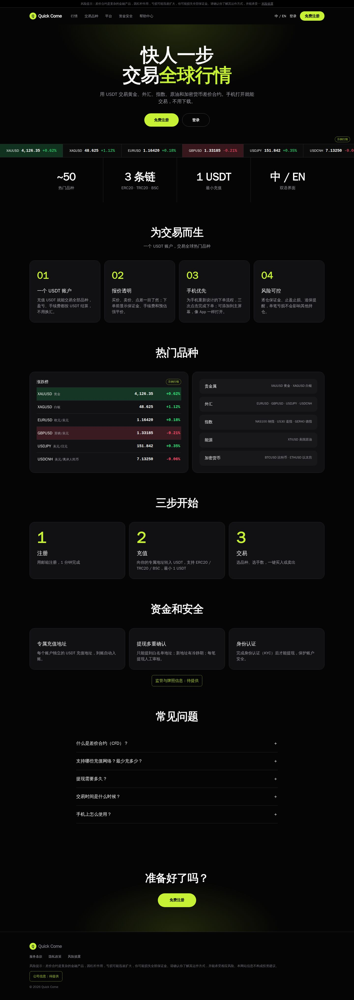
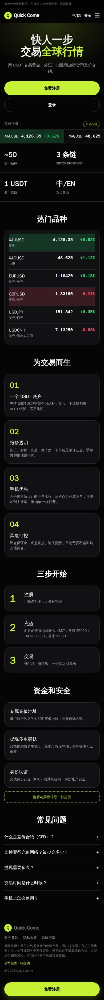

### 方向 C：券商明亮风
- 一句话定位：**像正规券商的官网**——白底、品牌蓝、首屏放手机产品图，行情表做成白色卡片。参考 Mitrade、Exness、Pepperstone。
- 配色：底色 `#ffffff`，浅灰分区 `#f5f7fb`，文字 `#0b1b33`，品牌蓝 `#1652f0`，涨 `#0f9d58`，跌 `#d93025`；页脚深海军蓝 `#0b1b33`。
- 首屏和行情跳动：
  - 电脑：左文字右手机产品图（手机里画的是客户端深色行情页）；首屏下面一排信任条；第二屏是"实时行情"白色卡片：分类标签 + 品种 + 今日走势 + 卖价 + 今日涨跌 + 每行"交易"按钮（Mitrade 的结构），卡片下写"测试环境为模拟行情"。
  - 手机：标题居中，两个整行宽按钮，信任条 2×2；行情表减成 3 列，去掉走势和按钮（Mitrade 手机版的做法）；底部固定"登录 | 免费注册"。
- 适合 Quick Come 的理由：
  - 看起来最"正规"，适合第一次接触差价合约的新手【推】。
  - 结构和调研里的券商最接近，用户熟悉【证：Mitrade、Pepperstone 的行情表结构】。
- 风险：
  - 白底官网和深色客户端反差最大，点进去落差明显。
  - "正规券商"的观感会让人期待看到牌照信息，而我们现在只能写"待提供"，空着的位置会更显眼。

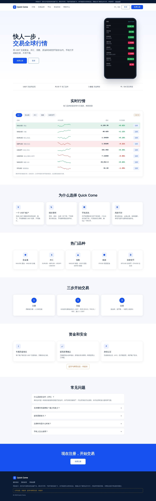
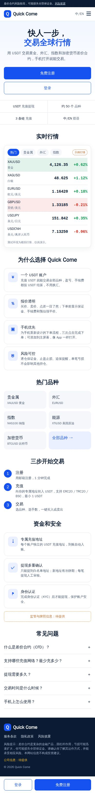

### 三个方向对比
| | **A 同一套深色（推荐）** | B 交易所营销风 | C 券商明亮风 |
|---|---|---|---|
| 和客户端是不是"一家" | 是（同一套 token） | 否 | 否（只有产品图是深色） |
| 行情信息量（手机首两屏） | 8 个品种列表 | 2–3 个（滚动带） | 6 个品种列表 |
| 营销冲击力 | 中 | 高 | 中 |
| 新手友好 | 中 | 中低 | 高 |
| 缺少牌照信息时的观感 | 影响小 | 影响小 | 影响较大 |
| 研发工作量（相对） | 小（复用客户端样式） | 中 | 中 |

## 4. 推荐方向 A 和理由
1. **官网和产品是一家**：官网的行情面板就是客户端行情表的样子，点"注册"进入客户端后，颜色、字体、涨跌色块都一样。
2. **行情是首页的主角**：这次需求把"实时行情跳动"排在标语之后的第一位。方向 A 在电脑版首屏、手机版第二屏就能看到 8–10 个品种，信息量是三个方向里最多的。
3. **不用重新讨论颜色**：深色、绿涨红跌、可切换，都已经在客户端定过（U2、U3）。
4. **缺牌照信息时影响最小**：深色"工具感"的页面不太依赖监管背书，"待提供"的位置不显眼。
5. 方向 A 可以借用 B 的一点：行情面板上方加一句醒目的大标题，弥补营销感（不影响结构）。

## 5. 选定后怎么做（研发预估，未开始）
### 5.1 行情数据从哪里来（需要技术方案）
- **实际查代码**：现在的报价接口 `GET /api/market/quotes` 和推送 `WS /api/ws/market` 都要求登录（`backend/src/main/java/com/falconx/lite/account/auth/SessionFilter.java` 的公开接口清单里没有行情）。官网的访客没有登录，**不能直接用**。
- 建议：新增一个公开的只读接口，只返回 8–12 个热门品种的卖价和今日涨跌幅，服务端缓存、每秒刷新一次；官网每秒拉一次（或用一个只推这些品种的公开推送）。不返回买价以外的交易参数，也不返回任何风控数据（约定 4）。具体放在技术方案里给 Amos 审核【推】。
- 测试环境是模拟行情，页面显示"示例行情"；正式环境改成"行情仅供参考，以交易页面为准"之类的说明（文案待 Amos 确认）。
- 后端拿不到行情时，官网显示"—"，不影响页面其他内容。

### 5.2 其他
- 官网是一个独立的静态站点（不需要登录），和客户端分开部署；"注册""登录"链接到客户端 `/register`、`/login`。域名待定（第 6 节 W3）。
- 页面结构手机和电脑各写一套（C64），按宽度切换；文案、行情数据、翻译文件共用。
- 中英文切换：右上角"中 / EN"，翻译放在官网自己的翻译文件里，PM 可以改文案。
- 产品名：客户端里现在还有"FalconX"字样（例如 `web/client/src/i18n/zh-CN.json` 的登录页标题"登录 FalconX"），改名要一起改，单独列成任务。
- 对比图的来源：`assets/v2/website-research/mockups/gen.cjs`，运行 `node gen.cjs` 生成 6 个 HTML；不带参数打开时行情每秒随机跳动并闪色，可以直接看效果；截图时加 `?static=1` 固定数字。研发写官网时可以参考这里的结构和 CSS。

## 6. 请你选择
| 编号 | 问题 | 选项 | 默认（建议） |
|---|---|---|---|
| W1 | 官网风格方向 | **A 同一套深色** / B 交易所营销风 / C 券商明亮风 | A |
| W2 | 官网主题 | **只做深色** / 深色 + 浅色可切换 | 只做深色（客户端已有浅色，官网先不做，减少工作量） |
| W3 | 官网域名 | 正式 `quickcome.online`（和 `www.`）、测试 `test-www.quickcome.online`（和 test-app、test-admin 一致，见《v2-需求说明书》2.1）/ 其他 | 按左边，DNS 由 Amos 配置 |
| W4 | 行情数据来源 | **新增公开只读的热门品种报价接口**（每秒更新）/ 官网只放静态示例数字 | 新增公开接口（技术方案里细化后再审核） |
| W5 | 行情面板放哪些品种 | **默认 10 个**：黄金、白银、欧元/美元、英镑/美元、美元/日元、美元/离岸人民币、纳指 100、美国原油、比特币、以太坊 / 后台"热门"品种 | 默认 10 个；以后改成跟后台"热门"标记走 |
| W6 | 默认语言 | **中文**，右上角切英文 / 按浏览器语言 | 中文 |
| W7 | 标语 | **"快人一步，交易全球行情"** / 你给 | 先用左边，可随时改 |
| W8 | 手机底部固定注册按钮 | **要** / 不要 | 要（竞品都没有，是我们参考客户端加的） |
| W9 | 顶部常驻风险提示条 | **常驻一行，点开看风险披露** / 只放页脚 | 常驻（Exness、Pepperstone、eToro 都这样做） |
| W10 | Logo | 先用临时文字 Logo（方块"Q" + Quick Come）/ 你提供正式 Logo | 先用临时的，正式 Logo 提供后替换 |

**需要你提供（不提供就一直显示"待提供"）**：
- 监管和牌照信息、公司名称和注册地址（官网不编写任何这类信息）。
- 服务条款、隐私政策、风险披露三个页面的正文（PM 可以先起草框架，正文需要你或法务确认）。
- 是否有客服、客服渠道和时间（对比图里没有写客服）。
- 提现到账时效（常见问题"提现需要多久"的答案）。

## 7. 未验证事项
- 竞品截图都是从美国网络出口打开的，**中国大陆网络下各家首页可能不同**，没有验证。
- Pepperstone 的行情表价格没有加载出来，是否逐秒跳动未验证。
- XM、Bybit、Vantage 没能打开，这三家的做法未查到。
- 对比图是示意稿，没有在真机上打开过；中文字体是本机的文泉驿正黑，iPhone、安卓、Windows 上实际显示的是苹方、思源黑体、微软雅黑，字宽会略有不同。

## 8. 参考链接（本次实际打开的）
- Exness：https://www.exness.com/
- IC：https://www.icmarkets.com/global/en/ （转到 https://www.ic.com/en/ ）
- Pepperstone：https://pepperstone.com/en/
- Mitrade：https://www.mitrade.com/ （转到 https://www.mitrade.com/en ）
- eToro：https://www.etoro.com/
- Bitget：https://www.bitget.com/zh-CN
- 未能打开或不纳入对比：https://www.xm.com/ 、https://www.xmglobal.com/ 、https://www.bybit.com/en/tradfi/ 、https://www.bybit.com/en/ 、https://www.vantagemarkets.com/ 、https://www.okx.com/ 、https://www.plus500.com/ 、https://www.dooprime.com/
