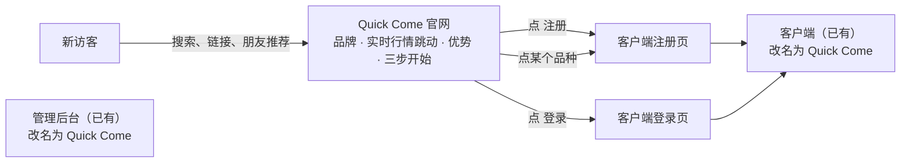
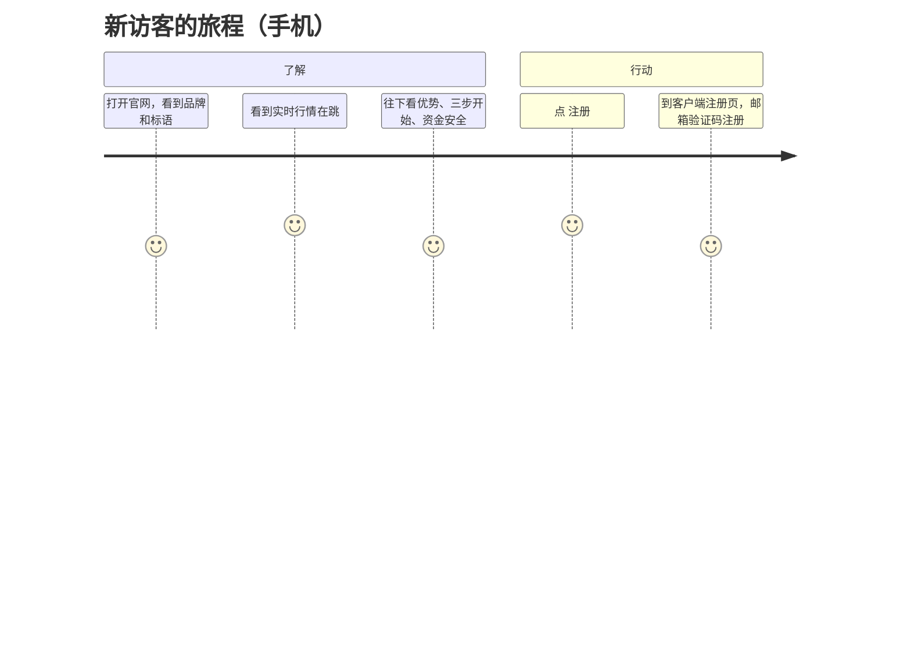
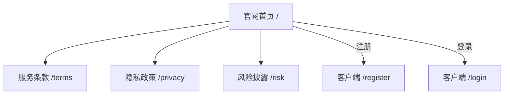

# Quick Come v2 需求说明书：官网 + 品牌改名
- 版本：v2.0 草稿（2026-10-16）
- 变更历史：v2.0 草稿（2026-10-16）首次创建；已按测试预审意见修订（见文末"跨角色反馈"TQ2-01～TQ2-05）
- 依据：agents main `2697d91`（v0.10）；Amos 2026-10-16 的原话："做个官网宣传当前品牌，官网上可以显示一些产品的跳动……新客户会通过官网了解我们，然后通过官网可以发起注册或登录"；"品牌用 Quick Come，别忘记修改前后台系统的品牌，其他按照建议"（Q1 品牌 = Quick Come，Q2–Q11 按建议）
- 状态：**草稿，交 Amos 审核**（和《v2-官网风格调研》一起）。审核通过、选定风格后，研发做高保真原型（Vercel 预览）；原型确认后才拆任务、开发。
- 上一版：《v1-需求说明书》v1.5（交易系统本身，不变）
- 编写：PM；测试预审验收标准的可测性

## 一图看懂



这张图想说明：本次新增一个**官网**，负责介绍品牌、展示实时行情，把新客户引到**已有的**注册和登录页。官网自己不做注册表单。同时把客户端、后台、邮件、推送里的产品名从 FalconX 改成 **Quick Come**。

## 1. 目标
| 编号 | 目标 | 怎么衡量 |
|---|---|---|
| G2-1 | 新客户能通过官网了解 Quick Come | 官网首页有品牌、行情、优势、三步开始、资金安全、常见问题；手机上 3 秒内看到首屏（AC2-09） |
| G2-2 | 官网能把访客引到注册和登录 | 首页任何位置一次点击就能到注册或登录页（AC2-04） |
| G2-3 | 全系统品牌统一为 Quick Come | 客户看得到的地方没有 "FalconX" 字样（AC2-11、AC2-12） |

## 2. 范围
### 2.1 做什么
1. **官网**：一个首页，加上服务条款、隐私政策、风险披露三个文字页面。中英文；手机和电脑分开设计（C64）。
2. **官网实时行情**：8–12 个热门品种，显示卖价和当日涨跌幅，价格变动时闪一下绿或红，约每秒更新；点品种跳到注册页。不登录也能看。
3. **品牌改名**：客户端、后台、邮件、推送、PWA 名称（添加到主屏幕后显示的名字）、浏览器标签页标题里的 FalconX 改成 Quick Come；"Lite""原型 v0.1"这类字样一并去掉。
4. **测试环境**：官网放在 `https://test-www.quickcome.online`，和测试环境同一台服务器，跟着现有的自动更新一起发布。

### 2.2 明确不做
- 官网里**不做**注册、登录表单，统一跳到客户端。
- **不做**博客、新闻、行情分析文章、在线客服、多级代理或推广返佣页面。
- **不加**任何第三方统计和广告代码（不用 Google Analytics、Google 字体等，AC-29）。
- **不编写**任何牌照、监管、公司资质内容。Amos 提供前一律用占位文字，并标注"待提供"。
- **不改**代码内部的名字（例如包名 `falconx`、数据库名、镜像名）：客户看不到，改了风险大、收益小。
- 生产环境的官网域名：等 Amos 另定，本次只做测试环境。

## 3. 使用者和场景
| 使用者 | 场景 |
|---|---|
| 新访客（手机为主） | 从链接打开官网 → 看品牌和实时行情 → 往下看优势、怎么开始、资金安全 → 点"注册" |
| 老客户 | 打开官网 → 点"登录"进入客户端 |
| 运营 | 官网文案改动由研发改文案文件后发布；本次**不做**官网内容管理后台 |



## 4. 功能需求
### 4.1 官网首页（从上到下）
| # | 区块 | 内容 |
|---|---|---|
| 1 | 顶部导航 | Quick Come Logo、语言切换（中文 / English）、"登录"、"注册"（主按钮）。手机上收进菜单，"注册"按钮始终可见 |
| 2 | 首屏 | 标语（Amos 提供，见第 9 节）、一句副标题、"立即注册"按钮、行情跳动区（见 4.2） |
| 3 | 产品优势 | 3–4 条，内容只写系统已经具备的能力（例如 USDT 充提、三条链、止盈止损、手机可用），不写夸大或无法证实的说法（见第 9 节） |
| 4 | 热门品种 | 按类别（外汇、贵金属、指数、加密货币等）列出品种名称，点任意一个跳注册 |
| 5 | 三步开始 | 注册 → 充值 USDT → 开始交易，每步一句说明 |
| 6 | 资金和安全 | 只写已经做到的：例如提现只能到白名单地址、冷静期、大额提现延迟和人工审核、充值地址的私钥不放在服务器上（以研发确认的为准）；不写牌照 |
| 7 | 常见问题 | 5–8 条（PM 起草，Amos 确认） |
| 8 | 页脚 | 风险提示（固定显示）、服务条款、隐私政策、风险披露、联系邮箱（Amos 提供）、版权（公司主体，Amos 提供） |

### 4.2 官网行情跳动
- 品种：默认 8–12 个（PM 建议：XAUUSD、XAGUSD、BTCUSD、ETHUSD、EURUSD、GBPUSD、USDJPY、US30 或 NAS100、USOIL，最终以品种表为准），研发做成可配置。
- 显示：品种名（中英文跟随语言）、**卖价**、**当日涨跌幅**；价格变动时闪绿（涨）或红（跌），颜色跟客户端的涨跌色一致。
- 更新：约每秒一次。行情断开或休市时显示"休市"或"暂无报价"，**不显示过期价格**。
- 测试环境的价格来自模拟报价源，页面上标注"示例行情"；**生产环境能不能公开展示 LP 报价，等 Amos 和 LP 确认**（第 9 节）。
- 只给这 8–12 个品种的卖价和涨跌幅。官网**拿不到**任何账户、持仓、风控数据。

### 4.3 文字页面
服务条款、隐私政策、风险披露：PM 起草框架，标注"**需法务审核**"，正式文案由 Amos 提供（N-12）。

### 4.4 注册和登录入口
"注册"跳客户端注册页，"登录"跳客户端登录页。测试环境是 `https://test-app.quickcome.online`，带上当前语言，到了客户端也是同一种语言。

### 4.5 品牌改名（客户端、后台、通知）
| 位置 | 现在 | 改为 |
|---|---|---|
| 客户端顶栏 Logo 文字 | FalconX + "Lite" 标记 | Quick Come（Logo 图形见第 9 节） |
| 客户端登录、注册页标题 | "登录 FalconX" | "登录 Quick Come" |
| 客户端"关于"或版本信息 | "FalconX Lite · 原型 v0.1" | "Quick Come"（版本号由研发定） |
| 浏览器标签页标题、PWA 名称和简称、图标 | FalconX | Quick Come |
| 管理后台 Logo、标题 | FalconX 管理后台 | Quick Come 管理后台 |
| 邮件（验证码等）标题和正文 | "FalconX 验证码" | "Quick Come 验证码"（测试环境仍带"[测试]"前缀） |
| 推送标题 | FalconX | Quick Come |

### 4.6 非功能要求
- 手机首屏 3 秒内可见（测试环境从国内测，AC-30 的同一批测试人员）。
- 首页不依赖任何 Google 域名（AC-29）。
- 手机 390 宽和电脑 1280、1440 宽都没有横向滚动。

## 5. 站点地图



## 6. 线框图（低保真，高保真由研发在原型里做）
**手机（390 宽）**
```
┌──────────────────────────┐
│ [Logo] Quick Come  ☰ [注册]│
├──────────────────────────┤
│   标语（两行）            │
│   副标题                  │
│   [ 立即注册 ]            │
│ ┌──────────────────────┐ │
│ │ 示例行情              │ │
│ │ XAUUSD 2,345.67 +0.8% │ │  ← 变动时闪绿/红
│ │ BTCUSD 63,210.5 −1.2% │ │
│ │ EURUSD 1.08452 +0.1%  │ │
│ │ ……（可横向或纵向滚动）│ │
│ └──────────────────────┘ │
├──────────────────────────┤
│ 产品优势（卡片，纵向排列）│
│ 热门品种（标签）          │
│ 三步开始 ①②③              │
│ 资金和安全                │
│ 常见问题（折叠）          │
├──────────────────────────┤
│ 风险提示 · 条款 · 隐私    │
└──────────────────────────┘
```
**电脑（1440 宽）**
```
┌──────────────────────────────────────────────────────────┐
│ [Logo] Quick Come      产品 品种 安全 常见问题  中/EN [登录][注册] │
├──────────────────────────────┬───────────────────────────┤
│ 标语（大字）                  │  行情面板（8–12 行）        │
│ 副标题                        │  品种  卖价  涨跌幅         │
│ [ 立即注册 ]  [ 登录 ]        │  ……  变动时闪绿/红          │
├──────────────────────────────┴───────────────────────────┤
│ 产品优势（4 列）                                          │
│ 热门品种 · 三步开始 · 资金和安全 · 常见问题                │
├──────────────────────────────────────────────────────────┤
│ 页脚：风险提示 · 条款 · 隐私 · 风险披露 · 联系邮箱 · 版权   │
└──────────────────────────────────────────────────────────┘
```
视觉风格见《v2-官网风格调研》（推荐方向 A：和客户端同一套深色），Amos 选定后由研发出高保真原型。

## 7. 验收标准
| 编号 | 验收标准 | 判定口径 | 测试方式 |
|---|---|---|---|
| AC2-01 | 官网首页包含 4.1 的 8 个区块 | 逐块对照 4.1，缺一个就不通过 | 自动（端到端检查区块存在）+ 人工 |
| AC2-02 | 行情跳动 | 8–12 个品种；开市品种 10 秒内价格至少变动一次，变动时有绿或红的闪烁；休市品种显示"休市"，不显示价格 | 自动（端到端：用模拟报价推动价格，检查数字和颜色变化） |
| AC2-03 | 官网行情不泄露其他数据 | 记录官网页面收到的所有接口返回和推送，只有品种、卖价、涨跌幅、时间、状态这些字段，没有账户、持仓、敞口、阈值等字段 | 自动（同 AC-23 的检查方法） |
| AC2-04 | 注册、登录入口 | 首页顶部导航、首屏、每个品种点一次就到客户端注册或登录页，语言和官网一致 | 自动 |
| AC2-05 | 中英文 | 官网切换英文后没有中文残留，切回中文没有英文残留（品种代码除外）；翻译键缺失由 CI 检查 | 自动 + 人工 |
| AC2-06 | 手机和电脑分开设计 | 390 宽是手机结构（导航收进菜单、注册按钮始终可见），1280 和 1440 宽是电脑结构；三种宽度都没有横向滚动 | 自动（截图 + 检查横向滚动） |
| AC2-07 | 不依赖 Google | 端到端记录官网的全部请求，没有任何 Google 域名 | 自动 |
| AC2-08 | 文字页面 | 服务条款、隐私政策、风险披露三个页面都能打开，标注"需法务审核"；页脚的风险提示在每个页面都显示 | 自动 + 人工 |
| AC2-09 | 首屏速度 | 国内电信、联通、移动各一处，手机 4G 或 5G 打开官网，首屏（标语和行情区）≤3 秒可见；测 3 次取中位数 | 真机（Amos 安排，和 AC-30 一起） |
| AC2-10 | 测试环境地址 | `https://test-www.quickcome.online` 可以访问，证书有效，http 跳 https，页面有测试环境标识 | 自动（`deploy/verify.sh` 扩展） |
| AC2-11 | 客户端和后台改名 | 客户端、后台所有页面的可见文字、标签页标题、PWA 名称里没有 "FalconX"；构建产物里搜不到对用户可见的 "FalconX" 字样 | 自动（构建产物扫描 + 端到端）+ 人工 |
| AC2-12 | 邮件和推送改名 | 新发出的验证码、通知邮件和推送，标题和正文是 Quick Come，没有 FalconX | 自动（后端测试）+ 真机收一封 |
| AC2-13 | 不影响现有功能 | v1 的全部自动测试和两种端到端测试照常通过 | CI |

## 8. 已有的数据怎么办（规则 C55）
| 数据 | 处理 |
|---|---|
| 内置通知模板（数据库 `notify_template`，含"FalconX 验证码"等） | 用一个新的数据库迁移把内置模板里的 FalconX 改成 Quick Come。**如果运营已经在后台改过某个模板，就不动它**（只改仍等于原始默认文字的模板），并在后台提醒运营检查 |
| 已经发出的邮件、推送、站内信记录 | 不改（历史记录保持原样） |
| 客户已经"添加到主屏幕"的 PWA | 图标和名称在下次打开、浏览器更新 manifest 后变成新名字；iOS 可能要删掉再重新添加，在常见问题里说明 |
| 测试环境里已有的客户和数据 | 不受影响 |

## 9. 需要 Amos 提供或确认的事实性内容
| # | 内容 | 默认（不提供时） |
|---|---|---|
| F2-1 | **Quick Come 的 Logo**：以前 Quick Come 官网用过的还用吗？请提供原始文件（SVG 最好） | 先用文字 Logo "Quick Come"，图形位置留空 |
| F2-2 | **标语**（中英文各一句） | 先用《v2-官网风格调研》W7 的"快人一步，交易全球行情"，你可以随时换 |
| F2-3 | 公司主体（页脚版权）、联系邮箱 | 占位"待提供" |
| F2-4 | 牌照、监管信息 | **不写**，不放任何牌照字样 |
| F2-5 | 产品优势、资金安全的每一条说法 | PM 起草后逐条列给你确认，只写系统已经做到的 |
| F2-6 | 服务条款、隐私政策、风险披露正文 | 框架加占位，标"需法务审核" |
| F2-7 | 生产环境能否公开展示 LP 报价（LP 合同）、正式官网域名 | 上生产前确认；测试环境标"示例行情" |

## 跨角色反馈 / 分歧记录
| 编号 | 方向 | 内容 | 处理 |
|---|---|---|---|
| TQ2-01 | 测试 → PM | "行情在跳"不可测：没说多久变一次、怎么判定 | 已采纳：AC2-02 写明"开市品种 10 秒内至少变动一次、有闪烁；休市显示'休市'" |
| TQ2-02 | 测试 → PM | "没有 FalconX"范围不清：代码内部名字、历史数据算不算 | 已采纳：AC2-11 限定"用户可见的文字、标题、PWA 名称和构建产物里对用户可见的字样"；2.2 写明内部名字不改；第 8 节写历史数据不改 |
| TQ2-03 | 测试 → PM | "首屏 3 秒"在境外测试环境无法执行 | 已采纳：AC2-09 写明由 Amos 安排国内三家运营商真机测试，测 3 次取中位数 |
| TQ2-04 | 测试 → PM | 官网行情是公开接口，要防止被拿来刷数据、泄露风控信息 | 已采纳：AC2-03 用 AC-23 的方法检查字段；接口只给 8–12 个品种（技术方案里写限流） |
| TQ2-05 | 测试 → PM | 通知模板改名可能覆盖运营改过的内容 | 已采纳：第 8 节只改仍等于默认文字的模板 |
