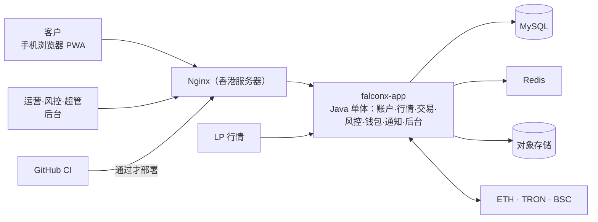

# 项目地图：FalconX Lite
- 用途：**新加入的人或大模型先读这一份**，10 分钟了解项目现在是什么样、代码在哪里、有哪些不能破坏的约定。要查具体的文件、接口、表、变量、历史问题，看《[项目索引](项目索引.md)》。
- 只写**当前状态**。按版本追加的文档（`00-架构方案.md`、技术方案）是当时的记录；和本文件不一致时，以本文件和代码为准。
- 版本：v0.8（2026-10-15，对应代码：客户端和后台的原型；后端到 S8：持仓操作）
- 维护：研发整合，各角色写自己的部分（C53）。**每次功能迭代，在同一个 PR 里更新本文件和《项目索引》**；`scripts/check-project-index.mjs` 在 CI 里检查索引（C54）。
- 变更历史：v0.1（2026-10-14）首次创建框架（规则 C53：架构方案审核时建立框架，首次合并到测试环境前补完整）；v0.2（2026-10-14）加入原型阶段的前端代码、Vercel 原型环境；v0.3（2026-10-15）客户端改为手机和电脑分开设计（UI 风格 C），补充页面结构约定；v0.4（2026-10-15）S2 加入后端骨架；v0.5（2026-10-15）S3 数据库和账本；v0.6（2026-10-15）S4 注册登录；v0.7（2026-10-15）S5 KYC；v0.8（2026-10-15）S6 行情；v0.9（2026-10-15）S7 下单；v0.10（2026-10-15）S8 持仓操作

## 一图看懂

这张图想说明：所有请求经过香港服务器上的 Nginx 进入一个 Java 应用；行情从 LP 进来，资金从三条链进出。（当前处于设计阶段，详见 `00-架构方案.md`。）

## 1. 这个项目做什么
FalconX 的精简重建版：客户用 USDT 充值，交易差价合约（只做逐仓），再用 USDT 提现。客户以中国大陆为主。需求见 `需求文档/v1-需求说明书.md`。

| 业务 | 版本 | 使用者 | 页面 | 接口 | 数据 |
|---|---|---|---|---|---|
| 全部业务 | 设计中 | 客户、运营、风控、超管 | 见需求说明书第 5、6 节 | 开发开始后补充 | 开发开始后补充 |

核心流程：充值（三条链扫块入账）→ 交易（行情驱动挂单、止盈止损、强平）→ 提现（白名单、冷静期、人工审核、签名上链）。

## 2. 代码怎么分层
- 计划的目录和归属见 `00-架构方案.md` 第 3.2 节。目前有两个前端（原型）和后端骨架；端到端测试 `e2e/`、部署 `deploy/` 还没有建。
- `backend/`（研发）：Java 25、Spring Boot 4.1，Maven 项目。入口 `com.falconx.lite.FalconxLiteApplication`。
  - 7 个业务模块各一个包：`account`、`market`、`trading`、`risk`、`wallet`、`notification`、`admin`；共用代码在 `common`。每个模块的 `api` 子包是对外接口，**其他模块只能依赖 `api` 包**（ArchUnit 测试 `ModuleBoundaryTest` 强制，违反就 CI 失败）。
  - 配置在 `src/main/resources/application.yml`，只写环境变量名（`FX_*`），值由服务器提供。
  - 对外健康检查 `GET /api/health`（应用、数据库、Redis）；应用管理端点在单独端口、只监听 127.0.0.1（约定 6）。
  - 数据库：Flyway 迁移（`src/main/resources/db/migration/`）+ MyBatis XML（`src/main/resources/mapper/<模块>/`）。表名以模块名开头，只由该模块读写。规则见 `技术方案/v1-数据库设计.md`。
  - **登录**：客户端用 HttpOnly Cookie 里的会话令牌；`/api/` 下除公开接口外都由 `account` 的过滤器检查登录，其他模块用 `common.web.CurrentUser.id()` 取当前用户。所有错误统一 `{code, message, fields}`。规则见 `技术方案/v1-数据库设计.md` 第 6 节。
  - **行情**：报价源只输出原始报价，`market` 的 `QuoteProcessor` 统一做交易时段、质量守卫、加点（只加一次）、K 线；其他模块只用 `market.api.MarketApi` 取报价、判断能否成交、折算汇率。报价源默认关闭（`FX_MARKET_SOURCE`）。规则见 `技术方案/v1-数据库设计.md` 第 8 节。
  - **下单**：`trading.order.OrderService`，计算公式只有一份（`OrderCalc`，和原型 `lib/trading.ts` 同一口径）。先锁账户行再检查可用余额和持仓上限；持仓操作在 `PositionService`，平仓核心 `closeLocked` 给撮合引擎复用；字段错误用 `common.error.ValidationException` 一次全部返回。规则见 `技术方案/v1-数据库设计.md` 第 9 节。
  - **时间**：需要"现在"的代码注入 `java.time.Clock`（`common/time/ClockConfig`），测试里固定时间，结果不受运行时是否休市影响。
  - **文件**（证件照片）只存对象存储（`common.storage.ObjectStorage`），数据库只存路径。
  - **改余额只能调用 `trading.api.LedgerApi`**：锁账户行、幂等、不能为负、和账本同一事务。可靠的异步工作写进任务表（`common.task.TaskService`）。
- `web/client/`（研发）：客户端 PWA。Vite + React + TypeScript。UI 风格 C（`需求文档/v1-UI风格调研.md`）：默认深色，涨跌色可切换。
  - **手机和电脑是两套页面结构**，按宽度 1024 切换（`src/hooks/useMediaQuery.ts` 的 `useIsDesktop`）。行情页、交易页、下单各有两套组件（例如 `OrderPanel` 是电脑右栏、`OrderSheet` 是手机抽屉）；资产、我的等表单页共用一套。
  - **下单的计算、校验、提交只有一份**：`src/hooks/useOrderForm.ts`（调用 `src/lib/trading.ts`、`src/lib/validators.ts`），两套界面都用它。
  - `src/pages/` 页面，`src/components/` 组件，`src/app/` 路由和布局，`src/hooks/` 状态和数据钩子，`src/lib/` 纯函数（定点小数、下单计算、格式化），`src/styles/` 样式。
  - **数据只经 `src/api/`**（按将来的真实接口设计）；原型阶段由 `src/mocks/` 模拟实现，页面不直接引用 mocks。
  - `src/i18n/` 中英文翻译（PM 可以改文案，不改键）。
- `web/admin/`（研发）：管理后台。Vite + React + TypeScript + Ant Design，路由前缀 `/admin`。
  - 目录分工同上；`src/config/` 菜单和权限配置，`src/auth/` 原型身份和权限判断，`src/utils/` 工具函数。
- 两个前端各自 `npm run build / lint / test`；`scripts/build-prototype.sh` 把它们合成一个静态站点（客户端在 `/`，后台在 `/admin/`）。

## 3. 环境
| 环境 | 分支 | 地址 | 数据 | 外部服务 |
|---|---|---|---|---|
| 原型 | 开发分支 | Vercel 预览（amos111 的团队，免费版，项目 `falconx-lite`），地址见 `技术方案/v1-原型说明.md` 第 1 节，配置见 `vercel.json` | 浏览器内模拟数据，页面顶部有"原型"横幅 | 无 |
| 测试 | `staging`（2026-10-15 已建；免费版私有仓库开不了分支保护，合并前人工确认 CI，C54） | 测试环境待建（S20；域名待 Amos 提供） | 独立测试库 | 区块链测试网 |
| 生产 | `main` | 待建 | 托管 MySQL | 区块链主网 |

发布流程：每个开发步骤一个分支，PR 合并到 `staging`（`需求文档/v1-任务清单.md`，进度看 Issue #3）→ 测试环境建好后（S20）合并 `staging` 自动部署测试环境 → Amos 验收 → 合并 `main` 自动部署生产。密钥只由 Amos 填在服务器和 GitHub Secrets 里，仓库只有变量名。

## 4. 关键流程在哪里
| 流程 | 入口 | 核心代码 |
|---|---|---|
| 平仓 | `POST /api/trading/positions/{id}/close` | `backend/src/main/java/com/falconx/lite/trading/order/PositionService.java` → `LedgerApi`（实现盈亏） |
| 下单 | `POST /api/trading/orders` | `backend/src/main/java/com/falconx/lite/trading/order/OrderService.java` → `LedgerApi`（手续费、冻结） |
| 报价 | 报价源 → `QuoteProcessor.process` | `backend/src/main/java/com/falconx/lite/market/quote/QuoteProcessor.java` → 最新报价、K 线、推送 |

## 5. 不能破坏的约定
1. 余额每次变动和对应的账本记录必须在同一个数据库事务里（资金一致性）：只通过 `LedgerApi` 改余额，测试检查"账本合计 = 余额"。
2. 金额一律用定点小数，不用浮点。
3. 只扫描配置好的 USDT 合约；合约未配置时扫块不启动（fxsystem 的 F3）。
4. 任何风控数据都不发给客户（fxsystem 的 T5）。
5. 仓库里不出现任何密钥的值（fxsystem 的 S2）。
6. 公网只开放 80 和 443；应用管理端点不对外（fxsystem 的 S1、S3）。
7. 模块之间只通过对方的 `api` 包调用，由 ArchUnit 测试强制（`00-架构方案.md` 3.2）。
8. 客户端的涨、跌、买、卖颜色只用语义色 `--long*` / `--short*`（随涨跌色设置变化）；错误、未读等警示红只用 `--danger*`（不随设置变化）。见 `web/client/src/styles/tokens.css`。
9. 表结构只通过 Flyway 迁移脚本修改，已合并的脚本不再改（`技术方案/v1-数据库设计.md`）。
10. 加点只在行情入口加一次，下单、撮合、强平都直接用 `MarketApi` 的买卖价，不再加点（修复 fxsystem 的 T1）；不可成交的报价（`executable = false`）不能用来成交。
11. 可用余额不计浮动盈利（`trading.order.Funds`）：保证"余额 ≥ 挂单冻结 + 全部持仓保证金"，平仓、强平不会把余额扣成负数。开仓、追加保证金、提现都按这个口径。

## 6. 常用命令
| 做什么 | 命令 |
|---|---|
| 安装 | `npm ci --prefix web/client`、`npm ci --prefix web/admin`；后端需要 JDK 25 和 Maven |
| 单元测试 | `npm test --prefix web/client`、`npm test --prefix web/admin`（vitest）；后端 `mvn -f backend verify`（需要本地 MySQL 8.4 和 Redis 7，环境变量见《项目索引》第 5 节） |
| 项目地图和索引检查 | `node scripts/check-project-index.mjs` |
| 端到端测试 | （开发开始后补充） |
| 本地运行 | 后端：设置 `FX_DB_*`、`FX_REDIS_*` 后 `mvn -f backend spring-boot:run`；前端 `npm run dev --prefix web/client`；后台同理；整站原型：`bash scripts/build-prototype.sh` 后用任意静态服务器打开 `dist/` |
| 看线上状态 | （部署后补充） |

## 7. 排查从哪里开始
（部署后补充：健康检查 → 《项目索引》的问题索引 → 日志在哪里 → 本地怎么复现 → 遗留事项在最新一份交付说明）

## 8. 常见改动的检查清单
| 改动 | 要改的地方 |
|---|---|
| （开发开始后补充：接口新增字段、新增环境变量、新增接口、新增数据表或列、新增页面） | |

## 9. 冷启动问题清单
1. 客户说充值没到账，从哪里开始查？
2. 新增一个交易品种，要改哪些配置、数据和测试？
3. 测试环境连的是哪个数据库、哪条链的测试网？谁能改它的密钥？
4. 一个 PR 合并前要通过哪些自动检查？没通过时去哪里看原因？
5. 强平是在哪里、被什么触发的？怎么确认它在 1 秒内完成？
