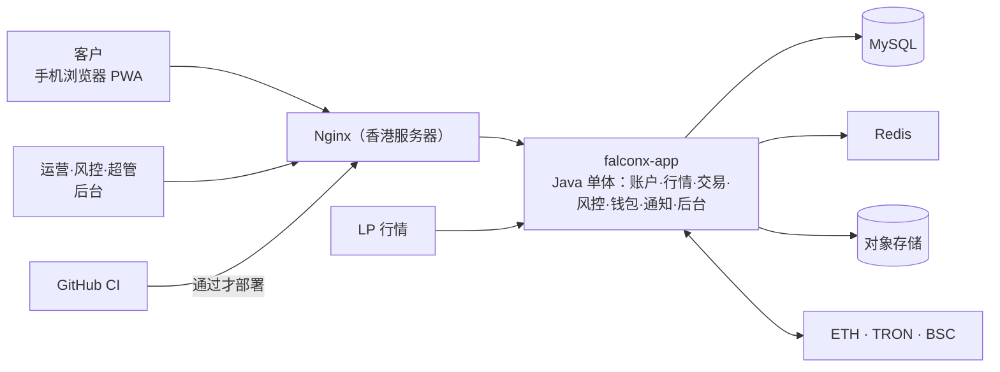

# 项目地图：FalconX Lite
- 用途：**新加入的人或大模型先读这一份**，10 分钟了解项目现在是什么样、代码在哪里、有哪些不能破坏的约定。要查具体的文件、接口、表、变量、历史问题，看《[项目索引](项目索引.md)》。
- 只写**当前状态**。按版本追加的文档（`00-架构方案.md`、技术方案）是当时的记录；和本文件不一致时，以本文件和代码为准。
- 版本：v0.31（2026-10-16，对应代码：v1 小缺口修补（充值待确认推送、验证码冷却秒数、提现字段错误、汇率为空、真实构建不含模拟层）；S20 部署工具（镜像、Nginx、服务器脚本、CI 推镜像）；S20 部署前的健康检查提交号和测试环境标识；S20 部署方案审核通过；端到端测试（S19）；客户密码规则前后端统一；客户端接真实接口（S17）；后台页面接真实接口（S18a、S18b）；两端都保留原型模式；后端到 S16c：后台接口全部完成）
- 维护：研发整合，各角色写自己的部分（C53）。**每次功能迭代，在同一个 PR 里更新本文件和《项目索引》**；`scripts/check-project-index.mjs` 在 CI 里检查索引（C54）。
- 变更历史：v0.1（2026-10-14）首次创建框架（规则 C53：架构方案审核时建立框架，首次合并到测试环境前补完整）；v0.2（2026-10-14）加入原型阶段的前端代码、Vercel 原型环境；v0.3（2026-10-15）客户端改为手机和电脑分开设计（UI 风格 C），补充页面结构约定；v0.4（2026-10-15）S2 加入后端骨架；v0.5（2026-10-15）S3 数据库和账本；v0.6（2026-10-15）S4 注册登录；v0.7（2026-10-15）S5 KYC；v0.8（2026-10-15）S6 行情；v0.9（2026-10-15）S7 下单；v0.10（2026-10-15）S8 持仓操作；v0.11（2026-10-15）S9 撮合引擎；v0.12（2026-10-15）S10 隔夜费；v0.13（2026-10-15）S11 风控；v0.14（2026-10-15）S12a 充值；v0.15（2026-10-15）S12b 真实扫块、冲正挂账；v0.16（2026-10-15）S13a 提现；v0.17（2026-10-15）S13b 提现签名广播；v0.18（2026-10-15）S14 对账；v0.19（2026-10-15）S15a 通知；v0.20（2026-10-15）S15b Web Push；v0.21（2026-10-15）S16a 后台登录、权限、审计、系统配置；v0.22（2026-10-16）S16b 后台客户、KYC、资金、通知；v0.23（2026-10-16）S16c 后台交易监控、风控、品种与行情、交易参数、仪表盘；v0.24（2026-10-16）S17 客户端接真实接口：`VITE_API_MODE` 切换真实接口和原型模拟两种模式，客户端可用余额改成和后端同一口径；v0.25（2026-10-16）S18 后台页面接真实接口（两种接口模式）；v0.26（2026-10-16）客户密码规则前后端统一（约定 17）；v0.27（2026-10-16）S19 端到端测试：`e2e/`（Playwright）、后端 e2e profile 的替身和 `/api/e2e/**`、CI 的 `e2e` job（约定 18）；v0.28（2026-10-16）S20 测试环境部署方案交 Amos 审核（美国 2 核 2G 服务器）；v0.29（2026-10-16）S20 部署前：健康检查返回提交号（`FX_VERSION`）和测试环境标识 `env`（`FX_ENV_LABEL`），测试环境的邮件和推送标题加"[测试] / [TEST] "，两个前端真实接口模式下顶部显示"测试环境"标识条；v0.30（2026-10-16）S20 部署工具和本机演练（`deploy/`），常用命令、排查补充测试环境；v0.31（2026-10-16）v1 小缺口修补：发现待确认的充值就推送 `deposit` 事件（E2E-2）、发验证码返回冷却秒数、提现页显示后端字段错误、汇率为空时预估显示“—”、真实接口模式的前端构建不含模拟层（约定 19）

## 一图看懂

这张图想说明：所有请求经过香港服务器上的 Nginx 进入一个 Java 应用；行情从 LP 进来，资金从三条链进出。（当前处于设计阶段，详见 `00-架构方案.md`。）

## 1. 这个项目做什么
FalconX 的精简重建版：客户用 USDT 充值，交易差价合约（只做逐仓），再用 USDT 提现。客户以中国大陆为主。需求见 `需求文档/v1-需求说明书.md`。

| 业务 | 版本 | 使用者 | 页面 | 接口 | 数据 |
|---|---|---|---|---|---|
| 全部业务 | 设计中 | 客户、运营、风控、超管 | 见需求说明书第 5、6 节 | 开发开始后补充 | 开发开始后补充 |

核心流程：充值（三条链扫块入账）→ 交易（行情驱动挂单、止盈止损、强平）→ 提现（白名单、冷静期、人工审核、签名上链）。

## 2. 代码怎么分层
- 计划的目录和归属见 `00-架构方案.md` 第 3.2 节。目前有两个前端、后端和端到端测试 `e2e/`；部署 `deploy/`（运维，S20：两个镜像的构建文件、Nginx 配置、服务器端工具包 `deploy/kit/`，镜像里带着工具包，服务器每次更新时自动同步）。
- `backend/`（研发）：Java 25、Spring Boot 4.1，Maven 项目。入口 `com.falconx.lite.FalconxLiteApplication`。
  - 7 个业务模块各一个包：`account`、`market`、`trading`、`risk`、`wallet`、`notification`、`admin`；共用代码在 `common`。每个模块的 `api` 子包是对外接口，**其他模块只能依赖 `api` 包**（ArchUnit 测试 `ModuleBoundaryTest` 强制，违反就 CI 失败）。
  - 配置在 `src/main/resources/application.yml`，只写环境变量名（`FX_*`），值由服务器提供。
  - 对外健康检查 `GET /api/health`（应用、数据库、Redis）；返回 `version`（部署时是镜像的 git 提交号 `FX_VERSION`，用来从外部确认新版本已生效）和测试环境标识 `env`（`FX_ENV_LABEL`，只有设置了才返回，生产不设）；不返回任何密钥或内部地址。应用管理端点在单独端口、只监听 127.0.0.1（约定 6）。
  - 数据库：Flyway 迁移（`src/main/resources/db/migration/`）+ MyBatis XML（`src/main/resources/mapper/<模块>/`）。表名以模块名开头，只由该模块读写。规则见 `技术方案/v1-数据库设计.md`。
  - **登录**：客户端用 HttpOnly Cookie 里的会话令牌；`/api/` 下除公开接口外都由 `account` 的过滤器检查登录，其他模块用 `common.web.CurrentUser.id()` 取当前用户。所有错误统一 `{code, message, fields}`。规则见 `技术方案/v1-数据库设计.md` 第 6 节。
  - **行情**：报价源只输出原始报价，`market` 的 `QuoteProcessor` 统一做交易时段、质量守卫、加点（只加一次）、K 线；其他模块只用 `market.api.MarketApi` 取报价、判断能否成交、折算汇率。报价源默认关闭（`FX_MARKET_SOURCE`）。规则见 `技术方案/v1-数据库设计.md` 第 8 节。
  - **下单**：`trading.order.OrderService`，计算公式只有一份（`OrderCalc`，和原型 `lib/trading.ts` 同一口径）。先锁账户行再检查可用余额和持仓上限；持仓操作在 `PositionService`（开仓核心 `openLocked`、平仓核心 `closeLocked`，客户操作和撮合引擎共用）；撮合引擎 `MatchingEngine` 由行情驱动，每条触发一个事务、先锁账户行；交易事件经 `/api/ws/trading` 只推给本人；字段错误用 `common.error.ValidationException` 一次全部返回。规则见 `技术方案/v1-数据库设计.md` 第 9 节。
  - **风控**：交易模块只问 `risk.api.RiskApi`"能不能开仓""要不要自动强平"；风控通过 `trading.api.ExposureApi` 拿持仓合计算敞口，每 5 秒检查，超阈值自动禁开。客户只看到"暂停开仓"，看不到风控数据（约定 4）。规则见 `技术方案/v1-数据库设计.md` 第 13 节。
  - **钱包**：服务器只有 xpub（公钥），派生充值地址、识别到账，**动不了充值地址里的钱**；充值记录每次变化（发现、确认数变化、到账、作废、冲正）都经 `trading.api.UserEventsApi` 推 `deposit` 事件给本人；资金归集由 Amos 离线做（充值方案 D1、D2）。扫块只依赖 `wallet.deposit.ChainClient` 接口（真实实现：以太坊体系 JSON-RPC、TRON 全节点接口；测试用链替身和本地 HTTP 替身）。冲正只扣可以自由动用的钱（`trading.api.FundsApi`），差额挂账、通知风控。提现按状态机走（`wallet.withdraw.WithdrawService`），任何失败路径都完整退回冻结，只有确定没上链才退款；签名广播只依赖 `WithdrawSender` 接口（真实实现：以太坊体系 web3j 签名、TRON 节点构造后本地签名）。**连不上节点不等于失败**：只有节点明确拒绝或链上确定没发生才退款。规则见 `技术方案/v1-提现方案.md`。规则见 `技术方案/v1-充值方案.md`。
  - **通知**：业务模块在自己的事务里调用 `notification.api.NotifyApi.toUser(用户, 模板编号, 变量)`，只说"发生了什么"；站内信、推送、邮件发不发、用什么语言由通知模块按模板和客户偏好决定，每个渠道一条通知记录。站内信存模板编号和变量，打开时按界面语言生成。邮件和推送写成任务，由 `NotifyWorker` 发出：邮件用 SMTP（没配置时只记录），Web Push 每台设备一个任务，按 RFC 8291 加密、VAPID 签名，只发到浏览器推送服务的地址。按邮箱发的（验证码、风控人员）用 `MailApi`。测试环境（`FX_ENV_LABEL` 非空）的邮件和推送标题由 `NotifyWorker` 加前缀（`notification/service/EnvLabel`：中文"[测试] "、英文"[TEST] "、中英文各一份的两段各加、后台手写的"[测试/TEST] "）；站内信不加（页面上已有标识条）；推送也加，因为系统通知栏里看不到页面上的标识条。追保预警在交易模块（`MarginCallMonitor`）。规则见 `技术方案/v1-数据库设计.md` 第 17 节、`技术方案/v1-通知方案.md`。
  - **后台**：`/api/admin/**` 由 `admin.security.AdminInterceptor` 依次检查 IP 白名单、后台登录（独立 Cookie）、权限点（`@RequiresPermission`，没有声明的一律 403）；写操作用 `admin.security.Audit.run` 记审计。后台只调用各模块的 `api` 包，不重写业务：查询走各模块的 `*AdminApi`（`account.api.CustomerAdminApi`、`trading.api.TradingAdminApi`、`wallet.api.WalletAdminApi`、`notification.api.NotifyAdminApi`、`market.api.MarketAdminApi`），业务接口在 `admin/ops/`。后台可改的参数在 `common.config.SystemConfig`（表 `common_config`），各模块读的时候优先用它。规则见 `技术方案/v1-数据库设计.md` 第 18 节、`技术方案/v1-后台方案.md`。
  - **时间**：需要"现在"的代码注入 `java.time.Clock`（`common/time/ClockConfig`），测试里固定时间，结果不受运行时是否休市影响。
  - **文件**（证件照片）只存对象存储（`common.storage.ObjectStorage`），数据库只存路径。
  - **改余额只能调用 `trading.api.LedgerApi`**：锁账户行、幂等、不能为负、和账本同一事务。可靠的异步工作写进任务表（`common.task.TaskService`）。
- `web/client/`（研发）：客户端 PWA。Vite + React + TypeScript。UI 风格 C（`需求文档/v1-UI风格调研.md`）：默认深色，涨跌色可切换。
  - **手机和电脑是两套页面结构**，按宽度 1024 切换（`src/hooks/useMediaQuery.ts` 的 `useIsDesktop`）。行情页、交易页、下单各有两套组件（例如 `OrderPanel` 是电脑右栏、`OrderSheet` 是手机抽屉）；资产、我的等表单页共用一套。
  - **下单的计算、校验、提交只有一份**：`src/hooks/useOrderForm.ts`（调用 `src/lib/trading.ts`、`src/lib/validators.ts`），两套界面都用它。
  - `src/pages/` 页面，`src/components/` 组件，`src/app/` 路由和布局，`src/hooks/` 状态和数据钩子，`src/lib/` 纯函数（定点小数、下单计算、格式化），`src/styles/` 样式。
  - **数据只经 `src/api/`**，页面不直接引用 mocks（lint 强制）。`src/api/` 有两种模式，由构建变量 `VITE_API_MODE` 决定（`src/api/mode.ts`）：
    - `real`（默认）：`src/api/real/` 用 fetch 调同源 `/api/...`（`src/api/http.ts`，`credentials: same-origin`），登录态在 HttpOnly Cookie 里，**前端不保存任何令牌**，打开页面时用 `GET /api/me/session` 判断是否已登录；任何接口返回 401 都回到登录页。实时推送是 `WS /api/ws/trading` 和 `WS /api/ws/market`（`src/api/ws.ts`，断线自动重连，重连后重新拉取账户、持仓、挂单）。报价的 `quoteToUsd`（汇率）可能为空，按 USD 折算的预估一律经 `src/lib/trading.ts` 的 `usdRate` 取，取不到显示“—”。发验证码按接口返回的 `cooldownSeconds` 倒计时。
    - `mock`：`src/mocks/` 浏览器内模拟，显示原型横幅、场景面板和原型提示。**原型预览站（Vercel，`scripts/build-prototype.sh`）和单元测试用 mock**。
    - real 构建不含 `src/mocks/`（约定 19）：`src/api/` 里按编译期常量 `IS_MOCK` 二选一，`vite.config.ts` 在 real 构建时声明 `src/mocks/` 无副作用；CI 用 `scripts/check-no-mocks.mjs` 检查产物。
    - 测试环境标识条（S20）：real 模式启动时调一次 `GET /api/health`（`src/api/envLabel.ts`），返回非空 `env` 时在顶部原型横幅的位置显示"测试环境"（`src/components/EnvBanner.tsx`，紫色斜纹，不遮挡内容、不接收点击）；健康检查失败不显示也不报错；mock 模式不调用。
    - 后端错误 `{code, message, fields}` 在 `src/api/errors.ts` 换成翻译键；后端新增错误码要在那里加映射并加中英文翻译（`errors.test.ts` 检查）。
    - Web Push：浏览器已授权、推送偏好开着、后端配置了公钥时订阅（`src/api/webPush.ts`），退出登录时取消；收到推送由 `public/push-sw.js` 显示系统通知。切换界面语言时告诉后端（`PUT /api/me/notify-lang`）。
  - `src/i18n/` 中英文翻译（PM 可以改文案，不改键）。
- `web/admin/`（研发）：管理后台。Vite + React + TypeScript + Ant Design，路由前缀 `/admin`。
  - 目录分工同上；`src/config/` 菜单和权限配置，`src/auth/` 登录状态和权限判断，`src/utils/` 工具函数。
  - **两种接口模式**（构建变量 `VITE_API_MODE`，`src/api/mode.ts`）：默认 `real`，`src/api/real.ts` 经 `src/api/http.ts` 同源调用 `/api/admin/**`（登录态只在 HttpOnly Cookie，前端不存令牌；401 回登录页，403 `PASSWORD_CHANGE_REQUIRED` 跳改密码页；后端错误码在 `http.ts` 的 `ERROR_KEYS` 映射成翻译键）；`mock` 用 `src/mocks/`，保留原型横幅、场景面板、切换演示身份。原型构建（`scripts/build-prototype.sh`、`vercel.json`）和单元测试（`vite.config.ts` 的 `test.env`）设成 `mock`。真实模式下和客户端一样按 `/api/health` 的 `env` 显示"测试环境"标识条（`src/api/envLabel.ts`、`src/components/EnvBanner.tsx`；真实模式顶部横幅高度默认是 0，显示标识条时给根元素加 `env-on` 恢复）。S18a 接了登录、系统、客户、KYC、资金、通知，S18b 接了仪表盘、交易监控、风控、品种与行情、交易参数，real 模式下全部页面都走后端；和原型不同的地方按 `技术方案/v1-后台方案.md` 第 7、8、9 节在 `real.ts` 转换或改页面（例如临时密码弹窗只显示一次、对账 7 种问题类型、交易时段按品种只读、休市日按品种全天、强平线改为说明文字）。
  - 菜单：real 模式按 `/api/admin/me` 返回的 `menus`（顺序、是否显示）和 `permissions` 显示（`src/config/menu.tsx` 的 `visibleMenu`）。时间：接口是 ISO UTC，页面用 `src/utils/display.ts` 的 `fullTime` / `shortTime` 按 UTC+8 显示。
- `e2e/`（测试）：端到端测试，Playwright + TypeScript（S19，方案和 AC 对照见 `测试报告/v1-端到端测试方案.md`）。
  - 一个用例走完主流程：客户在 390px 手机上注册 → 登录 → 充值到账 → KYC → 市价下单 → 止盈止损 → 报价触发止盈 → 手动平仓 → 资金流水 → 白名单 → 提现；超管在电脑上首次登录改密码 → 审核 KYC → 出金审核 → 查看客户。每步有超时，失败时写明卡在哪一步。
  - 浏览器访问 `e2e/server.mjs`：客户端和后台的真实模式构建产物，`/api`（含 WebSocket）转发到后端。后端用 Spring profile `e2e` 启动（`e2e/start-backend.sh`），外部依赖换成后端里的替身（类名以 `E2e` 开头）：邮件（`notification/service/E2eMailbox`）、链（`wallet/deposit/E2eChain`）、提现广播（`wallet/withdraw/E2eWithdraw`）、推动报价（`market/quote/E2eMarket`，用模拟报价源）；测试通过 `/api/e2e/**` 操作替身。
  - `common/e2e/E2eGuard` 在启动时检查：没有 `FX_E2E_ENABLED=true`、带了 prod/production/staging profile、配置了热钱包私钥、链节点或 SMTP 时拒绝启动（约定 18）。
- 两个前端各自 `npm run build / lint / test`；`scripts/build-prototype.sh` 把它们合成一个静态站点（客户端在 `/`，后台在 `/admin/`）。

## 3. 环境
| 环境 | 分支 | 地址 | 数据 | 外部服务 |
|---|---|---|---|---|
| 原型 | 开发分支 | Vercel 预览（amos111 的团队，免费版，项目 `falconx-lite`），地址见 `技术方案/v1-原型说明.md` 第 1 节，配置见 `vercel.json` | 浏览器内模拟数据（客户端用 `VITE_API_MODE=mock` 构建），页面顶部有"原型"横幅 | 无 |
| 测试 | `staging`（2026-10-15 已建；免费版私有仓库开不了分支保护，合并前人工确认 CI，C54） | 测试环境待建（S20）：美国云服务器 2 核 2G（Amos 2026-10-16 指定），方案见 `部署方案/v1-部署方案.md`（Amos 审核通过）；域名待 Amos 提供；设 `FX_ENV_LABEL=test`，页面顶部有"测试环境"标识条，邮件和推送标题带"[测试]" | 独立测试库 | 区块链测试网 |
| 生产 | `main` | 待建；**不设** `FX_ENV_LABEL` | 托管 MySQL | 区块链主网 |

发布流程：每个开发步骤一个分支，PR 合并到 `staging`（`需求文档/v1-任务清单.md`，进度看 Issue #3）→ 测试环境建好后（S20）合并 `staging` 自动部署测试环境 → Amos 验收 → 合并 `main` 自动部署生产。密钥只由 Amos 填在服务器和 GitHub Secrets 里，仓库只有变量名。

## 4. 关键流程在哪里
| 流程 | 入口 | 核心代码 |
|---|---|---|
| 撮合（挂单成交、止盈止损、强平） | 报价 → `MatchingEngine.onQuote` | `backend/src/main/java/com/falconx/lite/trading/order/MatchingEngine.java` → `PositionService.openLocked` / `closeLocked` → 推送 |
| 后台请求 | `/api/admin/**` | `backend/src/main/java/com/falconx/lite/admin/security/AdminInterceptor.java`（IP 白名单 → 登录 → 权限点）→ 各 Controller → `Audit.run`（审计） |
| 通知 | 业务事务里 `NotifyApi.toUser` | `backend/src/main/java/com/falconx/lite/notification/service/NotifyService.java` → 站内信、通知记录、邮件和推送任务 → `NotifyWorker`（每 2 秒，SMTP、Web Push）；站内信事务提交后经 `/api/ws/trading` 推送 |
| 追保预警 | 定时任务（每 10 秒） | `backend/src/main/java/com/falconx/lite/trading/order/MarginCallMonitor.java` → 跌破追保线 → `NotifyApi`（`MARGIN_CALL`） |
| 对账 | 定时任务（每小时） | `backend/src/main/java/com/falconx/lite/wallet/recon/ReconService.java` → 读钱包记录、账本（`LedgerQueryApi`）、链上 → 记问题、通知风控（只读，不改金额） |
| 提现 | `POST /api/wallet/withdrawals` → 定时推进 | `backend/src/main/java/com/falconx/lite/wallet/withdraw/WithdrawService.java` → `LedgerApi`（冻结、退回、完成）→ `WithdrawSender` |
| 充值入账 | 定时任务（每 15 秒） | `backend/src/main/java/com/falconx/lite/wallet/deposit/DepositService.java` → 确认数够了 → `LedgerApi`（`DEPOSIT`） |
| 净敞口自动禁开 | 定时任务（每 5 秒） | `backend/src/main/java/com/falconx/lite/risk/switches/ExposureMonitor.java` → `risk_symbol` / `risk_switch` → 通知 |
| 隔夜费 | 定时任务（每天 UTC 22:00） | `backend/src/main/java/com/falconx/lite/trading/order/SwapService.java` → 从持仓保证金扣或返还进余额 → `LedgerApi` |
| 平仓 | `POST /api/trading/positions/{id}/close` | `backend/src/main/java/com/falconx/lite/trading/order/PositionService.java` → `LedgerApi`（实现盈亏） |
| 下单 | `POST /api/trading/orders` | `backend/src/main/java/com/falconx/lite/trading/order/OrderService.java` → `LedgerApi`（手续费、冻结） |
| 客户端调接口 | 页面 → `web/client/src/api/<模块>.ts` | 按 `VITE_API_MODE` 走 `web/client/src/api/real/`（fetch、WebSocket）或 `web/client/src/mocks/`；错误统一经 `web/client/src/api/errors.ts` 翻译 |
| 报价 | 报价源 → `QuoteProcessor.process` | `backend/src/main/java/com/falconx/lite/market/quote/QuoteProcessor.java` → 最新报价、K 线、推送 |

## 5. 不能破坏的约定
1. 余额每次变动和对应的账本记录必须在同一个数据库事务里（资金一致性）：只通过 `LedgerApi` 改余额，测试检查"账本合计 = 余额"。
2. 金额一律用定点小数，不用浮点。
3. 只扫描配置好的 USDT 合约；合约未配置时扫块不启动（fxsystem 的 F3）。
4. 任何风控数据都不发给客户（fxsystem 的 T5）。
5. 仓库里不出现任何密钥的值（fxsystem 的 S2）。
6. 公网只开放 80 和 443；应用管理端点不对外（fxsystem 的 S1、S3）。
7. 模块之间只通过对方的 `api` 包调用，由 ArchUnit 测试强制（`00-架构方案.md` 3.2）。
8. 客户端的涨、跌、买、卖颜色只用语义色 `--long*` / `--short*`（随涨跌色设置变化）；错误、未读等警示红只用 `--danger*`（不随设置变化）。见 `web/client/src/styles/tokens.css`。
9. 表结构只通过 Flyway 迁移脚本修改，已合并的脚本不再改（`技术方案/v1-数据库设计.md`）。
10. 加点只在行情入口加一次，下单、撮合、强平都直接用 `MarketApi` 的买卖价，不再加点（修复 fxsystem 的 T1）；不可成交的报价（`executable = false`）不能用来成交。
11. 可用余额不计浮动盈利（`trading.order.Funds`；客户端显示和下单前校验用同一口径 `web/client/src/lib/trading.ts` 的 `availableFunds`）：保证"余额 ≥ 挂单冻结 + 全部持仓保证金"，平仓、强平不会把余额扣成负数。开仓、追加保证金、提现都按这个口径。
12. 服务器上不放充值地址的私钥（只放 xpub）；只认配置好的 USDT 合约（fxsystem 的 F3）。
13. 提现只有在确定交易没上链时才退款（节点明确拒绝、链上执行失败、TRON 过期查不到）；连不上节点、超时都不退款。热钱包私钥只在环境变量里，不进日志和仓库。
14. 通知要和业务在同一个事务里写（在业务事务里调用 `NotifyApi`），业务回滚就不发；邮件服务商故障不能影响交易，邮件失败不进健康检查。
15. 服务器只向浏览器推送服务的地址发推送（`falconx.notify.push.allowed-hosts`），不能放开成任意地址：订阅地址是客户端提交的，放开后可以被用来访问内网。VAPID 私钥只在环境变量里。
16. 每个后台接口都必须声明权限点（`@RequiresPermission`），或者标明只要登录（`@AdminLoginOnly`）；测试扫描全部后台接口，漏了就失败。权限点、菜单和后台原型（`web/admin/src/config/`）保持一致，改一边要同时改另一边。
17. 客户密码规则前后端一致：8–64 位，至少一个字母和一个数字（后端 `account/auth/AuthRequests.java` 的 `PASSWORD_MIX`，客户端 `web/client/src/lib/validators.ts` 的 `validatePassword`）。改一边必须同时改另一边。
18. 端到端测试的替身和 `/api/e2e/**`（不需要登录就能注入充值、改报价、读验证码）只在 Spring profile `e2e` 下存在，`E2eProfileTest` 检查默认配置里没有；测试环境和生产绝不能设 `SPRING_PROFILES_ACTIVE=e2e`、`FX_E2E_ENABLED`。新加替身时类名以 `E2e` 开头、标 `@Profile(E2eGuard.PROFILE)`，只替换和外部世界打交道的最后一步。
19. 真实接口模式的前端构建产物里不能有原型模拟层（`src/mocks/`）：两个前端的 `src/api/` 只能按编译期常量 `IS_MOCK` 选用模拟层（不能无条件引用模拟层的导出），`vite.config.ts` 在 real 构建时声明 `src/mocks/` 无副作用；CI 的 `scripts/check-no-mocks.mjs` 在模拟层特有的字符串出现在产物里时失败。

## 6. 常用命令
| 做什么 | 命令 |
|---|---|
| 安装 | `npm ci --prefix web/client`、`npm ci --prefix web/admin`；后端需要 JDK 25 和 Maven |
| 单元测试 | `npm test --prefix web/client`、`npm test --prefix web/admin`（vitest）；后端 `mvn -f backend verify`（需要本地 MySQL 8.4 和 Redis 7，环境变量见《项目索引》第 5 节） |
| 项目地图和索引检查 | `node scripts/check-project-index.mjs` |
| 端到端测试 | 准备空库 `falconx_e2e` → `mvn -f backend package -DskipTests`、两个前端 `npm run build` → 设好 `FX_DB_*`、`FX_REDIS_HOST`、`FX_ADMIN_INIT_*` 后 `bash e2e/start-backend.sh` → `cd e2e && npm ci && npx playwright test`（失败时 `npx playwright show-report`）。完整步骤见 `测试报告/v1-端到端测试方案.md` 第 2 节；CI 的 `e2e` job 每个 PR 都跑 |
| 本地运行 | 后端：设置 `FX_DB_*`、`FX_REDIS_*` 后 `mvn -f backend spring-boot:run`；前端 `npm run dev --prefix web/client`；后台同理；整站原型：`bash scripts/build-prototype.sh` 后用任意静态服务器打开 `dist/` |
| 部署（测试环境） | 合并到 staging、CI 全绿 → `publish-staging` 推镜像 → 服务器每分钟自己拉（`deploy/kit/deploy.sh`）。从外部确认：`bash deploy/verify.sh <客户端域名> <后台域名> [提交号]` |
| 回滚（测试环境） | 推荐：仓库里 revert 后合并到 staging；紧急：服务器上 `sudo /opt/falconx/rollback.sh [提交号]`；恢复数据：`sudo /opt/falconx/restore.sh <备份文件>` |
| 看线上状态 | 测试环境 `https://<客户端域名>/api/health`（`version` 是提交号，`env` 是 test）；服务器上 `/opt/falconx/logs/deploy.log`、`docker compose -p falconx logs app` |

## 7. 排查从哪里开始
健康检查 `/api/health`（哪一项 DOWN）→ 测试服务器上 `/opt/falconx/logs/deploy.log`（更新、回滚记录）和 `docker compose -p falconx logs app` → 《项目索引》的问题索引 → 本地复现（端到端环境见常用命令）→ 遗留事项在最新一份交付说明

## 8. 常见改动的检查清单
| 改动 | 要改的地方 |
|---|---|
| （开发开始后补充：接口新增字段、新增环境变量、新增接口、新增数据表或列、新增页面） | |

## 9. 冷启动问题清单
1. 客户说充值没到账，从哪里开始查？
2. 新增一个交易品种，要改哪些配置、数据和测试？
3. 测试环境连的是哪个数据库、哪条链的测试网？谁能改它的密钥？
4. 一个 PR 合并前要通过哪些自动检查？没通过时去哪里看原因？
5. 强平是在哪里、被什么触发的？怎么确认它在 1 秒内完成？
