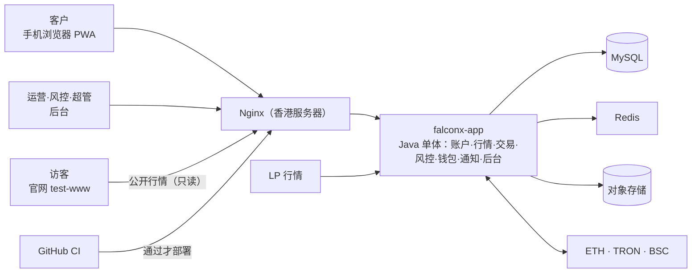

# 项目地图：FalconX Lite
- 用途：**新加入的人或大模型先读这一份**，10 分钟了解项目现在是什么样、代码在哪里、有哪些不能破坏的约定。要查具体的文件、接口、表、变量、历史问题，看《[项目索引](项目索引.md)》。
- 只写**当前状态**。按版本追加的文档（`00-架构方案.md`、技术方案）是当时的记录；和本文件不一致时，以本文件和代码为准。
- 版本：v0.67（2026-10-21）
- 维护：研发整合，各角色写自己的部分（C53）。**每次功能迭代，在同一个 PR 里更新本文件和《项目索引》**；`scripts/check-project-index.mjs` 在 CI 里检查索引（C54）。
- 变更历史：v0.1（2026-10-14）首次创建框架（规则 C53：架构方案审核时建立框架，首次合并到测试环境前补完整）；v0.2（2026-10-14）加入原型阶段的前端代码、Vercel 原型环境；v0.3（2026-10-15）客户端改为手机和电脑分开设计（UI 风格 C），补充页面结构约定；v0.4（2026-10-15）S2 加入后端骨架；v0.5（2026-10-15）S3 数据库和账本；v0.6（2026-10-15）S4 注册登录；v0.7（2026-10-15）S5 KYC；v0.8（2026-10-15）S6 行情；v0.9（2026-10-15）S7 下单；v0.10（2026-10-15）S8 持仓操作；v0.11（2026-10-15）S9 撮合引擎；v0.12（2026-10-15）S10 隔夜费；v0.13（2026-10-15）S11 风控；v0.14（2026-10-15）S12a 充值；v0.15（2026-10-15）S12b 真实扫块、冲正挂账；v0.16（2026-10-15）S13a 提现；v0.17（2026-10-15）S13b 提现签名广播；v0.18（2026-10-15）S14 对账；v0.19（2026-10-15）S15a 通知；v0.20（2026-10-15）S15b Web Push；v0.21（2026-10-15）S16a 后台登录、权限、审计、系统配置；v0.22（2026-10-16）S16b 后台客户、KYC、资金、通知；v0.23（2026-10-16）S16c 后台交易监控、风控、品种与行情、交易参数、仪表盘；v0.24（2026-10-16）S17 客户端接真实接口：`VITE_API_MODE` 切换真实接口和原型模拟两种模式，客户端可用余额改成和后端同一口径；v0.25（2026-10-16）S18 后台页面接真实接口（两种接口模式）；v0.26（2026-10-16）客户密码规则前后端统一（约定 17）；v0.27（2026-10-16）S19 端到端测试：`e2e/`（Playwright）、后端 e2e profile 的替身和 `/api/e2e/**`、CI 的 `e2e` job（约定 18）；v0.28（2026-10-16）S20 测试环境部署方案交 Amos 审核（美国 2 核 2G 服务器）；v0.29（2026-10-16）S20 部署前：健康检查返回提交号（`FX_VERSION`）和测试环境标识 `env`（`FX_ENV_LABEL`），测试环境的邮件和推送标题加"[测试] / [TEST] "，两个前端真实接口模式下顶部显示"测试环境"标识条；v0.30（2026-10-16）S20 部署工具和本机演练（`deploy/`），常用命令、排查补充测试环境；v0.31（2026-10-16）上公网前的安全审查（`测试报告/v1-安全审查.md`）：写请求只接受本站页面发起、路径不能带分号（`common/web/CrossSiteGuard`），发验证码按邮箱和 IP 限次，后台重置密码不能越权，Nginx 客户端域名用正则拦截后台接口；新增约定 19；v0.32（2026-10-16）v1 小缺口修补：发现待确认的充值就推送 `deposit` 事件（E2E-2）、发验证码返回冷却秒数、提现页显示后端字段错误、汇率为空时预估显示“—”、真实接口模式的前端构建不含模拟层（约定 20）；v0.33（2026-10-16）新增交付说明草稿（S21 验收清单在第 3 节）；v0.34（2026-10-16）端到端测试加部署形态（`e2e/run-deployed.sh`，浏览器经 Nginx 镜像、HTTPS、两个域名跑主流程），修复资产页路由被 Nginx 当成静态目录，CI 加 `e2e-deployed` job；v0.35（2026-10-16）记录 Amos 决定：测试环境后台不加 IP 白名单（SEC-06）；v0.36（2026-10-16）部署工具包加 init-env.sh（Amos 选择在命令助手里粘贴命令）；v0.37（2026-10-16）测试环境上线，环境表写入地址；v0.38（2026-10-16）测试环境发信地址、第一次自动更新；v0.39（2026-10-16）AC-13 压测：撮合引擎的收到时间和报价绑在一起（`MatchingEngine.Received`），压测工具 `e2e/load/`，常用命令加压测；v0.40（2026-10-16）新增《v1 功能对照核对》（`测试报告/v1-功能对照核对.md`）：对照表 235 项逐条核对新系统的真实状态和上生产前要处理的清单；v0.41（2026-10-16）通用限流（功能取舍对照表 P-05）：`common/ratelimit/`、Nginx `limit_req`/`limit_conn`、错误码 `RATE_LIMITED`，新增约定 21，排查加 429；v0.42（2026-10-16）v2 需求说明书草稿和官网风格调研（合并整理）；v0.43（2026-10-16）v2 需求说明书 v2.1：Amos 审核通过；v0.44（2026-10-16）资产页"充值"按钮、"充值暂未开通"提示（DEP-1）；v0.45（2026-10-16）图表补齐（v2 E5、对照表 M-28）：客户端 Tick 图、买卖价线、5 种指标（`src/lib/indicators.ts`，可选择、记在本地），后端内存里保留每个品种最近 500 笔报价（`market/quote/RecentTicks`，不入库）；v0.46（2026-10-16）v2 品牌改名 Quick Come（客户端、后台、PWA、通知模板迁移 V20，新增约定 22、`scripts/check-brand.mjs`）、电脑版顶栏跑马灯（E4，`HotTicker`）；v0.47（2026-10-16）v2 官网：新前端 `web/site/`、后端公开行情 `GET /api/public/quotes`、客户端读 `?lang=`、Nginx 官网一段和 `WWW_DOMAIN`、端到端官网用例、原型站 `/site/`；新增约定 23；v0.48（2026-10-16）v2 后台几项（E1 编辑客户资料 `customer:edit`、E2 深色主题、E3 新增品种 `symbol:create`（默认暂停开仓、不重启生效）、E6 品种最后报价时间和客户最近登录 IP、E7 风控看板等监控页自动刷新）：权限点 48 个，没有新迁移；v0.49（2026-10-16）v2 E8–E13：监控告警（`common/health/AlertCheck`、`notification/service/AlertMonitor`，健康检查加 `alert`/`alerts`，`deploy/kit/lib.sh` 只看 `status`）、追踪号（`common/trace/`，Nginx `$request_id`）、指标（`/actuator/prometheus` 只在 127.0.0.1:8081）、对外编号雪花 ID（`common/id/Snowflake`，迁移 V22）、K 线保留（`market/kline/KlineRetention`）、补测试；新增约定 24–26，约定 14 改写；v0.50（2026-10-16）模拟起始价：后台新增品种和编辑里可填（只在模拟报价源下显示和生效，品种列表接口返回 `simulatedQuotes`），存进 `market_symbol.sim_start_price`（迁移 V23），模拟报价源启动时读回；v0.51（2026-10-16）日期输入改版（Amos 真机发现手机数字键盘打不出"-"）：已知日期用三框组件 `DateFields`，选日期用日历控件，新增约定 27；v0.52（2026-10-16）电脑 1024 宽行情页横向溢出修复（品种名允许换行，端到端主流程加 1024 宽检查）；模拟报价起始价更新到 2026-10-16 市价，新增 `技术方案/v2-模拟报价起始价.md`；v0.53（2026-10-17）端到端测试在周末（外汇休市）也能通过：需要报价的断言只看加密货币，官网闪色在页面里同步读取；v0.54（2026-10-17）新增 `Amos待办.md`，入口文件提到它；v0.55（2026-10-17）接入真实报价源 AllTick（主）、iTick（备）：`market/quote/feed/`、`FX_MARKET_SOURCE` 新增 `live`、`FX_QUOTE_*`、`FX_PUBLIC_QUOTES_SOURCE`，新增约定 28；v0.56（2026-10-17）Q6 偏差只暂停开仓、Q7 买卖合计 20 点 = 每边 10 点（V24），约定 10、28 补充；v0.57（2026-10-17）接入币安报价（`BinanceFeed`，10 个加密货币币安主、AllTick 备，开关默认关闭；映射只用最前面两个能用的源），约定 28 补充；v0.58（2026-10-17）热钱包余额告警（`wallet/withdraw/HotBalanceMonitor`、`GET /api/admin/hot-wallets`、系统配置 `hotWallet.*` 默认 0、迁移 V25；`AlertMonitor` 对不再出现的告警项只清状态），约定 24 补充；v0.59（2026-10-17）提现自动审批方案和后台原型（约定 29）；v0.60（2026-10-17）提现自动审批已实现（Amos 确认"按建议"）：钱包 `withdraw/AutoApprove*`、`trading.api.CustomerFlowApi`、`AccountApi` 安全事件、迁移 V26、后台 3 个接口和权限点 `withdrawal:auto_rule_edit`，前端去掉"未上线"开关；约定 29 改写，关键流程加一行；v0.61（2026-10-18）提现自动审批加 R13 盈利客户（`CustomerFlowApi.netProfit`、迁移 V27、后台设置页 R13 一行、"12 条"改成按实际条数显示），约定 29、关键流程同步；v0.62（2026-10-20）资金归集方案 v1.0（待审核）和后台原型；v0.63（2026-10-20）资金归集方案 v1.1（Amos 10-20 已审核）：钱包一段和后台"资金归集原型"一段按审核结论改写；v0.64（2026-10-20）资金归集第一阶段（合约 + 以太坊 / BSC 的地址和归集）：第 2 节加 `contracts/`、钱包和后台归集两段改写，第 4 节加归集流程，第 5 节加约定 30，第 6 节加合约命令，约定 16 权限点 52 个；v0.65（2026-10-21）测试服务器内存耗尽卡死：后端 JVM 上限调小、容器不用交换分区（部署方案 v1.14 第 19 节）；v0.66（2026-10-21）GitHub Actions 额度用完：合并前由智能体在开发环境跑完整的 CI 命令代替（C54 例外，Amos 同意），镜像由 Amos 运行 `deploy/manual-publish.sh` 发布（部署方案第 20 节）；v0.67（2026-10-21）BSC 出块已缩短到约 0.45 秒（实测），`block-seconds` 改为小数 0.45、`scan-batch` 50 → 150，修复停机后 scan.BSC 一直 DOWN（扫块追不上）

## 一图看懂

这张图想说明：所有请求经过香港服务器上的 Nginx 进入一个 Java 应用；行情从 LP 进来，资金从三条链进出。（当前处于设计阶段，详见 `00-架构方案.md`。）

## 1. 这个项目做什么
FalconX 的精简重建版，v2 起对客户的品牌是 **Quick Come**（代码、包名、数据库、镜像等内部名字仍叫 falconx，见约定 22）：客户用 USDT 充值，交易差价合约（只做逐仓），再用 USDT 提现。客户以中国大陆为主。需求见 `需求文档/v1-需求说明书.md`。

| 业务 | 版本 | 使用者 | 页面 | 接口 | 数据 |
|---|---|---|---|---|---|
| 全部业务 | 设计中 | 客户、运营、风控、超管 | 见需求说明书第 5、6 节 | 开发开始后补充 | 开发开始后补充 |

核心流程：充值（三条链扫块入账）→ 交易（行情驱动挂单、止盈止损、强平）→ 提现（白名单、冷静期、人工审核、签名上链）。

## 2. 代码怎么分层
- 计划的目录和归属见 `00-架构方案.md` 第 3.2 节。目前有两个前端、后端和端到端测试 `e2e/`；部署 `deploy/`（运维，S20：两个镜像的构建文件、Nginx 配置、服务器端工具包 `deploy/kit/`，镜像里带着工具包，服务器每次更新时自动同步）。
- `backend/`（研发）：Java 25、Spring Boot 4.1，Maven 项目。入口 `com.falconx.lite.FalconxLiteApplication`。
  - 7 个业务模块各一个包：`account`、`market`、`trading`、`risk`、`wallet`、`notification`、`admin`；共用代码在 `common`。每个模块的 `api` 子包是对外接口，**其他模块只能依赖 `api` 包**（ArchUnit 测试 `ModuleBoundaryTest` 强制，违反就 CI 失败）。
  - 配置在 `src/main/resources/application.yml`，只写环境变量名（`FX_*`），值由服务器提供。
  - 对外健康检查 `GET /api/health`（应用、数据库、Redis）；返回 `version`（部署时是镜像的 git 提交号 `FX_VERSION`，用来从外部确认新版本已生效）和测试环境标识 `env`（`FX_ENV_LABEL`，只有设置了才返回，生产不设）；不返回任何密钥或内部地址。应用管理端点在单独端口、只监听 127.0.0.1（约定 6），指标在那里（`/actuator/prometheus`，自定义的都以 `fx_` 开头，v2 E10）。
  - **监控告警**（v2 E8，约定 24）：健康检查分两层。`status`（200/503）只看应用本身；外部服务的问题（行情全部断流 `market`、链节点连不上 `node.<链>`、扫块停滞 `scan.<链>`、邮件连续失败 `mail`）放在 `alerts`（每项 UP/DOWN）和 `alert`（OK/ALERT），**不影响 `status`**，部署脚本不会因此回滚；这两个字段**只在后台域名和服务器本机直连时返回**（Nginx 内部头 `X-Fx-Health-Alerts`，客户端域名、官网只返回存活信息）。各模块实现 `common.health.AlertCheck`（只看内存状态：`market/quote/MarketAlert`、`wallet/deposit/ChainMonitor`、`notification/service/MailHealth`、`wallet/withdraw/HotBalanceMonitor`），只检查配置了的东西；`notification/service/AlertMonitor` 每 15 秒检查，异常和恢复时给 `FX_ALERT_EMAILS` 发邮件，同一项 30 分钟内不重复；不再出现的项（例如下限改回 0）只清状态、不发恢复邮件。**热钱包余额**（v0.58）：`HotBalanceMonitor` 每 5 分钟查一次余额（访问节点只在它自己的定时任务里，告警检查只读结果），下限在后台系统配置页（`hotWallet.*`，默认 0 = 不告警），告警项 `hot.<链>.usdt`、`hot.<链>.gas`，查询失败不算余额低。阈值在 `falconx.alert.*`。规则见 `部署方案/v1-部署方案.md` 第 15 节。
  - **追踪号**（v2 E9，`common/trace/`）：每个请求一个（沿用 Nginx 的 `X-Request-Id`，格式不对时自己生成），写进日志（级别后面的 `[追踪号]`）、响应头 `X-Request-Id`、错误响应体 `traceId`；WebSocket 连接沿用握手的追踪号，定时任务每次一个 `job-…`。过滤器自己写错误 JSON 时用 `TraceIdFilter.jsonField()` 带上。
  - **对外编号**（v2 第 11.4 节，约定 25）：订单、持仓、提现、充值给客户和后台看的编号是雪花 ID（`common/id/Snowflake`，列 `public_no`），接口里一律字符串；内部主键仍是自增 id，只在库里和模块之间用。路径里的 `{id}` 是对外编号，控制器先换成内部 id（不是本人的当成不存在）。旧数据（V22 之前）的对外编号等于 id。
  - 数据库：Flyway 迁移（`src/main/resources/db/migration/`）+ MyBatis XML（`src/main/resources/mapper/<模块>/`）。表名以模块名开头，只由该模块读写。规则见 `技术方案/v1-数据库设计.md`。
  - **跨站检查**（安全审查 SEC-01、SEC-02）：`/api/` 的请求先经过 `common.web.CrossSiteGuard`：写请求（GET、HEAD、OPTIONS 以外）只接受本站页面发起（浏览器的 `Sec-Fetch-Site` 是 same-origin，老浏览器看 `Origin` 是否同源），否则 403；路径里有分号一律 400。非浏览器的请求（没有这两个头）不受影响。
  - **限流**（功能取舍对照表 P-05，`common/ratelimit/`）：跨站检查之后、登录检查之前按 IP 计数（`IpRateLimitFilter`：`/api/**` 每分钟 600 次，不含 `/api/health`；WebSocket 握手单独每分钟 120 次）；交易和资金写接口标 `@UserWriteLimited`，按客户每分钟合计 60 次（`UserWriteLimitInterceptor`）；后台登录按 IP 15 分钟 20 次（SEC-15）。Redis 计数，Redis 不可用时放行。超限 429 `RATE_LIMITED` 带 `Retry-After`。Nginx 外层还有一道更宽松的（`deploy/nginx/site.conf.template`）。规则见 `部署方案/v1-部署方案.md` 第 4.1 节。
  - **登录**：客户端用 HttpOnly Cookie 里的会话令牌；`/api/` 下除公开接口外都由 `account` 的过滤器检查登录，其他模块用 `common.web.CurrentUser.id()` 取当前用户。所有错误统一 `{code, message, fields}`。规则见 `技术方案/v1-数据库设计.md` 第 6 节。
  - **行情**：报价源只输出原始报价，`market` 的 `QuoteProcessor` 统一做交易时段、质量守卫、加点（只加一次）、K 线；其他模块只用 `market.api.MarketApi` 取报价、判断能否成交、折算汇率。报价源默认关闭（`FX_MARKET_SOURCE`：`none` / `simulated` / `live`）。真实报价源（v2，`market/quote/feed/`，`技术方案/v2-报价源接入.md`）：AllTick 主、iTick 备，按品种映射（`falconx.market.feeds.routes`），`QuoteRouter` 只把当前在用的源的报价交给 `QuoteProcessor`，主源 10 秒没价切备源、两家偏差超过 0.5% 该品种只暂停开仓（报价照常、只用主源，平仓、止盈止损、强平照常）；没配 token 时全部模拟（约定 28）。模拟报价源（`market/quote/SimulatedQuoteSource`，开发和测试环境）的起始价来自 `simulated-prices.csv`（2026-10-16 市价，来源和对测试环境已有持仓的影响见 `技术方案/v2-模拟报价起始价.md`；客户端原型品种表 `web/client/src/mocks/data/symbols.ts` 必须和它一致，`symbols.test.ts` 检查）；csv 里没有的品种（后台新增的）用后台填的模拟起始价（`market_symbol.sim_start_price`，提交后立即开始报价、启动时从库里读回，csv 里有的以 csv 为准；不是模拟源时这一项被忽略，见 `技术方案/v1-后台方案.md` 第 11.3 节）。官网公开行情 `market/web/PublicQuoteController`（v2）：不需要登录，只给配置的品种（`falconx.market.public-quotes.symbols`）的卖价、当日涨跌幅、时间、状态，整份结果缓存 1 秒（约定 23）。客户端 Tick 图要的最近逐笔报价只在内存里（`market/quote/RecentTicks`，每个品种 500 笔，重启清空，**不存数据库**，对照表 M-09）。规则见 `技术方案/v1-数据库设计.md` 第 8 节。
  - **下单**：`trading.order.OrderService`，计算公式只有一份（`OrderCalc`，和原型 `lib/trading.ts` 同一口径）。先锁账户行再检查可用余额和持仓上限；持仓操作在 `PositionService`（开仓核心 `openLocked`、平仓核心 `closeLocked`，客户操作和撮合引擎共用）；撮合引擎 `MatchingEngine` 由行情驱动，每条触发一个事务、先锁账户行；每条触发写一行耗时日志（`撮合完成：<类型> id=… 耗时 Nms`，超过 1 秒是 WARN `撮合耗时超过 1 秒：…`，AC-13 按它统计；格式不要改），耗时从撮合引擎收到触发价格算起，收到时间和报价放在同一个对象里（`MatchingEngine.Received`），不会用到后来的价格的时间；交易事件经 `/api/ws/trading` 只推给本人；字段错误用 `common.error.ValidationException` 一次全部返回。规则见 `技术方案/v1-数据库设计.md` 第 9 节。
  - **风控**：交易模块只问 `risk.api.RiskApi`"能不能开仓""要不要自动强平"；风控通过 `trading.api.ExposureApi` 拿持仓合计算敞口，每 5 秒检查，超阈值自动禁开。客户只看到"暂停开仓"，看不到风控数据（约定 4）。规则见 `技术方案/v1-数据库设计.md` 第 13 节。
  - **钱包**：服务器只有 xpub（公钥），派生充值地址、识别到账，**动不了充值地址里的钱**；充值记录每次变化（发现、确认数变化、到账、作废、冲正）都经 `trading.api.UserEventsApi` 推 `deposit` 事件给本人；**资金归集第一阶段**（v2，`技术方案/v2-半自动归集.md` v1.2，约定 30）：服务器配齐 4 个合约地址（`FX_SWEEP_EVM_*`）时，以太坊体系（ERC20、BSC 同一个地址）的充值地址 = BitGo 工厂的 CREATE2 地址（`wallet/address/Create2`、`ForwarderSchemes`，纯计算），钱只能去 Safe 冷钱包；`wallet_address` 每个用户每个体系只有一个"正在用"的地址，原来的 xpub 地址停用后**继续扫块 30 天、照常入账**；没配时照旧 xpub，TRON 一直 xpub。扫块另外看"从我们的地址转出"：归集转出（交易是批次发的、去了 parent）不算异常，其他转出告警并进对账（`wallet/sweep/SweepOutflows`）。归集只能后台手动执行（SW-5）：`wallet/sweep/SweepService` 预览（跳过规则、门槛、占比上限、**上线初期金额上限在这里检查**）→ 发起账户（`FX_SWEEP_EVM_OPERATOR_*`，不是热钱包）签名调用批量合约 → 按 Transfer 事件确认；归集不写账本、不改客户余额；出错只进 `alerts`（`sweep.*`），**不进 `status`**。TRON 归集（离线签名 + 租能量）是下一阶段，现在仍由 Amos 离线手动做（充值方案 D2）。扫块只依赖 `wallet.deposit.ChainClient` 接口（真实实现：以太坊体系 JSON-RPC、TRON 全节点接口；测试用链替身和本地 HTTP 替身）。冲正只扣可以自由动用的钱（`trading.api.FundsApi`），差额挂账、通知风控。提现按状态机走（`wallet.withdraw.WithdrawService`），任何失败路径都完整退回冻结，只有确定没上链才退款；签名广播只依赖 `WithdrawSender` 接口（真实实现：以太坊体系 web3j 签名、TRON 节点构造后本地签名）。**提现自动审批**（v2，约定 29）：冷静期结束时按 12 条规则复判（`withdraw/AutoApproveService`、`AutoApproveEngine`），总开关默认关闭，全部通过才由系统通过，之后流程和人工通过一样；判定要的账本数据经 `trading.api.CustomerFlowApi`、安全事件经 `AccountApi`、热钱包余额读 `HotWalletApi`（不访问网络）。**连不上节点不等于失败**：只有节点明确拒绝或链上确定没发生才退款。规则见 `技术方案/v1-提现方案.md`。规则见 `技术方案/v1-充值方案.md`。
  - **通知**：业务模块在自己的事务里调用 `notification.api.NotifyApi.toUser(用户, 模板编号, 变量)`，只说"发生了什么"；站内信、推送、邮件发不发、用什么语言由通知模块按模板和客户偏好决定，每个渠道一条通知记录。站内信存模板编号和变量，打开时按界面语言生成。邮件和推送写成任务，由 `NotifyWorker` 发出：邮件用 SMTP（没配置时只记录），Web Push 每台设备一个任务，按 RFC 8291 加密、VAPID 签名，只发到浏览器推送服务的地址。按邮箱发的（验证码、风控人员）用 `MailApi`。测试环境（`FX_ENV_LABEL` 非空）的邮件和推送标题由 `NotifyWorker` 加前缀（`notification/service/EnvLabel`：中文"[测试] "、英文"[TEST] "、中英文各一份的两段各加、后台手写的"[测试/TEST] "）；站内信不加（页面上已有标识条）；推送也加，因为系统通知栏里看不到页面上的标识条。追保预警在交易模块（`MarginCallMonitor`）。规则见 `技术方案/v1-数据库设计.md` 第 17 节、`技术方案/v1-通知方案.md`。
  - **后台**：`/api/admin/**` 由 `admin.security.AdminInterceptor` 依次检查 IP 白名单、后台登录（独立 Cookie）、权限点（`@RequiresPermission`，没有声明的一律 403）；写操作用 `admin.security.Audit.run` 记审计。后台只调用各模块的 `api` 包，不重写业务：查询走各模块的 `*AdminApi`（`account.api.CustomerAdminApi`、`trading.api.TradingAdminApi`、`wallet.api.WalletAdminApi`、`notification.api.NotifyAdminApi`、`market.api.MarketAdminApi`），业务接口在 `admin/ops/`。后台可改的参数在 `common.config.SystemConfig`（表 `common_config`），各模块读的时候优先用它。规则见 `技术方案/v1-数据库设计.md` 第 18 节、`技术方案/v1-后台方案.md`。
  - **时间**：需要"现在"的代码注入 `java.time.Clock`（`common/time/ClockConfig`），测试里固定时间，结果不受运行时是否休市影响。
  - **文件**（证件照片）只存对象存储（`common.storage.ObjectStorage`），数据库只存路径。
  - **改余额只能调用 `trading.api.LedgerApi`**：锁账户行、幂等、不能为负、和账本同一事务。可靠的异步工作写进任务表（`common.task.TaskService`）。
- `web/client/`（研发）：客户端 PWA。Vite + React + TypeScript。UI 风格 C（`需求文档/v1-UI风格调研.md`）：默认深色，涨跌色可切换。
  - **手机和电脑是两套页面结构**，按宽度 1024 切换（`src/hooks/useMediaQuery.ts` 的 `useIsDesktop`）。1280 宽以上顶部导航中间是热门品种跑马灯（v2 E4，`src/components/HotTicker.tsx`）：品种表 `hot` 标记的品种的卖价和当日涨跌幅，数据只用已有的品种列表和行情推送，悬停或聚焦暂停、点击进交易页，系统"减少动态效果"时静态横排；1024–1279 顶栏放不下、手机没有顶栏，都不渲染。
  - 品牌：顶栏和登录注册页的文字 Logo 是 `src/components/Icon.tsx` 的 `Brand`（图形 `Logo` 和 `public/favicon.svg`、PWA 图标同一个），品牌名常量在 `src/lib/brand.ts`。行情页、交易页、下单各有两套组件（例如 `OrderPanel` 是电脑右栏、`OrderSheet` 是手机抽屉）；资产、我的等表单页共用一套。
  - **下单的计算、校验、提交只有一份**：`src/hooks/useOrderForm.ts`（调用 `src/lib/trading.ts`、`src/lib/validators.ts`），两套界面都用它。
  - `src/pages/` 页面，`src/components/` 组件，`src/app/` 路由和布局，`src/hooks/` 状态和数据钩子，`src/lib/` 纯函数（定点小数、下单计算、格式化、图表指标 `indicators.ts`），`src/styles/` 样式。
  - **数据只经 `src/api/`**，页面不直接引用 mocks（lint 强制）。`src/api/` 有两种模式，由构建变量 `VITE_API_MODE` 决定（`src/api/mode.ts`）：
    - `real`（默认）：`src/api/real/` 用 fetch 调同源 `/api/...`（`src/api/http.ts`，`credentials: same-origin`），登录态在 HttpOnly Cookie 里，**前端不保存任何令牌**，打开页面时用 `GET /api/me/session` 判断是否已登录；任何接口返回 401 都回到登录页。实时推送是 `WS /api/ws/trading` 和 `WS /api/ws/market`（`src/api/ws.ts`，断线自动重连，重连后重新拉取账户、持仓、挂单）。报价的 `quoteToUsd`（汇率）可能为空，按 USD 折算的预估一律经 `src/lib/trading.ts` 的 `usdRate` 取，取不到显示“—”。发验证码按接口返回的 `cooldownSeconds` 倒计时。
    - `mock`：`src/mocks/` 浏览器内模拟，显示原型横幅、场景面板和原型提示。**原型预览站（Vercel，`scripts/build-prototype.sh`）和单元测试用 mock**。
    - real 构建不含 `src/mocks/`（约定 20）：`src/api/` 里按编译期常量 `IS_MOCK` 二选一，`vite.config.ts` 在 real 构建时声明 `src/mocks/` 无副作用；CI 用 `scripts/check-no-mocks.mjs` 检查产物。
    - 测试环境标识条（S20）：real 模式启动时调一次 `GET /api/health`（`src/api/envLabel.ts`），返回非空 `env` 时在顶部原型横幅的位置显示"测试环境"（`src/components/EnvBanner.tsx`，紫色斜纹，不遮挡内容、不接收点击）；健康检查失败不显示也不报错；mock 模式不调用。
    - 后端错误 `{code, message, fields}` 在 `src/api/errors.ts` 换成翻译键；后端新增错误码要在那里加映射并加中英文翻译（`errors.test.ts` 检查）。
    - Web Push：浏览器已授权、推送偏好开着、后端配置了公钥时订阅（`src/api/webPush.ts`），退出登录时取消；收到推送由 `public/push-sw.js` 显示系统通知。切换界面语言时告诉后端（`PUT /api/me/notify-lang`）。
  - `src/i18n/` 中英文翻译（PM 可以改文案，不改键）。
  - **日期输入**（约定 27）：出生日期等"已知日期"用 `src/components/DateFields.tsx`（年 / 月 / 日三个数字框，英文界面 日 / 月 / 年；纯函数 `src/lib/dateParts.ts`），对外仍是 `YYYY-MM-DD` 字符串。调研和用法见 `技术方案/v2-日期输入.md`。
- `web/site/`（研发，v2）：Quick Come 官网（首页 + 服务条款 `/terms`、隐私政策 `/privacy`、风险披露 `/risk`）。Vite + React + TypeScript，工程配置同客户端；方向 A（客户端同一套深色 token，`src/styles/tokens.css`）；方案见 `技术方案/v2-官网技术方案.md`。
  - **手机和电脑两套结构**（按宽度 1024 切换）：`pages/Home.tsx` 的 `HomeDesktop` / `HomeMobile`、`components/Chrome.tsx` 的两套导航，手机底部固定"登录 | 免费注册"。
  - 语言：默认跟随浏览器（`src/i18n/lang.ts`），手动切换后记住；文案在 `src/i18n/*.json`，法律页正文在 `src/content/legal.ts`（样板，需法务审核）。
  - 数据只经 `src/api/`，两种模式（`VITE_API_MODE`）：real 每秒调 `GET /api/public/quotes`（`hooks/useQuotes.ts`），mock 用 `src/mocks/`（原型站）。real 构建不含模拟层（约定 20）。
  - 注册、登录跳客户端 `/register`、`/login` 并带 `?lang=`；客户端地址不在构建时写死，由 Nginx 把页面里的占位符换成 `https://${APP_DOMAIN}`（`src/config.ts`）。
- `web/admin/`（研发）：管理后台。Vite + React + TypeScript + Ant Design，路由前缀 `/admin`。
  - 目录分工同上；`src/config/` 菜单和权限配置，`src/auth/` 登录状态和权限判断，`src/utils/` 工具函数。
  - **两种接口模式**（构建变量 `VITE_API_MODE`，`src/api/mode.ts`）：默认 `real`，`src/api/real.ts` 经 `src/api/http.ts` 同源调用 `/api/admin/**`（登录态只在 HttpOnly Cookie，前端不存令牌；401 回登录页，403 `PASSWORD_CHANGE_REQUIRED` 跳改密码页；后端错误码在 `http.ts` 的 `ERROR_KEYS` 映射成翻译键）；`mock` 用 `src/mocks/`，保留原型横幅、场景面板、切换演示身份。原型构建（`scripts/build-prototype.sh`、`vercel.json`）和单元测试（`vite.config.ts` 的 `test.env`）设成 `mock`。真实模式下和客户端一样按 `/api/health` 的 `env` 显示"测试环境"标识条（`src/api/envLabel.ts`、`src/components/EnvBanner.tsx`；真实模式顶部横幅高度默认是 0，显示标识条时给根元素加 `env-on` 恢复）。S18a 接了登录、系统、客户、KYC、资金、通知，S18b 接了仪表盘、交易监控、风控、品种与行情、交易参数，real 模式下全部页面都走后端；和原型不同的地方按 `技术方案/v1-后台方案.md` 第 7、8、9 节在 `real.ts` 转换或改页面（例如临时密码弹窗只显示一次、对账 7 种问题类型、交易时段按品种只读、休市日按品种全天、强平线改为说明文字）。
  - **深浅色主题**（v2 E2）：右上角"跟随系统 / 浅色 / 深色"（`src/components/ThemeSwitch.tsx`、`src/hooks/useThemeMode.tsx`），默认跟随系统，选择存在 `localStorage`（读写都包 try/catch，出错按跟随系统）；Ant Design 主题两套（`src/theme.ts` 的 `buildAntdTheme`），自定义样式用 CSS 变量，根元素 `data-theme="dark"` 时换成 `src/styles/global.css` 末尾的深色变量；`index.html` 里先设好 `data-theme` 防白屏一闪。**新加样式不要写死浅色颜色值**，先在两处各定义变量；深色下文字对比度 ≥ 4.5:1。
  - **资金归集**（v2，方案 v1.2，第一阶段已实现）：`src/pages/funds/sweep/` 四个页面（归集记录、生成 / 执行、批次详情、设置），路由在 `/funds/reconciliation/sweep` 下、归在入金对账菜单（不改菜单），对账页右上角入口（有 `sweep:view` 才显示）。权限点 `sweep:view`、`sweep:operate`（高危）、`sweep:config`（高危）（`config/sweep.ts` 的 `SWEEP_PERM`，和后端一致）。真实接口模式：以太坊、BSC 接 `/api/admin/sweep/**`（`api/real.ts` 把后端字段补成原型类型，TRON 专用字段补成"没有"）；**TRON 卡片、TRON 预览、TRON 冷钱包和能量设置、自动归集显示"下一阶段"**（`SWEEP_NEXT_PHASE`、`sweepChainLive`），TRON 专用接口直接返回 `errors.sweepNextPhase`。原型模式照旧全部显示（含 TRON 的离线签名和租能量演示）。`SWEEP_UI` 留作总开关。
  - **自动刷新**（v2 E7）：`src/hooks/useAutoRefresh.ts` + `src/components/AutoRefreshControl.tsx`，风控看板、持仓、品种页每 5 秒、仪表盘每 30 秒，用 `useApi` 的 `refresh`（静默，不显示加载中），可暂停，页面不可见时停止。
  - **日期输入**（约定 27）：编辑客户资料的出生日期用 `src/components/DateFields.tsx`（antd 风格三框，纯函数 `src/utils/dateParts.ts`，和客户端同一逻辑）；休市日用 antd `DatePicker`（`Form.Item` 里字符串和 dayjs 互转）。dayjs 的语言在 `src/Providers.tsx` 随界面语言切换（antd 文档要求，否则日历是英文、周日开头）。
  - 菜单：real 模式按 `/api/admin/me` 返回的 `menus`（顺序、是否显示）和 `permissions` 显示（`src/config/menu.tsx` 的 `visibleMenu`）。时间：接口是 ISO UTC，页面用 `src/utils/display.ts` 的 `fullTime` / `shortTime` 按 UTC+8 显示。
- `e2e/`（测试）：端到端测试，Playwright + TypeScript（S19，方案和 AC 对照见 `测试报告/v1-端到端测试方案.md`）。
  - 一个用例走完主流程：客户在 390px 手机上注册 → 登录 → 充值到账 → KYC → 市价下单 → 止盈止损 → 报价触发止盈 → 手动平仓 → 资金流水 → 白名单 → 提现；超管在电脑上首次登录改密码 → 审核 KYC → 出金审核 → 查看客户。每步有超时，失败时写明卡在哪一步。
  - 浏览器访问 `e2e/server.mjs`：客户端和后台的真实模式构建产物，`/api`（含 WebSocket）转发到后端。后端用 Spring profile `e2e` 启动（`e2e/start-backend.sh`），外部依赖换成后端里的替身（类名以 `E2e` 开头）：邮件（`notification/service/E2eMailbox`）、链（`wallet/deposit/E2eChain`）、提现广播（`wallet/withdraw/E2eWithdraw`）、推动报价（`market/quote/E2eMarket`，用模拟报价源）；测试通过 `/api/e2e/**` 操作替身。
  - `common/e2e/E2eGuard` 在启动时检查：没有 `FX_E2E_ENABLED=true`、带了 prod/production/staging profile、配置了热钱包私钥、链节点或 SMTP 时拒绝启动（约定 18）。
  - **两种运行形态，同一份用例**（地址在 `e2e/tests/targets.ts`）：默认经 `server.mjs`；**部署形态**（`e2e/run-deployed.sh`）构建两个镜像，用 `deploy/kit/docker-compose.yml` 加只给测试用的覆盖文件 `e2e/compose.deployed.yml`（打开 e2e profile、`FX_ENV_LABEL=test`）启动，浏览器经 Nginx（HTTPS、自签名证书、两个假域名 `*.e2e.test`）访问，测试代码调替身接口直接访问后端 `127.0.0.1:8080`（Nginx 的 `/api/e2e/` 限制不放开）；另外检查 Cookie 的 Secure、标识条、Nginx 路由、Service Worker（`e2e/tests/deployed.spec.ts`）。改 Nginx 配置、Dockerfile、compose 时先跑一遍部署形态。
  - **任何时间都要通过**（E2E-4，`测试报告/v1-端到端测试方案.md` 第 1 节）：需要"有报价"的断言只看加密货币（ETHUSD），不要取"第一个品种""第一行"（外汇，周末和节假日一直"—"）；需要"休市"的显示用替换接口返回检查；读会被页面频繁替换的元素（闪色层）时在页面里同步找并读。
  - **AC-13 压测** `e2e/load/`（`README.md`）：同样的两个镜像和 `deploy/kit/docker-compose.yml`，叠加 `e2e/compose.deployed.yml` 和只给压测用的 `e2e/load/compose.load.yml`（容器绑 CPU 0、1 模拟 2 核服务器，端口 18443、18080，发验证码按 IP 限次调大）；压测程序 `ac13.mjs` 绑另外两个核，用替身同时推动几十个品种的报价制造集中触发；`analyze.mjs` 从后端日志统计耗时。**不能用在测试环境和生产**（约定 18）。
- `contracts/`（研发，v2 资金归集第一阶段，`contracts/README.md`）：Foundry 项目。`lib/` 下是 BitGo `eth-multisig-v4`（固定提交 `9566bcd4…`）和 OpenZeppelin v5.0.0 的**原样**源码（`lib/SHA256SUMS`，`script/check-vendor.sh` 核对，CI 每次跑），`lib/forge-std` 是测试库子模块；`src/SweepBatcher.sol` 是我们写的批量合约（只能由登记的发起账户调用、钱只进 parent、不持有任何钱）；`test/` 单元、模糊（10,000 次）、不变量测试和 1,000 个 CREATE2 测试向量（和后端 `Create2Test` 共用 `backend/src/test/resources/wallet/create2-vectors.json`）；`script/` 部署（Amos 在自己电脑上运行，私钥终端输入）、部署后核对、本地 anvil 端到端 `anvil-e2e.sh`。
- 三个前端各自 `npm run build / lint / test`；`scripts/build-prototype.sh` 把它们合成一个静态站点（客户端在 `/`，后台在 `/admin/`，官网在 `/site/`）。

## 3. 环境
| 环境 | 分支 | 地址 | 数据 | 外部服务 |
|---|---|---|---|---|
| 原型 | 开发分支 | Vercel 预览（amos111 的团队，免费版，项目 `falconx-lite`），地址见 `技术方案/v1-原型说明.md` 第 1 节，配置见 `vercel.json` | 浏览器内模拟数据（客户端用 `VITE_API_MODE=mock` 构建），页面顶部有"原型"横幅 | 无 |
| 测试 | `staging`（2026-10-15 已建；免费版私有仓库开不了分支保护，合并前人工确认 CI，C54；**2026-10-21 起 GitHub Actions 额度用完**：合并前由智能体在开发环境跑完整的 CI 命令代替、结果贴在 PR 里（C54 例外，Amos 2026-10-21 同意，Actions 恢复后取消），镜像由 Amos 运行 `deploy/manual-publish.sh` 发布，部署方案第 20 节） | https://test-app.quickcome.online （客户端）、https://test-admin.quickcome.online （后台）、https://test-www.quickcome.online （官网，v2；需要 Amos 在服务器上加 DNS 和扩展证书，部署方案第 14 节）；美国阿里云轻量应用服务器 2 核 2G，2026-10-16 上线，合并到 staging 后自动更新（`部署方案/v1-部署方案.md`） | 独立测试库 | 区块链测试网 |
| 生产 | `main` | 待建；**不设** `FX_ENV_LABEL` | 托管 MySQL | 区块链主网 |

发布流程：每个开发步骤一个分支，PR 合并到 `staging`（`需求文档/v1-任务清单.md`，进度看 Issue #3）→ 测试环境建好后（S20）合并 `staging` 自动部署测试环境 → Amos 验收 → 合并 `main` 自动部署生产。密钥只由 Amos 填在服务器和 GitHub Secrets 里，仓库只有变量名。

## 4. 关键流程在哪里
| 流程 | 入口 | 核心代码 |
|---|---|---|
| 撮合（挂单成交、止盈止损、强平） | 报价 → `MatchingEngine.onQuote` | `backend/src/main/java/com/falconx/lite/trading/order/MatchingEngine.java` → `PositionService.openLocked` / `closeLocked` → 推送 |
| 后台请求 | `/api/admin/**` | `backend/src/main/java/com/falconx/lite/admin/security/AdminInterceptor.java`（IP 白名单 → 登录 → 权限点）→ 各 Controller → `Audit.run`（审计） |
| 通知 | 业务事务里 `NotifyApi.toUser` | `backend/src/main/java/com/falconx/lite/notification/service/NotifyService.java` → 站内信、通知记录、邮件和推送任务 → `NotifyWorker`（每 2 秒，SMTP、Web Push）；站内信事务提交后经 `/api/ws/trading` 推送 |
| 追保预警 | 定时任务（每 10 秒） | `backend/src/main/java/com/falconx/lite/trading/order/MarginCallMonitor.java` → 跌破追保线 → `NotifyApi`（`MARGIN_CALL`） |
| 对账 | 定时任务（每小时） | `backend/src/main/java/com/falconx/lite/wallet/recon/ReconService.java` → 读钱包记录、账本（`LedgerQueryApi`）、链上 → 记问题、通知风控（只读，不改金额） |
| 提现 | `POST /api/wallet/withdrawals` → 定时推进 | `backend/src/main/java/com/falconx/lite/wallet/withdraw/WithdrawService.java` → `LedgerApi`（冻结、退回、完成）→ `WithdrawSender` |
| 资金归集（v2 第一阶段，以太坊、BSC） | 后台"执行归集" `POST /api/admin/sweep/batches` → 定时推进（每 15 秒） | `backend/src/main/java/com/falconx/lite/wallet/sweep/SweepService.java`（预览 → 建批次 → 模拟 → 签名、落库、广播 → 按 Transfer 事件确认）→ 链上 `contracts/src/SweepBatcher.sol` → BitGo 转发合约 → Safe；扫块 `SweepOutflows` 区分归集和异常转出；对账 `ReconService.checkSweeps` |
| 提现自动审批（v2） | 提交后预判；定时推进到冷静期结束 → `WithdrawService.coolingEnded` | `backend/src/main/java/com/falconx/lite/wallet/withdraw/AutoApproveService.java`（锁、判定记录）→ `AutoApproveEngine.java`（13 条规则）→ 全部通过时 `system:auto-approve` 通过；后台 `admin/ops/AutoApproveOps.java` |
| 充值入账 | 定时任务（每 15 秒） | `backend/src/main/java/com/falconx/lite/wallet/deposit/DepositService.java` → 确认数够了 → `LedgerApi`（`DEPOSIT`） |
| 净敞口自动禁开 | 定时任务（每 5 秒） | `backend/src/main/java/com/falconx/lite/risk/switches/ExposureMonitor.java` → `risk_symbol` / `risk_switch` → 通知 |
| 隔夜费 | 定时任务（每天 UTC 22:00） | `backend/src/main/java/com/falconx/lite/trading/order/SwapService.java` → 从持仓保证金扣或返还进余额 → `LedgerApi` |
| 平仓 | `POST /api/trading/positions/{id}/close` | `backend/src/main/java/com/falconx/lite/trading/order/PositionService.java` → `LedgerApi`（实现盈亏） |
| 下单 | `POST /api/trading/orders` | `backend/src/main/java/com/falconx/lite/trading/order/OrderService.java` → `LedgerApi`（手续费、冻结） |
| 客户端调接口 | 页面 → `web/client/src/api/<模块>.ts` | 按 `VITE_API_MODE` 走 `web/client/src/api/real/`（fetch、WebSocket）或 `web/client/src/mocks/`；错误统一经 `web/client/src/api/errors.ts` 翻译 |
| 报价 | 报价源 → `QuoteProcessor.process` | `backend/src/main/java/com/falconx/lite/market/quote/QuoteProcessor.java` → 最新报价、最近 500 笔（`RecentTicks`）、K 线、推送 |
| 交易页图表 | `web/client/src/pages/Trade.tsx` 的 `ChartToolbar` → `web/client/src/components/KChart.tsx` | K 线：`GET /api/market/klines` + 推送；Tick 图：`GET /api/market/ticks` + 报价推送；指标 `web/client/src/lib/indicators.ts`；显示设置 `web/client/src/hooks/useChartPrefs.ts`（localStorage `fx.chart.prefs`） |

## 5. 不能破坏的约定
1. 余额每次变动和对应的账本记录必须在同一个数据库事务里（资金一致性）：只通过 `LedgerApi` 改余额，测试检查"账本合计 = 余额"。
2. 金额一律用定点小数，不用浮点。
3. 只扫描配置好的 USDT 合约；合约未配置时扫块不启动（fxsystem 的 F3）。
4. 任何风控数据都不发给客户（fxsystem 的 T5）。
5. 仓库里不出现任何密钥的值（fxsystem 的 S2）。
6. 公网只开放 80 和 443；应用管理端点不对外（fxsystem 的 S1、S3）。
7. 模块之间只通过对方的 `api` 包调用，由 ArchUnit 测试强制（`00-架构方案.md` 3.2）。
8. 客户端的涨、跌、买、卖颜色只用语义色 `--long*` / `--short*`（随涨跌色设置变化）；错误、未读等警示红只用 `--danger*`（不随设置变化）。见 `web/client/src/styles/tokens.css`。
9. 表结构只通过 Flyway 迁移脚本修改，已合并的脚本不再改（`技术方案/v1-数据库设计.md`）。
10. 加点只在行情入口加一次（卖价减、买价加各一次，点差宽 2 × `markup`），下单、撮合、强平都直接用 `MarketApi` 的买卖价，不再加点（修复 fxsystem 的 T1）；默认每边 10 点、买卖合计 20 点（`markup` = 10 × 10^(-digits)，Amos 2026-10-17，迁移 V24 只改仍为 0 的品种，后台新增品种默认也是每边 10 点），后端和 e2e 测试里的价格都按含加点计算；不可成交的报价（`executable = false`）不能用来成交。
11. 可用余额不计浮动盈利（`trading.order.Funds`；客户端显示和下单前校验用同一口径 `web/client/src/lib/trading.ts` 的 `availableFunds`）：保证"余额 ≥ 挂单冻结 + 全部持仓保证金"，平仓、强平不会把余额扣成负数。开仓、追加保证金、提现都按这个口径。
12. 服务器上不放充值地址的私钥（只放 xpub）；只认配置好的 USDT 合约（fxsystem 的 F3）。
13. 提现只有在确定交易没上链时才退款（节点明确拒绝、链上执行失败、TRON 过期查不到）；连不上节点、超时都不退款。热钱包私钥只在环境变量里，不进日志和仓库。
14. 通知要和业务在同一个事务里写（在业务事务里调用 `NotifyApi`），业务回滚就不发；邮件服务商故障不能影响交易，邮件失败不进健康检查的 `status`（连续失败只进 `alerts.mail` 和告警邮件，约定 24）。
15. 服务器只向浏览器推送服务的地址发推送（`falconx.notify.push.allowed-hosts`），不能放开成任意地址：订阅地址是客户端提交的，放开后可以被用来访问内网。VAPID 私钥只在环境变量里。
16. 每个后台接口都必须声明权限点（`@RequiresPermission`），或者标明只要登录（`@AdminLoginOnly`）；测试扫描全部后台接口，漏了就失败。权限点、菜单和后台原型（`web/admin/src/config/`）保持一致，改一边要同时改另一边（现在 52 个，v2 归集加了 `sweep:view`、`sweep:operate`、`sweep:config`）。
17. 客户密码规则前后端一致：8–64 位，至少一个字母和一个数字（后端 `account/auth/AuthRequests.java` 的 `PASSWORD_MIX`，客户端 `web/client/src/lib/validators.ts` 的 `validatePassword`）。改一边必须同时改另一边。
18. 端到端测试的替身和 `/api/e2e/**`（不需要登录就能注入充值、改报价、读验证码）只在 Spring profile `e2e` 下存在，`E2eProfileTest` 检查默认配置里没有；测试环境和生产绝不能设 `SPRING_PROFILES_ACTIVE=e2e`、`FX_E2E_ENABLED`，也绝不能用 `e2e/compose.deployed.yml`（只给部署形态的端到端测试用）。新加替身时类名以 `E2e` 开头、标 `@Profile(E2eGuard.PROFILE)`，只替换和外部世界打交道的最后一步。
19. 写请求只接受本站页面发起、`/api/` 路径不能带分号（`common/web/CrossSiteGuard`，安全审查 SEC-01、SEC-02）：不要关掉，也不要给前端开发代理加 `changeOrigin`（会让 Origin 和 Host 对不上）；以后真的需要跨域调用时，要在这里按白名单放行，不能整个去掉。Nginx 客户端域名拦截后台和端到端测试接口用正则（`deploy/nginx/site.conf.template`），不要改回前缀写法。发验证码按邮箱（每天）和 IP（每小时）限次；后台非超级管理员只能重置权限点都在自己范围内的管理员的密码。
20. 真实接口模式的前端构建产物里不能有原型模拟层（`src/mocks/`）：两个前端的 `src/api/` 只能按编译期常量 `IS_MOCK` 选用模拟层（不能无条件引用模拟层的导出），`vite.config.ts` 在 real 构建时声明 `src/mocks/` 无副作用；CI 的 `scripts/check-no-mocks.mjs` 在模拟层特有的字符串出现在产物里时失败。
21. 限流（P-05）：IP 只用 `request.getRemoteAddr()`（Nginx 传来的真实 IP），不能读客户端自己带的请求头；Redis 不可用时必须放行（限流不能把系统拖死）；新增客户端的交易或资金写接口要标 `@UserWriteLimited`（`RateLimitTest` 列出了全部接口，漏了或多了就失败）。后端测试、e2e profile（端到端测试和压测）把后端上限调大，压测（`e2e/load/compose.load.yml`）把 Nginx 阈值调大；**测试环境和生产不能用这些调大的值**。Nginx 的 WebSocket 只用 `limit_req` 数握手，不要给长连接加读写速率限制。
22. 对客户的品牌是 Quick Come（v2）：客户看得到的文字、标签页标题、PWA 名称、邮件和推送里不能出现旧品牌名 FalconX；CI 的 `scripts/check-brand.mjs` 扫两个前端的构建产物，后端 `BrandTextTest` 扫通知模板和代码里写死的字符串。代码内部的名字（包名 `com.falconx`、配置前缀 `falconx.`、数据库、镜像、服务器目录）不改。通知模板是运营可改的数据：品牌相关的改动用新迁移，只改仍等于原始默认文字的模板（V20 的做法），不能覆盖运营改过的。
23. 官网（v2）只能调公开接口：Nginx 官网域名只转发 `/api/public/quotes`（精确匹配）和 `/api/health`，其他 `/api/` 404；`GET /api/public/quotes` 只返回 `symbol`、`nameZh`、`nameEn`、`bid`、`changePct`、`time`、`status` 和 `sample`（`PublicQuoteControllerTest` 逐个检查字段，AC2-03），休市或没有报价时不返回价格。给它加字段前先确认不是账户、持仓、风控或品种交易参数（约定 4）。
24. 健康检查的 `status`（和 HTTP 状态码）只表示"应用活着"（数据库、Redis、模块配置），部署脚本（`deploy/kit/lib.sh` 的 `wait_healthy`）只看它和 `version`。外部服务（LP 行情、链节点、邮件服务商）的故障一律做成 `common.health.AlertCheck`，只进 `alerts` 和告警邮件，**不能让 `status` 变成 DOWN**：否则外部抖动会让刚发布的新版本被自动换回。`alerts` 只给后台域名（`deploy/nginx/proxy.inc` 默认清空 `X-Fx-Health-Alerts`，只有后台域名的 `/api/health` 设成 1）和不经过 Nginx 的本机请求，不要在客户端域名、官网的 location 里设这个头。告警检查只看内存状态、不访问网络，只检查配置了的东西（测试环境没配链、没有报价源时不能误报）。热钱包余额告警（v0.58）的下限只在后台系统配置页设（`hotWallet.*`），**默认必须是 0 = 不告警**（Amos 2026-10-17），不要改回环境变量或写死非 0 的默认值；查询失败不能当成余额低（保留上次结果）。告警邮箱不写死在代码里（默认值在 `deploy/kit/docker-compose.yml`、`env.example`）。
25. 对外编号（订单、持仓、提现、充值）是雪花 ID，**接口里一律字符串**，前端（含原型模拟层）只当字符串用，不能 `Number()`、`parseInt`（超过 2^53 会丢精度）。新插入这四张表时必须写 `public_no`（列是 NOT NULL；测试里直接插库时用 `Snowflake.shared(1).next()`）。节点号 `FX_ID_NODE` 多实例时必须不同。
26. 追踪号只接受 `[A-Za-z0-9._-]{8,64}`（防止往日志里注入）；Nginx 必须用 `$request_id` 覆盖客户端带的 `X-Request-Id`（`deploy/nginx/proxy.inc`）。撮合耗时日志（`撮合完成：… id=… 耗时 Nms`）里的 id 仍是内部 id、格式不变（AC-13 压测按它统计）。
27. 日期输入（v2，`技术方案/v2-日期输入.md`）：**"已知日期"（出生日期、以后的证件有效期等）一律用三框组件 `DateFields`**（客户端 `web/client/src/components/DateFields.tsx`，后台 `web/admin/src/components/DateFields.tsx`），不要再用"按 YYYY-MM-DD 填写"的单个文本框（手机数字键盘没有"-"，Amos 在 iPhone 上注册时卡住）；"在日历上选一天 / 一段"（休市日、日期范围筛选）用日历控件（后台 antd `DatePicker` / `RangePicker`）。对外的值和接口一律是 `YYYY-MM-DD` 字符串。两端的 `dateParts`（客户端 `src/lib/`、后台 `src/utils/`）是同一份逻辑，改一边要同时改另一边。
28. 报价源（v2，`技术方案/v2-报价源接入.md`）：**按品种配置**主源、备源，映射写在 `backend/src/main/resources/application.yml` 的 `falconx.market.feeds.routes`（不放数据库；后台新增的品种没有映射就只走模拟源）。**每个品种只用映射里最前面两个能用的源**（主、备；第三个只在前两个有一个不能用时补上）。**token 只由 Amos 填进服务器 `.env`**（`FX_QUOTE_ALLTICK_TOKEN`、`FX_QUOTE_ITICK_TOKEN`），仓库、日志、告警里都不能出现（AllTick 的 token 在 URL 参数里，日志只写去掉参数的地址；测试里的假 token 是 `ci_only_fake_token`）。没配 token 的源当作不存在，两个都没配时行为必须和接入以前完全一样。**币安（v0.57）不要 token，用开关 `FX_QUOTE_BINANCE_ENABLED`，默认必须是关闭**（币安公开数据是非商业许可，Amos 决定何时打开）；关闭时加密货币仍是"AllTick 主、iTick 备"；**币安永续不给任何品种用**（Amos 2026-10-17 决定，`futures-enabled` 默认关闭、映射里不写 `binance:futures:`）。一个品种只要有真实源，交易报价就只来自真实源，**模拟价不能进交易链路**（只进官网示例行情）；`live` 模式下绝不用模拟价成交。**官网 `/api/public/quotes` 默认只显示模拟价**（`FX_PUBLIC_QUOTES_SOURCE=simulated`，AllTick、iTick、币安的条款都禁止未授权的公开展示或商业使用），拿到书面展示授权前不能改成 `live`；客户端的报价就是交易报价，生产上线前必须先有书面授权。报价源连不上只进 `alerts.quote.*`，不能让 `status` DOWN（约定 24）。**两家偏差超过阈值时只暂停开仓**（Amos 2026-10-17 选 B）：市价开仓、新挂单、已有挂单成交都不行（客户看到 `SYMBOL_PAUSED`“品种暂停开仓”，不是“报价不可用”），平仓、止盈止损、强平照常，偏差期间只用主源的价格；偏差暂停只在内存（`QuoteProcessor.setDeviationPaused` → `MarketApi.quoteDeviationPaused`），和品种自己的 `open_paused`、风控暂停是三个独立开关，恢复时只清自己，不能改成写 `open_paused`。只要报价，不抛单。加新的报价源（例如 OKX；币安就是这样加的）：写一个 `QuoteFeed` 实现（WebSocket 的继承 `WsFeed`），在 `QuoteFeeds`、`QuoteRouter` 里登记名字和连接，主备逻辑不改。
29. 提现自动审批（v2，`技术方案/v2-提现自动审批.md` v1.2，Amos 2026-10-17 确认，已实现；R13 盈利客户 2026-10-18 加）：规则只决定"要不要人工看"，**不能放宽**冷静期、大额延迟、白名单生效、单笔和当日限额；**总开关默认必须是关闭**（`withdraw.autoApprove.enabled = false`，迁移 V26），关闭时照样判定并记录"如果打开会怎样"、全部人工；判定以冷静期结束时的复判为准（`WithdrawService.coolingEnded`，和状态变化同一个事务），预判只做参考、不占额度；R2 / R3 的累计必须在全局锁（`wallet_auto_approve_lock`）里用 SQL 现算，顺序固定"提现单 → 全局锁"，事务里第一条一致性读要在拿到全局锁之后（配置在事务外读）；规则出错或数据读不到 → 这条"无法判定"→ 转人工，**不能因为出错放行**；判定记录存当时的配置快照，只增不改。规则配置不在系统配置页（`ConfigKey` 的 `configPage = false`），只能在"自动审批规则"页改（`withdrawal:auto_rule_edit`，高危、原因必填、审计 `withdrawal.auto_rule_update`、带版本号防覆盖，总开关切换发告警邮件）；前后端的规则定义（`wallet/api/AutoApprove.java`、`web/admin/src/config/autoApprove.ts`）改一边要同时改另一边。客户端不显示规则、不显示是不是自动通过（AA-11）。规则条数不要在前后端写死，按 `AutoApprove.Rule` / `AUTO_RULES` 算（现在 13 条）；R13 的累计净盈利只读账本（`REALIZED_PNL` − 手续费 `TRADE_FEE` − 隔夜费 `SWAP`），**不能把持仓浮动盈亏算进去**，"> 门槛"才转人工、等于门槛通过。账号安全事件（改密码、重置密码、冻结、解冻）要和操作同一个事务写 `account_security_event`，以后加改邮箱功能时也要写（R6）。
30. 资金归集（v2，`技术方案/v2-半自动归集.md` v1.2，第一阶段已实现）：①`contracts/lib/` 下的 BitGo、OpenZeppelin 源码**一行不能改**（`lib/SHA256SUMS` 在 CI 核对）；要升级只能换整个提交号、重新生成清单、重新部署，并在方案里写清楚。②批量合约 `SweepBatcher` 要保持"碰不到钱"：不加 payable / receive、不加能把钱转到任意地址的函数、不用 delegatecall、不做成可升级；改它要保持覆盖率 100%（CI 卡住）。③合约充值地址的算法（盐 = keccak256("falconx-deposit" ‖ 用户ID)、BitGo 工厂把 parent 和 feeAddress 混进盐）在 Java（`wallet/address/Create2`）、合约测试和测试向量三处一致，改一处要三处一起改；**`FX_SWEEP_EVM_*` 四个地址填了以后不要改**（改任何一个，新客户的地址都会变，老地址仍然只认老参数，见方案第 4.13.2 节）。④上线初期的金额上限（每个地址 5,000、每批 20,000 USDT，Amos 10-20 保留，后台归集设置页可改）在后端预览时检查，不在合约里。⑤归集出错（合约地址或发起账户配错、批次失败、余额低、异常转出）**只进 `alerts` 和告警邮件，不能让 `status` DOWN**（约定 24）；归集相关的类都不能实现 `HealthCheck`（`SweepFlowTest` 检查）。⑥归集不写账本、不改客户余额；发起账户私钥 `FX_SWEEP_EVM_OPERATOR_KEY` 只由 Amos 填，不进日志、审计和接口（e2e profile 下配了会拒绝启动）。⑦TRON 是下一阶段：真实接口模式下后台显示"下一阶段"；数据表和状态机已为它留了 `mode`、状态值和部分列，下一阶段新加列用新迁移。

## 6. 常用命令
| 做什么 | 命令 |
|---|---|
| 安装 | `npm ci --prefix web/client`、`npm ci --prefix web/admin`、`npm ci --prefix web/site`；后端需要 JDK 25 和 Maven |
| 单元测试 | `npm test --prefix web/client`、`npm test --prefix web/admin`、`npm test --prefix web/site`（vitest）；后端 `mvn -f backend verify`（需要本地 MySQL 8.4 和 Redis 7，环境变量见《项目索引》第 5 节） |
| 项目地图和索引检查 | `node scripts/check-project-index.mjs` |
| 端到端测试 | 准备空库 `falconx_e2e` → `mvn -f backend package -DskipTests`、三个前端 `npm run build` → 设好 `FX_DB_*`、`FX_REDIS_HOST`、`FX_ADMIN_INIT_*` 后 `bash e2e/start-backend.sh` → `cd e2e && npm ci && npx playwright test`（失败时 `npx playwright show-report`）。完整步骤见 `测试报告/v1-端到端测试方案.md` 第 2 节；CI 的 `e2e` job 每个 PR 都跑 |
| 合约（v2 资金归集） | `cd contracts && git submodule update --init && bash script/check-vendor.sh && forge test`；覆盖率 `forge coverage --report summary --no-match-coverage "(test|script|lib)"`；本地链端到端 `bash contracts/script/anvil-e2e.sh`（需要 Foundry、JDK 25、Maven、MySQL、Redis）；部署见 `部署方案/v2-归集合约部署.md`（Amos 在自己电脑上运行） |
| 本地运行 | 后端：设置 `FX_DB_*`、`FX_REDIS_*` 后 `mvn -f backend spring-boot:run`；前端 `npm run dev --prefix web/client`；后台同理；整站原型：`bash scripts/build-prototype.sh` 后用任意静态服务器打开 `dist/` |
| AC-13 压测（撮合耗时） | `bash e2e/load/run-ac13.sh`（需要 Docker、至少 4 核、本机 18443、18080 空闲；`LOAD_ALL_OPEN=1` 让 50 个品种都开市）：同样的镜像和 compose，容器绑 2 个核，压测程序绑另外 2 个核；结果在 `e2e/logs/load/summary.md`。见 `e2e/load/README.md`、`测试报告/v1-压测报告-AC13.md` |
| 端到端测试（部署形态） | `bash e2e/run-deployed.sh`（需要 Docker、JDK 25 + Maven、Node 22；本机 80、443、8080 空闲）：构建 jar、两个前端、两个镜像 → compose 启动（项目名 `falconx-e2e`，新库）→ Playwright → 停容器、删临时文件；日志在 `e2e/logs/deployed/`。见 `测试报告/v1-端到端测试方案.md` 第 9 节；CI 的 `e2e-deployed` job 每个 PR 都跑 |
| 部署（测试环境） | 合并到 staging、CI 全绿 → `publish-staging` 推镜像 → 服务器每分钟自己拉（`deploy/kit/deploy.sh`）。从外部确认：`bash deploy/verify.sh <客户端域名> <后台域名> [提交号]` |
| 回滚（测试环境） | 推荐：仓库里 revert 后合并到 staging；紧急：服务器上 `sudo /opt/falconx/rollback.sh [提交号]`；恢复数据：`sudo /opt/falconx/restore.sh <备份文件>` |
| 看线上状态 | 测试环境 `https://<客户端域名>/api/health`（`version` 是提交号，`env` 是 test，后台域名的 `alerts` 是业务告警）；服务器上 `/opt/falconx/logs/deploy.log`、`docker compose -p falconx logs app`；按追踪号查一个请求：`docker compose -p falconx logs app \| grep <追踪号>`；指标：见部署方案第 15.4 节（镜像里没有 curl） |

## 7. 排查从哪里开始
健康检查 `/api/health`（哪一项 DOWN；后台域名的 `/api/health` 里 `status` 是 UP 但 `alert` 是 ALERT 时看 `alerts` 和告警邮件：行情断流、节点、扫块、邮件）→ 客户报错误时给的追踪号（错误里的 `traceId`、响应头 `X-Request-Id`）→ 后端日志 `grep 追踪号` → 接口返回 429 `RATE_LIMITED`"操作太频繁"：限流（约定 21），响应体 `message` 是 "too many requests" 的是 Nginx 那一道，其余是后端（阈值见 `部署方案/v1-部署方案.md` 第 4.1 节；Nginx 日志里有 `limiting requests`）→ 写请求莫名 403 `FORBIDDEN`"不接受其他网站发起的请求"：页面和接口不同源（代理改了 Host、从别的域名调用），见约定 19 → 测试服务器上 `/opt/falconx/logs/deploy.log`（更新、回滚记录）和 `docker compose -p falconx logs app` → 《项目索引》的问题索引 → 本地复现（端到端环境见常用命令）→ 遗留事项在最新一份交付说明

## 8. 常见改动的检查清单
| 改动 | 要改的地方 |
|---|---|
| （开发开始后补充：接口新增字段、新增环境变量、新增接口、新增数据表或列、新增页面） | |

## 9. 冷启动问题清单
1. 客户说充值没到账，从哪里开始查？
2. 新增一个交易品种，要改哪些配置、数据和测试？
3. 测试环境连的是哪个数据库、哪条链的测试网？谁能改它的密钥？
4. 一个 PR 合并前要通过哪些自动检查？没通过时去哪里看原因？
5. 强平是在哪里、被什么触发的？怎么确认它在 1 秒内完成？
